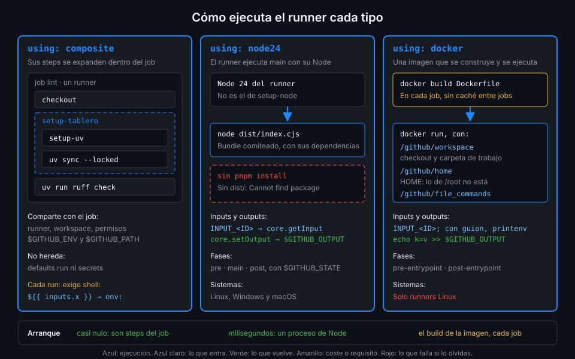

# Actions Docker

> Una action Docker es una imagen que el runner construye y ejecuta como un step. Lleva dentro
> su sistema, su lenguaje y sus herramientas con versión fijada, así que se comporta igual en el
> runner que en tu portátil. El precio es tiempo de arranque y que solo corre en Linux.



## 🎯 Objetivos

Al terminar este archivo eres capaz de:

- Declarar una action con `runs.using: docker` a partir de un `Dockerfile`
- Explicar qué monta el runner en el contenedor y en qué carpeta arranca
- Leer inputs desde el contenedor, incluidos los que llevan guion en el nombre
- Devolver outputs y anotaciones desde el `entrypoint`
- Elegir entre composite, JavaScript y Docker para un problema concreto

## 1. Qué problema resuelve

Quieres revisar las migraciones SQL de `api/migrations/` con sqlfluff, una herramienta de
Python. En una composite serían `setup-uv`, `uv tool install sqlfluff==4.5.0` y la llamada, en
cada job que la use; el resultado depende además de qué Python trae la imagen del runner ese
mes. En JavaScript no hay forma razonable de ejecutar una herramienta de Python.

Una action Docker resuelve las dos cosas: el `Dockerfile` fija el Python, uv y sqlfluff, y quien
usa la action solo escribe `uses:` y `with:`. Lo mismo vale para cualquier herramienta escrita en
otro lenguaje o que necesite paquetes del sistema.

## 2. Cómo funciona

### `runs` de una action Docker

```yaml
runs:
  using: docker
  image: Dockerfile
```

| Clave | Qué hace |
|---|---|
| `image` | `Dockerfile` (ruta relativa a la action) o `docker://<imagen>@sha256:<digest>` ya publicada |
| `args` | Argumentos para el `ENTRYPOINT`, como lista; admiten expresiones |
| `env` | Variables extra para el contenedor |
| `entrypoint` | Sustituye el `ENTRYPOINT` del `Dockerfile` |
| `pre-entrypoint`, `post-entrypoint` | Otro comando en la misma imagen al principio o al final del job (archivo 05) |

### Qué hace el runner con ella

1. **Construye la imagen** con `docker build` sobre la carpeta de la action. En los runners de
   GitHub no hay caché entre jobs: se construye en **cada** job que la usa.
2. **La ejecuta** con `docker run`, montando:

| En el contenedor | Qué es |
|---|---|
| `/github/workspace` | El workspace del job, con el checkout. Es también la carpeta de trabajo |
| `/github/home` | El `HOME` del contenedor |
| `/github/file_commands` | Los archivos de `$GITHUB_OUTPUT`, `$GITHUB_ENV`, `$GITHUB_STEP_SUMMARY`... |
| Variables `GITHUB_*`, `RUNNER_*` | Las mismas que ve un step normal, con rutas del contenedor |
| Variables `INPUT_*` | Un input por variable |

3. **Su código de salida** es el del step: 0 verde, otro rojo.

Dos consecuencias del montaje:

- **`WORKDIR` no sirve.** El runner arranca el contenedor en `/github/workspace` diga lo que diga
  el `Dockerfile`. Trabaja con rutas relativas al workspace.
- **`HOME` cambia.** Lo que instales en el `Dockerfile` bajo `/root` (por ejemplo, con
  `uv tool install` por defecto, en `/root/.local/bin`) no está en el PATH al ejecutarse. Por
  eso se instala en carpetas del sistema con `UV_TOOL_DIR` y `UV_TOOL_BIN_DIR`.

Tampoco uses `USER` en el `Dockerfile`: los archivos del workspace son del usuario del runner y
`$GITHUB_OUTPUT` tiene que poder escribirse; la documentación pide que el contenedor corra con
el usuario por defecto.

Las actions Docker **solo corren en runners Linux**. En `windows-*` o `macos-*` el step falla.

### Los inputs dentro del contenedor

No hay contexto `inputs` ni `@actions/core`: cada input llega como variable `INPUT_<ID>` en
mayúsculas. Con `path` no hay problema, `$INPUT_PATH`. Con un input que lleva guion, sí:

```bash
echo "$INPUT_EXCLUDE-RULES"   # bash lee $INPUT_EXCLUDE y luego el texto "-RULES"
```

Un nombre de variable de bash no puede tener guiones, pero una variable de entorno sí: la
variable existe, bash no sabe nombrarla. Se pide por su nombre con `printenv`:

```bash
config="$(printenv 'INPUT_CONFIG-FILE' || true)"
```

El `|| true` evita que `set -e` corte el script cuando el input viene vacío y `printenv` sale
con 1. Verificado con act 0.2.94 y ubuntu-24.04, noviembre 2026.

La otra vía es `args:` en el `action.yml`, con `- ${{ inputs.config-file }}`: el valor llega
como argumento al `ENTRYPOINT`. Con `ENTRYPOINT` en forma de lista (`["/entrypoint.sh"]`) no hay
shell de por medio. Las variables son más cómodas cuando hay varios inputs opcionales.

### Outputs y anotaciones

`$GITHUB_OUTPUT` apunta a un archivo montado, así que se escribe igual que en un `run:`:
`echo "files=3" >> "$GITHUB_OUTPUT"`. Y los comandos de workflow funcionan por la salida
estándar: una línea `::warning file=api/migrations/001_tasks.sql,line=4::...` es una anotación en
ese archivo y esa línea del PR.

Muchas herramientas ya saben escribirlas: sqlfluff con `--format github-annotation-native` y
yamllint con `--format github`. La ruta de la anotación tiene que ser relativa al workspace,
otra razón para trabajar con rutas relativas.

## 3. Cómo se usa

### Un ejemplo completo con otros nombres

Esta action, `yaml-lint`, revisa los YAML de una carpeta con yamllint:

```dockerfile
FROM python:3.15.2-slim-trixie

COPY --from=ghcr.io/astral-sh/uv:0.13.6 /uv /usr/local/bin/uv

# En el runner HOME es /github/home: lo instalado en /root/.local no estaría en el PATH.
ENV UV_TOOL_DIR=/opt/uv-tools UV_TOOL_BIN_DIR=/usr/local/bin
RUN uv tool install yamllint==1.38.0

COPY entrypoint.sh /entrypoint.sh
ENTRYPOINT ["/entrypoint.sh"]
```

```bash
#!/usr/bin/env bash
set -euo pipefail

# INPUT_CONFIG-FILE lleva guion: no es un nombre de variable válido en bash.
config="$(printenv 'INPUT_CONFIG-FILE' || true)"

args=(--format github)
if [ -n "$config" ]; then args+=(--config-file "$config"); fi

echo "files=$(find "$INPUT_PATH" -name '*.yml' -o -name '*.yaml' | wc -l)" >> "$GITHUB_OUTPUT"
yamllint "${args[@]}" "$INPUT_PATH"
```

```yaml
name: yaml-lint
description: Revisa con yamllint los YAML de una carpeta y anota cada problema
inputs:
  path:
    description: Carpeta relativa al workspace
    default: .
  config-file:
    description: Configuración de yamllint; vacío usa la de por defecto
    default: ""
outputs:
  files:
    description: Número de archivos YAML encontrados
runs:
  using: docker
  image: Dockerfile
```

- **Todo con versión fijada**: imagen base con tag completo, uv por tag de su imagen y la
  herramienta con `==`. Una action Docker que hace `uv tool install yamllint` sin versión cambia
  de comportamiento el día que sale una nueva.
- **`entrypoint.sh` con bit de ejecución** (`git add --chmod=+x`): sin él el contenedor sale con
  `permission denied`.
- **El código de salida es el de la herramienta**: yamllint sale con 1 si hay errores y la
  action se pone roja sin código extra.

Probada contra un YAML con espacios de más: dos `::error` y un `::warning` con `file` y `line`,
`files=1` en `$GITHUB_OUTPUT` y salida 1. `sql-lint` sigue el mismo esqueleto con sqlfluff 4.5.0,
el dialecto `postgres` y el input `exclude-rules`. Contra `001_tasks.sql` da cinco avisos LT01
por las columnas alineadas a mano. Verificado con sqlfluff 4.5.0 y ubuntu-24.04, noviembre 2026.

### Cuánto cuesta

La construcción de la imagen de `sql-lint` es el grueso del step: descargar la imagen base e
instalar sqlfluff, en cada job. Si eso molesta, la salida es publicar la imagen una vez y usar
`image: docker://ghcr.io/<tu-org>/sql-lint@sha256:<digest>`. `tablero` no lo hace (la imagen
tarda poco), y fijar imágenes por digest lo verás en la Semana 14.

### Qué tipo elegir

| Si necesitas... | Elige | Porque |
|---|---|---|
| Juntar steps que ya existen (setup, caché, instalar) | Composite | Cero código nuevo; corre en el job, comparte PATH y workspace |
| Lógica con decisiones, JSON, la API de GitHub o el resumen | JavaScript | Arranca en milisegundos, tests con `node --test`, Linux, Windows y macOS |
| Una herramienta de otro lenguaje o con dependencias del sistema | Docker | Entorno fijado e idéntico en local; solo Linux y más lenta al arrancar |
| `pre` y `post` | JavaScript (o Docker) | La composite no tiene fases propias |

## 4. Antipatrones

| Antipatrón | Por qué duele | Qué hacer en su lugar |
|---|---|---|
| `FROM python:latest` o sin tag | La action cambia sin que nadie toque el repo | Tag completo: `python:3.15.2-slim-trixie` |
| `uv tool install` en `/root/.local` | `HOME` es `/github/home`: la herramienta no está en el PATH | `UV_TOOL_DIR` y `UV_TOOL_BIN_DIR` en carpetas del sistema |
| `WORKDIR /app` y rutas a `/app` | El runner arranca en `/github/workspace` | Rutas relativas al workspace |
| `"$INPUT_EXCLUDE-RULES"` en bash | Lee otra variable y concatena texto: input perdido sin error | `printenv 'INPUT_EXCLUDE-RULES'` |
| `USER app` en el `Dockerfile` | Sin permisos sobre el workspace ni sobre `$GITHUB_OUTPUT` | Usuario por defecto |
| Una action Docker en `runs-on: windows-*` | El step falla: solo hay contenedores Linux | Runner Linux, o reescribirla en JavaScript |

## 5. Trucos

- **Prueba la imagen sin runner**: `docker build -t x .` y luego
  `docker run --rm -v "$PWD":/github/workspace -w /github/workspace -e INPUT_PATH=. -e GITHUB_OUTPUT=/github/workspace/out x`.
  Es casi lo que hace el runner, y `out` te enseña los outputs.
- **`docker run -e 'INPUT_EXCLUDE-RULES=LT01'`** acepta nombres con guion: así reproduces en local
  justo el caso que bash no sabe escribir.
- **El log del step empieza con `Build container for action use`** y el `docker build` completo
  dentro: si una action Docker tarda, ahí ves qué capa se lleva el tiempo.

## 📚 Recursos Adicionales

- [GitHub Docs: Creating a Docker container action](https://docs.github.com/en/actions/tutorials/use-containerized-services/create-a-docker-container-action)
- [GitHub Docs: Dockerfile support for GitHub Actions](https://docs.github.com/en/actions/reference/workflows-and-actions/dockerfile-support)
- [sqlfluff: formatos de salida y reglas](https://docs.sqlfluff.com/en/stable/)

## ✅ Checklist de Verificación

- [ ] Sé declarar `runs.using: docker` con `image: Dockerfile`
- [ ] Sé qué monta el runner y dónde arranca el contenedor
- [ ] Sé por qué `WORKDIR` y `HOME` no son los del `Dockerfile`
- [ ] Sé leer un input con guion con `printenv`
- [ ] Sé devolver outputs y anotaciones desde el `entrypoint`
- [ ] Sé elegir entre composite, JavaScript y Docker

---

| ← Anterior | Siguiente → |
|:---|---:|
| [pre, post y estado](05-pre-post-y-estado.md) | [Probar actions](07-probar-actions.md) |
