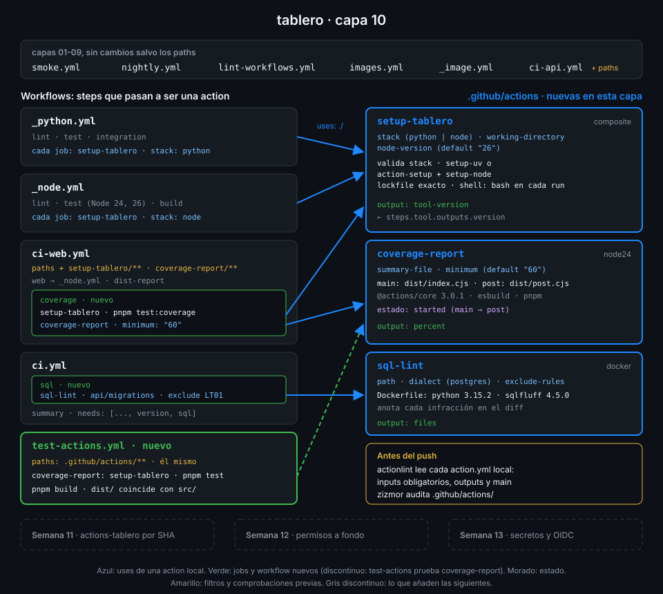

# Probar actions

> Una action es código que ejecutan muchos jobs. Si se rompe `setup-tablero`, se rompen a la vez
> el CI de la API y el de la web. Por eso una action tiene sus propias pruebas, por capas, y un
> workflow que las corre cada vez que alguien la toca.



## 🎯 Objetivos

Al terminar este archivo eres capaz de:

- Elegir qué capa de prueba cubre cada fallo de una action
- Usar actionlint y zizmor sobre actions y sobre los workflows que las usan
- Probar una action dentro de un workflow, incluido el caso en que debe fallar
- Disparar los workflows correctos cuando cambia una action, con `paths`
- Ejecutar las actions locales con act y saber qué diferencias esperar

## 1. Qué problema resuelve

Una action local tiene una ventaja: va en el mismo commit que los workflows que la usan, así que
un PR que rompe `setup-tablero` rompe su propio CI y no llega a `main`. Pero eso solo pasa si
algo la ejecuta en ese PR, y "algo falló en `Run ./.github/actions/setup-tablero`" no dice si el
error es de la lógica, del bundle, del contrato o del runner.

Cada tipo de fallo tiene una prueba que lo atrapa antes y con un mensaje mejor:

| Fallo | Ejemplo | Lo atrapa | Cuándo |
|---|---|---|---|
| Lógica | La cobertura se compara con `>` en vez de `>=` | Tests unitarios con `node --test` | En tu máquina, en segundos |
| Contrato | Un workflow pasa `stak:` o se olvida `stack:` | actionlint | Antes del push |
| Seguridad | `${{ inputs.x }}` dentro de un `run:` de la composite | zizmor | Antes del push |
| Bundle | `src/` cambiado sin `pnpm build` | `dist/` reconstruido en CI | En el PR |
| Integración | El output no llega o la action no falla cuando debe | Un workflow que la usa con datos conocidos | En el PR |

## 2. Cómo funciona

### actionlint lee las actions locales

actionlint no valida un `action.yml` por sí mismo, pero cuando un workflow tiene
`uses: ./.github/actions/x`, abre su `action.yml` y comprueba el `with:` contra él. Sobre un
workflow de prueba que escribe `stak:` en lugar de `stack:`:

```text
bad.yml:10:15: missing input "stack" which is required by action "setup-tablero" defined at "./.github/actions/setup-tablero". all required inputs are "stack", "working-directory" [action]
bad.yml:12:11: input "stak" is not defined in action "setup-tablero" defined at "./.github/actions/setup-tablero". available inputs are "node-version", "stack", "working-directory" [action]
```

Esto es lo que suple al runner, que no corta el job por un input obligatorio que falta
(archivo 01). Comprueba también otras dos cosas del contrato:

```text
bad.yml:19:18: property "nope" is not defined in object type {count: string} [expression]
w03.yml:14:15: file "dist/index.cjs" does not exist in ".../.github/actions/bundle-size". it is specified at "main" key in "runs" section in "bundle-size" action [action]
```

La primera es un output que la action no declara. La segunda es la más útil de esta semana: un
`dist/` que nadie comiteó se detecta antes del push, sin esperar al runner. Verificado con
actionlint 1.7.12 y ubuntu-24.04, noviembre 2026.

### zizmor audita el `action.yml`

zizmor sí lee los `action.yml`: `zizmor .github/` recorre los workflows **y** las actions. Sobre
una composite con `run: echo "${{ inputs.greeting }}"` da:

```text
error[template-injection]: code injection via template expansion
```

Y avisa también de una `uses:` sin SHA dentro de la composite, que es tan grave como en un
workflow. Fíjate en la ruta: el `lint-workflows.yml` de la Semana 08 audita
`.github/workflows/`, que no contiene ningún `action.yml`. Para las actions, pásalo sobre la
carpeta que las contiene: `zizmor --offline .github/actions/`.

### `paths`: que el cambio de una action dispare a quien la usa

`ci-web.yml` filtra por `web/**` y sus workflows (Semana 07). Si el PR solo toca
`.github/actions/setup-tablero/action.yml`, `ci-web` no corre, y el fallo aparece en el
siguiente PR que toque `web/`, de otra persona. La regla: **cada workflow añade a sus `paths` las
actions locales que usa**.

| Workflow | Añade a `paths` |
|---|---|
| `ci-api.yml` | `.github/actions/setup-tablero/**` |
| `ci-web.yml` | `.github/actions/setup-tablero/**` y `.github/actions/coverage-report/**` |
| `test-actions.yml` | `.github/actions/**` y él mismo |

`ci.yml`, que contiene el job `sql`, corre en todo PR y no necesita el filtro.

## 3. Cómo se usa

### Un workflow de pruebas de actions

`test-actions.yml` es el sitio de las pruebas que no son de ningún componente: los tests
unitarios de `coverage-report` y la comprobación de `dist/` del archivo 04. La misma idea sirve
para una prueba de integración. Este ejemplo prueba la action `yaml-lint` del archivo 06 con dos
carpetas de ejemplo comiteadas: una limpia y otra con errores a propósito.

```yaml
name: test-yaml-lint

on:
  pull_request:
    paths:
      - ".github/actions/yaml-lint/**"
      - ".github/workflows/test-yaml-lint.yml"

# Mínimo privilegio: lo verás a fondo en la Semana 12.
permissions:
  contents: read

jobs:
  yaml-lint:
    name: yaml-lint (casos conocidos)
    runs-on: ubuntu-24.04
    timeout-minutes: 10
    steps:
      - uses: actions/checkout@3d3c42e5aac5ba805825da76410c181273ba90b1 # v7.0.1
        with:
          persist-credentials: false

      - id: clean
        uses: ./.github/actions/yaml-lint # zizmor: ignore[self-repository] actionlint 1.7.12 no admite $/
        with:
          path: .github/actions/yaml-lint/fixtures/clean

      - id: broken
        uses: ./.github/actions/yaml-lint # zizmor: ignore[self-repository] actionlint 1.7.12 no admite $/
        continue-on-error: true
        with:
          path: .github/actions/yaml-lint/fixtures/broken

      - name: El caso roto falla y los dos cuentan sus archivos
        env:
          BROKEN_OUTCOME: ${{ steps.broken.outcome }}
          CLEAN_FILES: ${{ steps.clean.outputs.files }}
          BROKEN_FILES: ${{ steps.broken.outputs.files }}
        run: |
          test "$BROKEN_OUTCOME" = failure || { echo "::error::yaml-lint no falló con errores"; exit 1; }
          test "$CLEAN_FILES" = 2 || { echo "::error::clean: se esperaban 2 archivos y hay $CLEAN_FILES"; exit 1; }
          test "$BROKEN_FILES" = 1 || { echo "::error::broken: se esperaba 1 archivo y hay $BROKEN_FILES"; exit 1; }
```

Lo que lo hace funcionar:

- **`continue-on-error: true` y `outcome`.** Con `continue-on-error`, el step que falla deja el
  job seguir; su `conclusion` es `success`, pero su `outcome` es `failure`. Comparar `outcome`
  es como se prueba que una action **falla cuando debe**, que es la mitad de su contrato.
- **Datos conocidos.** Las carpetas `fixtures/` son parte de la action y van en el repo: la
  prueba no depende de cómo estén hoy los YAML reales del proyecto.
- **Los outputs se comprueban por `env:`**, como cualquier dato que llega al shell.
- **Un output escrito antes de fallar llega igual.** El `entrypoint` escribe `files=` antes de
  llamar a yamllint, así que `steps.broken.outputs.files` existe aunque el step haya fallado.

Probado con act 0.2.94: el step `broken` sale rojo con su `::error` de `trailing-spaces`, el de
comprobación sale verde y el job termina bien.

### Los tests unitarios en el mismo workflow

Para `coverage-report`, la prueba más barata no necesita la action: `pnpm test` en su carpeta
ejecuta `node --test` sobre `evaluate.js`. El job prepara pnpm con `setup-tablero` (stack `node`,
la carpeta de la action como `working-directory`), corre los tests, reconstruye `dist/` y
compara. Si `setup-tablero` se rompe, este job también lo dice: una action probando otra.

### act: las tres en tu máquina

```bash
act pull_request -W .github/workflows/test-actions.yml
act pull_request -W .github/workflows/ci.yml -j sql
```

act lee los `action.yml` locales igual que el runner: ejecuta la composite, lanza el bundle de
la JavaScript con Node y construye la imagen de la Docker con tu Docker. Diferencias que
conviene conocer, verificado con act 0.2.94 y ubuntu-24.04, noviembre 2026:

| En act | Por qué | Qué hacer |
|---|---|---|
| El `post` de `setup-node` falla con `Path Validation Error` | La caché de pnpm no existe como en un runner de GitHub | Ignorarlo: no es un fallo de tu capa |
| El `post` de `coverage-report` sí corre | act implementa `post` y `$GITHUB_STATE` | Sirve para comprobar el ciclo del archivo 05 |
| La imagen de `sql-lint` se reconstruye al cambiar el `Dockerfile` | Usa la caché de tu Docker local | Más rápido que en el runner, que no tiene caché |

act sirve para iterar rápido; la prueba que cuenta es la del runner de GitHub en el PR.

## 4. Antipatrones

| Antipatrón | Por qué duele | Qué hacer en su lugar |
|---|---|---|
| Probar la action solo usándola en `ci-web` | El fallo sale mezclado con el de la web y sin casos de error | Workflow de pruebas con datos conocidos |
| No añadir la action a los `paths` de quien la usa | El PR que la rompe sale verde; el siguiente paga | `.github/actions/<x>/**` en cada workflow que la usa |
| Probar solo el caso verde | Una action que nunca falla también "pasa" | `continue-on-error` y comprobar `outcome` |
| Comparar `conclusion` en vez de `outcome` | Con `continue-on-error`, `conclusion` siempre es `success` | `steps.<id>.outcome` |
| Dar por bueno lo que pasa en act | act no es el runner: cachés, imágenes y `post` difieren | act para iterar, el PR para decidir |
| Tests que leen el `coverage-summary.json` real de la web | Cambian cuando cambia la web, no la action | Datos de prueba dentro de la action |

## 5. Trucos

- **`actionlint -shellcheck= .github/workflows/ci-web.yml`** comprueba solo el contrato con las
  actions, sin el ruido de shellcheck: útil cuando acabas de renombrar un input.
- **`yq '.runs.steps[] | select(.run) | has("shell")' action.yml`** lista `true` o `false` por
  cada `run:` de una composite: un `false` es un step que el runner va a rechazar.
- **`steps.<id>.outcome` en un `if:`** permite un step de diagnóstico que solo corre cuando la
  action falló, sin `continue-on-error` en todo el job.

## 📚 Recursos Adicionales

- [actionlint: checks de actions locales](https://github.com/rhysd/actionlint/blob/main/docs/checks.md)
- [zizmor: auditorías](https://docs.zizmor.sh/audits/)
- [GitHub Docs: Contexts, `steps.<id>.outcome`](https://docs.github.com/en/actions/reference/workflows-and-actions/contexts#steps-context)

## ✅ Checklist de Verificación

- [ ] Sé qué capa de prueba atrapa cada tipo de fallo
- [ ] Sé qué comprueba actionlint de una action local y qué no
- [ ] Sé que zizmor audita los `action.yml`
- [ ] Sé probar que una action falla cuando debe, con `outcome`
- [ ] Sé qué `paths` añade cada workflow que usa una action local
- [ ] Sé qué diferencias esperar entre act y el runner

---

| ← Anterior | Siguiente → |
|:---|---:|
| [Actions Docker](06-actions-docker.md) | [Primera action composite](../2-practicas/01-primera-action-composite.md) |
