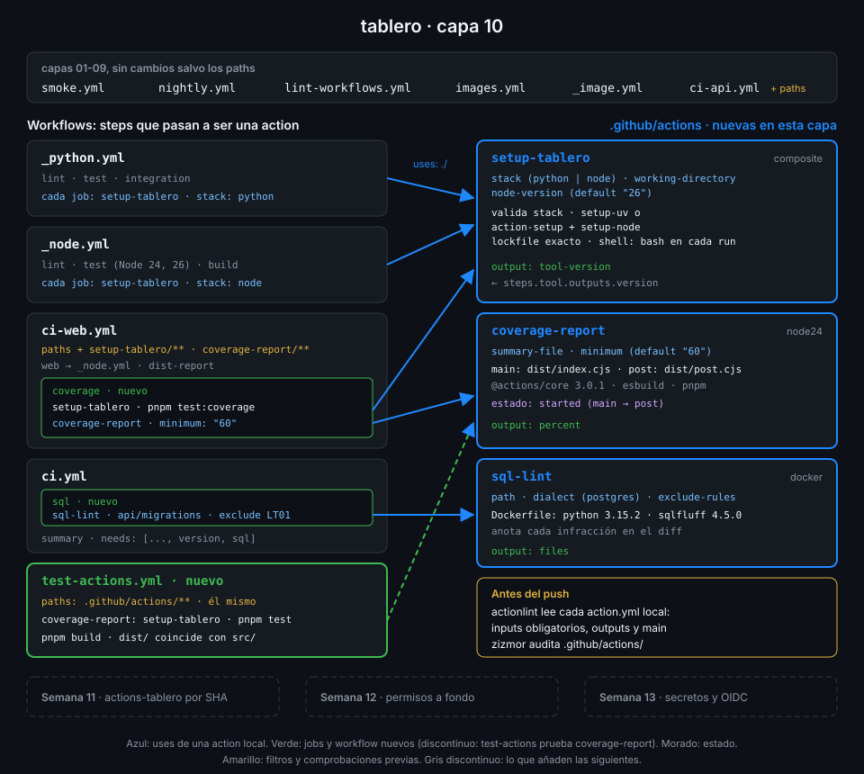

# Proyecto: capa 10 de tablero



## 🎯 Objetivo

Que la preparación del entorno de `tablero` exista una sola vez, en una action composite, y que el
pipeline gane dos comprobaciones hechas a medida: la cobertura de la web publicada en el resumen
del job, con un mínimo, y el SQL de las migraciones revisado con anotaciones en el diff. Una
action de cada tipo, cada una por la razón que la justifica.

## 📦 Qué añade esta capa

`smoke.yml`, `nightly.yml`, `images.yml`, `_image.yml` y `lint-workflows.yml` se quedan como
están. Nacen tres actions y un workflow, y cambian cuatro workflows:

| Archivo | Qué hace | Por qué existe |
|---|---|---|
| `.github/actions/setup-tablero/` (nuevo, composite) | Instala uv o pnpm con Node y las dependencias del lockfile de un componente. Inputs `stack`, `working-directory`, `node-version`; output `tool-version` | Los seis jobs de `_python.yml` y `_node.yml` repetían de dos a tres `uses:` más la instalación; la versión de uv o la caché se cambian ahora en un sitio |
| `.github/actions/coverage-report/` (nuevo, JavaScript) | Lee `coverage-summary.json`, escribe una tabla en el resumen del job, devuelve `percent` y falla bajo `minimum`. Su post deja en el log cuánto tardó | Leer JSON, componer el resumen y decidir con un umbral es lógica: en JavaScript se prueba con `node:test`, en bash no |
| `.github/actions/sql-lint/` (nuevo, Docker) | Construye una imagen con sqlfluff y revisa los `.sql` de una carpeta. Inputs `path`, `dialect`, `exclude-rules`; output `files` | sqlfluff es una herramienta Python con su intérprete: la imagen la trae entera y no ensucia el runner |
| `.github/workflows/test-actions.yml` (nuevo) | Tests de `coverage-report` y comprobación de que `dist/` coincide con `src/` | Una action JavaScript se ejecuta desde `dist/`: si nadie lo reconstruye, el código que corre no es el que revisaste |
| `_python.yml` y `_node.yml` | Cada job prepara el entorno con `setup-tablero` | El contrato con los llamadores no cambia: mismos inputs, mismos outputs |
| `ci-web.yml` | Job nuevo `coverage` con `coverage-report`; `paths` con las dos actions que usa | La cobertura se ve en el resumen del run, sin descargar nada |
| `ci-api.yml` | `paths` con `setup-tablero` | Un cambio en la action cambia este CI |
| `ci.yml` | Job nuevo `sql` con `sql-lint`, que `summary` espera | El SQL de `api/migrations` se revisa en cada push y cada PR |

| Situación | Qué pasa |
|---|---|
| PR que toca `src/` de `coverage-report` sin `pnpm build` | `test-actions` falla en "Reconstruir dist" y dice qué ejecutar |
| PR que baja la cobertura de líneas de la web del 60 % | El job `coverage` de `ci-web` sale rojo con el porcentaje y el mínimo |
| PR con una migración mal formateada | `ci` sale rojo y cada infracción de sqlfluff aparece anotada en su línea |
| PR que cambia la versión de uv en `setup-tablero` | `ci-api` y `ci-web` corren: la action está en sus `paths` |

La Semana 11 saca estas actions y los reutilizables a `<tu-org>/actions-tablero`, con versiones y
releases, y `tablero` las llama por SHA.

## ✅ Requisitos verificables

- setup-tablero es una action composite, coverage-report una action JavaScript con node24 y sql-lint una action Docker
- setup-tablero declara los inputs stack y working-directory como obligatorios y node-version con valor por defecto
- Todos los steps run de setup-tablero declaran shell
- setup-tablero devuelve el output tool-version a partir del output version del step tool
- Todos los jobs de _python.yml y _node.yml preparan el entorno con setup-tablero y ninguno llama directamente a setup-uv, action-setup ni setup-node
- coverage-report ejecuta dist/index.cjs como main y dist/post.cjs como post
- coverage-report fija @actions/core y pnpm, y trae su pnpm-lock.yaml
- El main de coverage-report guarda estado con saveState y el post lo lee con getState
- dist/index.cjs y dist/post.cjs de coverage-report están en el repo y node_modules no
- Los tests de coverage-report pasan con pnpm test
- sql-lint se construye desde su Dockerfile, con una imagen base de tag completo y sqlfluff instalado con uv tool install a versión fijada
- El entrypoint de sql-lint lee el input exclude-rules con printenv y escribe el output files en GITHUB_OUTPUT
- ci-web.yml usa coverage-report en el job coverage y ci.yml usa sql-lint en el job sql
- test-actions.yml reconstruye dist y falla si no coincide con lo comiteado
- Los workflows y las actions pasan actionlint y zizmor sin hallazgos
- Toda uses remota de workflows y actions está fijada por SHA de 40 caracteres con el tag en comentario
- test-actions, ci-web y ci terminan en success sobre el último commit de main

## 🎨 Criterios de calidad

Lo que `check-week.sh` no ve y la [rúbrica](../rubrica-evaluacion.md) sí puntúa:

- Cada `action.yml` tiene `description` y cada input y output la suya: la action se entiende sin
  abrir sus steps ni su código.
- Ningún `${{ inputs.* }}` dentro de un `run:` de `setup-tablero`: los inputs llegan al shell por
  `env:`. Un `stack` no válido para el job con un `::error::` que dice qué valores admite.
- Los `uses:` dentro de `setup-tablero` están fijados por SHA igual que en un workflow: una
  action composite no hereda la seguridad de quien la llama.
- `coverage-report` separa la lógica pura (`evaluate.js`) de la E/S (`index.js`), y los tests
  cubren el caso que pasa, el que falla y un resumen mal formado.
- `dist/` se regenera con `pnpm build` y nunca se edita a mano; `node_modules/` está en el
  `.gitignore` de la action.
- La imagen de `sql-lint` fija la base, uv y sqlfluff con versión completa.
- Cada regla excluida de sqlfluff lleva un comentario con el motivo.
- Sin `TODO` en `.github/` y commits en Conventional Commits.

## 💡 Adaptación a tu dominio

| Tu proyecto | Composite | JavaScript | Docker |
|---|---|---|---|
| Monorepo con varios servicios Python | `setup-python-service` con uv y caché por servicio | Comentario de cobertura por servicio en el resumen | Linter de migraciones Alembic |
| Librería TypeScript publicada en npm | `setup-library` con pnpm y Node | Comprobar el tamaño del bundle contra un límite | Pruebas en una imagen con navegadores |
| Infraestructura como código | Preparar Terraform con la versión fijada | Resumen del plan con recursos creados y destruidos | `tflint` o `checkov` en su imagen |
| Documentación técnica | Preparar el generador de la web | Comprobar enlaces y publicar el informe | `vale` para el estilo de la prosa |

## 🚦 Cómo entregarlo

Si hiciste las cuatro prácticas ya tienes todos los archivos: repásalos contra los requisitos y
los criterios. Si no, parte del starter.

1. Copia el starter y completa los `TODO 1` a `TODO 9`:

   ```bash
   cd ~/code/tablero
   S=~/code/bc-github-actions/bootcamp/week-10-actions_propias/3-proyecto/starter
   cp -r "$S"/.github/. .github/
   grep -rn "TODO" .github/ | wc -l
   # 9
   ```

   Después, los cambios en `_python.yml`, `_node.yml`, `ci-web.yml`, `ci-api.yml` y `ci.yml` de
   las prácticas 01 y 04: el starter no los trae porque esos archivos ya son tuyos.

2. Reconstruye `dist/`, pasa los tests y los linters:

   ```bash
   (cd .github/actions/coverage-report && pnpm install --frozen-lockfile && pnpm test && pnpm build)
   # ℹ pass 3
   # ℹ fail 0
   actionlint && zizmor --offline .github/
   # No findings to report. Good job! (... ignored, ... suppressed)
   ```

3. Pruébalo en local antes del push:

   ```bash
   ./scripts/ci-local.sh ci sql
   # ...
   # [ci/SQL de las migraciones] 🏁  Job succeeded
   ```

4. Súbelo a `main` en un solo commit y espera a los runs de **tu** commit:

   ```bash
   git add .github/
   git commit -m "ci: add setup-tablero, coverage-report and sql-lint actions"
   git push
   sleep 10
   for w in test-actions ci-web ci; do
     id=$(gh run list --workflow "$w.yml" --commit "$(git rev-parse HEAD)" --json databaseId --jq '.[0].databaseId')
     gh run watch "$id" --exit-status > /dev/null && echo "$w ok"
   done
   # test-actions ok
   # ci-web ok
   # ci ok
   ```

5. Lanza la verificación:

   ```bash
   cd ~/code/bc-github-actions
   ./scripts/check-week.sh 10
   # 17/17 comprobaciones superadas.
   ```

## 🧯 Errores comunes

| Síntoma | Causa | Solución |
|---|---|---|
| `Can't find 'action.yml', 'action.yaml' or 'Dockerfile' under '.../.github/actions/setup-tablero'` | El job usa la action local antes del checkout | `actions/checkout` primero: el runner lee la action del workspace |
| `Required property is missing: shell` | Un step `run` de la composite sin `shell:` (TODO 2) | `shell: bash` en cada step `run` |
| `missing input "stack" which is required by action "setup-tablero"` en actionlint | Marcaste `stack` como obligatorio y un job no lo pasa | Añade `stack: python` o `stack: node` al `with:` |
| `Cannot find module '.../dist/index.cjs'` | No comiteaste `dist/` o lo ignora un `.gitignore` | `pnpm build`, `git add .github/actions/coverage-report/dist` |
| `ERR_PNPM_IGNORED_BUILDS` al instalar la action | Falta `pnpm-workspace.yaml` con `allowBuilds` | Copia el del starter |
| `Dynamic require of "net" is not supported` | Empaquetaste en formato ESM | El script `build` del starter: `--format=cjs` y extensión `.cjs` |
| `sql-lint` sale 1 con avisos `LT01` en `001_tasks.sql` | sqlfluff no admite columnas alineadas con espacios | `exclude-rules: LT01` con su comentario, o reformatea la migración |
| `exclude-rules` no tiene efecto | El entrypoint lee `$INPUT_EXCLUDE_RULES` con guion bajo | `printenv 'INPUT_EXCLUDE-RULES'` (TODO 8) |
| `ci-local.sh ci-web coverage` falla en el post de `setup-node` | Limitación de act con la caché de pnpm | Las actions sí corrieron: el job se valida en GitHub |

## 🔗 Navegación

---

| ← Anterior | Siguiente → |
|:---|---:|
| [Probar y mantener actions](../2-practicas/04-probar-y-mantener-actions.md) | [Rúbrica de evaluación](../rubrica-evaluacion.md) |
