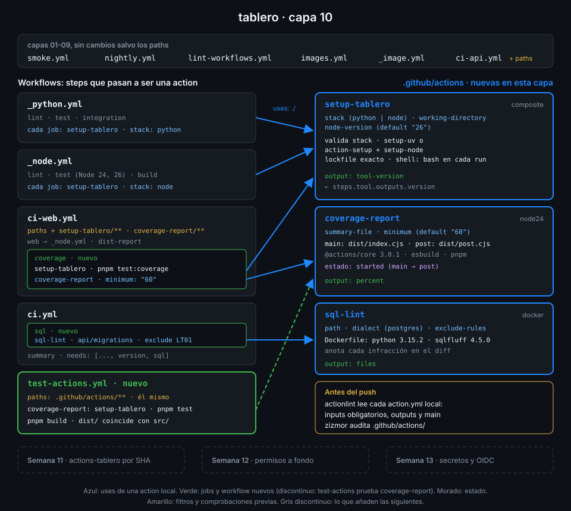

# Semana 10 — Actions propias: composite, JavaScript y Docker

> Los reutilizables de la Semana 09 todavía repiten, job tras job, los mismos cuatro steps de
> preparación. Esta semana los conviertes en tus propias actions: una composite, una JavaScript y una Docker.

## 🎯 Objetivos de la Semana

Al terminar la semana eres capaz de:

- Leer y escribir el `action.yml` de una action: `inputs`, `outputs` y `runs`, y decidir cuándo
  conviene una action (steps dentro de un job) y cuándo un reutilizable (jobs enteros)
- Escribir una action composite que agrupe steps, `uses:` remotos fijados por SHA y outputs, con
  `shell:` en cada step `run`
- Escribir una action JavaScript con `@actions/core`, gestionada con pnpm, probada con `node:test`
  y empaquetada en `dist/` con esbuild para el runtime `node24`
- Usar `pre` y `post` y pasar estado de un paso a otro con `$GITHUB_STATE`
- Escribir una action Docker, saber cómo le llegan los inputs (`INPUT_<NOMBRE>`) y qué cuesta
  construir su imagen en cada job
- Probar una action en local y en CI: actionlint sobre la llamada, zizmor sobre el `action.yml`,
  act y un workflow que comprueba que `dist/` está al día

## 📋 Prerrequisitos

| Necesitas | Dónde se aprende |
|---|---|
| `check-week.sh 09` en 18/18 | [Semana 09](../week-09-workflows_reutilizables/README.md) |
| `$GITHUB_OUTPUT`, `$GITHUB_STEP_SUMMARY` y outputs de step | [Semana 02](../week-02-expresiones_contextos_y_flujo_de_datos/README.md) |
| pnpm, Node y `pnpm install --frozen-lockfile` | [Semana 04](../week-04-ci_de_frontend_pnpm_matrices_y_artefactos/README.md) |
| Dockerfile y etapas de build | [Semana 06](../week-06-imagenes_docker_y_ghcr/README.md) |
| Comandos de workflow (`::error`, `::warning`), act y zizmor | [Semana 08](../week-08-probar_y_depurar_workflows/README.md) |
| `_python.yml` y `_node.yml` | [Semana 09](../week-09-workflows_reutilizables/README.md) |

## 🗂️ Estructura de la Semana

```
week-10-actions_propias/
├── README.md
├── rubrica-evaluacion.md
├── checks.json                    17 comprobaciones
├── 0-assets/                      4 diagramas SVG
├── 1-teoria/                      7 archivos, uno por concepto
├── 2-practicas/                   4 prácticas guiadas
├── 3-proyecto/
│   ├── README.md
│   └── starter/.github/
│       ├── actions/setup-tablero/action.yml
│       ├── actions/coverage-report/   action.yml, package.json, src/, tests/
│       ├── actions/sql-lint/          action.yml, Dockerfile, entrypoint.sh
│       └── workflows/test-actions.yml
├── 4-recursos/{ebooks-free,videografia,webgrafia}/README.md
└── 5-glosario/README.md
```

## 📝 Contenidos

### Teoría

| # | Archivo | Qué aprendes | Tiempo |
|:--:|---|---|:--:|
| 01 | [Anatomía de una action](1-teoria/01-anatomia-de-una-action.md) | `action.yml`, los tres tipos, dónde vive una action y action frente a reutilizable | 30 min |
| 02 | [Actions composite](1-teoria/02-actions-composite.md) | Steps con `shell:`, `uses:` dentro de la action, inputs por `env:` y outputs desde un step | 30 min |
| 03 | [Actions JavaScript](1-teoria/03-actions-javascript.md) | `node24`, `@actions/core`: `getInput`, `setOutput`, `summary`, `setFailed` | 30 min |
| 04 | [Empaquetar dist/ con pnpm](1-teoria/04-empaquetar-dist-con-pnpm.md) | Por qué `dist/` va al repo, esbuild a CommonJS y `node_modules` fuera | 30 min |
| 05 | [pre, post y estado](1-teoria/05-pre-post-y-estado.md) | El ciclo pre → main → post, `post-if` y `$GITHUB_STATE` | 25 min |
| 06 | [Actions Docker](1-teoria/06-actions-docker.md) | `image: Dockerfile` o `docker://`, `INPUT_<NOMBRE>`, el workspace montado y su coste | 30 min |
| 07 | [Probar actions](1-teoria/07-probar-actions.md) | actionlint sobre la llamada, zizmor sobre el `action.yml`, tests de la lógica, act y frescura de `dist/` | 35 min |

### Prácticas

| # | Archivo | Qué haces | Tiempo |
|:--:|---|---|:--:|
| 01 | [Primera action composite](2-practicas/01-primera-action-composite.md) | `setup-tablero` y los seis jobs de `_python.yml` y `_node.yml` preparados con ella | 1 h |
| 02 | [Una action JavaScript](2-practicas/02-action-javascript.md) | `coverage-report` con pnpm, tests con `node:test`, `dist/` con esbuild y un post | 1 h |
| 03 | [Una action Docker](2-practicas/03-action-docker.md) | `sql-lint` con sqlfluff, sus anotaciones sobre la migración y el input con guion | 1 h |
| 04 | [Probar y mantener actions](2-practicas/04-probar-y-mantener-actions.md) | Las actions en `ci-web` y `ci`, `test-actions.yml`, linters, act y el run remoto | 1 h |

### Proyecto

[Capa 10 de `tablero`](3-proyecto/README.md): tres actions en `.github/actions/` que preparan el
entorno, publican la cobertura de la web y revisan el SQL de las migraciones.



## ⏱️ Distribución del Tiempo (10 horas)

| Actividad | Horas |
|---|:--:|
| Teoría (7 archivos) | 3,5 |
| Práctica 01 — Primera action composite | 1 |
| Práctica 02 — Una action JavaScript | 1 |
| Práctica 03 — Una action Docker | 1 |
| Práctica 04 — Probar y mantener actions | 1 |
| Proyecto — capa 10 | 1,5 |
| Autoevaluación con la rúbrica | 1 |
| **Total** | **10** |

## 🎩 Trucos y atajos

- **Lee los inputs reales de cualquier action en su SHA**:
  `gh api 'repos/actions/setup-node/contents/action.yml?ref=<sha>' --jq .content | base64 -d | yq '.inputs | keys'`.
  Es la única fuente fiable: el README puede ir por delante o por detrás del SHA que fijas.
- **actionlint no valida un `action.yml`, pero sí la llamada**: si un workflow pasa `stak:` a
  `./.github/actions/setup-tablero`, avisa con `input "stak" is not defined in action`. El
  `action.yml` en sí lo revisa zizmor (`zizmor --offline .github/`).
- **Un input con guion en una action Docker** llega como `INPUT_EXCLUDE-RULES`, que bash no puede
  leer con `$`: usa `printenv 'INPUT_EXCLUDE-RULES'`, o nombra los inputs con guion bajo.
- **`git diff --exit-code -- dist`** tras `pnpm build` convierte "se me olvidó reconstruir" en un
  job rojo con la ruta exacta del archivo desfasado.
- **Un `%` en un mensaje de `core.setFailed` sale como `%25`** en el log crudo: los comandos de
  workflow codifican `%`, `\r` y `\n`. Si buscas el texto con `grep` en `gh run view --log`,
  busca la forma codificada.

## 📌 Entregables

- `setup-tablero`, `coverage-report` y `sql-lint` en `.github/actions/`, usadas por `_python.yml`,
  `_node.yml`, `ci-web` y `ci`, con `test-actions`, `ci-web` y `ci` en verde sobre el último commit
  de `main` (ver [proyecto](3-proyecto/README.md))
- La rúbrica respondida

## ✅ Verificación

```bash
cd ~/code/bc-github-actions
./scripts/check-week.sh 10
# Semana 10 — Actions propias: composite, JavaScript y Docker  [repo: <tu-org>/tablero]
#
#   ✅ setup-tablero es una action composite, coverage-report una action JavaScript con node24 y sql-lint una action Docker
#   ...
# 17/17 comprobaciones superadas.
```

Si algo sale en rojo, la pista te dice qué práctica y qué paso lo arreglan.

## 🔗 Navegación

---

| ← Anterior | Siguiente → |
|:---|---:|
| [Semana 09 — Workflows reutilizables](../week-09-workflows_reutilizables/README.md) | [Anatomía de una action](1-teoria/01-anatomia-de-una-action.md) |
