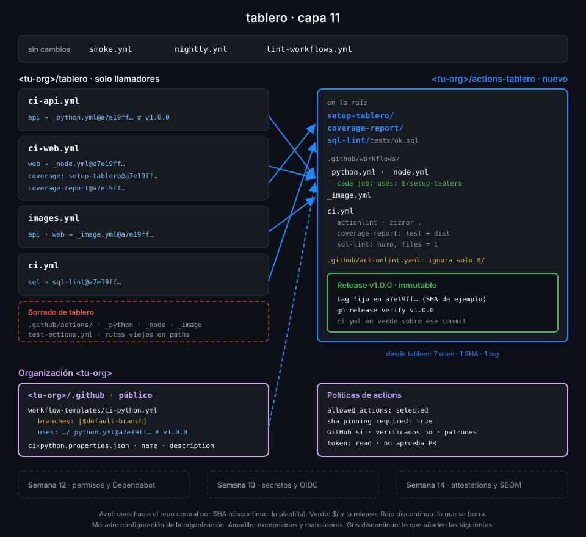

# Un repo central de CI

> Mientras tus actions y tus reutilizables viven dentro de `tablero`, solo `tablero` los usa. El
> día que la organización tiene un segundo repo, o los copias o los sacas a un sitio propio con
> versiones. Este archivo explica ese sitio: qué va dentro, cómo se ordena y cómo se consume.



## 🎯 Objetivos

Al terminar este archivo eres capaz de:

- Explicar qué problema aparece cuando el CI reutilizable vive dentro de un repo de producto
- Decidir qué va en el repo central `<tu-org>/actions-tablero` y qué se queda en `tablero`
- Ordenar el repo central para que cada action tenga una ruta de referencia corta
- Escribir las dos formas de consumirlo: una action y un reutilizable, fijados por SHA
- Explicar por qué el repo central necesita un CI propio que pruebe lo que publica

## 1. Qué problema resuelve

Al terminar la Semana 10, `tablero` guarda dentro todo lo que sabe hacer su CI:

| Pieza | Dónde vive en la capa 10 |
|---|---|
| `setup-tablero`, `coverage-report`, `sql-lint` | `.github/actions/` |
| `_python.yml`, `_node.yml`, `_image.yml` | `.github/workflows/` |
| La prueba de las actions | `.github/workflows/test-actions.yml` |

Funciona porque solo hay un consumidor. Imagina que la organización crea mañana `tablero-admin`,
otro servicio en Python con uv. Tiene tres caminos:

1. **Copiar** las carpetas. A la semana hay dos `setup-tablero` distintos: alguien arregla la
   caché de uv en uno y el otro sigue roto. Cada copia es un fork silencioso.
2. **Llamar a `tablero`** como si fuera una librería:
   `uses: <tu-org>/tablero/.github/actions/setup-tablero@<sha>`. Funciona, pero cada versión de
   tus actions es un commit de la aplicación: no puedes publicar una corrección del CI sin
   publicar también lo que haya en `main` de la API y la web, ni etiquetar una sin la otra.
3. **Un repo central** cuyo único producto es el CI. Tiene su propio ciclo de vida, sus propias
   releases y su propio CI; los repos de producto lo consumen por SHA, como consumen
   `actions/checkout`.

El tercero es lo que hace esta semana. El repo se llama `<tu-org>/actions-tablero` y `tablero`
pasa a ser **un consumidor más**.

## 2. Cómo funciona

### Qué va dentro

Va dentro todo lo que no depende del código de un producto concreto:

- Las **actions**: preparan un job, revisan SQL, comentan la cobertura. Reciben por inputs lo
  que cambia de un repo a otro (la carpeta, el mínimo de cobertura).
- Los **reutilizables**: definen jobs completos. También reciben por inputs la carpeta y el
  paquete.
- El **CI del propio repo central**, que prueba las dos cosas anteriores antes de publicarlas.

Se queda en cada repo de producto lo que decide **cuándo** y **con qué**: los disparadores, los
filtros `paths`, la concurrencia y los valores de los inputs. Un llamador de `tablero` es corto
porque solo dice eso.

### Cómo se ordena

```text
<tu-org>/actions-tablero/
├── setup-tablero/
│   └── action.yml
├── coverage-report/
│   ├── action.yml
│   ├── dist/                  (generado y comiteado, como en la Semana 10)
│   └── src/
├── sql-lint/
│   ├── action.yml
│   ├── Dockerfile
│   └── tests/ok.sql           (fixture para la prueba de humo)
└── .github/
    ├── actionlint.yaml
    └── workflows/
        ├── _python.yml
        ├── _node.yml
        ├── _image.yml
        └── ci.yml             (el CI del repo central)
```

Las actions van **en la raíz**, una carpeta por action. No es estética: la ruta de la carpeta
forma parte de cada referencia que escriben los consumidores. Compara:

```text
<tu-org>/actions-tablero/setup-tablero@<sha>
<tu-org>/actions-tablero/.github/actions/setup-tablero@<sha>
```

Las dos funcionan; la primera es la que lee mejor quien abre un workflow y la que usan los repos
de actions de varias piezas que vas a ver en GitHub.

Los reutilizables **no** pueden ir en la raíz: GitHub solo los busca en `.github/workflows/`, en
cualquier repo. Por eso se quedan donde estaban en la Semana 09.

### Cómo se referencia

Una action y un reutilizable de otro repo se escriben con el mismo patrón,
`owner/repo/ruta@ref`. En `uses:` de un **step**, la ruta es la carpeta de la action; en `uses:`
de un **job**, la ruta es el archivo del reutilizable:

```yaml
jobs:
  api:
    uses: <tu-org>/actions-tablero/.github/workflows/_python.yml@a7e19ff8d215588d594f79b969b79bed58287cea # v1.0.0
    with:
      working-directory: api
      package: tablero

  coverage:
    runs-on: ubuntu-24.04
    timeout-minutes: 10
    steps:
      - uses: actions/checkout@3d3c42e5aac5ba805825da76410c181273ba90b1 # v7.0.1
        with:
          persist-credentials: false
      - uses: <tu-org>/actions-tablero/setup-tablero@a7e19ff8d215588d594f79b969b79bed58287cea # v1.0.0
        with:
          stack: node
          working-directory: web
```

El SHA `a7e19ff8…` es **de ejemplo**: el tuyo es el commit al que apunta tu tag `v1.0.0` y lo
sacas con `scripts/resolve-sha.sh` (archivo 03). Las reglas son las de la Semana 01, sin
excepción por ser "de casa": SHA de 40 caracteres y el tag en comentario.

### Quién puede usarlo

En este bootcamp `actions-tablero` es **público**, como `tablero`: cualquier repo, de tu
organización o de fuera, puede llamar a sus actions y reutilizables. Es lo que permite el plan
gratuito sin coste y lo que facilita el autograding. Qué se puede ejecutar dentro de tu
organización no lo decide la visibilidad del repo central, sino las políticas de la org
(archivo 06).

Si el repo central fuera **privado o interno**, nadie fuera de él podría usarlo hasta abrirlo en
Settings → Actions → General → Access: "Accessible from repositories in the '<tu-org>'
organization" (o del enterprise, o de tu cuenta). Se lee con
`gh api repos/<tu-org>/actions-tablero/actions/permissions/access --jq .access_level`
(`none`, `user`, `organization` o `enterprise`). Sobre un repo público la API responde HTTP 422
con `Access policy only applies to internal and private repositories.`: aquí es solo teoría,
pero es pregunta habitual del examen.

### El repo central se prueba a sí mismo

En la Semana 10, `test-actions.yml` probaba `coverage-report` dentro de `tablero`. Esa prueba se
muda con la action: el repo central tiene su `ci.yml` con cuatro jobs.

| Job | Qué comprueba |
|---|---|
| `actionlint` | Los reutilizables y el CI, con la excepción para `$/` del archivo 02 |
| `zizmor` | **Todo el repo** (`zizmor .`), para auditar también los `action.yml` de la raíz |
| `coverage-report` | `pnpm test` y que `dist/` coincide con `src/` tras `pnpm build` |
| `sql-lint` | Humo: la action revisa `sql-lint/tests/ok.sql` y su output `files` vale `1` |

Una release del repo central solo se etiqueta sobre un commit con ese CI en verde: lo que
publicas es lo que van a ejecutar todos los consumidores.

## 3. Cómo se usa

### El reparto, pieza a pieza

| Pieza de la capa 10 | En la capa 11 |
|---|---|
| `.github/actions/setup-tablero/` | `actions-tablero/setup-tablero/` |
| `.github/actions/coverage-report/` | `actions-tablero/coverage-report/` |
| `.github/actions/sql-lint/` | `actions-tablero/sql-lint/` |
| `.github/workflows/_python.yml`, `_node.yml`, `_image.yml` | `actions-tablero/.github/workflows/`, con `./` cambiado a `$/` |
| `.github/workflows/test-actions.yml` | Desaparece: sus pasos viven en `actions-tablero/.github/workflows/ci.yml` |
| `ci-api.yml`, `ci-web.yml`, `images.yml`, `ci.yml` | Se quedan en `tablero` y llaman al central por SHA |

Fíjate en la cuarta fila: los reutilizables no se copian tal cual. Dentro llaman a
`setup-tablero` con `./`, y en el repo central esa ruta deja de funcionar. Es el problema central
de la semana y lo resuelve el archivo 02.

### Qué cambia en los filtros de `tablero`

En la capa 10, `ci-web.yml` se disparaba también con cambios en
`.github/actions/setup-tablero/**`. Esa carpeta ya no existe en `tablero`: un filtro que apunta
a una ruta que nunca cambia no rompe nada, pero engaña a quien lo lee. Se quita.

Lo que sí sigue disparando el CI es el **propio archivo del llamador**. Subir de `v1.0.0` a
`v1.1.0` es cambiar el SHA dentro de `ci-web.yml`, y como `ci-web.yml` está en sus propios
`paths`, ese commit ejecuta el CI con la versión nueva antes de fusionarse.

### Un orden de trabajo que no deja `tablero` en rojo

1. Crea `actions-tablero`, mueve las piezas y deja su `ci.yml` en verde.
2. Publica la release `v1.0.0` y resuelve su SHA.
3. Cambia los llamadores de `tablero` a ese SHA **y** borra las copias locales en el mismo
   commit.

Si borras primero, `tablero` queda en rojo entre medias; si cambias los llamadores sin borrar,
conviven dos versiones del CI y nadie sabe cuál corre.

## 4. Antipatrones

| Antipatrón | Por qué duele | Qué hacer en su lugar |
|---|---|---|
| Copiar `.github/actions/` a cada repo nuevo | Cada copia diverge: un arreglo llega a una y no a las otras | Un repo central y referencias por SHA |
| Consumir las actions desde el repo de producto (`<tu-org>/tablero/.github/actions/...`) | Cada versión del CI es también una versión de la app | Repo propio con su ciclo de releases |
| Llamar al central con `@main` | Cualquier push al central cambia el CI de todos sin revisión | SHA de una release, con el tag en comentario |
| Repo central sin CI | Publicas a todos los consumidores algo que nadie ha ejecutado | `ci.yml` en verde antes de cada release |
| Meter en el central disparadores o `paths` de un producto | Mezcla "qué hacer" con "cuándo hacerlo" de un repo concreto | Los disparadores, en el llamador |
| Dejar en `tablero` las copias "por si acaso" | Dos versiones de la misma action; la local puede ser la que corre | Borrarlas en el mismo commit que cambia los llamadores |

## 5. Trucos

- **Lee un archivo del central sin clonarlo**:
  `gh api 'repos/<tu-org>/actions-tablero/contents/setup-tablero/action.yml?ref=v1.0.0' -H 'Accept: application/vnd.github.raw'`
  te da el `action.yml` exacto de esa versión, que es lo que ejecuta quien la fija.
- **Encuentra todos los consumidores de una versión**:
  `grep -rhoE 'actions-tablero/[^@ ]+@[0-9a-f]{40} # v[0-9.]+' .github/workflows | sort | uniq -c`
  cuenta cuántas referencias hay por ruta y versión. Si sale más de una versión, alguien se quedó
  atrás.
- **Las actions en la raíz se ven en la portada del repo**: quien abre
  `github.com/<tu-org>/actions-tablero` ve tres carpetas con nombre de action y el README. Úsalo
  como catálogo: una línea por action con su ruta de `uses:`.

## 📚 Recursos Adicionales

- [GitHub Docs: Reuse workflows](https://docs.github.com/en/actions/how-tos/reuse-automations/reuse-workflows)
- [GitHub Docs: Sharing actions and workflows with your organization](https://docs.github.com/en/actions/how-tos/reuse-automations/share-with-your-organization)
- [GitHub Docs: Metadata syntax for actions](https://docs.github.com/en/actions/reference/workflows-and-actions/metadata-syntax)

## ✅ Checklist de Verificación

- [ ] Sé explicar por qué copiar las actions a cada repo acaba en versiones distintas
- [ ] Sé qué va en el repo central y qué se queda en el repo de producto
- [ ] Sé por qué las actions van en la raíz y los reutilizables en `.github/workflows/`
- [ ] Sé escribir un `uses:` de step y uno de job hacia el central, fijados por SHA
- [ ] Sé qué comprueba el `ci.yml` del repo central y por qué se ejecuta antes de cada release
- [ ] Sé en qué orden mover las piezas para que `tablero` no quede en rojo

---

| ← Anterior | Siguiente → |
|:---|---:|
| [Semana 11 — Actions a escala de organización](../README.md) | [Referencias dentro del repo central](02-referencias-dentro-del-repo-central.md) |
