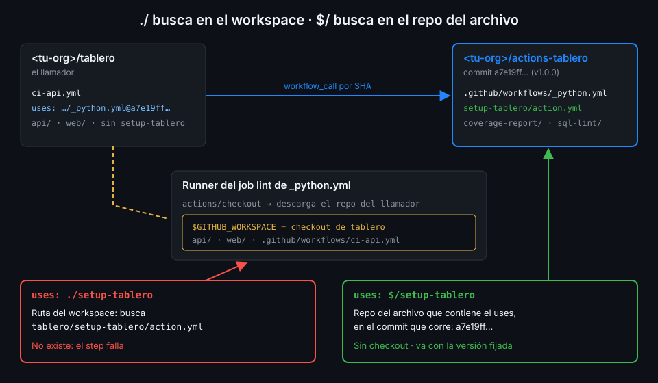

# Referencias dentro del repo central

> Un reutilizable que llama a una action de su mismo repo con `./` funciona mientras el llamador
> vive en ese repo. En cuanto lo llama otro repo, `./` apunta al sitio equivocado. Este archivo
> explica por qué y cómo lo arregla la referencia `$/`.



## 🎯 Objetivos

Al terminar este archivo eres capaz de:

- Predecir contra qué repo se resuelve `uses: ./ruta` dentro de un reutilizable
- Explicar por qué un reutilizable del repo central no puede usar `./` para sus propias actions
- Usar `$/` en steps de un reutilizable y saber a qué commit apunta
- Hacer que actionlint acepte `$/` sin desactivar el resto de sus comprobaciones
- Distinguir `github.workflow_sha` de `job.workflow_sha` dentro de un reutilizable

## 1. Qué problema resuelve

En la capa 10, cada job de `_python.yml` empieza así:

```yaml
steps:
  - uses: actions/checkout@3d3c42e5aac5ba805825da76410c181273ba90b1 # v7.0.1
    with:
      persist-credentials: false
  - uses: ./.github/actions/setup-tablero # zizmor: ignore[self-repository] actionlint 1.7.12 no admite $/
    with:
      stack: python
      working-directory: ${{ inputs.working-directory }}
```

Mueve `_python.yml` y `setup-tablero` a `actions-tablero`, cambia la ruta a `./setup-tablero` y
llama al reutilizable desde `tablero`. El job falla en el segundo step: el runner no encuentra
`setup-tablero/action.yml`.

El archivo existe en el repo central. Lo que falla es **dónde lo busca** el runner.

## 2. Cómo funciona

### `./` es una ruta del workspace

Una referencia `uses: ./ruta` no nombra un repo: es una ruta dentro del **workspace del job**,
la carpeta `$GITHUB_WORKSPACE` del runner. Y el workspace contiene lo que el job haya puesto
ahí, que normalmente es el resultado de `actions/checkout`.

Dentro de un reutilizable, `actions/checkout` sin `repository:` descarga **el repo del
llamador**: el contexto `github` de un reutilizable es el del workflow que lo llama (lo viste en
la Semana 09). Así que, en un job de `_python.yml` llamado desde `tablero`:

| Qué | Vale |
|---|---|
| Archivo de workflow que define el job | `actions-tablero/.github/workflows/_python.yml` |
| Repo que descarga `actions/checkout` | `<tu-org>/tablero` |
| Dónde busca el runner `./setup-tablero` | `$GITHUB_WORKSPACE/setup-tablero`, dentro de `tablero` |

En la capa 10 coincidían los dos repos y por eso funcionaba. Ahora no.

### Los parches de antes de `$/`

Antes de julio de 2026 había dos salidas, y las dos tienen un coste:

- **Referencia remota al propio repo**: `uses: <tu-org>/actions-tablero/setup-tablero@<sha>`
  dentro de `_python.yml`. Funciona, pero el SHA tiene que ser de un commit que ya existe:
  apunta a la versión **anterior** del propio repo. Cada release obliga a un segundo commit que
  actualice las referencias internas, y entre medias los dos están desalineados.
- **Un segundo checkout** del repo central en una subcarpeta y `uses: ./subcarpeta/...`. Hay
  que saber qué repo y qué commit descargar desde dentro del reutilizable, lo que nos lleva al
  contexto `job` de más abajo, y el job paga una descarga extra.

### `$/`: el repo del archivo que corre, en el commit que corre

El changelog de GitHub del 30 de julio de 2026 introduce la referencia "self-repository":

> A `uses:` value that starts with `$/` resolves to your workflow's own repository at the exact
> commit that is running, with no checkout required.

"Your workflow's own repository" es el repo del **archivo** que contiene el `uses:`. En
`_python.yml` llamado desde `tablero`, eso es `actions-tablero`, en el commit que fijó
`tablero`. El mismo changelog lo dice así:

> It works everywhere the workspace-relative `./` syntax works, including workflow steps,
> composite action steps, nested composition, and reusable workflow calls.

> [...] so your internal references stay consistent even when callers pin to a full-length
> commit SHA.

Tres consecuencias para el repo central:

1. **No depende del checkout.** El job puede descargar `tablero`, no descargar nada o descargar
   otra cosa: `$/setup-tablero` sigue siendo la del repo central.
2. **Va con la versión fijada.** Si `tablero` llama a `_python.yml@<sha de v1.0.0>`, las
   actions que usa `_python.yml` son las de ese mismo commit. Reutilizable y actions se publican
   y se consumen juntos, sin segundo commit.
3. **Cuenta como fijada.** El changelog presenta `$/` como la forma de cumplir la política que
   exige SHA completo en workflows que llaman a sus propias actions (archivo 06). Y la documentación
   de la política de la org nombra `./` y `$/` como acciones locales permitidas.

Límites, también del changelog: solo existe en github.com (no en GitHub Enterprise Server) y
exige runner 2.336.0 o posterior. Los runners alojados ya lo tienen; cuando montes runners
propios en la Semana 15 tendrás que comprobarlo.

_verificado con el changelog de GitHub del 2026-07-30, noviembre de 2026. El caso concreto de
un reutilizable llamado desde otro repo se deduce del texto del changelog; la práctica 01 lo
comprueba con un run real._

### Y el `./` de dentro de las actions

`setup-tablero` es una composite que solo usa actions remotas (`astral-sh/setup-uv`,
`actions/setup-node`...), fijadas por SHA. No tiene `./` dentro, así que no cambia al mudarse.
Si una composite del central llamara a otra composite del central, aplicaría lo mismo: `$/`.

## 3. Cómo se usa

### Los reutilizables del repo central

Cada job de `_python.yml` y `_node.yml` cambia una sola línea:

```yaml
steps:
  - uses: actions/checkout@3d3c42e5aac5ba805825da76410c181273ba90b1 # v7.0.1
    with:
      persist-credentials: false
  - uses: $/setup-tablero
    with:
      stack: python
      working-directory: ${{ inputs.working-directory }}
```

El comentario `# zizmor: ignore[self-repository]` desaparece: la auditoría `self-repository` de
zizmor 1.31.1 pide justamente `$/`, así que no da ningún hallazgo. `_image.yml` no usa
`setup-tablero` y no cambia.

El CI del propio central usa la misma referencia para probar sus actions en el commit que se
está probando:

```yaml
- id: lint
  uses: $/sql-lint
  with:
    path: sql-lint/tests
```

### Que actionlint acepte `$/`

actionlint 1.7.12 todavía no conoce la sintaxis (issue rhysd/actionlint#711, abierto a
noviembre de 2026) y rechaza cada `$/` así:

```text
specifying action "$/setup-tablero" in invalid format because ref is missing. available formats are "{owner}/{repo}@{ref}" or "{owner}/{repo}/{path}@{ref}" [action]
```

En la Semana 09 la salida era quedarse en `./` e ignorar el hallazgo de zizmor. En el repo
central esa salida no existe, porque `./` no funciona. Lo que se hace es lo contrario: ignorar
**ese mensaje concreto** de actionlint en `.github/actionlint.yaml`:

```yaml
paths:
  .github/workflows/**/*.yml:
    ignore:
      - 'specifying action "\$/[^"]+" in invalid format'
```

La regex solo casa con referencias que empiezan por `$/`. Un `uses: actions/checkout@v7` o un
`owner/repo` sin `@` siguen siendo error. Cuando actionlint publique soporte para `$/`, se borra
la excepción y nada más cambia.

### Saber qué versión del reutilizable corre

El contexto `github` de un reutilizable es el del llamador, así que `github.workflow_sha` es el
commit de `tablero`. Para saber qué versión **del reutilizable** está corriendo existe el
contexto `job`, con cuatro propiedades documentadas en la referencia de contextos (no en GitHub
Enterprise Server):

| Propiedad | En un job de `_python.yml` llamado desde `tablero` |
|---|---|
| `github.workflow_ref` | `<tu-org>/tablero/.github/workflows/ci-api.yml@refs/heads/main` |
| `github.workflow_sha` | El commit de `tablero` |
| `job.workflow_repository` | `<tu-org>/actions-tablero` |
| `job.workflow_sha` | El commit de `actions-tablero` que fijó el llamador |
| `job.workflow_file_path` | `.github/workflows/_python.yml` |
| `job.workflow_ref` | La referencia completa al archivo del reutilizable |

Sirven para escribir en el resumen del job "CI de actions-tablero en `<sha>`" o para un checkout
explícito del central. Aviso: actionlint 1.7.12 tampoco las conoce y da
`property "workflow_sha" is not defined`; por eso `tablero` no las usa esta semana.

## 4. Antipatrones

| Antipatrón | Por qué duele | Qué hacer en su lugar |
|---|---|---|
| `uses: ./setup-tablero` en un reutilizable del central | Se busca en el checkout del llamador: no existe | `uses: $/setup-tablero` |
| `uses: <tu-org>/actions-tablero/setup-tablero@<sha>` dentro del propio central | Apunta a una versión anterior; cada release pide otro commit | `$/setup-tablero`, que va con el commit que corre |
| Hacer checkout del central "para que `./` funcione" | Descarga extra y hay que adivinar qué commit | `$/`, que no necesita checkout |
| Desactivar la regla `action` de actionlint entera | Deja de detectar referencias mal fijadas de verdad | Ignorar solo el mensaje de `$/` con una regex |
| Leer `github.workflow_sha` para saber qué versión del CI corre | Es el commit del llamador | `job.workflow_sha` |

## 5. Trucos

- **`actionlint -verbose`** dice, por cada archivo, cuántos errores ha filtrado la
  configuración: `verbose: Filtered 3 error(s) due to "-ignore" command line option and "ignore"
  configuration`. En `_python.yml` son tres, uno por job. Si `$/` sigue dando error y esa línea no
  aparece, actionlint no está leyendo tu `.github/actionlint.yaml`.
- **Comprueba en la release, no en local**: lo que ejecuta `tablero` es el archivo en el tag.
  `gh api 'repos/<tu-org>/actions-tablero/contents/.github/workflows/_python.yml?ref=v1.0.0' -H 'Accept: application/vnd.github.raw' | grep -c 'uses: \$/'`
  te dice cuántos `$/` llevan los jobs publicados.
- **Busca los `./` que quedan antes de etiquetar**: `grep -rn 'uses: \./' .github/workflows`
  en el central tiene que salir vacío. El `ci.yml` del central no llama a `_python.yml` ni a
  `_node.yml`, así que un `./` olvidado no lo descubre su CI: lo descubre el primer consumidor.

## 📚 Recursos Adicionales

- [GitHub Changelog: Reference same-repository actions with self-repository syntax (2026-07-30)](https://github.blog/changelog/2026-07-30-reference-same-repository-actions-with-self-repository-syntax/)
- [GitHub Docs: Contexts reference, contexto `job`](https://docs.github.com/en/actions/reference/workflows-and-actions/contexts#job-context)
- [actionlint: issue #711, sintaxis `$/`](https://github.com/rhysd/actionlint/issues/711)
- [actionlint: configuración e `ignore`](https://github.com/rhysd/actionlint/blob/main/docs/config.md)

## ✅ Checklist de Verificación

- [ ] Sé contra qué carpeta se resuelve `./` dentro de un reutilizable
- [ ] Sé por qué `./setup-tablero` falla en el central y funcionaba en `tablero`
- [ ] Sé a qué repo y a qué commit apunta `$/setup-tablero`
- [ ] Sé por qué una referencia remota al propio repo no es buena solución
- [ ] Sé configurar actionlint para aceptar `$/` sin apagar la regla `action`
- [ ] Sé qué diferencia hay entre `github.workflow_sha` y `job.workflow_sha`

---

| ← Anterior | Siguiente → |
|:---|---:|
| [Un repo central de CI](01-un-repo-central-de-ci.md) | [Versionar actions](03-versionar-actions.md) |
