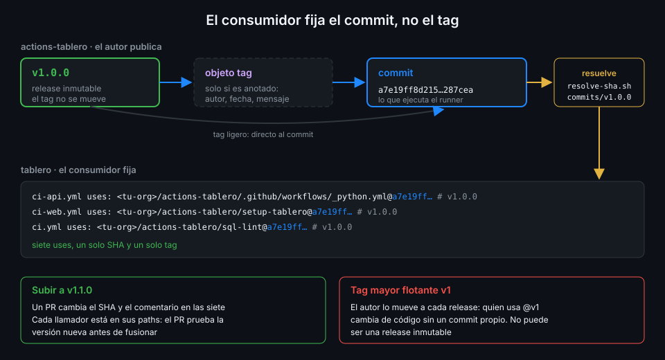

# Versionar actions

> En cuanto otro repo depende de tus actions, cada cambio que haces es un cambio en su CI. Una
> versión le dice al consumidor qué puede esperar; el SHA que fija le garantiza que nada cambia
> hasta que él decida subir.



## 🎯 Objetivos

Al terminar este archivo eres capaz de:

- Aplicar SemVer a una action: qué cuenta como mayor, menor y parche
- Explicar qué es el tag mayor flotante (`v1`) y por qué tus consumidores no lo usan
- Resolver el tag de una release del central al SHA que se fija, y comprobarlo después
- Subir a todos los llamadores de una versión a otra con un solo cambio revisable
- Planificar un cambio incompatible sin romper a nadie

## 1. Qué problema resuelve

Mientras `setup-tablero` vivía en `tablero`, cambiar su `action.yml` y los workflows que la usan
era un único commit: no había nadie más a quien avisar. Con el repo central, la action y sus
consumidores cambian en repos distintos y en momentos distintos. Aparecen dos preguntas:

1. **Para el consumidor**: "si subo de la versión que uso a la nueva, ¿se me rompe algo?".
2. **Para ti**: "¿cómo publico un cambio sin que el CI de todos cambie a la vez?".

La primera la contesta **SemVer**: el número dice qué tipo de cambio es. La segunda la contesta
el **pinning por SHA**: el consumidor no recibe nada hasta que cambia su SHA.

## 2. Cómo funciona

### SemVer aplicado a una action

La interfaz pública de una action es su `action.yml`: inputs, outputs, defaults y lo que hace
con ellos. La de un reutilizable, su bloque `on.workflow_call`: inputs, secretos, outputs y los
permisos que necesita. SemVer se aplica a esa interfaz.

| Cambio | Ejemplo en `actions-tablero` | Versión |
|---|---|---|
| Arreglo sin cambiar la interfaz | `setup-tablero` cachea con la clave correcta | Parche: `v1.0.1` |
| Algo nuevo y opcional | Input `python-version` con default; output nuevo en `sql-lint` | Menor: `v1.1.0` |
| Quitar o renombrar un input u output | `working-directory` pasa a llamarse `dir` | Mayor: `v2.0.0` |
| Hacer obligatorio un input que no lo era | `coverage-min` sin default en `_python.yml` | Mayor |
| Cambiar un default que altera el resultado | `minimum` de `coverage-report` de 60 a 80 | Mayor |
| Pedir más permisos al llamador | Un reutilizable que pasa a necesitar `packages: write` | Mayor |
| Subir el runtime o la imagen base | `node24` a un runtime nuevo; otra versión de sqlfluff | Depende: si cambia el resultado para alguien, mayor |

La regla para dudar: si un consumidor que **no toca nada** puede pasar de verde a rojo al subir,
es mayor. Los tags se escriben siempre completos, `vMAYOR.MENOR.PARCHE`; el autograding de esta
semana lo exige en el comentario.

### Tags, commits y lo que realmente se ejecuta

Un tag es un nombre que apunta a un commit. Hay dos tipos:

- **Ligero**: el tag apunta directamente al commit.
- **Anotado**: el tag apunta a un objeto `tag` (con autor, fecha y mensaje), que a su vez apunta
  al commit.

El runner ejecuta un commit. Lo que fijas en `uses:` es, por tanto, el **SHA del commit**, no el
del objeto tag. `scripts/resolve-sha.sh` ya distingue los dos casos desde la Semana 01 y sirve
igual para tu repo central:

```bash
./scripts/resolve-sha.sh <tu-org>/actions-tablero v1.0.0
# uses: <tu-org>/actions-tablero@a7e19ff8d215588d594f79b969b79bed58287cea # v1.0.0
```

(SHA de ejemplo.) La línea que imprime nombra el repo, no una carpeta: copia el SHA y el
comentario, y escribe tú la ruta (`/setup-tablero`, `/.github/workflows/_python.yml`).

### El tag mayor flotante

Las actions públicas suelen publicar, además de `v1.2.3`, un tag `v1` que el autor **mueve** a
cada release de la serie 1. Es la convención de GitHub para autores de actions: quien escribe
`@v1` recibe parches y menores sin tocar nada.

Ese "sin tocar nada" es justo lo que no quieres en tu organización:

- Lo que ejecuta tu CI cambia sin un commit en tu repo y sin revisión.
- Un tag movido por error, o por alguien con acceso que no debía, llega a todos a la vez.
- Una release inmutable (archivo 04) bloquea su tag: un `v1` que se mueve no puede ser el tag
  de una release inmutable.

Por eso en esta semana `actions-tablero` publica solo tags completos y los consumidores fijan
SHA. Si algún día lo abres a terceros y quieres ofrecer `v1`, será un tag aparte, sin release.

## 3. Cómo se usa

### Una sola versión del central en cada consumidor

`tablero` llama al central desde cuatro workflows y siete `uses:`. Todas tienen que fijar el
**mismo** SHA con el **mismo** tag. Si `ci-api.yml` usa `v1.0.0` y `ci-web.yml` usa `v1.1.0`,
`_python.yml` y `setup-tablero` vienen de commits distintos y depurar un fallo exige saber cuál
corrió en cada sitio.

Comprobarlo es un `grep`:

```bash
grep -rhoE '<tu-org>/actions-tablero/[^@ ]+@[0-9a-f]{40} # v[0-9]+\.[0-9]+\.[0-9]+' .github/workflows \
  | sed -E 's/.*@//' | sort -u
# a7e19ff8d215588d594f79b969b79bed58287cea # v1.0.0
```

Una línea: una versión. Dos líneas: alguien se quedó atrás.

### Comprobar que el SHA es el del tag

El comentario `# v1.0.0` es texto: nadie impide escribir un SHA y un tag que no se corresponden.
La comprobación es pedirle a GitHub a qué commit resuelve el tag:

```bash
gh api repos/<tu-org>/actions-tablero/commits/v1.0.0 --jq .sha
# a7e19ff8d215588d594f79b969b79bed58287cea
```

`commits/<ref>` acepta un tag ligero o anotado y devuelve siempre el commit, así que no tienes
que distinguirlos. Si el SHA no coincide con el que fijas, o el comentario miente o el tag se
movió después de que lo resolvieras. El archivo 04 explica cómo impedir lo segundo.

### Subir de versión

Subir a `v1.1.0` es un commit en `tablero` que cambia las siete líneas a la vez:

```bash
old=a7e19ff8d215588d594f79b969b79bed58287cea
new=$(gh api repos/<tu-org>/actions-tablero/commits/v1.1.0 --jq .sha)
grep -rl "$old" .github/workflows | xargs sed -i "s/$old # v1.0.0/$new # v1.1.0/"
git diff --stat
```

Ese commit se revisa en un PR como cualquier otro, y como cada llamador está en sus propios
`paths`, el PR ejecuta `ci-api`, `ci-web`, `images` y `ci` **con la versión nueva** antes de
fusionarse. Si algo se rompe, se rompe en el PR. En la Semana 12, Dependabot abrirá estos PR
por ti, con el SHA y el comentario ya actualizados.

### Un cambio incompatible sin romper a nadie

1. Publica `v2.0.0` con el cambio y una nota de qué hay que cambiar en el llamador.
2. Los consumidores que siguen en `v1.x.y` no notan nada: su SHA no ha cambiado.
3. Cada consumidor sube cuando puede, en un PR que hace los dos cambios juntos: el SHA y lo que
   pide la versión mayor (el input renombrado, el permiso nuevo).
4. Si hace falta arreglar algo urgente en la serie 1, se publica `v1.0.2` desde una rama
   `release/v1`. Las versiones son tags: no exigen que `main` siga en la serie 1.

### Qué escribir en las notas de la release

El número dice **qué tipo** de cambio es; las notas dicen **qué** cambia para el consumidor. En
un repo central, quien las lee es otro equipo decidiendo si sube hoy o la semana que viene. Lo
que necesita, en este orden:

1. **Qué piezas cambian**: `setup-tablero`, `_python.yml`... Si su repo no usa esa pieza, sube
   sin mirar más.
2. **Qué tiene que tocar en su llamador**: el input renombrado, el permiso nuevo, el default que
   cambia. En una versión menor o de parche, esta sección está vacía; si no lo está, la versión
   está mal elegida.
3. **Por qué**: el arreglo o la mejora, en una frase.

`gh release create --generate-notes` arranca las notas con la lista de PR fusionados desde la
release anterior. Es un buen punto de partida, pero no dice qué tiene que cambiar el
consumidor: esa parte la escribes tú.

### Publicar en el Marketplace

`actions-tablero` no se puede publicar en el Marketplace, y es a propósito. Los requisitos
(docs "Publishing actions in GitHub Marketplace", noviembre 2026):

- Repo **público** con **un solo** `action.yml` en la **raíz**: el que esté en subcarpetas no se
  lista. Una action para el Marketplace vive en su propio repo y se versiona sola.
- El `name` del `action.yml` es único: no puede coincidir con otra action publicada, con un
  usuario u organización ajenos ni con una categoría.
- `branding` (`icon` y `color`) da el icono de la ficha.
- Se publica desde una release: en el borrador, la casilla "Publish this Action to the GitHub
  Marketplace" (exige aceptar el acuerdo de desarrollador y 2FA), una categoría y el tag.
  No hay revisión previa de GitHub.

Para la org, un repo central con varias actions es más práctico; para la comunidad, un repo por
action.

## 4. Antipatrones

| Antipatrón | Por qué duele | Qué hacer en su lugar |
|---|---|---|
| Renombrar un input en una versión menor | El consumidor sube "sin riesgo" y su CI pasa a rojo | Versión mayor y nota de migración |
| Consumir el central por `@v1` o `@main` | El CI cambia sin un commit en tu repo | SHA de la release con `# vX.Y.Z` |
| Tags incompletos (`v1.1`) | No dicen si es un parche o un menor, y no cumplen el formato del bootcamp | `vMAYOR.MENOR.PARCHE` |
| Fijar el SHA del objeto tag anotado | No es el SHA de un commit: no apunta a lo que ejecuta el runner | `resolve-sha.sh` o `commits/<tag>` |
| Subir de versión solo uno de los llamadores | Dos versiones del central conviven en el mismo repo | Un commit que cambia todas las referencias |
| Mover un tag ya publicado para "arreglarlo" | Los consumidores que lo resolvieron antes y después tienen SHA distintos | Un tag nuevo, de parche |

## 5. Trucos

- **`git ls-remote --tags https://github.com/<tu-org>/actions-tablero`** lista los tags del
  central sin clonarlo. En un tag anotado verás dos líneas: `refs/tags/v1.0.0` (el objeto tag) y
  `refs/tags/v1.0.0^{}` (el commit). La que se fija es la de `^{}`.
- **`gh api repos/<tu-org>/actions-tablero/compare/v1.0.0...v1.1.0 --jq '.files[].filename'`**
  lista los archivos que cambian entre dos versiones: antes de subir sabes si tocó la action que
  usas o solo otra.
- **`gh release list -R <tu-org>/actions-tablero`** enseña las releases con su tag y cuál es la
  más reciente (`Latest`): es la forma rápida de saber a qué versión subir.

## 📚 Recursos Adicionales

- [Semantic Versioning 2.0.0](https://semver.org/lang/es/)
- [GitHub Docs: Releasing and maintaining actions](https://docs.github.com/en/actions/how-tos/create-and-publish-actions/release-and-maintain-actions)
- [GitHub Docs: Using pre-written building blocks, versiones y SHA](https://docs.github.com/en/actions/how-tos/write-workflows/choose-what-workflows-do/find-and-customize-actions)

## ✅ Checklist de Verificación

- [ ] Sé clasificar un cambio de un `action.yml` o de un `workflow_call` como mayor, menor o parche
- [ ] Sé por qué se fija el SHA del commit y no el del objeto tag
- [ ] Sé por qué los consumidores de la org no usan el tag mayor flotante
- [ ] Sé comprobar que todas las referencias de un repo al central fijan la misma versión
- [ ] Sé comprobar que un SHA fijado es el del tag que dice su comentario
- [ ] Sé subir de versión en un PR que prueba la versión nueva antes de fusionar

---

| ← Anterior | Siguiente → |
|:---|---:|
| [Referencias dentro del repo central](02-referencias-dentro-del-repo-central.md) | [Releases inmutables](04-releases-inmutables.md) |
