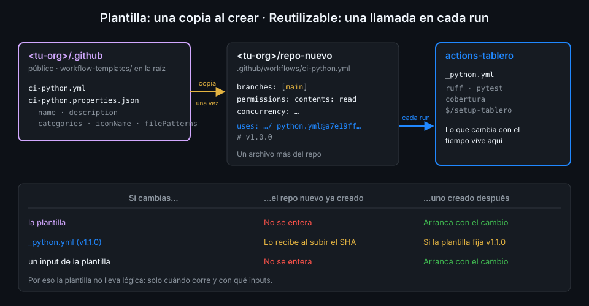

# Workflow templates

> El repo central hace que el CI se reutilice. Falta que el próximo repo de la organización
> sepa que existe y empiece a usarlo sin copiarlo de `tablero`. Una workflow template se lo
> ofrece en la pestaña Actions, el primer día.



## 🎯 Objetivos

Al terminar este archivo eres capaz de:

- Explicar qué es una workflow template de organización y dónde la ve el resto de la org
- Montar el repo `<tu-org>/.github` con la carpeta `workflow-templates/`
- Escribir el `.properties.json` de una plantilla con sus claves obligatorias y opcionales
- Usar `$default-branch` para que la plantilla sirva en cualquier repo
- Explicar por qué una buena plantilla es un llamador fino a un reutilizable fijado por SHA

## 1. Qué problema resuelve

Tienes `actions-tablero` con `_python.yml` en `v1.0.0`. Alguien de la organización crea
`tablero-admin`, otro servicio Python. ¿Cómo sabe que existe `_python.yml`, cómo se llama, qué
inputs pide y qué SHA fijar? Hoy, abriendo `tablero` y copiando `ci-api.yml`. Eso funciona
hasta que copia uno antiguo, o uno con los `paths` de `tablero`.

Una **workflow template** de organización es un workflow de partida que GitHub ofrece en la
pestaña **Actions → New workflow** de los repos de la organización, junto a las plantillas
públicas de GitHub. Quien crea el repo elige la plantilla de su organización y obtiene un
workflow que ya sigue vuestras reglas.

## 2. Cómo funciona

### El repo `.github` de la organización

Las plantillas viven en un repo con un nombre especial: **`.github`**, dentro de la
organización. GitHub lo lee para varias cosas de toda la org (perfil, plantillas de issue por
defecto...) y, para lo que interesa aquí, busca en su raíz una carpeta `workflow-templates/`.

```text
<tu-org>/.github/
└── workflow-templates/
    ├── ci-python.yml
    └── ci-python.properties.json
```

Fíjate en la ruta: `workflow-templates/` va en la **raíz** del repo, no dentro de `.github/`. Un
`.github/workflow-templates/` no lo ve nadie, y tampoco da error.

En el plan gratuito, el repo `.github` tiene que ser **público**: las plantillas de un `.github`
público las ven los repos públicos de la organización, que es el caso de `tablero` y de los
repos de este bootcamp.

### El par `.yml` + `.properties.json`

Cada plantilla son dos archivos con el mismo nombre base:

| Archivo | Qué contiene |
|---|---|
| `ci-python.yml` | El workflow que se copia al repo |
| `ci-python.properties.json` | Cómo se presenta en la lista: nombre, descripción, icono y cuándo sugerirla |

Claves del `.properties.json`:

| Clave | Obligatoria | Para qué |
|---|:--:|---|
| `name` | Sí | El nombre que aparece en la tarjeta |
| `description` | Sí | Una frase de qué hace |
| `iconName` | No | Un SVG de la propia carpeta (nombre sin extensión) o el nombre de un Octicon |
| `categories` | No | Lenguajes o tipos de proyecto con los que se agrupa |
| `filePatterns` | No | Lista de regex: la plantilla se sugiere si el repo tiene **en su raíz** un archivo que case |

```json
{
  "name": "CI de Python con uv",
  "description": "Lint con ruff, tests y cobertura usando el reutilizable _python.yml de actions-tablero v1.0.0",
  "categories": ["Python"]
}
```

Cuidado con `filePatterns`: mira **solo la raíz**. Un patrón `pyproject\\.toml$` dejaría la
plantilla fuera de las sugerencias para `tablero`, que tiene su `pyproject.toml` en `api/`. Sin
`filePatterns`, la plantilla aparece siempre en la lista de la organización.

### `$default-branch`

Una plantilla no sabe si el repo usa `main`, `master` o `trunk`. Para eso existe el marcador
`$default-branch`: al crear el workflow desde la plantilla, GitHub lo sustituye por el nombre
de la rama por defecto del repo.

```yaml
on:
  push:
    branches: [$default-branch]
```

Es sustitución de texto en el momento de copiar, no una expresión: en el workflow resultante ya
pone `main`. Por eso tampoco lleva `${{ }}`.

### Una plantilla se copia una vez

Este es el punto que decide cómo se escribe. Cuando alguien crea un workflow desde la plantilla,
GitHub **copia** el archivo al repo. Desde ese momento es un archivo más del repo: si mañana
cambias la plantilla, los repos que ya la usaron no se enteran.

Compara con el reutilizable:

| | Workflow template | Reutilizable |
|---|---|---|
| Cuándo actúa | Una vez, al crear el workflow | En cada run |
| Qué recibe el repo | Una copia | Una referencia (`uses:` + SHA) |
| Si la cambias | Solo afecta a los repos nuevos | Afecta a quien suba de SHA |
| Para qué sirve | Descubrir y arrancar | Ejecutar y mantener |

Las dos piezas se complementan si la plantilla **no contiene lógica**: solo disparadores,
concurrencia, permisos y un job que llama al reutilizable central fijado por SHA. Lo que cambia
con el tiempo (cómo se instala uv, qué ejecuta ruff) vive en `actions-tablero`, y los repos
creados desde la plantilla lo reciben subiendo el SHA, como `tablero`.

## 3. Cómo se usa

### La plantilla `ci-python`

```yaml
# Plantilla de la organización: CI de un proyecto Python con uv. Todo el trabajo lo hace el
# reutilizable central; este archivo solo decide cuándo corre y con qué inputs.
name: ci-python

on:
  push:
    branches: [$default-branch]
  pull_request:
  workflow_dispatch:

concurrency:
  group: ${{ github.workflow }}-${{ github.ref }}
  cancel-in-progress: ${{ github.event_name == 'pull_request' }}

permissions:
  contents: read

jobs:
  python:
    name: Python
    uses: <tu-org>/actions-tablero/.github/workflows/_python.yml@a7e19ff8d215588d594f79b969b79bed58287cea # v1.0.0
    with:
      # Cambia estos dos valores a los de tu proyecto al crear el workflow.
      working-directory: .
      package: app
      integration: false
```

(SHA de ejemplo: el tuyo es el de tu `v1.0.0`.) Decisiones que no se ven a simple vista:

- **Sin `paths`**: la plantilla no sabe dónde está el código del repo nuevo. Quien la usa los
  añade si su repo es un monorepo.
- **`integration: false`**: un repo nuevo no tiene `tests/integration` ni migraciones; activarlo
  por defecto lo dejaría en rojo el primer día.
- **El comentario de los inputs** es el único que hace falta: es lo que quien crea el workflow
  tiene que tocar.
- **Las reglas de seguridad van incluidas**: `permissions` en la raíz, SHA con su tag. Un repo
  nuevo empieza cumpliéndolas sin saber que existen.

### Cuando subes de versión el central

Al publicar `v1.1.0` en `actions-tablero`, actualiza también el SHA de la plantilla. No cambia
nada en los repos que ya la usaron (eso lo hace su propio PR de subida), pero los repos nuevos
arrancan en la versión actual.

### Cómo se ve desde un repo

En un repo público de la org, **Actions → New workflow** enseña las plantillas de la
organización junto a las de GitHub, con el nombre y la descripción del `.properties.json`. Al
elegir una, GitHub abre el editor con el `.yml` y `$default-branch` ya sustituido, y lo guardas en
`.github/workflows/` como un commit normal. El aspecto exacto de esa pantalla cambia con el
tiempo; lo que no cambia es que lo que se guarda es una copia.

## 4. Antipatrones

| Antipatrón | Por qué duele | Qué hacer en su lugar |
|---|---|---|
| `workflow-templates/` dentro de `.github/` del repo `.github` | GitHub no la busca ahí: la plantilla no aparece | En la raíz del repo `.github` |
| Plantilla con todos los steps del CI | Cada repo se queda con una copia que nadie actualiza | Llamador fino a un reutilizable fijado por SHA |
| `branches: [main]` en la plantilla | Falla en repos con otra rama por defecto | `$default-branch` |
| `filePatterns` con una ruta de subcarpeta | Solo mira la raíz: no se sugiere nunca | Sin `filePatterns`, o con archivos que estén en la raíz |
| Plantilla que apunta al central por `@v1` o `@main` | Los repos nuevos nacen sin pinning | SHA de la release y `# vX.Y.Z` |
| `.properties.json` sin `description` | Es obligatoria: la plantilla no se ofrece bien | `name` y `description` siempre |

## 5. Trucos

- **Lee la plantilla publicada como la ve GitHub**:
  `gh api 'repos/<tu-org>/.github/contents/workflow-templates/ci-python.yml' -H 'Accept: application/vnd.github.raw'`.
  Si la ruta da 404, la carpeta no está en la raíz.
- **Valida el JSON antes de subirlo**: `jq -e '.name and .description' ci-python.properties.json`
  sale con código distinto de cero si falta una de las dos claves obligatorias.
- **actionlint valida la plantilla** si la copias a un `.github/workflows/` temporal: trata
  `$default-branch` como un nombre de rama más y comprueba el resto.

## 📚 Recursos Adicionales

- [GitHub Docs: Creating workflow templates for your organization](https://docs.github.com/en/actions/how-tos/reuse-automations/create-workflow-templates)
- [GitHub Docs: Workflow templates reference](https://docs.github.com/en/actions/reference/workflows-and-actions/reusing-workflow-configurations#workflow-templates)
- [GitHub Docs: Creating a default community health file](https://docs.github.com/en/communities/setting-up-your-project-for-healthy-contributions/creating-a-default-community-health-file)

## ✅ Checklist de Verificación

- [ ] Sé en qué repo y en qué carpeta viven las plantillas de la organización
- [ ] Sé qué claves del `.properties.json` son obligatorias y qué hace `filePatterns`
- [ ] Sé qué sustituye `$default-branch` y cuándo
- [ ] Sé por qué una plantilla copiada no recibe los cambios posteriores
- [ ] Sé por qué la plantilla llama a un reutilizable en lugar de contener los steps
- [ ] Sé qué hay que actualizar en la plantilla al publicar una versión nueva del central

---

| ← Anterior | Siguiente → |
|:---|---:|
| [Releases inmutables](04-releases-inmutables.md) | [Políticas de actions de la organización](06-politicas-de-actions-de-la-organizacion.md) |
