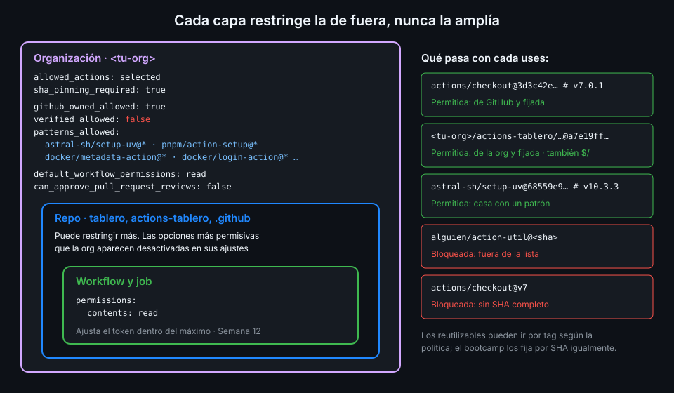

# Políticas de actions de la organización

> Las reglas del bootcamp (SHA fijado, token de solo lectura, nada de actions al azar) dependen
> hasta ahora de que cada workflow las cumpla. La organización puede convertirlas en
> condiciones: lo que no las cumple no se ejecuta, en ningún repo.



## 🎯 Objetivos

Al terminar este archivo eres capaz de:

- Explicar cómo se combinan las políticas de la organización, del repo y del workflow
- Elegir entre permitir todas las actions, solo las de la org o una selección
- Escribir una lista de patrones de actions permitidas para lo que usa `tablero`
- Exigir a toda la org que las actions vayan fijadas por SHA completo
- Dejar el `GITHUB_TOKEN` de toda la org en solo lectura y sin poder aprobar PR
- Leer y cambiar todo lo anterior con `gh api`

## 1. Qué problema resuelve

En la Semana 01 activaste en `tablero` el ajuste que exige SHA completo, y desde entonces todos
los workflows del bootcamp declaran `permissions: contents: read`. Funciona en `tablero` porque
lo configuraste tú. Pero:

- `actions-tablero` y `.github` son repos nuevos: nacen con los ajustes por defecto.
- El próximo repo de la org lo creará alguien que no ha hecho la Semana 01.
- Un PR puede añadir `uses: alguien/action-util@v2` <!-- antipatron --> y, si nadie lo ve en
  la revisión, se ejecuta con el token del job.

Las políticas de **organización** se aplican a todos sus repos, a los de hoy y a los que vengan,
sin que nadie tenga que acordarse.

## 2. Cómo funciona

### Las capas

Cada capa puede restringir lo que deja la de encima, nunca ampliarlo:

1. **Empresa** (si la org pertenece a una; no es tu caso).
2. **Organización**: qué actions se permiten, si se exige SHA y qué permisos tiene el token por
   defecto.
3. **Repo**: puede restringir más; las opciones más permisivas que la org aparecen desactivadas.
4. **Workflow y job**: `permissions:` baja lo que el token tiene por defecto (o lo sube dentro
   del máximo permitido); lo verás a fondo en la Semana 12.

Así, si la org fija el token por defecto en lectura, un repo no puede volver a ponerlo en
escritura por defecto: esa opción queda desactivada en sus ajustes.

### Qué actions se permiten

En la org, **Settings → Actions → General → Policies**. En la API, el campo `allowed_actions`
de `GET /orgs/{org}/actions/permissions`:

| `allowed_actions` | Qué permite |
|---|---|
| `all` | Cualquier action y cualquier reutilizable, de cualquiera |
| `local_only` | Solo actions y reutilizables de la propia organización. Bloquea también las de GitHub (`actions/checkout`) |
| `selected` | Las de la propia org, más las que elijas de fuera. En la UI: "Allow *OWNER*, and select non-*OWNER*, actions and reusable workflows" |

`local_only` suena bien y deja `tablero` sin `actions/checkout`. `selected` es la que encaja:
`actions-tablero` entra por ser de la org, las referencias `./` y `$/` también (la
documentación las nombra como acciones locales permitidas), y lo de fuera, solo si está en la
lista.

### La lista de `selected`

Con `selected`, la lista se define con tres campos de
`GET /orgs/{org}/actions/permissions/selected-actions`:

| Campo | Qué abre |
|---|---|
| `github_owned_allowed` | Todas las actions creadas por GitHub (organizaciones `actions` y `github`) |
| `verified_allowed` | Todas las actions del Marketplace de creadores verificados |
| `patterns_allowed` | Una lista explícita de patrones |

`verified_allowed` es tentador y amplio: "verificado" dice quién es el creador, no qué hace cada
versión de cada una de sus actions. En esta semana queda en `false` y se usa la lista.

Formato de los patrones (documentación de la política de la org):

| Patrón | Casa con |
|---|---|
| `astral-sh/setup-uv@*` | Esa action, en cualquier versión |
| `docker/*` | Cualquier action de la org `docker` |
| `owner/repo@<sha>` | Esa action solo en ese commit |
| `owner/repo/.github/workflows/x.yml@*` | Un reutilizable concreto de otro repo |
| `!space-org/action@*` | Excluye esa action aunque otro patrón la incluya |

Lo que usa `tablero` de fuera de GitHub y de la org son seis actions, de tres dueños:
`astral-sh/setup-uv`, `pnpm/action-setup` y cuatro de `docker` (`metadata-action`,
`setup-buildx-action`, `login-action`, `build-push-action`). Puedes nombrarlas una a una o abrir
`docker/*`; la primera opción es más estricta y te obliga a revisar la lista cuando entra una
action nueva, que es precisamente lo que buscas.

### SHA completo obligatorio

El campo `sha_pinning_required` de `GET /orgs/{org}/actions/permissions`. Activado, toda action
tiene que ir fijada por SHA de 40 caracteres para ejecutarse, incluidas las de GitHub y las de la
propia org. Matices de la documentación:

- **Los reutilizables pueden seguir referenciándose por tag.** La política se aplica a actions;
  el bootcamp los fija por SHA igualmente, por la regla 1 de seguridad.
- **`$/` cuenta como fijada**: va al commit exacto que corre. Es uno de los motivos del archivo
  02 para usarla en el repo central.

Si un workflow incumple la política, el run no llega a ejecutar esa action y falla; el mensaje
dice qué referencia no está permitida o no está fijada. El texto exacto depende del caso: si
quieres verlo, provócalo en una rama de prueba durante la práctica 03.

### El `GITHUB_TOKEN` por defecto

`GET /orgs/{org}/actions/permissions/workflow`:

| Campo | Valor que buscas | Por qué |
|---|---|---|
| `default_workflow_permissions` | `read` | Un workflow sin `permissions:` recibe solo lectura de `contents` y `packages` |
| `can_approve_pull_request_reviews` | `false` | Un workflow no puede crear ni aprobar PR: no se salta la revisión humana |

Una organización nueva ya viene así según la documentación. Lo que haces en la práctica 03 es
**comprobarlo** y dejarlo fijado; si alguien lo cambió, lo devuelves.

## 3. Cómo se usa

### Leer el estado

Estos endpoints piden el scope `admin:org` en el token de `gh`. Sin él responden HTTP 403 con
"You must be an org admin or have the actions policies fine-grained permission." y `gh` te
sugiere el comando para añadirlo:

```bash
gh auth refresh -h github.com -s admin:org
export GH_REPO=<tu-org>/tablero
gh api orgs/{owner}/actions/permissions \
  --jq '"\(.allowed_actions) sha_pinning_required=\(.sha_pinning_required)"'
gh api orgs/{owner}/actions/permissions/selected-actions
gh api orgs/{owner}/actions/permissions/workflow
```

Con `GH_REPO` exportado, `gh` sustituye `{owner}` también en las rutas de organización.

### Cambiarlo

Los tres endpoints tienen su `PUT`, con los mismos campos en el cuerpo y respuesta `204` sin
contenido. El primero exige `enabled_repositories` aunque no lo cambies:

```bash
gh api -X PUT orgs/{owner}/actions/permissions \
  -f enabled_repositories=all -f allowed_actions=selected -F sha_pinning_required=true

gh api -X PUT orgs/{owner}/actions/permissions/selected-actions \
  -F github_owned_allowed=true -F verified_allowed=false \
  -f 'patterns_allowed[]=astral-sh/setup-uv@*' \
  -f 'patterns_allowed[]=pnpm/action-setup@*' \
  -f 'patterns_allowed[]=docker/metadata-action@*'
```

`-F` convierte `true` y `false` en booleanos JSON; `-f` los mandaría como texto. Cada
`patterns_allowed[]=` añade un elemento al array, y el `PUT` **sustituye** la lista entera: si
mandas tres patrones, quedan tres. La lista completa de `tablero` la escribes en la práctica 03.

### El orden importa

Activa `selected` y la lista en el mismo momento. Si activas `selected` con la lista vacía, el
siguiente push de `tablero` falla en `setup-uv`. Y antes de `sha_pinning_required`, comprueba
que no queda ningún `uses:` sin SHA en ningún repo de la org (el check `actions-pinned` lo hace
en `tablero`; en `actions-tablero` lo hace zizmor).

## 4. Antipatrones

| Antipatrón | Por qué duele | Qué hacer en su lugar |
|---|---|---|
| `allowed_actions: all` en la org | Cualquier PR puede meter cualquier action | `selected` con lista explícita |
| `local_only` "para ir a lo seguro" | Bloquea también `actions/checkout` y el resto de GitHub | `selected` con `github_owned_allowed: true` |
| `verified_allowed: true` | Abre todo el Marketplace verificado sin revisar ninguna action | Patrones concretos |
| Patrones como `*/*` o `*` | Equivale a no tener lista | Un patrón por action o por dueño de confianza |
| `PUT` de `selected-actions` con solo el patrón nuevo | Sustituye la lista: borra los demás | Mandar la lista completa |
| Token por defecto en `write` "porque algún workflow lo necesita" | Todos los workflows sin `permissions:` escriben | `read` y que cada job pida lo suyo (Semana 12) |
| Fiarse solo del pinning del repo | Los repos nuevos nacen sin él | `sha_pinning_required` en la org |

## 5. Trucos

- **Mira qué actions de fuera usa realmente un repo** antes de escribir la lista:
  `grep -rhoE 'uses: [^.$][^@ ]+' .github/workflows | sort -u | grep -vE '^uses: (actions|github|<tu-org>)/'`
  te da los dueños y repos que necesitan patrón.
- **`--jq '.patterns_allowed[]'`** sobre `selected-actions` imprime un patrón por línea: con
  `diff` contra un archivo del repo central detectas si alguien tocó la lista en la UI.
- **El scope `admin:org` es solo para ti**: en el CI no hace falta. Los workflows no leen estas
  políticas; GitHub las aplica al preparar cada run.

## 📚 Recursos Adicionales

- [GitHub Docs: Disabling or limiting GitHub Actions for your organization](https://docs.github.com/en/organizations/managing-organization-settings/disabling-or-limiting-github-actions-for-your-organization)
- [GitHub REST API: GitHub Actions permissions](https://docs.github.com/en/rest/actions/permissions)
- [GitHub Docs: Secure use reference](https://docs.github.com/en/actions/reference/security/secure-use)

## ✅ Checklist de Verificación

- [ ] Sé cómo se combinan las políticas de org, repo y workflow
- [ ] Sé qué hace cada valor de `allowed_actions` y por qué `local_only` no sirve aquí
- [ ] Sé escribir patrones de actions permitidas y por qué no abrir los creadores verificados
- [ ] Sé qué exige `sha_pinning_required` y qué deja fuera
- [ ] Sé qué valores del token por defecto quiero en la org y por qué
- [ ] Sé leer y cambiar las tres políticas con `gh api`, y qué scope necesito

---

| ← Anterior | Siguiente → |
|:---|---:|
| [Workflow templates](05-workflow-templates.md) | [Rulesets que exigen workflows](07-rulesets-que-exigen-workflows.md) |
