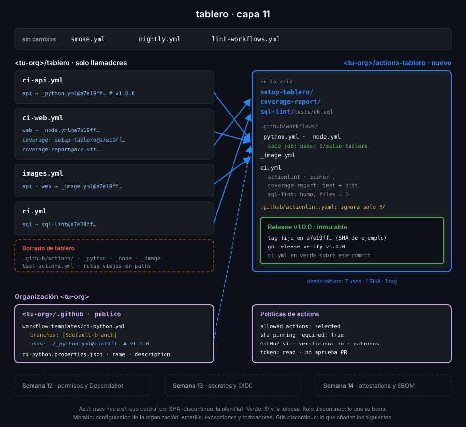

# Proyecto: capa 11 de tablero



## 🎯 Objetivo

Que el CI de `tablero` deje de ser solo de `tablero`. Las tres actions y los tres reutilizables
salen a un repo central versionado, `<tu-org>/actions-tablero`, con su propio CI y releases
inmutables; `tablero` los consume fijados por el SHA de una release. La organización ofrece una
plantilla para que un repo nuevo se sume en un clic, y sus políticas solo dejan ejecutar las
actions que has decidido, fijadas por SHA.

## 📦 Qué añade esta capa

Esta capa toca tres repos de tu organización:

| Repo y archivo | Qué hace | Por qué existe |
|---|---|---|
| `actions-tablero/setup-tablero/`, `coverage-report/`, `sql-lint/` (movidos) | Las actions de la Semana 10, sin cambios, en la raíz del repo central | Se llaman como `<tu-org>/actions-tablero/<action>@<sha>` desde cualquier repo |
| `actions-tablero/.github/workflows/_python.yml`, `_node.yml`, `_image.yml` (movidos) | Los reutilizables de la Semana 09; cada job prepara el entorno con `$/setup-tablero` | Llamado desde otro repo, `./` apunta al workspace del llamador; `$/` apunta al repo y commit del reutilizable |
| `actions-tablero/.github/workflows/ci.yml` (nuevo) | actionlint, zizmor sobre todo el repo, tests y frescura de `dist/` de `coverage-report` y una prueba de humo de `sql-lint` | Una release solo se publica sobre un commit en verde |
| `actions-tablero/.github/actionlint.yaml` (nuevo) | Ignora el único error que actionlint 1.7.12 da con `$/` | Sin él, cada `uses: $/...` rompe la puerta de linters |
| `actions-tablero/README.md` (nuevo) | Catálogo de lo que hay y política de versiones | Quien consume tus actions empieza por aquí |
| Release `v1.0.0` de `actions-tablero` (nueva, inmutable) | Bloquea el tag en su commit y firma una attestation | El SHA que fijan los consumidores es el de un tag que ya no se puede mover |
| `tablero`: `ci-api.yml`, `ci-web.yml`, `images.yml`, `ci.yml` | Llaman a `actions-tablero` por el SHA de `v1.0.0` | Una sola fuente de verdad para el CI de la organización |
| `tablero`: `.github/actions/`, `_*.yml`, `test-actions.yml` (borrados) | — | Dos copias divergen; lo que se prueba ahora vive en el repo central |
| `<tu-org>/.github`: `workflow-templates/ci-python.yml` y `.properties.json` (nuevos) | Plantilla de CI de Python que llama al `_python.yml` central | Un repo nuevo de la org se suma con un clic desde la pestaña Actions |
| Políticas de Actions de la org (nuevas) | Solo actions de GitHub y patrones explícitos, pinning por SHA obligatorio, `GITHUB_TOKEN` de solo lectura | Lo que no está en la lista no se ejecuta en ningún repo de la org |

| Situación | Qué pasa |
|---|---|
| Cambias `setup-tablero` en `actions-tablero` | `tablero` no se entera hasta que sube el SHA fijado: el cambio llega cuando lo decides |
| Publicas `v1.1.0` y actualizas `tablero` | Un commit que cambia el SHA de los llamadores; los filtros `paths` de cada workflow lo detectan solos |
| Alguien añade una action de un tercero que no está en la lista | El run falla antes de ejecutar el job: la política de la org lo bloquea |
| Alguien escribe `uses: owner/action@v3` | El run falla: la org exige SHA completo |

La Semana 12 se pone del lado del atacante: con qué permisos corre cada job, inyección de
scripts, `pull_request_target` y Dependabot para mantener al día los SHA que fijas aquí.

## ✅ Requisitos verificables

- ci-api.yml, ci-web.yml e images.yml llaman a los reutilizables de actions-tablero fijados por SHA con el tag en comentario
- El job coverage de ci-web.yml usa setup-tablero y coverage-report, y el job sql de ci.yml usa sql-lint, todas desde actions-tablero por SHA
- tablero ya no guarda copias locales: ni .github/actions/, ni reutilizables _*.yml, ni test-actions.yml
- Todas las referencias de tablero al repo central fijan el mismo SHA y el mismo tag
- El SHA que fija tablero es el commit al que apunta, en actions-tablero, el tag que lleva en el comentario
- La última release de actions-tablero es una v1.x.y publicada (no borrador) e inmutable
- El ci.yml de actions-tablero terminó en success sobre el commit de su última release
- En la última release, _python.yml y _node.yml preparan cada job con $/setup-tablero y ninguno usa ./
- La organización solo permite actions seleccionadas y exige fijarlas por SHA completo
- La lista de la organización admite las actions de GitHub y una lista de patrones explícita, sin abrir la puerta a todo creador verificado
- El GITHUB_TOKEN de la organización es de solo lectura por defecto y no puede aprobar pull requests
- El repo .github de la organización existe y es público
- workflow-templates/ci-python.properties.json tiene name y description propios, sin TODO
- La plantilla ci-python.yml filtra por $default-branch y llama al _python.yml central fijado por SHA
- Los workflows de tablero pasan actionlint y zizmor sin hallazgos
- Toda uses remota de los workflows de tablero está fijada por SHA de 40 caracteres con el tag en comentario
- ci, ci-api y ci-web terminan en success sobre el último commit de main, ya con el repo central

## 🎨 Criterios de calidad

Lo que `check-week.sh` no ve y la [rúbrica](../rubrica-evaluacion.md) sí puntúa:

- El `README.md` de `actions-tablero` tiene el catálogo completo (cada action y cada reutilizable
  con su línea `uses:` lista para copiar) y una política de versiones que dice qué cambio sube el
  major (TODO 5 y TODO 6).
- Las notas de la release `v1.0.0` dicen qué contiene y de qué semanas viene cada pieza.
- La excepción de `actionlint.yaml` ignora solo el mensaje de `$/`, con un comentario que enlaza
  el issue de actionlint: ningún otro error queda silenciado.
- La lista de patrones de la org es la mínima: las actions de terceros que de verdad usas, por
  repo (`astral-sh/setup-uv@*`), no por propietario entero salvo que lo justifiques.
- La plantilla dice al que la adopta qué inputs tiene que cambiar, y su `description` cita la
  versión del repo central que usa.
- Los commits de los tres repos van en Conventional Commits; en `actions-tablero`, uno por pieza
  movida, para que el historial cuente de dónde viene cada cosa.
- Sin `TODO` en ninguno de los tres repos.

## 💡 Adaptación a tu dominio

| Tu organización | Repo central | Plantilla | Política |
|---|---|---|---|
| Varios microservicios Python | `actions-<empresa>` con `_python.yml` y una action de despliegue | `ci-servicio-python` | Solo `astral-sh/*` y `docker/*` además de GitHub |
| Librerías TypeScript publicadas | Reutilizable de build y publicación con pnpm | `ci-libreria` con matriz de Node | Solo `pnpm/action-setup@*` además de GitHub |
| Infraestructura como código | Actions de `plan` y `apply` de Terraform | `ci-terraform` con el plan en el resumen | Lista mínima y `local_only` en los repos de producción |
| Equipo de datos | Reutilizable de tests de dbt contra PostgreSQL | `ci-dbt` | Solo actions de GitHub y del repo central |

## 🚦 Cómo entregarlo

Si hiciste las cuatro prácticas ya lo tienes todo: repásalo contra los requisitos y los
criterios. Si no, parte del starter.

1. Crea `actions-tablero`, copia en él las actions, los reutilizables y el starter, y completa
   los `TODO 1` a `TODO 6`:

   ```bash
   gh repo create <tu-org>/actions-tablero --public --clone && cd actions-tablero
   S=~/code/bc-github-actions/bootcamp/week-11-actions_a_escala_de_organizacion/3-proyecto/starter
   cp -r "$S"/actions-tablero/. .
   grep -rnE "TODO [0-9]" . | wc -l
   # 6
   ```

   El resto (mover las actions, cambiar `./` por `$/` y publicar `v1.0.0`) está en la
   [práctica 01](../2-practicas/01-repo-central-y-primera-release.md).

2. Crea `<tu-org>/.github` y completa los `TODO 7` a `TODO 9` del starter `org-dot-github/`
   ([práctica 04](../2-practicas/04-workflow-templates.md)).

3. Cambia `tablero` para que consuma el repo central y borra sus copias
   ([práctica 02](../2-practicas/02-consumir-el-repo-central.md)), y configura las políticas
   ([práctica 03](../2-practicas/03-politicas-de-la-organizacion.md)).

4. Espera a los runs de **tu** commit en `tablero`:

   ```bash
   cd ~/code/tablero
   for w in ci ci-api ci-web; do
     id=$(gh run list --workflow "$w.yml" --commit "$(git rev-parse HEAD)" --json databaseId --jq '.[0].databaseId')
     gh run watch "$id" --exit-status > /dev/null && echo "$w ok"
   done
   # ci ok
   # ci-api ok
   # ci-web ok
   ```

5. Lanza la verificación:

   ```bash
   cd ~/code/bc-github-actions
   ./scripts/check-week.sh 11
   # 17/17 comprobaciones superadas.
   ```

## 🧯 Errores comunes

| Síntoma | Causa | Solución |
|---|---|---|
| `Can't find 'action.yml', 'action.yaml' or 'Dockerfile' under '.../.github/actions/setup-tablero'` en `ci-api` | El `_python.yml` central sigue usando `./`, que apunta al workspace de `tablero` | `uses: $/setup-tablero` en cada job del reutilizable, nueva release y nuevo SHA en `tablero` |
| `specifying action "$/setup-tablero" in invalid format` en actionlint | actionlint 1.7.12 no conoce `$/` | `.github/actionlint.yaml` con la excepción del TODO 1 |
| Las comprobaciones de la org salen rojas sin motivo aparente | `gh` no tiene el scope `admin:org` | `gh auth refresh -s admin:org` |
| `immutable=false` en la release | Activaste la inmutabilidad después de publicarla: no es retroactiva | Activa la opción y publica una release nueva (`v1.0.1`) |
| GitHub no te deja mover ni borrar el tag `v1.0.0` | El tag pertenece a una release inmutable | Es lo esperado: publica otro número de versión |
| Un run de `tablero` falla antes de empezar el job y el error dice que una action no está permitida en el repo | La lista de patrones de la org no incluye una action que usas | Añade su patrón (por ejemplo `pnpm/action-setup@*`) y relanza |
| La plantilla no aparece en Actions → New workflow | El repo `.github` es privado, o los archivos no están en `workflow-templates/` en la raíz | Repo público y la carpeta en la raíz, no dentro de `.github/` |
| `pinned-sha-matches-tag` en rojo | Escribiste el SHA a mano o fijaste el SHA del objeto tag anotado | `scripts/resolve-sha.sh <tu-org>/actions-tablero v1.0.0` |

## 🔗 Navegación

---

| ← Anterior | Siguiente → |
|:---|---:|
| [Workflow templates](../2-practicas/04-workflow-templates.md) | [Rúbrica de evaluación](../rubrica-evaluacion.md) |
