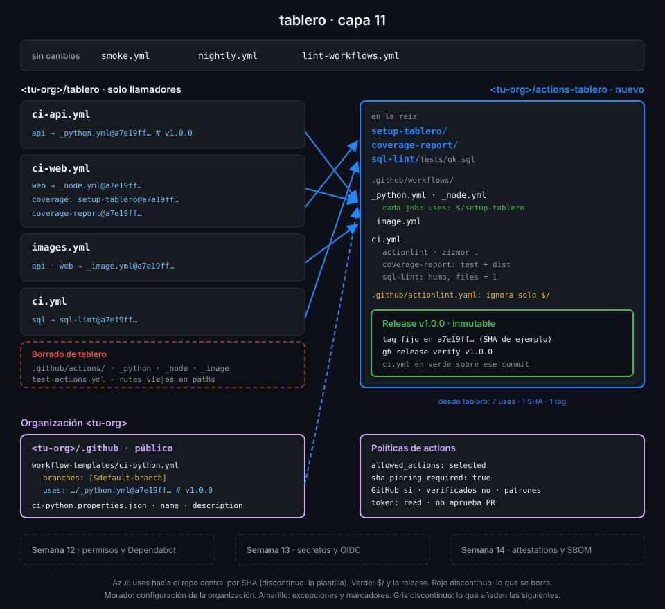

# Semana 11 — Actions a escala de organización

> Tus actions y tus reutilizables viven dentro de `tablero`: el próximo repo de la organización
> tendría que copiarlos. Esta semana los sacas a un repo central versionado y gobiernas desde la org qué se puede ejecutar.

## 🎯 Objetivos de la Semana

Al terminar la semana eres capaz de:

- Montar un repo central de CI (`<tu-org>/actions-tablero`) con actions y reutilizables, y
  consumirlo desde otro repo fijado por SHA
- Explicar por qué `./` deja de funcionar dentro de un reutilizable llamado desde otro repo y
  resolverlo con la referencia `$/`
- Versionar actions con SemVer, publicar releases inmutables y comprobar que el SHA que fijas es
  el del tag que dices
- Ofrecer workflow templates de organización desde el repo `<tu-org>/.github`
- Configurar y leer las políticas de actions de la organización: actions permitidas, pinning
  obligatorio por SHA y permisos por defecto del `GITHUB_TOKEN`
- Explicar qué añaden los rulesets de organización que exigen workflows y por qué no se pueden
  practicar con el plan gratuito

## 📋 Prerrequisitos

| Necesitas | Dónde se aprende |
|---|---|
| `check-week.sh 10` en 17/17 | [Semana 10](../week-10-actions_propias/README.md) |
| Pinning por SHA, `scripts/resolve-sha.sh` y ajustes de Actions del repo | [Semana 01](../week-01-primer_workflow_y_modelo_de_ejecucion/README.md) |
| Referencias `./`, `$/` y `owner/repo/...@sha` a un reutilizable | [Semana 09](../week-09-workflows_reutilizables/README.md) |
| `setup-tablero`, `coverage-report` y `sql-lint` | [Semana 10](../week-10-actions_propias/README.md) |
| Scope `admin:org` en `gh` (`gh auth refresh -s admin:org`) | [Autograding](../../docs/autograding.md) |

## 🗂️ Estructura de la Semana

```
week-11-actions_a_escala_de_organizacion/
├── README.md
├── rubrica-evaluacion.md          incluye el minisimulacro de cierre de la Fase 3
├── checks.json                    17 comprobaciones
├── 0-assets/                      diagramas SVG
├── 1-teoria/                      7 archivos, uno por concepto
├── 2-practicas/                   4 prácticas guiadas
├── 3-proyecto/
│   ├── README.md
│   └── starter/
│       ├── actions-tablero/       .github/actionlint.yaml, .github/workflows/ci.yml, README.md
│       └── org-dot-github/        workflow-templates/ci-python.yml y su .properties.json
├── 4-recursos/{ebooks-free,videografia,webgrafia}/README.md
└── 5-glosario/README.md
```

## 📝 Contenidos

### Teoría

| # | Archivo | Qué aprendes | Tiempo |
|:--:|---|---|:--:|
| 01 | [Un repo central de CI](1-teoria/01-un-repo-central-de-ci.md) | Qué problema resuelve, qué va dentro, cómo se organiza y quién puede usarlo | 25 min |
| 02 | [Referencias dentro del repo central](1-teoria/02-referencias-dentro-del-repo-central.md) | Por qué `./` apunta al llamador, `$/` y el contexto `job.workflow_*` | 30 min |
| 03 | [Versionar actions](1-teoria/03-versionar-actions.md) | SemVer para actions, tag mayor flotante, SHA del consumidor y cambios incompatibles | 25 min |
| 04 | [Releases inmutables](1-teoria/04-releases-inmutables.md) | Qué bloquean, borradores, attestation de la release y `gh release verify` | 25 min |
| 05 | [Workflow templates](1-teoria/05-workflow-templates.md) | El repo `.github`, `workflow-templates/`, `.properties.json` y `$default-branch` | 25 min |
| 06 | [Políticas de actions de la organización](1-teoria/06-politicas-de-actions-de-la-organizacion.md) | Actions permitidas, patrones, pinning obligatorio y permisos por defecto del token | 30 min |
| 07 | [Rulesets que exigen workflows](1-teoria/07-rulesets-que-exigen-workflows.md) | Qué hacen, con qué eventos, sus límites y por qué piden el plan Team | 20 min |

### Prácticas

| # | Archivo | Qué haces | Tiempo |
|:--:|---|---|:--:|
| 01 | [Repo central y primera release](2-practicas/01-repo-central-y-primera-release.md) | `actions-tablero` con las tres actions y los tres reutilizables, su CI y la release inmutable `v1.0.0` | 1 h |
| 02 | [Consumir el repo central](2-practicas/02-consumir-el-repo-central.md) | `tablero` llama a `actions-tablero` por SHA y borra sus copias locales | 1 h |
| 03 | [Políticas de la organización](2-practicas/03-politicas-de-la-organizacion.md) | Actions seleccionadas, pinning obligatorio y token de solo lectura en toda la org | 1 h |
| 04 | [Workflow templates](2-practicas/04-workflow-templates.md) | El repo `<tu-org>/.github` con la plantilla `ci-python` | 1 h |

### Proyecto

[Capa 11 de `tablero`](3-proyecto/README.md): el CI de `tablero` pasa a depender de
`<tu-org>/actions-tablero@v1.0.0`, la organización ofrece una plantilla que reutiliza lo mismo y
sus políticas solo dejan ejecutar lo que has decidido.



## ⏱️ Distribución del Tiempo (10 horas)

| Actividad | Horas |
|---|:--:|
| Teoría (7 archivos) | 3 |
| Práctica 01 — Repo central y primera release | 1 |
| Práctica 02 — Consumir el repo central | 1 |
| Práctica 03 — Políticas de la organización | 1 |
| Práctica 04 — Workflow templates | 1 |
| Proyecto — capa 11 | 1 |
| Minisimulacro de cierre de la Fase 3 | 1 |
| Autoevaluación con la rúbrica | 1 |
| **Total** | **10** |

## 🎓 Cierre de la Fase 3

Con esta semana termina la Fase 3 (Reutilización). La [rúbrica](rubrica-evaluacion.md) incluye un
minisimulacro cronometrado de 60 minutos sobre las semanas 09-11: preguntas tipo GH-200 de los
dominios que cubre la fase (D1, D3 y D4) y una tarea práctica sobre tu repo central.

## 🎩 Trucos y atajos

- **Comprueba que un SHA fijado es el del tag que dice el comentario**:
  `gh api repos/<tu-org>/actions-tablero/commits/v1.0.0 --jq .sha`. `commits/<tag>` resuelve tags
  ligeros y anotados al commit, sin que tengas que distinguirlos.
- **Lee un archivo de otro repo sin clonarlo ni pasar por base64**:
  `gh api 'repos/<tu-org>/.github/contents/workflow-templates/ci-python.yml' -H 'Accept: application/vnd.github.raw'`.
  Añade `?ref=v1.0.0` a la ruta para leerlo en un tag.
- **`gh release verify v1.0.0 -R <tu-org>/actions-tablero`** comprueba la attestation que GitHub
  firma al publicar una release inmutable: te dice a qué commit resolvió el tag y el digest de cada
  asset.
- **`{owner}` funciona también en rutas de organización**: con `GH_REPO` exportado,
  `gh api orgs/{owner}/actions/permissions` lee la política de tu org sin escribir su nombre.
- **Un reutilizable puede decir qué versión de sí mismo está corriendo**: `job.workflow_sha` y
  `job.workflow_repository` apuntan al archivo del reutilizable, mientras que `github.sha` y
  `github.workflow_sha` siguen siendo los del llamador.

## 📌 Entregables

- `<tu-org>/actions-tablero` con su CI en verde y la release inmutable `v1.x.y`; `tablero` sin
  copias locales, consumiéndolo por SHA, con `ci`, `ci-api` y `ci-web` en verde sobre el último
  commit de `main`
- `<tu-org>/.github` con la plantilla `ci-python` y las políticas de actions de la org configuradas
  (ver [proyecto](3-proyecto/README.md))
- La rúbrica respondida, con el minisimulacro de cierre de la Fase 3

## ✅ Verificación

```bash
cd ~/code/bc-github-actions
gh auth refresh -s admin:org   # una vez: leer las políticas de la org pide este scope
./scripts/check-week.sh 11
# Semana 11 — Actions a escala de organización  [repo: <tu-org>/tablero]
#
#   ✅ ci-api.yml, ci-web.yml e images.yml llaman a los reutilizables de actions-tablero fijados por SHA con el tag en comentario
#   ...
# 17/17 comprobaciones superadas.
```

Si algo sale en rojo, la pista te dice qué práctica y qué paso lo arreglan.

## 🔗 Navegación

---

| ← Anterior | Siguiente → |
|:---|---:|
| [Semana 10 — Actions propias: composite, JavaScript y Docker](../week-10-actions_propias/README.md) | [Un repo central de CI](1-teoria/01-un-repo-central-de-ci.md) |
