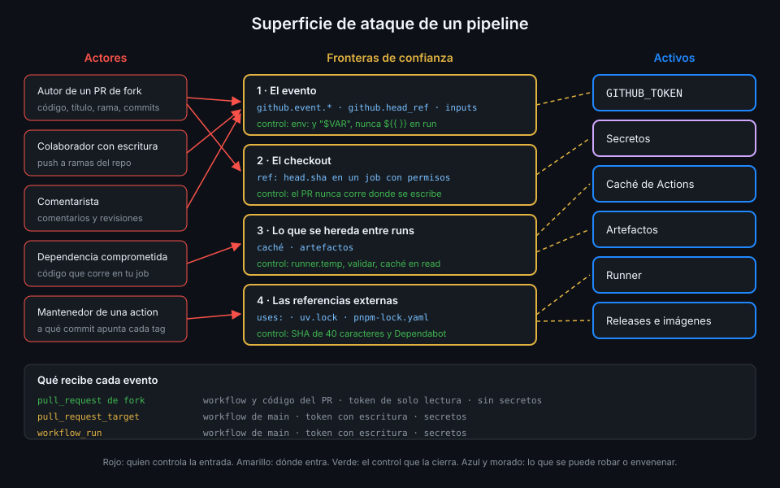

# Modelo de amenazas de un pipeline

> Un workflow es código que se ejecuta con credenciales cuando alguien dispara un evento. Antes
> de endurecer nada, necesitas saber quién puede disparar qué, con qué permisos y qué hay a su
> alcance.



## 🎯 Objetivos

Al terminar este archivo eres capaz de:

- Nombrar los actores que pueden influir en un run de `tablero` y qué controla cada uno
- Enumerar los activos que un atacante busca en un pipeline: token, secretos, caché,
  artefactos, runner y releases
- Situar las fronteras de confianza: dónde entra código o texto que no escribiste tú
- Leer un evento y decir qué código corre, con qué token y con qué secretos
- Explicar con dos incidentes reales por qué fijar por SHA no es paranoia
- Usar el modelo como guion para las otras seis teorías de la semana

## 1. Qué problema resuelve

Desde la Semana 01 aplicas las reglas de seguridad del bootcamp: SHA de 40 caracteres,
`permissions:` en la raíz, `persist-credentials: false`, datos por `env:`. Las has seguido como
receta. Esta semana cambias de lado: te preguntas **qué haría alguien que quiere aprovecharse de
tu CI** y compruebas que cada regla cierra una puerta concreta.

Un pipeline es un objetivo atractivo por tres motivos:

- **Corre con credenciales.** Cada job recibe un `GITHUB_TOKEN`, y algunos, secretos. Un token
  con `contents: write` puede reescribir `main`; uno con `packages: write`, publicar una imagen
  con tu nombre.
- **Ejecuta código ajeno.** El código de un PR, las actions de terceros, las dependencias de
  `uv` y `pnpm`, la imagen base del Dockerfile. Ninguno lo has escrito tú.
- **Produce lo que otros consumen.** Una imagen de GHCR o una release de `tablero` se despliegan
  en otro sitio. Si el atacante envenena el pipeline, envenena todo lo que sale de él.

Sin un modelo, endurecer es ir parcheando hallazgos de zizmor uno a uno sin saber cuál importa.
Con él, cada hallazgo cae en una casilla: qué actor, qué frontera, qué activo.

## 2. Cómo funciona

### Los actores

| Actor | Qué controla | Ejemplo en `tablero` |
|---|---|---|
| **Autor de un PR desde un fork** | El código del PR, su título, su cuerpo, el nombre de su rama, los mensajes de commit | Cualquier cuenta de GitHub: el repo es público |
| **Colaborador con escritura** | Lo mismo, pero en ramas del propio repo; puede hacer `push` | Tú, y quien añadas a la org |
| **Comentarista** | El texto de un comentario o de una revisión | Cualquier cuenta que pueda comentar en el repo |
| **Dependencia o action comprometida** | El código que corre dentro de tu job cuando la descargas | Una versión maliciosa de un paquete o de una action |
| **Mantenedor de una action** | A qué commit apunta cada tag de su repo | El dueño de `astral-sh/setup-uv` o de `pnpm/action-setup` |

Fíjate en la última fila. El mantenedor no tiene por qué ser malicioso: basta con que roben su
cuenta. Mientras tú escribas `@v4`, el commit que ejecutas lo decide él.

### Los activos

| Activo | Qué consigue un atacante con él |
|---|---|
| `GITHUB_TOKEN` | Lo que sus permisos dejen: escribir en el repo, comentar, publicar paquetes, relanzar workflows |
| Secretos | Lo que abran fuera de GitHub: un registro, una nube, una API (Semana 13) |
| Caché de Actions | Que un run de confianza restaure un archivo que él preparó (archivo 05) |
| Artefactos | Que un workflow con permisos lea datos que él escribió (archivos 04 y 05) |
| Runner | Ejecutar código en la máquina; en un runner propio, persistir entre jobs (Semana 15) |
| Releases e imágenes | Que tus usuarios descarguen algo que él modificó (Semana 14) |

### Las fronteras de confianza

Una frontera de confianza es el punto donde algo que no controlas entra en un contexto que sí
tiene poder. En un workflow hay cuatro:

1. **El evento.** Título, cuerpo, rama, comentario: texto escrito por el actor. Si llega al
   shell sin protección, es código (archivo 03).
2. **El checkout.** El código del PR. Si lo ejecutas en un job con permisos o secretos, el PR
   decide qué hace ese token (archivo 04).
3. **Lo que se hereda entre runs.** Caché y artefactos que escribió un run de menos confianza
   y lee uno de más (archivo 05).
4. **Las referencias externas.** Cada `uses:` y cada dependencia del lockfile (archivo 06).

El diagrama de arriba pone los cuatro actores a la izquierda, los activos a la derecha y las
fronteras en medio. Todo control que veas esta semana vive en una de esas fronteras.

### Qué recibe cada evento

La pregunta clave de cada workflow: **¿qué código corre y con qué credenciales?**

| Evento | Workflow que corre | Código que hace checkout por defecto | Token | Secretos |
|---|---|---|---|---|
| `push` a `main` | El de `main` | `main` | Lo que declares | Sí |
| `pull_request` desde una rama del repo | El del PR | El merge del PR | Lo que declares | Sí |
| `pull_request` desde un fork | El del PR | El merge del PR | Solo lectura | No (salvo el `GITHUB_TOKEN`) |
| `pull_request_target` | El de la rama por defecto | La rama por defecto | Lo que declares, con escritura | Sí |
| `workflow_run` | El de la rama por defecto | La rama por defecto | Lo que declares, con escritura | Sí |

_Verificado con la documentación de eventos y ubuntu-24.04, noviembre de 2026._

La tercera fila es la defensa que GitHub te da gratis: el código de un desconocido corre, pero
sin escritura y sin secretos. Las dos últimas existen precisamente para cuando necesitas
escritura en un PR de fork, y por eso son las más delicadas.

Hay una defensa más antes de que corra nada: la **aprobación de workflows de forks**. Por
defecto, GitHub pide aprobación a un mantenedor solo para la primera contribución de alguien.
Tras un PR aceptado, los siguientes de esa persona corren sin preguntar. En la práctica 01 lo
subes a `all_external_contributors`: todo PR de fuera espera a que un mantenedor lo mire.

## 3. Cómo se usa

### Los incidentes que lo justifican

**tj-actions/changed-files (marzo de 2025, CVE-2025-30066).** Alguien movió los tags de la
action a un commit que volcaba los secretos del runner en el log. Todo workflow que la usaba
por tag ejecutó ese commit en su siguiente run; en repos públicos, el log lo podía leer
cualquiera. Quien la tenía fijada por SHA siguió ejecutando el commit de siempre y no se vio
afectado.

Actor: el mantenedor (su cuenta). Frontera: la referencia externa. Activo: los secretos.
Control: el SHA, que es la regla 1 del bootcamp.

**Trivy 0.69.4 (2026-03-19, GHSA-69fq-xp46-6x23).** Una release de la herramienta salió
comprometida. Por eso la regla 9 prohíbe esa versión y prohíbe `trivy-action` por tag: una
herramienta de seguridad también es una dependencia, y corre dentro de tu job con tu token.

Actor: dependencia comprometida. Frontera: la herramienta descargada en el job. Activo: lo
que el job tenga a mano. Control: versión fijada con checksum y no la versión comprometida.

### Un job leído con el modelo

Este job de un repo cualquiera mezcla las cuatro fronteras:

```yaml
name: preview
on:
  pull_request_target:
permissions: write-all  # antipatron
jobs:
  preview:
    runs-on: ubuntu-24.04
    steps:
      - uses: actions/checkout@3d3c42e5aac5ba805825da76410c181273ba90b1 # v7.0.1
        with:
          ref: ${{ github.event.pull_request.head.sha }}  # antipatron
      - run: echo "Preview de ${{ github.event.pull_request.title }}"  # antipatron
      - run: make preview
```

Recorrido con el modelo:

- **Evento**: `pull_request_target` da escritura y secretos a un PR de cualquiera.
- **Token**: `write-all`. Todo lo que el token puede hacer, lo puede hacer el PR.
- **Checkout**: el head del PR. `make preview` ejecuta el `Makefile` que escribió el atacante.
- **Evento otra vez**: el título del PR entra en el shell sin `env:`.
- **Checkout otra vez**: sin `persist-credentials: false`, el token queda en `.git/config`
  para cualquier proceso posterior.

Tres caminos distintos al mismo activo. Corregirlo no es un parche: es separar lo que necesita
escritura (comentar el enlace) de lo que ejecuta código del PR (construir). Lo ves en el
archivo 04.

### El modelo de `tablero`, workflow a workflow

| Workflow | Disparado por | Ejecuta código de | Escribe en |
|---|---|---|---|
| `ci`, `ci-api`, `ci-web` | `push`, `pull_request`, `workflow_dispatch` | El PR o `main` | Nada |
| `images` | `push` a `main`, `workflow_dispatch` | `main` | GHCR (`packages`) |
| `nightly` | `schedule`, `workflow_dispatch` | Nada: solo relanza | Runs (`actions`) |
| `lint-workflows`, `codeql` | `push`, `pull_request` | Herramientas fijadas | Code scanning (`codeql`) |
| `labeler` (nuevo) | `pull_request_target` | Nada del PR | Etiquetas del PR |
| `pr-report` (nuevo) | `workflow_run` | Nada del PR | Comentarios del PR |

La regla que sale de la tabla: **ningún job que ejecuta código del PR puede escribir, y ningún
job que escribe ejecuta código del PR.** Las prácticas de la semana dejan `tablero` así.

### Las preguntas, en orden

Para cada workflow nuevo:

1. ¿Qué eventos lo disparan y quién puede provocarlos?
2. ¿Qué texto del evento usa y dónde acaba?
3. ¿De qué commit hace checkout y ejecuta algo de él?
4. ¿Qué permisos tiene cada job y cuáles usa de verdad?
5. ¿Qué lee de caché o de artefactos y quién los escribió?
6. ¿Cada `uses:` y cada herramienta está fijada?

## 4. Antipatrones

| Antipatrón | Por qué duele | Qué hacer en su lugar |
|---|---|---|
| "Mi repo es pequeño, nadie lo va a atacar" | Los ataques a actions son masivos: el atacante no elige tu repo, elige la action que usas | Aplicar las reglas a todo repo público |
| Pensar solo en el código del PR | El título, la rama y los comentarios también son entrada del atacante | Tratar todo `github.event.*` como no confiable |
| Confiar en una action por su número de estrellas | Popularidad no es integridad; el incidente de 2025 fue una action muy usada | SHA fijado y revisión de cada actualización |
| Un mismo job que construye el PR y comenta en él | El código del PR hereda el permiso de comentar | Dos workflows separados (archivo 04) |
| Dejar la aprobación de forks en su valor por defecto | Tras un PR aceptado, los siguientes corren sin mirar | `all_external_contributors` |
| Tratar las herramientas de seguridad como de confianza | Trivy 0.69.4 fue una release comprometida | Versión fijada y checksum, como cualquier otra |

## 5. Trucos

- **Lista los eventos de todos tus workflows de una vez** para empezar el modelo:
  `yq '.on | keys' .github/workflows/*.yml` te da cada trigger. Los `pull_request_target` y
  `workflow_run` son los primeros que revisas.
- **Busca qué workflows hacen checkout de algo que no es su propio ref**:
  `grep -n "ref:" .github/workflows/*.yml`. Cada resultado necesita una justificación.
- **Antes de añadir una action nueva, mira quién mantiene el repo y cuántas personas tienen
  escritura en él.** Esa es la gente que decide qué ejecutas si usas tags.

## 📚 Recursos Adicionales

- [GitHub Docs: Secure use reference](https://docs.github.com/en/actions/reference/security/secure-use)
- [GitHub Docs: Events that trigger workflows](https://docs.github.com/en/actions/reference/workflows-and-actions/events-that-trigger-workflows)
- [NVD: CVE-2025-30066](https://nvd.nist.gov/vuln/detail/CVE-2025-30066), el compromiso de
  `tj-actions/changed-files`
- [zizmor: Audit rules](https://docs.zizmor.sh/audits/)

## ✅ Checklist de Verificación

- [ ] Sé nombrar los cinco actores y qué controla cada uno
- [ ] Sé enumerar los seis activos y qué consigue un atacante con cada uno
- [ ] Sé situar las cuatro fronteras de confianza de un workflow
- [ ] Sé decir qué código corre y con qué credenciales en `pull_request` desde un fork,
      `pull_request_target` y `workflow_run`
- [ ] Sé explicar qué cerró el SHA en el incidente de `tj-actions/changed-files`
- [ ] Sé recorrer un workflow con las seis preguntas

---

| ← Anterior | Siguiente → |
|:---|---:|
| [Semana 12 — Modelo de amenazas y endurecimiento](../README.md) | [Permisos del GITHUB_TOKEN](02-permisos-del-github-token.md) |
