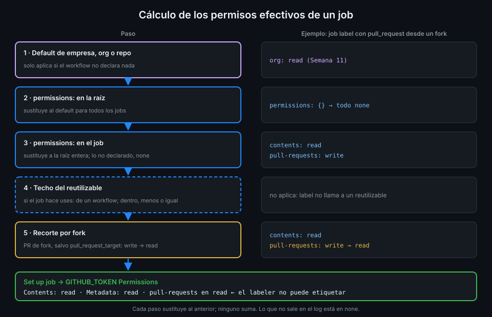

# Permisos del GITHUB_TOKEN

> Cada job recibe un token que puede actuar sobre tu repo. Lo que no pueda hacer ese token no
> lo puede hacer nadie que consiga ejecutar código en el job: ni una dependencia comprometida
> ni una inyección.



## 🎯 Objetivos

Al terminar este archivo eres capaz de:

- Enumerar los scopes del `GITHUB_TOKEN` y qué nivel admite cada uno
- Calcular los permisos efectivos de un job a partir del default de la org, la raíz y el job
- Explicar por qué un job que llama a un reutilizable fija el techo de ese reutilizable
- Explicar el recorte automático que sufren los PR desde forks
- Escribir `permissions: {}` en la raíz y los permisos justos en cada job
- Leer en el log qué permisos recibió de verdad un job

## 1. Qué problema resuelve

Imagina un paso de `ci-api` que ejecuta `uv sync --locked`. Una de las dependencias publica una
versión comprometida y su código de instalación lee `GITHUB_TOKEN` del entorno del proceso o de
`.git/config`. Lo que haga después depende de una sola cosa: **qué permisos tiene ese token**.

- Con `contents: write`, puede hacer `push` a `main` o mover un tag.
- Con `packages: write`, puede publicar una imagen en tu GHCR.
- Con `actions: write`, puede relanzar o cancelar workflows.
- Con `contents: read` en un repo público, no consigue nada que no tuviera ya.

Ningún control de esta semana es perfecto: una inyección se cuela, una action se compromete.
Los permisos mínimos son el control que **limita el daño** cuando falla otro.

## 2. Cómo funciona

### Los scopes

| Scope | Niveles | Para qué lo pide `tablero` |
|---|---|---|
| `actions` | read, write, none | `nightly` relanza workflows; `pr-report` descarga artefactos de otro run |
| `artifact-metadata`, `attestations` | read, write, none | Semana 14 |
| `checks`, `statuses` | read, write, none | — |
| `code-quality` | read, write, none | — |
| `contents` | read, write, none | Checkout; casi todos los jobs |
| `copilot-requests` | write, none | — |
| `deployments` | read, write, none | — (el deployment lo crea el job con `environment:`, sin este permiso) |
| `discussions`, `issues` | read, write, none | — |
| `id-token` | write, none | OIDC, Semana 13 |
| `packages` | read, write, none | `images` publica en GHCR |
| `pages` | read, write, none | — |
| `pull-requests` | read, write, none | `labeler` etiqueta, `pr-report` comenta |
| `security-events` | read, write, none | `codeql` sube el SARIF |
| `vulnerability-alerts` | read, none | — |

_Verificado con la referencia de sintaxis de workflows y ubuntu-24.04, noviembre de 2026._

Tres atajos además de la lista: `read-all`, `write-all` y `{}`. El último deja **todos** los
scopes en `none`.

### La regla que más se olvida

**En cuanto declaras un scope, todos los que no declaras pasan a `none`.** No hay herencia
parcial:

```yaml
permissions:
  pull-requests: write
# contents queda en none: el actions/checkout de este job falla
```

Por eso casi todo job lleva `contents: read` aunque su razón de ser sea otro scope.

### El cálculo, paso a paso

El runner calcula los permisos de cada job así (el diagrama los apila de arriba abajo):

1. **Default de la empresa, la org o el repo.** En tu org lo dejaste en `read` en la Semana 11:
   un workflow sin `permissions:` recibe solo lectura de `contents` y `packages`.
2. **`permissions:` en la raíz del workflow.** Sustituye al default para todos los jobs.
3. **`permissions:` en el job.** Sustituye a la raíz para ese job. No se suman: el job
   reemplaza lo de la raíz entero.
4. **Techo del reutilizable.** Si el job llama a un reutilizable con `uses:`, sus permisos son
   el máximo que reciben los jobs de dentro. El reutilizable puede pedir menos, nunca más
   (Semana 09).
5. **Recorte por fork.** Si el evento viene de un PR desde un fork (salvo
   `pull_request_target`) y el repo no tiene activado "Send write tokens to workflows from pull
   requests", todo `write` pasa a `read`.

El paso 5 explica por qué un `labeler` con `pull_request` funciona con tus ramas y falla en
silencio con un PR de fork: pide `pull-requests: write` y recibe `read`. Lo resuelves en el
archivo 04.

### Dónde se ve el resultado

En el log de cada job, el paso **Set up job** tiene un grupo **GITHUB_TOKEN Permissions** con
los permisos efectivos:

```text
GITHUB_TOKEN Permissions
  Contents: read
  Metadata: read
Secret source: Actions
Cache mode: write
```

`Metadata: read` aparece siempre: es el mínimo que GitHub da a cualquier token. Lo que no sale
en la lista está en `none`. Esto es lo que el job **recibió**, después de los cinco pasos; el
YAML solo dice lo que pidió.

## 3. Cómo se usa

### El patrón de `tablero`

`permissions: {}` en la raíz y cada job declara lo suyo:

```yaml
name: images
on:
  push:
    branches: [main]
  workflow_dispatch:
# Raíz vacía: un job nuevo sin permissions no recibe nada y falla en el checkout,
# en lugar de heredar en silencio lo que pidió otro job.
permissions: {}
jobs:
  build:
    runs-on: ubuntu-24.04
    timeout-minutes: 15
    permissions:
      contents: read
      packages: write
    steps:
      - uses: actions/checkout@3d3c42e5aac5ba805825da76410c181273ba90b1 # v7.0.1
        with:
          persist-credentials: false
      - run: docker build -t tablero-api:ci api
  smoke:
    needs: build
    runs-on: ubuntu-24.04
    timeout-minutes: 5
    permissions:
      contents: read
    steps:
      - uses: actions/checkout@3d3c42e5aac5ba805825da76410c181273ba90b1 # v7.0.1
        with:
          persist-credentials: false
      - run: test -f api/Dockerfile
```

¿Por qué `{}` en la raíz y no `contents: read`, como hasta ahora? Con `contents: read` en la
raíz, un job que olvida su bloque hereda lectura y funciona: el olvido no se nota. Con `{}`,
ese job falla en el primer checkout. **El fallo te obliga a pensar qué necesita.**

### El mismo workflow, mal

```yaml
name: images
on:
  push:
    branches: [main]
permissions: write-all  # antipatron
jobs:
  build:
    runs-on: ubuntu-24.04
    timeout-minutes: 15
    steps:
      - uses: actions/checkout@3d3c42e5aac5ba805825da76410c181273ba90b1 # v7.0.1
      - run: docker build -t tablero-api:ci api
```

`write-all` da a `build` escritura sobre `contents`, `actions`, `pull-requests` y el resto de
la tabla. Cualquier paso, cualquier dependencia del `docker build`, recibe todo eso. Y el
checkout sin `persist-credentials: false` deja ese token en `.git/config`, al alcance de todo
proceso posterior del job. zizmor lo marca como `excessive-permissions` y `artipacked`; CodeQL,
el workflow sin `permissions:` como `actions/missing-workflow-permissions`.

### Jobs que llaman a un reutilizable

Desde la Semana 11 el job `web` de `ci-web` es una sola línea `uses:` hacia
`<tu-org>/actions-tablero`. También declara permisos, y son el techo de todo lo que corre
dentro:

```yaml
  web:
    uses: <tu-org>/actions-tablero/.github/workflows/_node.yml@<sha-de-v1.0.0> # v1.0.0
    with:
      working-directory: web
    permissions:
      contents: read
```

Si `_node.yml` pidiera `packages: write` en uno de sus jobs, el run fallaría en la validación:
pide más que el techo. Esto es lo que quieres. Que el repo central crezca no da más poder a
`tablero` sin que lo cambies tú.

### Qué escribe `tablero` al terminar la semana

| Workflow | Job | Escritura | Por qué |
|---|---|---|---|
| `images` | `api`, `web` | `packages: write` | Publica en GHCR |
| `nightly` | `dispatch` | `actions: write` | Relanza los workflows de CI |
| `codeql` | `analyze` | `security-events: write` | Sube el SARIF a code scanning |
| `labeler` | `label` | `pull-requests: write` | Pone etiquetas en el PR |
| `pr-report` | `comment` | `pull-requests: write` | Comenta el informe de `dist` |

Todo lo demás, `contents: read` como mucho. El check `writes-only-where-needed` lo comprueba.

`id-token: write` no aparece: es el permiso de OIDC y lo ves a fondo en la Semana 13.

## 4. Antipatrones

| Antipatrón | Por qué duele | Qué hacer en su lugar |
|---|---|---|
| `permissions: write-all` | Cualquier código del job puede hacer cualquier cosa | `{}` en la raíz y scopes por job |
| `permissions: read-all` "por si acaso" | Abre lectura de alertas, issues y más a todo el job | Solo los scopes que el job usa |
| Sin `permissions:` en el workflow | Hereda el default, que puede cambiar en la org sin que lo veas | Declararlo siempre |
| `contents: read` en la raíz y escrituras en un job | Los jobs nuevos heredan sin que lo pienses | `{}` en la raíz |
| Declarar solo `pull-requests: write` | `contents` queda en `none` y el checkout falla | Añadir `contents: read` si hace checkout |
| Activar "Send write tokens to workflows from pull requests" | Da escritura al código de cualquier fork | Dejarlo apagado; usar el patrón del archivo 04 |
| Mirar el YAML para saber qué recibe un job | El default de la org y el recorte de forks no salen en el YAML | Leer "GITHUB_TOKEN Permissions" en el log |

## 5. Trucos

- **Permisos efectivos sin abrir la UI**:
  `gh run view <run-id> --log | grep -A6 "GITHUB_TOKEN Permissions"`. Si el run tiene varios
  jobs, sale un bloque por job.
- **Qué jobs no declaran permisos**, con `yq`:
  `yq '.jobs | to_entries | .[] | select(.value.permissions == null) | .key' .github/workflows/*.yml`.
  Debe salir vacío.
- **Prueba de humo del `{}`**: borra el bloque `permissions:` de un job en una rama. Si el job
  sigue en verde, ese job no hacía checkout ni llamaba a la API: quizá no necesitaba nada, y
  `permissions: {}` también vale a nivel de job.

## 📚 Recursos Adicionales

- [GitHub Docs: Workflow syntax, permissions](https://docs.github.com/en/actions/reference/workflows-and-actions/workflow-syntax#permissions)
- [GitHub Docs: GITHUB_TOKEN](https://docs.github.com/en/actions/concepts/security/github_token)
- [zizmor: excessive-permissions](https://docs.zizmor.sh/audits/#excessive-permissions)

## ✅ Checklist de Verificación

- [ ] Sé qué scopes existen y cuáles solo admiten `write` o `read` además de `none`
- [ ] Sé que declarar un scope deja los demás en `none`
- [ ] Sé aplicar los cinco pasos del cálculo a un job concreto
- [ ] Sé por qué un job que llama a un reutilizable fija su techo
- [ ] Sé qué hace GitHub con los `write` en un PR desde un fork
- [ ] Sé por qué `{}` en la raíz es mejor que `contents: read`
- [ ] Sé leer los permisos efectivos de un job en su log

---

| ← Anterior | Siguiente → |
|:---|---:|
| [Modelo de amenazas de un pipeline](01-modelo-de-amenazas-de-un-pipeline.md) | [Inyección de scripts](03-inyeccion-de-scripts.md) |
