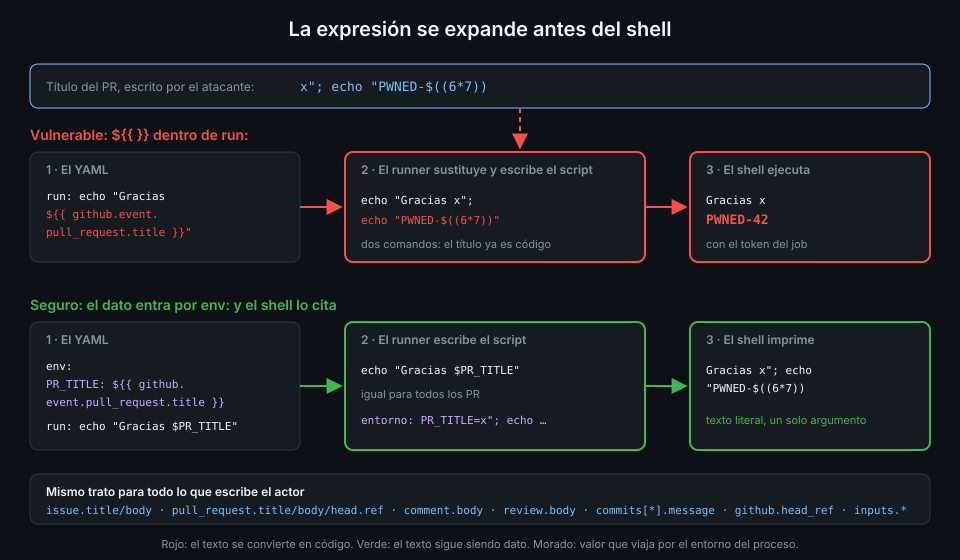

# Inyección de scripts

> El título de un PR lo escribe quien abre el PR. Si ese texto acaba dentro de un `run:` con
> `${{ }}`, deja de ser texto: es código que se ejecuta en tu runner con tu token.



## 🎯 Objetivos

Al terminar este archivo eres capaz de:

- Explicar en qué momento se expande `${{ }}` y por qué eso convierte un dato en código
- Enumerar los contextos que controla un atacante
- Explotar una inyección con un título de PR inofensivo y leer el resultado en el log
- Corregirla pasando el dato por `env:` y citando la variable en el shell
- Reconocer las variantes menos obvias: `github-script`, `GITHUB_ENV`, `GITHUB_OUTPUT` y
  `GITHUB_PATH`
- Saber qué auditoría de zizmor y qué consulta de CodeQL la detectan

## 1. Qué problema resuelve

En el archivo 01 viste la primera frontera de confianza: **el evento**. Título, cuerpo, rama,
comentario. Todo eso lo escribe el actor, y desde la Semana 01 la regla 4 te pide que llegue al
shell por `env:`. Aquí ves por qué con el ataque delante.

Un `run:` no es un script que GitHub ejecute tal cual. Antes de arrancar el shell, el runner
**sustituye cada `${{ }}` por su valor y escribe el resultado en un archivo temporal**. El shell
recibe ese archivo ya montado. No sabe qué partes venían de tu YAML y qué partes del título de
un PR: para él todo es código.

Si un atacante consigue que su texto cierre una comilla, todo lo que escriba después se
ejecuta. Con el token del job, con los secretos que el job tenga a mano y en el runner donde
corre el job.

## 2. Cómo funciona

### La expansión ocurre antes del shell

Un step vulnerable:

```yaml
      - run: echo "Título: ${{ github.event.pull_request.title }}"
```

Con un PR titulado `Arreglo del login`, el runner escribe en el script:

```bash
echo "Título: Arreglo del login"
```

Con un PR titulado `x"; echo "PWNED-$((6*7))`, escribe:

```bash
echo "Título: x"; echo "PWNED-$((6*7))"
```

Dos comandos. El segundo imprime `PWNED-42`: la aritmética `$((6*7))` solo la evalúa un shell,
así que ver `42` en el log demuestra que el título se ejecutó. Es la prueba que haces en la
práctica 02. Un atacante real no imprimiría nada: leería `.git/config`, llamaría a la API con el
token o descargaría un script.

Las comillas no protegen. Las pone tu YAML y el atacante las cierra. Cambiarlas por comillas
simples solo cambia qué carácter tiene que escribir él.

### La versión segura

```yaml
      - name: Mostrar el título
        env:
          PR_TITLE: ${{ github.event.pull_request.title }}
        run: echo "Título: $PR_TITLE"
```

El script que recibe el shell es ahora `echo "Título: $PR_TITLE"`, **igual para todos los PR**.
El título viaja en una variable de entorno del proceso, y el shell expande `"$PR_TITLE"` como
un único argumento sin volver a interpretarlo. `x"; echo "PWNED-$((6*7))` se imprime tal cual.

Dos condiciones, las dos necesarias:

1. El valor entra por `env:`, no por `${{ }}` dentro del `run:`.
2. La variable va **entre comillas dobles** en el shell. `echo $PR_TITLE` sin comillas no
   ejecuta comandos, pero parte el valor en palabras y expande comodines como `*`.

### Qué contextos controla un atacante

| Contexto | Quién lo escribe |
|---|---|
| `github.event.issue.title`, `github.event.issue.body` | Quien abre la issue |
| `github.event.pull_request.title`, `.body` | Quien abre el PR |
| `github.event.pull_request.head.ref`, `.head.label` | Quien abre el PR: nombre de su rama |
| `github.head_ref` | Lo mismo que `head.ref` |
| `github.event.comment.body`, `github.event.review.body` | Cualquiera que pueda comentar |
| `github.event.commits[*].message`, `github.event.head_commit.message` | Quien hace el commit |
| `github.event.head_commit.author.*` | Quien hace el commit: lo configura en su `git config` |
| `inputs.*` de `workflow_dispatch` | Quien lanza el workflow |

Un nombre de rama puede contener `$(...)` o comillas: Git lo admite. Un mensaje de commit llega
a `main` desde un PR aceptado sin que nadie lo lea como código. Un input de `workflow_dispatch`
parece de confianza porque solo lo lanza quien tiene escritura, pero sigue siendo texto libre:
ese colaborador, o quien robe su sesión, decide qué llega al shell.

¿Y `github.event.pull_request.number` o `github.sha`? Son números y hashes que genera GitHub,
no el actor. Aun así, en `tablero` **ninguna expresión entra en un `run:`**: la regla es más
fácil de comprobar con un `grep` que con una lista blanca, y es lo que hace el check
`no-expressions-in-run`.

## 3. Cómo se usa

### El ataque completo

Este es el workflow de la rama de laboratorio de la práctica 02. **Nunca llega a `main`.**

```yaml
name: injection-lab
on:
  pull_request:
permissions: {}
jobs:
  greet:
    runs-on: ubuntu-24.04
    timeout-minutes: 5
    steps:
      - run: echo "Gracias por el PR ${{ github.event.pull_request.title }}"
```

Fíjate en lo que limita el daño aunque la inyección funcione: `pull_request` desde un fork da
un token de solo lectura y ningún secreto (archivo 01), y `permissions: {}` deja el token sin
ningún scope. El atacante ejecuta código, pero en un job que no tiene nada que robar. Por eso
los permisos mínimos del archivo 02 van antes que este: **la inyección se previene aquí, y el
daño se limita allí**.

Cambia el trigger por `pull_request_target` o `issue_comment` y el mismo step corre con
escritura y secretos. Ese es el caso que de verdad se explota.

### La corrección

```yaml
name: injection-lab
on:
  pull_request:
permissions: {}
jobs:
  greet:
    runs-on: ubuntu-24.04
    timeout-minutes: 5
    steps:
      - name: Saludar
        env:
          PR_TITLE: ${{ github.event.pull_request.title }}
        run: echo "Gracias por el PR $PR_TITLE"
```

Con el mismo título, el log muestra el texto literal, sin `PWNED-42`.

### Variantes menos obvias

**`actions/github-script`.** Su input `script:` es JavaScript que se monta igual: con `${{ }}`
dentro, el título se convierte en código JavaScript.

```yaml
      # ❌ El título se pega dentro del código JavaScript
      - uses: actions/github-script@3a2844b7e9c422d3c10d287c895573f7108da1b3 # v9.0.0
        with:
          script: console.log("${{ github.event.pull_request.title }}")
```

```yaml
      # ✅ El título llega como variable de entorno y se lee como dato
      - uses: actions/github-script@3a2844b7e9c422d3c10d287c895573f7108da1b3 # v9.0.0
        env:
          PR_TITLE: ${{ github.event.pull_request.title }}
        with:
          script: console.log(process.env.PR_TITLE)
```

**`GITHUB_ENV`.** Escribir texto del atacante en `$GITHUB_ENV` define variables de entorno
para **todos los steps siguientes**. Si el texto contiene un salto de línea, puede añadir una
segunda línea `NOMBRE=valor` con la variable que él elija, como `LD_PRELOAD` o `BASH_ENV`, y
tomar el control de procesos que tú no tocaste.

**`GITHUB_PATH`.** Lo mismo con el `PATH`: si el atacante controla una ruta que añades, controla
qué binario se ejecuta cuando un step posterior llama a `git` o a `node`.

**`GITHUB_OUTPUT`.** Un output con texto del atacante es igual de no confiable en el step que lo
lee. Si ese step lo usa como `${{ steps.x.outputs.y }}` dentro de un `run:`, la inyección
reaparece un step más abajo.

La defensa es la misma en los cuatro casos: el dato no confiable no se escribe en esos
archivos. Si hace falta en un step posterior, se pasa otra vez por `env:` desde su origen.

### Quién lo detecta

- **zizmor**, auditoría `template-injection`: marca expresiones con contextos peligrosos
  dentro de `run:` y de `script:`. Corre en `lint-workflows` desde la Semana 08.
- **CodeQL**, consultas `actions/code-injection/critical` (severidad 9.0) y
  `actions/code-injection/medium` (5.0). Analiza los workflows de `.github/workflows/` y los
  `action.yml` del repo.

_Verificado con zizmor 1.31.1, github/codeql-action@v4.39.1 y ubuntu-24.04, noviembre de
2026._

Los dos se ven a fondo en el archivo 07.

## 4. Antipatrones

| Antipatrón | Por qué duele | Qué hacer en su lugar |
|---|---|---|
| `${{ github.event.* }}` dentro de `run:` | El texto se convierte en código antes del shell | `env:` y `"$VAR"` |
| "Lo pongo entre comillas y ya" | El atacante cierra la comilla | `env:` |
| `env:` pero `echo $VAR` sin comillas | Partición en palabras y comodines | `"$VAR"` siempre |
| Confiar en `inputs.*` de `workflow_dispatch` | Texto libre de quien lanza el run | Tratarlo como cualquier otro dato del evento |
| `${{ }}` dentro de `script:` de `github-script` | Inyección de JavaScript | `env:` y `process.env` |
| Escribir datos del evento en `GITHUB_ENV` | Un salto de línea define variables arbitrarias | No escribirlos; `env:` en cada step que los use |
| Una lista blanca de contextos "seguros" en `run:` | Difícil de revisar y fácil de equivocar | Ninguna expresión en `run:` |

## 5. Trucos

- **Busca expresiones en `run:` con `yq`**, la misma idea del check `no-expressions-in-run`:
  `yq '.jobs[].steps[] | select(.run != null) | .run' .github/workflows/*.yml | grep -n '\${{'`.
  Debe salir vacío.
- **Comprueba que una corrección funciona** con el mismo título de ataque: si el log enseña
  `PWNED-$((6*7))` literal en lugar de `PWNED-42`, el shell ya no lo interpreta.
- **Pon a las variables de `env:` nombres que digan de dónde vienen** (`PR_TITLE`,
  `HEAD_REF`). Quien lea el `run:` sabe que maneja texto ajeno.

## 📚 Recursos Adicionales

- [GitHub Docs: Script injections](https://docs.github.com/en/actions/concepts/security/script-injections)
- [GitHub Docs: Secure use reference](https://docs.github.com/en/actions/reference/security/secure-use)
- [zizmor: template-injection](https://docs.zizmor.sh/audits/#template-injection)
- [github/codeql: consultas del lenguaje `actions`](https://github.com/github/codeql/tree/main/actions)

## ✅ Checklist de Verificación

- [ ] Sé explicar en qué momento se expande `${{ }}` dentro de un `run:`
- [ ] Sé enumerar los contextos que escribe el actor de un PR, un comentario o un commit
- [ ] Sé por qué `x"; echo "PWNED-$((6*7))` imprime `PWNED-42` en un step vulnerable
- [ ] Sé corregir un step con `env:` y la variable entre comillas dobles
- [ ] Sé por qué `permissions: {}` limita el daño aunque la inyección funcione
- [ ] Sé reconocer la inyección en `github-script`, `GITHUB_ENV`, `GITHUB_PATH` y outputs
- [ ] Sé qué auditoría de zizmor y qué consultas de CodeQL la detectan

---

| ← Anterior | Siguiente → |
|:---|---:|
| [Permisos del GITHUB_TOKEN](02-permisos-del-github-token.md) | [pull_request_target y workflow_run](04-pull-request-target-y-workflow-run.md) |
