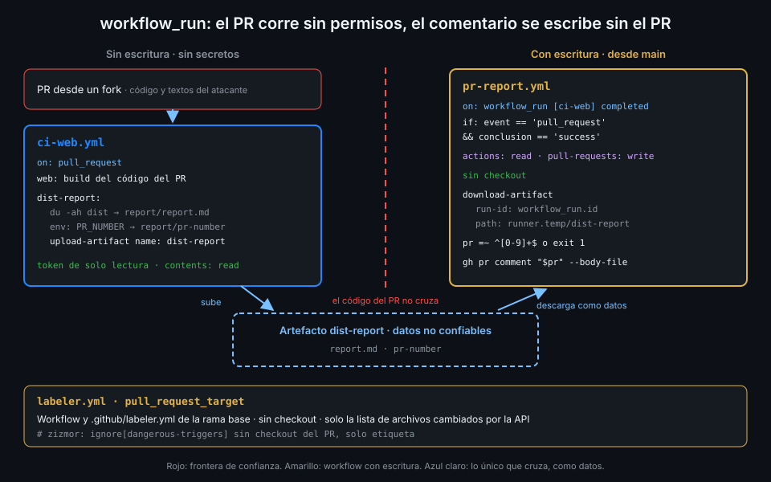

# pull_request_target y workflow_run

> Etiquetar o comentar un PR de un fork exige escritura, y un PR de fork no la tiene. Los dos
> triggers que la dan son los más atacados de Actions: se usan sin ejecutar nunca el código
> del PR.



## 🎯 Objetivos

Al terminar este archivo eres capaz de:

- Explicar por qué `pull_request` no puede etiquetar ni comentar un PR de fork
- Decir qué workflow, qué commit y qué credenciales usan `pull_request_target` y `workflow_run`
- Describir el ataque «pwn request» y señalar la línea que lo hace posible
- Escribir un `labeler` con `pull_request_target` que no toca el código del PR
- Separar en dos workflows lo que ejecuta el PR y lo que escribe en él
- Tratar un artefacto de otro run como datos no confiables
- Justificar la excepción de zizmor `dangerous-triggers` con un comentario

## 1. Qué problema resuelve

En el archivo 02 viste el recorte por fork: en un `pull_request` desde un fork, todo `write`
pasa a `read` y no hay secretos. Es la defensa correcta, pero rompe dos cosas útiles:

- **Etiquetar el PR** según las rutas que toca (`api`, `web`, `ci`) necesita
  `pull-requests: write`.
- **Comentar el PR** con el informe de `dist` que genera `ci-web` necesita lo mismo.

Con `pull_request`, las dos funcionan con tus ramas y fallan con un PR de fork. GitHub ofrece
dos triggers que corren con escritura incluso en ese caso. El precio es que **todo lo que hagan
con el PR lo hacen con escritura**, y por eso zizmor los marca siempre.

## 2. Cómo funciona

### pull_request_target

Se dispara con los mismos tipos de actividad que `pull_request`, pero:

- Corre **el workflow de la rama por defecto**, no el del PR. El PR no puede cambiar los
  steps.
- `GITHUB_SHA` es el último commit de la rama por defecto y `GITHUB_REF`, la rama por defecto.
  Un `actions/checkout` sin `ref:` trae `main`, no el PR.
- Tiene secretos y un token con la escritura que declares, aunque el PR venga de un fork.

La documentación lo dice sin rodeos: está pensado para etiquetar y comentar, y hay que evitarlo
si necesitas construir o ejecutar código del PR. Un detalle práctico: las ramas con nombres que
parecen un SHA pueden no dispararlo.

### workflow_run

Se dispara cuando termina otro workflow:

- Solo funciona si el archivo está en la rama por defecto, y como mucho encadena tres niveles.
- Tiene secretos y token con escritura **aunque el run que lo disparó no los tuviera**.
- `github.event.workflow_run` describe el run anterior: `.event`, `.conclusion`, `.id`,
  `.head_sha` y `.pull_requests`.
- `.pull_requests` llega **vacío en los PR de forks**. Si necesitas el número del PR, tiene que
  viajar en un artefacto.

_Verificado con la documentación de eventos y ubuntu-24.04, noviembre de 2026._

### El ataque: «pwn request»

```yaml
name: preview
on:
  pull_request_target:
permissions: {}
jobs:
  build:
    runs-on: ubuntu-24.04
    timeout-minutes: 10
    permissions:
      contents: read
      pull-requests: write
    steps:
      # ❌ Trae el código del PR a un job con escritura
      - uses: actions/checkout@3d3c42e5aac5ba805825da76410c181273ba90b1 # v7.0.1
        with:
          ref: ${{ github.event.pull_request.head.sha }}  # antipatron
          persist-credentials: false
      - run: make preview
```

Los permisos están acotados y las credenciales no se guardan, y aun así es vulnerable. El
atacante abre un PR desde su fork que cambia el `Makefile`. `make preview` ejecuta su objetivo
`preview` en un job con `pull-requests: write` y acceso a los secretos del repo. No hace falta
inyección ni action comprometida: **el checkout del head es la línea que lo rompe**, y la regla
6 del bootcamp la prohíbe.

Ojo con lo que "ejecutar código del PR" incluye: un `uv sync`, un `pnpm install` con scripts de
instalación, un `docker build` con su `Dockerfile` o una action local `uses: ./` del PR. Todos
corren código que escribió el atacante.

## 3. Cómo se usa

### Etiquetar con pull_request_target, sin checkout

`actions/labeler` no necesita el código del PR: pide a la API la lista de archivos cambiados y
lee `.github/labeler.yml` de la rama base, también por la API.

```yaml
name: labeler
on:
  # Corre con el workflow y la configuración de la rama base: el PR solo aporta la lista
  # de archivos cambiados. No hace checkout ni ejecuta nada del PR.
  pull_request_target: # zizmor: ignore[dangerous-triggers] sin checkout del PR, solo etiqueta
    types: [opened, synchronize, reopened]
permissions: {}
jobs:
  label:
    name: Etiquetar por ruta
    runs-on: ubuntu-24.04
    timeout-minutes: 5
    permissions:
      contents: read
      pull-requests: write
    steps:
      - uses: actions/labeler@bf12e9b00b37c5c0ca2b87b79b2daf7891dbda13 # v7.0.0
```

Y la configuración, con el formato de la v5 en adelante:

```yaml
# .github/labeler.yml
api:
  - changed-files:
      - any-glob-to-any-file: api/**
web:
  - changed-files:
      - any-glob-to-any-file: web/**
```

Como corre el workflow de la rama base, **el PR que añade `labeler.yml` no se etiqueta**: en
`main` todavía no existe. Lo dice el README de la action y lo ves en la práctica 03.

_Verificado con actions/labeler@v7.0.0 y ubuntu-24.04, noviembre de 2026._

### Comentar con workflow_run: dos workflows, una frontera

El informe de `dist` necesita construir `web`, es decir, ejecutar código del PR. Eso no puede
pasar en un job con escritura. Así que se parte en dos:

1. **`ci-web`** corre con `pull_request`: ejecuta el PR sin escritura y sin secretos, escribe
   `report.md` y `pr-number`, y los sube como artefacto `dist-report`.
2. **`pr-report`** corre con `workflow_run` cuando `ci-web` termina: tiene escritura, **no hace
   checkout**, descarga el artefacto y lo trata como datos.

El step de `ci-web` que guarda el número:

```yaml
      - name: Número del PR para pr-report
        if: github.event_name == 'pull_request'
        env:
          PR_NUMBER: ${{ github.event.pull_request.number }}
        run: echo "$PR_NUMBER" > report/pr-number
```

Y `pr-report` entero:

```yaml
name: pr-report
on:
  # ci-web corre el código del PR sin permisos; este workflow corre después, con permiso
  # para comentar, y solo trata el artefacto como datos.
  workflow_run: # zizmor: ignore[dangerous-triggers] sin checkout, el artefacto se valida
    workflows: [ci-web]
    types: [completed]
permissions: {}
jobs:
  comment:
    name: Comentar el informe de dist
    if: github.event.workflow_run.event == 'pull_request' && github.event.workflow_run.conclusion == 'success'
    runs-on: ubuntu-24.04
    timeout-minutes: 5
    permissions:
      actions: read
      pull-requests: write
    steps:
      - uses: actions/download-artifact@9000827ccba6bdab643e8b6fd33ac0654aef8333 # v8.0.2
        with:
          name: dist-report
          path: ${{ runner.temp }}/dist-report
          run-id: ${{ github.event.workflow_run.id }}
          github-token: ${{ github.token }}
      - name: Comentar en el PR
        env:
          GH_TOKEN: ${{ github.token }}
          GH_REPO: ${{ github.repository }}
          REPORT_DIR: ${{ runner.temp }}/dist-report
        run: |
          # El artefacto lo escribió código del PR: el número se valida antes de usarlo.
          pr=$(head -c 10 "$REPORT_DIR/pr-number")
          if ! [[ "$pr" =~ ^[0-9]+$ ]]; then
            echo "::error::pr-number no es un número"
            exit 1
          fi
          gh pr comment "$pr" --body-file "$REPORT_DIR/report.md"
```

Cada línea cierra una puerta:

- **El `if:`** filtra: solo runs de `pull_request` que acabaron bien. Un `push` a `main` o un
  run fallido no comentan nada.
- **`actions: read`** es lo que exige descargar un artefacto de **otro** run con `run-id` y
  `github-token`. No hay `contents`: no hay checkout.
- **`runner.temp`** saca el artefacto del workspace. Si un step posterior hiciera checkout o
  ejecutara algo del workspace, no encontraría ahí archivos del atacante (archivo 05).
- **La validación** con `^[0-9]+$` y `head -c 10` impide que `pr-number` traiga otra cosa
  que un número. Sin ella, el atacante elige a qué PR o issue comenta el bot.
- **`--body-file`** pasa el informe como archivo: el texto nunca entra en la línea de comandos
  ni en una expresión.

El contenido de `report.md` también lo escribió el PR. Como comentario es inofensivo, porque
GitHub lo renderiza como Markdown y no lo ejecuta. Lo que nunca harías es usarlo como código.

### La excepción justificada

zizmor 1.31.1 marca **todo** `pull_request_target` y todo `workflow_run` con
`dangerous-triggers`, de severidad error. No mira si el uso es seguro. Cuando lo es, lo dices
en la línea del trigger:

```yaml
  pull_request_target: # zizmor: ignore[dangerous-triggers] sin checkout del PR, solo etiqueta
```

El texto después del corchete es el motivo. zizmor no lo lee, pero quien revise el PR sí, y es
la diferencia entre silenciar una alarma y documentar una decisión.

_Verificado con zizmor 1.31.1 y ubuntu-24.04, noviembre de 2026._

## 4. Antipatrones

| Antipatrón | Por qué duele | Qué hacer en su lugar |
|---|---|---|
| `checkout` de `head.sha` o `head.ref` en `pull_request_target` | El código del atacante corre con escritura y secretos | Sin checkout del PR; separar con `workflow_run` |
| `pull_request_target` "para que los forks tengan secretos" en un build | Lo mismo, con otro nombre | `pull_request` sin secretos; lo que los necesite, tras merge |
| `workflow_run` sin `if:` sobre `event` y `conclusion` | Comenta en runs de `push` o fallidos | `if:` con los dos |
| Descargar el artefacto en el workspace | Puede pisar archivos que otro step ejecuta | `runner.temp` |
| Usar `pr-number` sin validar | El atacante elige el destino del comentario | `^[0-9]+$` antes de usarlo |
| Leer `workflow_run.pull_requests` para el número | Llega vacío con PRs de forks | El número en el artefacto |
| `# zizmor: ignore[dangerous-triggers]` sin motivo | Nadie sabe por qué se aceptó | Motivo en el comentario |

## 5. Trucos

- **Lista los triggers peligrosos de un repo** con `grep -nE 'pull_request_target|workflow_run' .github/workflows/*.yml`.
  Cada línea debe llevar su `ignore` con motivo, y cada workflow, ningún checkout del PR.
- **Prueba el `labeler` con un PR posterior al que lo añade**: el primero nunca se etiqueta,
  y no es un fallo de tu configuración.
- **El run de `pr-report` aparece en la pestaña Actions de `main`, no en el PR.** Si buscas por
  qué no comentó, fíltralo con `gh run list --workflow pr-report.yml`.

## 📚 Recursos Adicionales

- [GitHub Docs: pull_request_target](https://docs.github.com/en/actions/reference/workflows-and-actions/events-that-trigger-workflows#pull_request_target)
- [GitHub Docs: workflow_run](https://docs.github.com/en/actions/reference/workflows-and-actions/events-that-trigger-workflows#workflow_run)
- [GitHub Security Lab: Preventing pwn requests](https://securitylab.github.com/resources/github-actions-preventing-pwn-requests/)
- [zizmor: dangerous-triggers](https://docs.zizmor.sh/audits/#dangerous-triggers)

## ✅ Checklist de Verificación

- [ ] Sé por qué un `labeler` con `pull_request` falla con PRs de forks
- [ ] Sé qué workflow y qué commit usa `pull_request_target`
- [ ] Sé señalar la línea que convierte un `pull_request_target` en un «pwn request»
- [ ] Sé por qué `labeler` puede usar `pull_request_target` sin riesgo
- [ ] Sé repartir entre `ci-web` y `pr-report` lo que ejecuta el PR y lo que escribe en él
- [ ] Sé para qué sirve cada línea de `pr-report`: `if:`, `actions: read`, `runner.temp`,
      validación y `--body-file`
- [ ] Sé justificar una excepción de `dangerous-triggers`

---

| ← Anterior | Siguiente → |
|:---|---:|
| [Inyección de scripts](03-inyeccion-de-scripts.md) | [Caché y artefactos envenenados](05-cache-y-artefactos-envenenados.md) |
