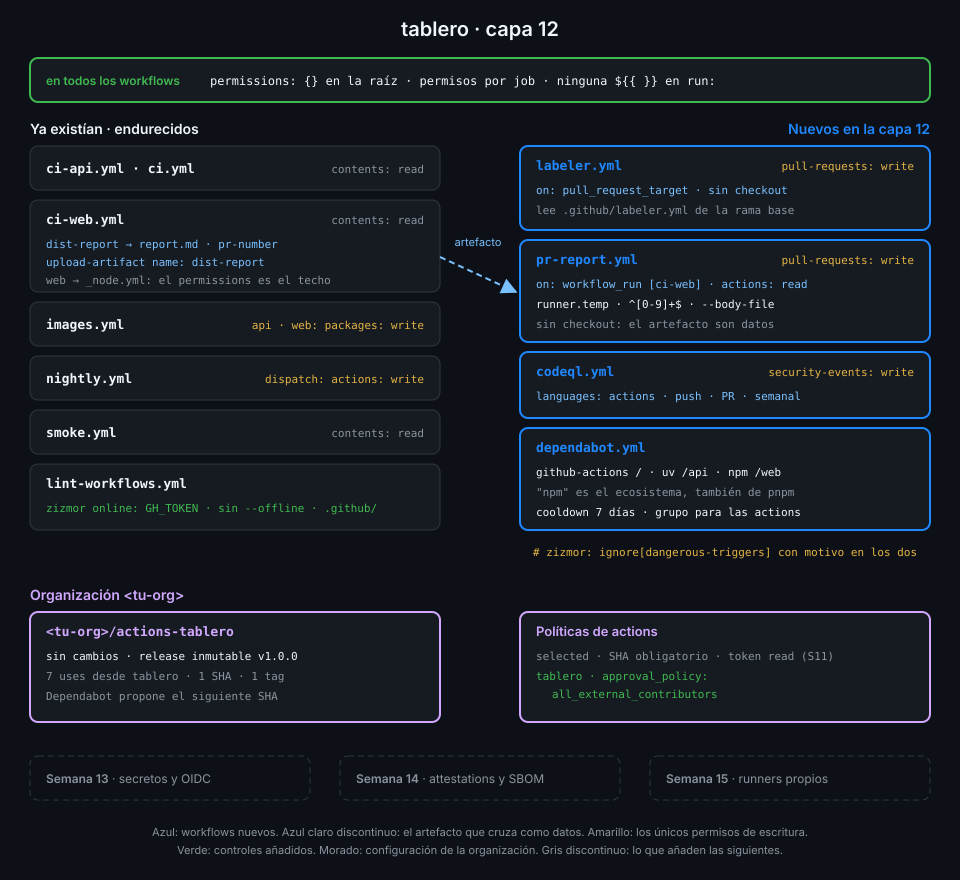

# Proyecto: capa 12 de tablero



## 🎯 Objetivo

Que el CI de `tablero` resista a quien no es de confianza: un PR de un fork, un título con
comillas, una action cuyo tag se mueve o una caché que no escribiste tú. Cada job recibe solo los
permisos que usa, ningún dato del evento llega al shell sin pasar por `env:`, los PRs se etiquetan y
se comentan sin ejecutar su código, Dependabot vigila las dependencias con cooldown, y zizmor y
CodeQL vigilan los propios workflows.

## 📦 Qué añade esta capa

| Archivo de `tablero` | Qué hace | Por qué existe |
|---|---|---|
| Los 7 workflows de la capa 11 | `permissions: {}` en la raíz y un bloque `permissions` en cada job | Un job que no declara nada no recibe nada: añadir un job no hereda permisos por accidente |
| `images.yml`, `nightly.yml` | Los únicos jobs previos que escriben: `packages` y `actions` | Si se compromete otro job, su token no puede publicar imágenes ni lanzar workflows |
| `ci-web.yml`, job `dist-report` | Escribe `report.md` y el número del PR, y los sube como artefacto `dist-report` | `ci-web` corre el código del PR sin permisos: no puede comentar, pero puede dejar el informe |
| `pr-report.yml` (nuevo) | Con `workflow_run`, descarga `dist-report` del run de `ci-web`, valida el número y comenta en el PR | Comentar necesita `pull-requests: write`, que nunca debe tener un job que ejecuta código del PR |
| `labeler.yml` y `.github/labeler.yml` (nuevos) | Con `pull_request_target`, etiqueta cada PR por las rutas que cambia, sin checkout | Un PR de fork recibe un token de solo lectura en `pull_request`; aquí el workflow es el de `main` |
| `codeql.yml` (nuevo) | CodeQL con el lenguaje `actions` sobre los workflows; los resultados van a Security → Code scanning | Detecta inyecciones, checkouts no confiables y artefactos envenenados que actionlint no ve |
| `dependabot.yml` (nuevo) | Version updates de actions, `uv` y pnpm, con 7 días de cooldown y las actions agrupadas | Los SHA fijados envejecen; el cooldown deja pasar los días en que se suele detectar una release comprometida |
| `lint-workflows.yml`, job `zizmor` | Sin `--offline`, con `GH_TOKEN`, sobre todo `.github/` | Las auditorías online detectan commits impostores, actions con avisos y tags que no coinciden con el SHA |
| Ajuste del repo | Aprobación de workflows para todos los colaboradores externos | Ningún PR de un fork ejecuta nada hasta que lo miras |

| Situación | Qué pasa |
|---|---|
| Alguien abre un PR con el título `x"; curl ...` | Nada: el título llega al shell como valor de una variable, nunca como código |
| Un PR de un fork cambia `ci-web` para leer el token | No hay nada que leer: el job no tiene permisos de escritura ni secretos |
| Un PR de un fork escribe `pr-number` con `1; rm -rf ~` | `pr-report` lo rechaza antes de usarlo: no es un número |
| Sale una versión nueva de una action que usas | Dependabot espera 7 días y abre un PR que cambia el SHA y el comentario del tag |
| Alguien añade un `uses:` con un SHA que no está en el repo de la action | zizmor online lo marca como commit impostor y `lint-workflows` falla |

La Semana 13 sigue con lo que este modelo de amenazas deja abierto: secretos con alcance de
environment, revisores obligatorios y OIDC en lugar de credenciales de larga duración.

## ✅ Requisitos verificables

- Todos los workflows de tablero declaran permissions: {} en la raíz
- Cada job de cada workflow declara sus propios permissions
- Solo escriben codeql (security-events), images (packages), labeler y pr-report (pull-requests) y nightly (actions); ningún write-all ni read-all
- Ningún run ni script de github-script contiene una expresión ${{ }}: todo dato llega por env
- codeql.yml analiza el lenguaje actions con init y analyze en un job con security-events: write
- Code scanning tiene análisis de CodeQL y ninguna alerta abierta
- labeler.yml se dispara con pull_request_target, no hace checkout y usa actions/labeler fijada por SHA
- Al menos un pull request de tablero tiene una etiqueta api, web o ci puesta por labeler
- pr-report.yml se dispara al terminar ci-web, solo actúa si el run vino de un pull_request, no hace checkout y descarga el artefacto de ese run
- github-actions[bot] ha comentado el informe de web/dist en un pull request de tablero
- tablero exige aprobación para los workflows de todos los colaboradores externos
- dependabot.yml vigila github-actions en la raíz, uv en /api y npm (pnpm) en /web
- Cada ecosistema de dependabot.yml espera al menos 7 días antes de proponer una versión nueva
- El job zizmor de lint-workflows.yml corre las auditorías online con el GITHUB_TOKEN
- Los workflows y dependabot.yml de tablero pasan actionlint y zizmor con las auditorías online sin hallazgos
- Toda uses remota de los workflows de tablero está fijada por SHA de 40 caracteres con el tag en comentario
- ci, ci-api, ci-web, lint-workflows y codeql terminan en success sobre el último commit de main

## 🎨 Criterios de calidad

Lo que `check-week.sh` no ve y la [rúbrica](../rubrica-evaluacion.md) sí puntúa:

- Cada `# zizmor: ignore[dangerous-triggers]` lleva un motivo que se sostiene leyendo el workflow:
  sin checkout, sin ejecutar nada del PR, el artefacto se valida.
- `pr-report` valida el número del PR con una expresión regular estricta (`^[0-9]+$`) y descarga
  el artefacto fuera del workspace (`runner.temp`), nunca encima del código.
- Cada permiso de escritura tiene un comentario o un motivo evidente en el nombre del job; ningún
  job tiene un permiso «por si acaso».
- El PR de prueba de la práctica 02, con el workflow vulnerable, está cerrado sin fusionar y su
  rama borrada.
- Los PRs de Dependabot no se fusionan a ciegas: el diff de un `uses:` se lee contra la release
  de la action antes de aprobar.
- Commits en Conventional Commits, uno por mecanismo (`ci: drop default token permissions`,
  `ci: add codeql for workflows`…).
- Sin `TODO` en el repo.

## 💡 Adaptación a tu dominio

| Tu proyecto | Qué escribe y quién | Workflow privilegiado | Dependabot |
|---|---|---|---|
| Librería open source con muchos PRs de forks | Solo el job de release (`contents: write`, `id-token: write` desde la S13) | `workflow_run` que comenta la cobertura del PR | Ecosistema del lenguaje y `github-actions`, agrupados por semana |
| Servicio interno en un repo privado | Imagen (`packages: write`) y despliegue (environment) | `pull_request_target` para etiquetar por equipo con `actions/labeler` | `docker` para las imágenes base además del lenguaje |
| Monorepo con varios equipos | Un job de escritura por paquete publicado | `workflow_run` que publica el informe de cada paquete | Un `directory` por paquete y `groups` por equipo |
| Repo de infraestructura como código | El job de `apply`, solo en `push` a `main` | Comentario del `plan` desde `workflow_run`, nunca desde el job que corre el `plan` del PR | `terraform` y `github-actions`, cooldown más largo en majors (`semver-major-days`) |

## 🚦 Cómo entregarlo

Si hiciste las cuatro prácticas ya lo tienes todo: repásalo contra los requisitos y los
criterios. Si no, parte del starter.

1. Copia el starter en `tablero` y completa los `TODO 1` a `TODO 10`:

   ```bash
   cd ~/code/tablero
   S=~/code/bc-github-actions/bootcamp/week-12-modelo_de_amenazas_y_endurecimiento/3-proyecto/starter
   cp -r "$S"/.github/. .github/
   grep -rnE "TODO [0-9]+" .github | wc -l
   # 10
   ```

2. Cambia los 7 workflows previos a permisos por job y sube el artefacto `dist-report` desde
   `ci-web` ([práctica 01](../2-practicas/01-permisos-minimos-por-job.md) y
   [práctica 03](../2-practicas/03-pull-request-target-y-workflow-run.md)).

3. Quita `--offline` del job `zizmor` y pásale `GH_TOKEN`
   ([práctica 04](../2-practicas/04-dependabot-y-zizmor-online.md)).

4. Antes de hacer push, comprueba lo que se puede ver en local:

   ```bash
   actionlint && GH_TOKEN=$(gh auth token) zizmor -q .github/ && echo limpio
   # limpio
   ```

5. Haz push a `main`, configura la aprobación de forks y abre un PR de prueba que toque `web/`
   para que `labeler` y `pr-report` dejen su huella. `labeler.yml` y `pr-report.yml` tienen que
   estar ya en `main`: los dos corren la versión de la rama por defecto.

   ```bash
   gh api -X PUT 'repos/{owner}/{repo}/actions/permissions/fork-pr-contributor-approval' \
     -f approval_policy=all_external_contributors
   git switch -c test/pr-report
   echo "<!-- prueba de pr-report -->" >> web/index.html
   git commit -am "test(web): trigger pr-report" && git push -u origin test/pr-report
   gh pr create --fill
   ```

6. Espera a los runs de `main` y lanza la verificación:

   ```bash
   cd ~/code/bc-github-actions
   ./scripts/check-week.sh 12
   # 17/17 comprobaciones superadas.
   ```

   Cuando esté en verde, cierra el PR de prueba sin fusionarlo y borra su rama.

## 🧯 Errores comunes

| Síntoma | Causa | Solución |
|---|---|---|
| `Resource not accessible by integration` en un step que antes funcionaba | Con `permissions: {}` en la raíz el job ya no hereda nada | Añade al job el permiso exacto que nombra la API que falla |
| `The nested job 'build' is requesting 'packages: write', but is only allowed 'packages: none'` | El job que llama a `_image.yml` no declara lo que el reutilizable pide | Los permisos del job llamador son el techo del reutilizable: decláralos en él |
| `labeler` no corre en el PR que lo añade | `pull_request_target` usa el workflow de `main`, que aún no lo tiene | Fusiona `labeler.yml` primero y prueba con otro PR |
| `pr-report` termina en `skipped` | El run de `ci-web` vino de un `push`, o falló | Es lo esperado: solo comenta runs de `pull_request` en `success` |
| `Unable to download artifact(s): Artifact not found for name: dist-report` | Falta `run-id` (descarga del run de `pr-report`) o `ci-web` no subió el artefacto | `run-id: ${{ github.event.workflow_run.id }}` y `github-token`; revisa el job `dist-report` |
| `code-scanning-clean` en rojo con `no analysis found` | `codeql.yml` nunca ha terminado en `main` | Haz push a `main` y espera al run de `codeql` |
| `gh` te pide el scope `admin:repo_hook` al leer alertas | Aviso engañoso de `gh` ante un 403 | Con el scope `repo` basta si eres dueño del repo; revisa a qué repo apunta `GH_REPO` |
| `error[dangerous-triggers]` en zizmor | `pull_request_target` o `workflow_run` sin excepción justificada | Comentario `# zizmor: ignore[dangerous-triggers] <motivo>` en la línea del trigger, y que el motivo sea cierto |
| `warning[dependabot-cooldown]` en zizmor | Falta `cooldown` o tiene menos de 7 días | `cooldown: {default-days: 7}` en cada ecosistema |
| `couldn't list tags for <tu-org>/actions-tablero` en zizmor | `GH_TOKEN` no puede leer el repo central | Comprueba que `actions-tablero` es público y que el token es el tuyo |

## 🔗 Navegación

---

| ← Anterior | Siguiente → |
|:---|---:|
| [Dependabot y zizmor online](../2-practicas/04-dependabot-y-zizmor-online.md) | [Rúbrica de evaluación](../rubrica-evaluacion.md) |
