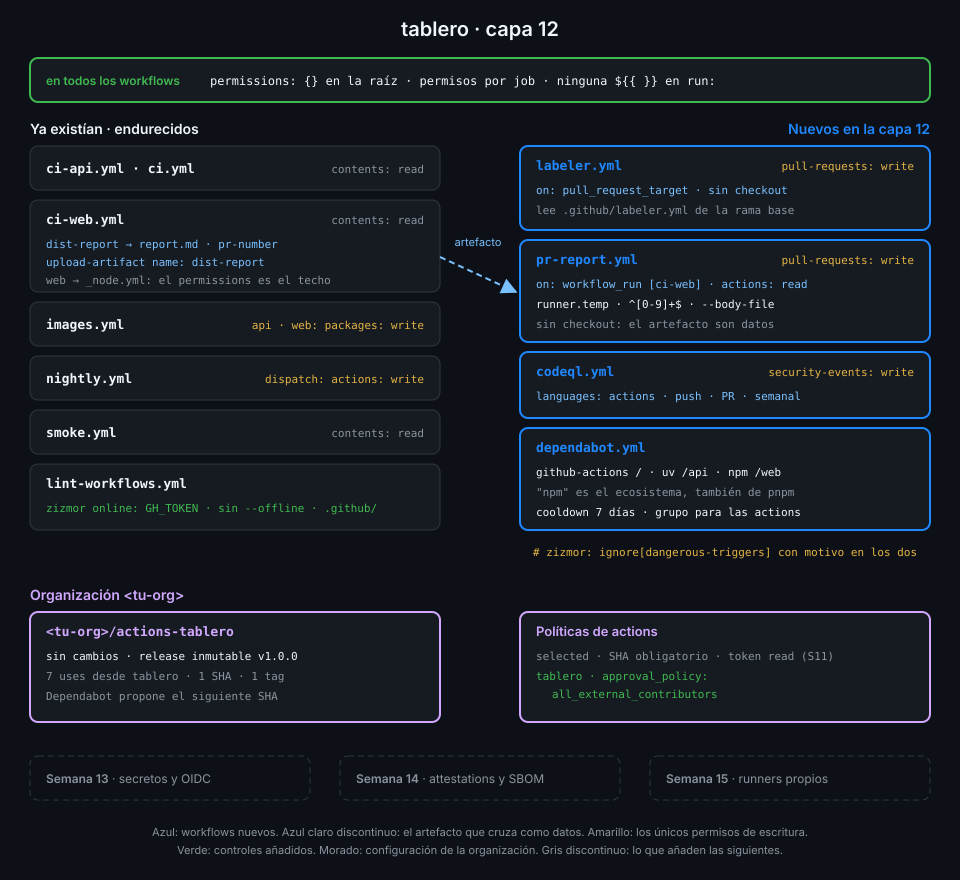

# Semana 12 — Modelo de amenazas y endurecimiento

> Hasta ahora has escrito pipelines que funcionan. Esta semana te pones del lado del atacante:
> qué puede hacer un PR, una dependencia o un título malicioso con tu CI, y cómo se lo impides.

## 🎯 Objetivos de la Semana

Al terminar la semana eres capaz de:

- Dibujar el modelo de amenazas de un pipeline: quién puede disparar qué, con qué permisos y
  sobre qué activos
- Calcular los permisos efectivos del `GITHUB_TOKEN` de un job y reducirlos al mínimo con
  `permissions: {}` en la raíz y permisos por job
- Explotar y corregir una inyección de scripts, y explicar por qué `env:` la evita
- Usar `pull_request_target` y `workflow_run` con el patrón seguro: sin código del PR en un
  contexto con permisos, y el artefacto tratado como datos
- Explicar el envenenamiento de caché y de artefactos, qué triggers pueden escribir en la caché
  de la rama por defecto y qué controla `cache-mode`
- Mantener al día las actions fijadas por SHA con Dependabot y un cooldown, y auditar los
  workflows con zizmor online y CodeQL

## 📋 Prerrequisitos

| Necesitas | Dónde se aprende |
|---|---|
| `check-week.sh 11` en 17/17 | [Semana 11](../week-11-actions_a_escala_de_organizacion/README.md) |
| Pinning por SHA y releases inmutables | [Semana 01](../week-01-primer_workflow_y_modelo_de_ejecucion/README.md) y [Semana 11](../week-11-actions_a_escala_de_organizacion/README.md) |
| Artefactos entre jobs y entre runs | [Semana 04](../week-04-ci_de_frontend_pnpm_matrices_y_artefactos/README.md) |
| `workflow_run` y concurrencia | [Semana 07](../week-07-disparadores_filtros_y_concurrencia/README.md) |
| `actions/cache` y `cache-mode` | [Semana 03](../week-03-ci_de_python_con_uv/README.md) y [Semana 09](../week-09-workflows_reutilizables/README.md) |
| actionlint y zizmor en local | [Semana 08](../week-08-probar_y_depurar_workflows/README.md) |
| Permisos de un job que llama a un reutilizable | [Semana 09](../week-09-workflows_reutilizables/README.md) |

## 🗂️ Estructura de la Semana

```
week-12-modelo_de_amenazas_y_endurecimiento/
├── README.md
├── rubrica-evaluacion.md
├── checks.json                    17 comprobaciones
├── 0-assets/                      diagramas SVG
├── 1-teoria/                      7 archivos, uno por concepto
├── 2-practicas/                   4 prácticas guiadas
├── 3-proyecto/
│   ├── README.md
│   └── starter/.github/           workflows/{codeql,labeler,pr-report}.yml, labeler.yml, dependabot.yml
├── 4-recursos/{ebooks-free,videografia,webgrafia}/README.md
└── 5-glosario/README.md
```

## 📝 Contenidos

### Teoría

| # | Archivo | Qué aprendes | Tiempo |
|:--:|---|---|:--:|
| 01 | [Modelo de amenazas de un pipeline](1-teoria/01-modelo-de-amenazas-de-un-pipeline.md) | Actores, activos y fronteras de confianza; los incidentes que lo justifican | 30 min |
| 02 | [Permisos del GITHUB_TOKEN](1-teoria/02-permisos-del-github-token.md) | Scopes, cómo se calculan los permisos efectivos, el techo de los reutilizables y el recorte en forks | 30 min |
| 03 | [Inyección de scripts](1-teoria/03-inyeccion-de-scripts.md) | Qué contextos controla un atacante, por qué `${{ }}` en `run:` es inyección y cómo lo evita `env:` | 30 min |
| 04 | [pull_request_target y workflow_run](1-teoria/04-pull-request-target-y-workflow-run.md) | Por qué existen, el ataque «pwn request» y el patrón seguro | 30 min |
| 05 | [Caché y artefactos envenenados](1-teoria/05-cache-y-artefactos-envenenados.md) | Ámbitos de la caché, triggers que pueden escribir, `cache-mode` y artefactos como entrada no confiable | 30 min |
| 06 | [Dependencias de actions](1-teoria/06-dependencias-de-actions.md) | SHA, commits impostores, Dependabot con cooldown y lockfiles de workflows | 30 min |
| 07 | [Análisis estático: zizmor y CodeQL](1-teoria/07-analisis-estatico-zizmor-y-codeql.md) | Auditorías online, excepciones justificadas y code scanning de workflows | 30 min |

### Prácticas

| # | Archivo | Qué haces | Tiempo |
|:--:|---|---|:--:|
| 01 | [Permisos mínimos por job](2-practicas/01-permisos-minimos-por-job.md) | `permissions: {}` en la raíz, permisos por job y aprobación para todos los colaboradores externos | 1 h |
| 02 | [Inyección de scripts](2-practicas/02-inyeccion-de-scripts.md) | Explotas una inyección en una rama de laboratorio, la corriges y la detectas con zizmor y CodeQL | 1 h |
| 03 | [pull_request_target y workflow_run](2-practicas/03-pull-request-target-y-workflow-run.md) | Etiquetas PRs con `labeler` y comentas el informe de `dist` con el patrón seguro | 1 h |
| 04 | [Dependabot y zizmor online](2-practicas/04-dependabot-y-zizmor-online.md) | Dependabot para actions, uv y pnpm con cooldown, y zizmor con las auditorías que consultan la API | 1 h |

### Proyecto

[Capa 12 de `tablero`](3-proyecto/README.md): cada job con los permisos que usa y ninguno más,
ningún dato no confiable en un `run:`, etiquetas y comentarios en los PRs sin ejecutar su código,
dependencias vigiladas por Dependabot y dos analizadores que vigilan los propios workflows.



## ⏱️ Distribución del Tiempo (10 horas)

| Actividad | Horas |
|---|:--:|
| Teoría (7 archivos) | 3,5 |
| Práctica 01 — Permisos mínimos por job | 1 |
| Práctica 02 — Inyección de scripts | 1 |
| Práctica 03 — pull_request_target y workflow_run | 1 |
| Práctica 04 — Dependabot y zizmor online | 1 |
| Proyecto — capa 12 | 1,5 |
| Autoevaluación con la rúbrica | 1 |
| **Total** | **10** |

## 🎩 Trucos y atajos

- **Mira los permisos reales de un job sin abrir la UI**:
  `gh run view <run-id> --log | grep -A6 "GITHUB_TOKEN Permissions"`. Es lo que el runner
  recibió de verdad, después de aplicar el default de la org, la raíz, el job y el recorte de los
  forks.
- **El mismo grupo del log dice qué acceso a la caché tuvo el job**: la línea `Cache mode:` justo
  debajo vale `write` en un `push` y `read` en un trigger de baja confianza como
  `pull_request_target`.
- **Lista solo los PRs de Dependabot**: `gh pr list --app dependabot`. `--author` no sirve para
  una GitHub App; `--app` sí.
- **Las alertas de code scanning en una tabla**:
  `gh api 'repos/{owner}/{repo}/code-scanning/alerts?state=open' --jq '.[] | [.rule.id, .most_recent_instance.location.path] | @tsv'`.
  Si `gh` te pide el scope `admin:repo_hook` es un falso aviso: el 403 real es que no tienes
  permiso de escritura en ese repo.
- **`zizmor --fix` corrige solo algunos hallazgos**, como el `persist-credentials` que falta. Es
  experimental: aplica por defecto solo los arreglos seguros, y siempre revisas el diff antes de
  hacer commit.

## 📌 Entregables

- `tablero` con `permissions: {}` en la raíz de cada workflow, permisos por job y ninguna
  expresión en un `run:`
- `labeler.yml`, `pr-report.yml`, `codeql.yml` y `dependabot.yml` en `main`, un PR etiquetado y
  comentado por el bot, y code scanning sin alertas abiertas
- `ci`, `ci-api`, `ci-web`, `lint-workflows` y `codeql` en verde sobre el último commit de `main`
  (ver [proyecto](3-proyecto/README.md))
- La rúbrica respondida

## ✅ Verificación

```bash
cd ~/code/bc-github-actions
./scripts/check-week.sh 12
# Semana 12 — Modelo de amenazas y endurecimiento  [repo: <tu-org>/tablero]
#
#   ✅ Todos los workflows de tablero declaran permissions: {} en la raíz
#   ...
# 17/17 comprobaciones superadas.
```

Si algo sale en rojo, la pista te dice qué práctica y qué paso lo arreglan.

## 🔗 Navegación

---

| ← Anterior | Siguiente → |
|:---|---:|
| [Semana 11 — Actions a escala de organización](../week-11-actions_a_escala_de_organizacion/README.md) | [Modelo de amenazas de un pipeline](1-teoria/01-modelo-de-amenazas-de-un-pipeline.md) |
