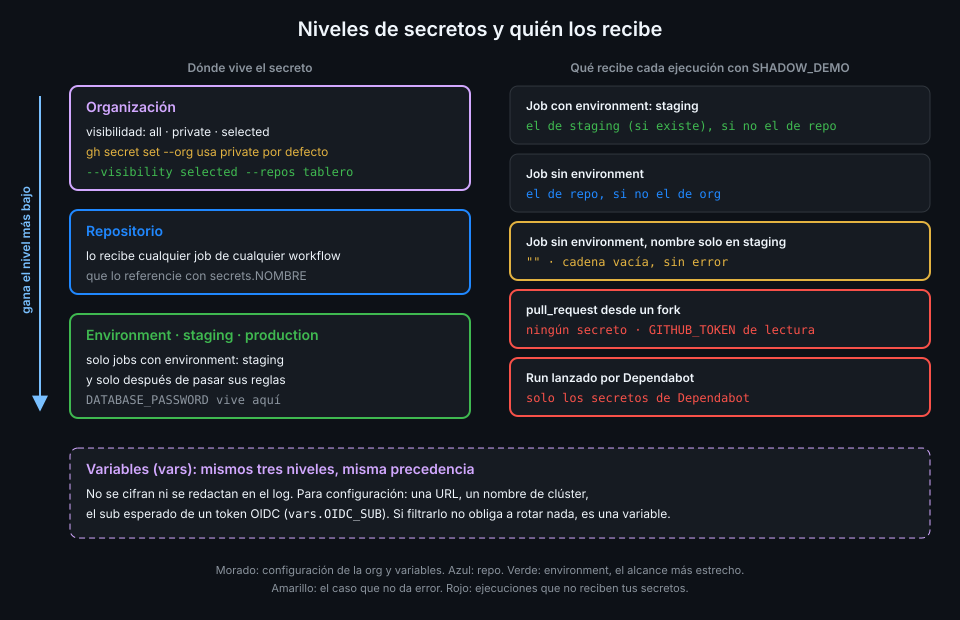

# Secretos de repo, environment y org

> Un secreto no es solo un valor cifrado: es un valor cifrado **con un alcance**. Elegir dónde
> vive decide qué jobs lo reciben, y eso pesa más que lo bien guardado que esté.



## 🎯 Objetivos

Al terminar este archivo eres capaz de:

- Elegir entre secreto de org, de repo y de environment según quién debe recibirlo
- Predecir qué valor recibe un job cuando el mismo nombre existe en varios niveles
- Configurar la visibilidad de un secreto de org para que llegue a un repo público
- Explicar quién no recibe secretos: PR de forks, Dependabot y jobs sin environment
- Distinguir un secreto de una variable y saber cuándo usar cada uno
- Crear y listar secretos con `gh` sin que el valor pase por el historial

## 1. Qué problema resuelve

Hasta la Semana 12 `tablero` solo ha usado un secreto: `GITHUB_TOKEN`, que GitHub crea en cada
job y destruye al terminar. En la Semana 17 `tablero` despliega a un clúster y, antes de eso,
necesita credenciales que no inventa GitHub: la contraseña de la base de datos de staging, la de
production, quizá la clave de un servicio externo.

Si las guardas todas como secretos de repo, **cualquier job de cualquier workflow del repo** las
recibe en cuanto escriba `${{ secrets.NOMBRE }}`: el lint, el labeler, un workflow que alguien
añade mañana. La contraseña de production acaba al alcance del job menos vigilado. El problema
no es el cifrado; es el **alcance**.

GitHub ofrece tres niveles para que el alcance de cada secreto sea el mínimo:

| Nivel | Lo reciben | Para qué |
|---|---|---|
| Organización | Los repos que elijas de la org | Un valor compartido: la clave de un registro común, un token de un servicio de la org |
| Repositorio | Todos los jobs del repo | Lo que necesita cualquier workflow del repo y no es delicado por environment |
| Environment | Solo los jobs que declaran ese environment, y solo cuando pasan sus reglas | Credenciales de despliegue: una por staging, otra por production |

## 2. Cómo funciona

### Cifrado y entrega

Cuando creas un secreto, `gh` o la UI lo cifran **en tu máquina** con la clave pública del repo,
del environment o de la org (cifrado de caja sellada de libsodium). GitHub guarda el texto
cifrado y solo lo descifra para entregarlo al runner cuando un job lo referencia. Nadie, ni tú,
puede volver a leer el valor por la API o la UI: solo sobrescribirlo o borrarlo.

El runner recibe los secretos que el job usa y no los demás. Un job que no escribe
`${{ secrets.DATABASE_PASSWORD }}` no tiene ese valor en ningún sitio.

### Precedencia

Si el mismo nombre existe en varios niveles, **gana el más bajo**: environment gana a repo, repo
gana a org. Así puedes tener un valor por defecto en el repo y sobrescribirlo en un environment.

| `SHADOW_DEMO` existe en | Job sin `environment:` recibe | Job con `environment: staging` recibe |
|---|---|---|
| Org y repo | El de repo | El de repo |
| Repo y staging | El de repo | El de staging |
| Solo staging | Cadena vacía | El de staging |

La última fila es la que más sorprende: **un secreto que no existe no da error**, llega como
cadena vacía. Un `POSTGRES_PASSWORD` vacío hace que el service container falle al arrancar, y el
síntoma no dice "falta el secreto". En la práctica 01 compruebas las tres filas sin imprimir
ningún valor.

### Límites y nombres

- Nombres: solo letras, números y `_`; no pueden empezar por `GITHUB_` ni por un número. No
  distinguen mayúsculas.
- Hasta 1.000 secretos de org, 100 de repo y 100 por environment; 48 KB por secreto.
- Si a un repo le llegan más de 100 secretos de org, solo recibe los 100 primeros por orden
  alfabético.

_Verificado con la documentación de secretos de GitHub Actions y ubuntu-24.04, noviembre de 2026._

### Quién no recibe secretos

| Ejecución | Qué recibe |
|---|---|
| PR desde un fork (`pull_request`) | Ningún secreto salvo `GITHUB_TOKEN`, y de solo lectura |
| Run lanzado por Dependabot | Solo los secretos de Dependabot, un almacén aparte |
| Job sin `environment:` | Ningún secreto de environment |
| Job con environment que espera aprobación | Nada hasta que se aprueba |
| Reutilizable llamado con `uses:` | Los secretos que el llamador le pasa uno a uno (Semana 09) |

La primera fila es la defensa que la Semana 12 dio por supuesta: el código de un fork no ve tus
secretos. La quinta tiene un matiz: los secretos de environment **no se pasan** a un
reutilizable; los recibe el job del reutilizable que declara ese environment.

### Visibilidad de un secreto de org

Un secreto de org tiene una de tres visibilidades:

| Visibilidad | Lo reciben |
|---|---|
| `all` | Todos los repos de la org |
| `private` | Solo los repos privados e internos |
| `selected` | Solo los repos que enumeras |

`gh secret set --org` usa `private` si no dices otra cosa, y `tablero` es **público**: un
secreto creado así no le llega nunca. Para `tablero` usa `--visibility selected --repos tablero`.
Con `selected` además el alcance es explícito: un repo nuevo de la org no recibe el secreto
porque sí.

En GitHub Free, los secretos de environment solo existen en repos públicos. `tablero` lo es.

### Secretos y variables

Las **variables** (`vars`) tienen los mismos tres niveles y la misma precedencia, pero no se
cifran ni se redactan en el log: se leen y se listan en claro. Sirven para configuración que no
es secreta y cambia por environment: una URL, un nombre de clúster, el `sub` esperado de un
token OIDC.

```yaml
env:
  API_URL: ${{ vars.API_URL }}               # configuración: se ve en el log
  DB_PASSWORD: ${{ secrets.DATABASE_PASSWORD }}  # secreto: se redacta
```

Regla rápida: **si filtrarlo no te obliga a rotar nada, es una variable**. El ID de un tenant de
Azure o de una cuenta de AWS no es secreto; la contraseña de una base de datos, sí.

## 3. Cómo se usa

### Crear un secreto sin dejar rastro

`gh secret set` lee el valor de stdin si no le das `--body`. Así el valor no queda en
`~/.zsh_history` ni en la pantalla:

```bash
openssl rand -hex 24 | gh secret set DATABASE_PASSWORD --env staging
openssl rand -hex 24 | gh secret set DATABASE_PASSWORD --env production
gh secret list --env staging
# NAME               UPDATED
# DATABASE_PASSWORD  less than a minute ago
```

`openssl rand -hex 24` da 48 caracteres hexadecimales: sin `@`, `/` ni `:`, que romperían la URL
de conexión de PostgreSQL. Cada environment recibe un valor **distinto**: si se filtra el de
staging, production no cae con él.

Otros flags útiles de `gh secret set`: `--org` con `--visibility` y `--repos`; `--env-file` para
cargar varios de un archivo `.env`; `--app dependabot` para el almacén de Dependabot.

_Verificado con gh 2.103.3, noviembre de 2026._

### Un secreto de org para un repo público

```bash
gh auth refresh -h github.com -s admin:org
printf '%s' "$VALOR" | gh secret set REGISTRY_TOKEN --org <tu-org> \
  --visibility selected --repos tablero
gh secret list --org <tu-org> --json name,visibility,numSelectedRepos
```

Crear y listar secretos de org pide el scope `admin:org`; sin él, `gh` devuelve `HTTP 403`.

### Usarlo en un job

Un secreto se referencia con `${{ secrets.NOMBRE }}` en `env:`, en `with:` o en la definición de
un service container. **Nunca dentro de `run:`**: llega al shell por `env:`.

```yaml
name: secrets-example
on:
  workflow_dispatch:
permissions: {}
jobs:
  migrate:
    runs-on: ubuntu-24.04
    timeout-minutes: 10
    environment: staging
    permissions:
      contents: read
    env:
      DB_PASSWORD: ${{ secrets.DATABASE_PASSWORD }}
    steps:
      - name: Comprobar que el secreto llegó sin imprimirlo
        run: |
          if [ -z "$DB_PASSWORD" ]; then
            echo "::error::DATABASE_PASSWORD no existe en este environment"
            exit 1
          fi
```

### Un secreto en una condición

`secrets` no se puede usar directamente en un `if:`. El patrón es pasarlo a `env:` y comparar
`env`:

```yaml
name: optional-secret
on:
  workflow_dispatch:
permissions: {}
jobs:
  notify:
    runs-on: ubuntu-24.04
    timeout-minutes: 5
    permissions: {}
    env:
      WEBHOOK_URL: ${{ secrets.WEBHOOK_URL }}
    steps:
      - name: Avisar solo si hay webhook configurado
        if: env.WEBHOOK_URL != ''
        run: curl -sSf -X POST -d 'deploy ok' "$WEBHOOK_URL"
```

## 4. Antipatrones

| Antipatrón | Por qué duele | Qué hacer en su lugar |
|---|---|---|
| Credenciales de despliegue como secretos de repo | Las recibe cualquier job del repo | Secretos de environment |
| La misma contraseña en staging y production | Una fuga en staging abre production | Un valor generado por environment |
| `gh secret set X --body "valor"` | El valor queda en el historial del shell | Pásalo por stdin desde `openssl rand` o un gestor |
| Secreto de org con `all` | Llega a cada repo nuevo de la org | `selected` con la lista explícita |
| Secreto de org con la visibilidad por defecto para un repo público | `private` no llega: el job recibe cadena vacía | `--visibility selected --repos tablero` |
| Guardar como secreto lo que no lo es | Se redacta en el log y entorpece la depuración | Variable (`vars`) |
| `secrets: inherit` al llamar a un reutilizable | Pasa todos los secretos a código que no controlas | Declararlos y pasarlos uno a uno |
| Suponer que un secreto que falta da error | Llega vacío y el fallo aparece lejos | Comprobar `-z` al principio del job |

## 5. Trucos

- **Qué secretos existen en cada nivel, en tres líneas**:
  `gh secret list`, `gh secret list --env staging` y `gh secret list --org <tu-org>`. Ninguno
  muestra valores; `--json name,updatedAt` te dice cuándo se rotó cada uno por última vez.
- **Rotar es sobrescribir**: `openssl rand -hex 24 | gh secret set DATABASE_PASSWORD --env staging`
  otra vez. No hay que borrar antes.
- **Cargar varios de golpe** desde un `.env` que nunca entra en git:
  `gh secret set --env staging --env-file .env.staging`.

## 📚 Recursos Adicionales

- [GitHub Docs: Using secrets in GitHub Actions](https://docs.github.com/en/actions/how-tos/write-workflows/choose-what-workflows-do/use-secrets)
- [GitHub Docs: Secrets reference](https://docs.github.com/en/actions/reference/security/secrets)
- [GitHub Docs: Store information in variables](https://docs.github.com/en/actions/how-tos/write-workflows/choose-what-workflows-do/use-variables)
- [`gh secret set`](https://cli.github.com/manual/gh_secret_set)

## ✅ Checklist de Verificación

- [ ] Sé qué jobs reciben un secreto de org, de repo y de environment
- [ ] Sé qué valor recibe un job cuando el nombre existe en varios niveles
- [ ] Sé que un secreto que no existe llega como cadena vacía
- [ ] Sé por qué `private` no llega a `tablero` y qué visibilidad usar
- [ ] Sé quién no recibe secretos: forks, Dependabot, jobs sin environment
- [ ] Sé cuándo algo es una variable y no un secreto
- [ ] Sé crear un secreto por stdin y usarlo en un `if:` a través de `env`

---

| ← Anterior | Siguiente → |
|:---|---:|
| [Semana 13 — Secretos, entornos y OIDC](../README.md) | [Enmascarado y fugas de secretos](02-enmascarado-y-fugas-de-secretos.md) |
