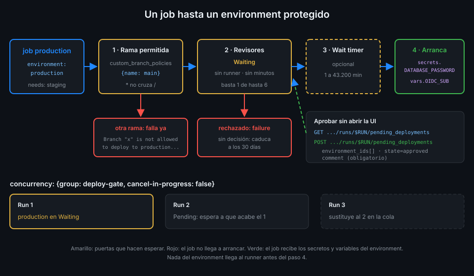

# Environments y reglas de protección

> Un environment es una puerta delante de un job: decide desde qué rama se puede llegar, quién
> tiene que abrirla y cuánto espera. Solo al otro lado están sus secretos.



## 🎯 Objetivos

Al terminar este archivo eres capaz de:

- Explicar qué es un environment y qué guarda: reglas, secretos y variables
- Configurar ramas permitidas, revisores obligatorios y wait timer, por la UI y por la API
- Predecir en qué orden se evalúan las reglas y qué ve el job mientras espera
- Aprobar o rechazar un despliegue pendiente desde la terminal
- Combinar environments con `concurrency` para que dos despliegues no se pisen
- Conocer los límites del plan gratuito y de la autoaprobación

## 1. Qué problema resuelve

El archivo 01 dejó las contraseñas en secretos de environment. Pero un secreto de environment
lo recibe **cualquier job que escriba `environment: production`**. Si cualquiera con permiso de
escritura puede abrir una rama, escribir un workflow con esa línea y lanzarlo, el alcance del
secreto no ha cambiado mucho.

Las **reglas de protección** cierran ese hueco: el job declara el environment, pero no arranca,
y no recibe nada, hasta que cumple las reglas. Las tres que usa `tablero`:

| Regla | Qué impide |
|---|---|
| Ramas permitidas | Que un workflow de una rama cualquiera llegue a los secretos de production |
| Revisores obligatorios | Que production cambie sin que una persona lo mire |
| Wait timer | Que production se despliegue nada más terminar staging, sin margen para pararlo |

## 2. Cómo funciona

### Qué es un environment

Un environment es un objeto del repo con un nombre y tres cosas dentro: **reglas de
protección**, **secretos** y **variables**. Un job lo usa con una línea:

```yaml
    environment: production
```

Si el environment no existe, GitHub lo crea vacío la primera vez que un job lo nombra: sin
reglas. Por eso en `tablero` los creas antes con la API.

Un job con `environment:` además crea un **deployment** de GitHub, que aparece en la portada del
repo. Lo usarás a fondo en la Semana 17.

### Las reglas

| Regla | Valores | Detalle |
|---|---|---|
| Required reviewers | Hasta 6 usuarios o equipos | Basta con que **uno** apruebe |
| Prevent self-review | Sí o no | Quien lanzó el run no puede aprobarlo |
| Wait timer | 1 a 43.200 minutos | Espera tras pasar el resto de reglas |
| Deployment branches and tags | Todas, protegidas o una lista de patrones | El comodín `*` no cruza `/`: `release/*` no casa con `release/a/b` |
| Custom deployment protection rules | Una GitHub App que responde sí o no | En public preview |

Como mucho 6 reglas de protección activas por environment. En la UI hay además la casilla
"Allow administrators to bypass configured protection rules": si está marcada, un administrador
del repo puede saltarse las reglas.

En los planes Free, Pro y Team, revisores y wait timer solo existen en **repos públicos**.
`tablero` lo es.

_Verificado con la documentación de deployments y environments de GitHub y ubuntu-24.04,
noviembre de 2026._

### El orden en que se evalúan

Cuando un run llega a un job con `environment: production`:

1. **Rama**. Si la ref del run no está permitida, el job falla en el acto con un mensaje como
   `Branch "x" is not allowed to deploy to production due to environment protection rules.`
   No hay nada que aprobar.
2. **Revisores**. El job pasa a **Waiting** y el run muestra "Review deployments". Los revisores
   reciben un aviso. Si nadie decide, el job caduca a los 30 días.
3. **Wait timer**. Tras la aprobación, la cuenta atrás.
4. **Arranca el job**. Solo ahora el runner recibe los secretos y las variables del environment.

Mientras el job espera **no ocupa runner** ni consume minutos. Si se rechaza, el job termina en
`failure` y los que dependen de él se saltan.

### Ramas permitidas por la API

La regla de ramas tiene dos booleanos opuestos en `deployment_branch_policy`:

| `protected_branches` | `custom_branch_policies` | Significado |
|:--:|:--:|---|
| `true` | `false` | Solo ramas con protección de rama |
| `false` | `true` | Solo las ramas o tags de la lista de políticas |
| (`deployment_branch_policy: null`) | | Todas las ramas |

`tablero` usa la lista, con una sola entrada: `main`. Una política de la lista se crea aparte,
con `POST .../deployment-branch-policies`, y solo existe si `custom_branch_policies` es `true`;
si no, la API responde `404`.

## 3. Cómo se usa

### Crear los environments de `tablero`

```bash
gh api -X PUT 'repos/{owner}/{repo}/environments/staging' --input - <<'EOF'
{"deployment_branch_policy": {"protected_branches": false, "custom_branch_policies": true}}
EOF
gh api -X POST 'repos/{owner}/{repo}/environments/staging/deployment-branch-policies' \
  -f name=main -f type=branch
```

Production añade el revisor. El `id` es tu ID numérico de usuario, no tu login:

```bash
ME=$(gh api user --jq .id)
gh api -X PUT 'repos/{owner}/{repo}/environments/production' --input - <<EOF
{
  "prevent_self_review": false,
  "reviewers": [{"type": "User", "id": $ME}],
  "deployment_branch_policy": {"protected_branches": false, "custom_branch_policies": true}
}
EOF
```

`prevent_self_review: false` porque trabajas solo: con `true` no podrías aprobar tus propios
runs y nadie más podría. En un equipo, `true`: quien lanza no es quien aprueba.

Para comprobar lo que quedó:

```bash
gh api 'repos/{owner}/{repo}/environments/production' --jq '[.protection_rules[].type]'
# [
#   "required_reviewers",
#   "branch_policy"
# ]
```

### El workflow

```yaml
name: deploy-example
on:
  push:
    branches: [main]
  workflow_dispatch:
# Un despliegue no se corta a medias: el siguiente espera a que acabe el anterior.
concurrency:
  group: deploy-example
  cancel-in-progress: false
permissions: {}
jobs:
  staging:
    runs-on: ubuntu-24.04
    timeout-minutes: 15
    environment: staging
    permissions:
      contents: read
    steps:
      - run: echo "staging"
  production:
    needs: staging
    runs-on: ubuntu-24.04
    timeout-minutes: 15
    environment: production
    permissions:
      contents: read
    steps:
      - run: echo "production"
```

**Por qué `cancel-in-progress: false`.** En CI cancelar el run anterior ahorra minutos (Semana
07). En un despliegue, cancelar a medias deja una migración a medio aplicar. Con `false`, el run
nuevo espera en `Pending`. Ojo: si el run anterior está esperando tu aprobación, el nuevo
también espera. Y si llega un tercero, el que estaba en `Pending` se cancela: solo se guarda el
último en cola.

### Aprobar desde la terminal

Cuando production está en Waiting, la API dice qué espera y si puedes aprobarlo:

```bash
RUN=$(gh run list --workflow deploy-gate.yml --limit 1 --json databaseId --jq '.[0].databaseId')
gh api "repos/{owner}/{repo}/actions/runs/$RUN/pending_deployments" \
  --jq '.[] | [.environment.name, .environment.id, .current_user_can_approve] | @tsv'
```

Y la aprobación es un `POST` al mismo endpoint, con el ID del environment (entero), el estado y
un comentario, que es obligatorio:

```bash
gh api -X POST "repos/{owner}/{repo}/actions/runs/$RUN/pending_deployments" \
  -F 'environment_ids[]=<id>' -f state=approved -f comment='staging verde, adelante'
```

`state=rejected` lo rechaza. El comentario queda en el historial del run: escribe por qué.

### Variables de environment

Las variables de environment siguen la misma precedencia que los secretos y, como ellos, solo
llegan al job que declara el environment. `tablero` guarda en cada uno la variable `OIDC_SUB`
con el `sub` que acepta (archivo 06):

```bash
gh variable set OIDC_SUB --env staging --body '<sub-de-staging>'
gh variable list --env staging --json name,value
```

## 4. Antipatrones

| Antipatrón | Por qué duele | Qué hacer en su lugar |
|---|---|---|
| Dejar que un job cree el environment al nombrarlo | Nace sin reglas: cualquier rama despliega | Crearlo y configurarlo antes por la API |
| Environment sin regla de ramas | Una rama cualquiera llega a sus secretos | `custom_branch_policies` con `main` |
| `cancel-in-progress: true` en un despliegue | Corta una migración a medias | `false` |
| `prevent_self_review: true` siendo el único revisor | Nadie puede aprobar | `false` si trabajas solo; un segundo revisor en equipo |
| Aprobar sin mirar qué cambió | La regla existe, el control no | Revisar el diff y el resultado de staging |
| Comentario vacío o "ok" | El historial no explica la decisión | Escribe por qué apruebas o rechazas |
| Marcar "Allow administrators to bypass" sin necesidad | Un admin se salta revisores sin dejar rastro claro | Dejarla desmarcada salvo emergencias |

## 5. Trucos

- **Qué environments existen y qué protegen, en una línea**:
  `gh api 'repos/{owner}/{repo}/environments' --jq '.environments[] | [.name, ([.protection_rules[].type] | join(","))] | @tsv'`.
- **Ver las ramas permitidas**:
  `gh api 'repos/{owner}/{repo}/environments/staging/deployment-branch-policies' --jq '.branch_policies[].name'`.
- **Esperar a que un run llegue a Waiting** sin refrescar la UI: `gh run watch <run-id>` se
  queda en el job pendiente; en otra terminal, `pending_deployments`.

## 📚 Recursos Adicionales

- [GitHub Docs: Deployments and environments](https://docs.github.com/en/actions/reference/workflows-and-actions/deployments-and-environments)
- [GitHub Docs: Managing environments for deployment](https://docs.github.com/en/actions/how-tos/deploy/configure-and-manage-deployments/manage-environments)
- [GitHub Docs: Reviewing deployments](https://docs.github.com/en/actions/how-tos/deploy/configure-and-manage-deployments/review-deployments)
- [REST API: Deployment environments](https://docs.github.com/en/rest/deployments/environments)

## ✅ Checklist de Verificación

- [ ] Sé qué guarda un environment y qué pasa si un job nombra uno que no existe
- [ ] Sé configurar ramas permitidas con `custom_branch_policies` y una política
- [ ] Sé en qué orden se evalúan rama, revisores y wait timer
- [ ] Sé que el job no recibe secretos ni ocupa runner mientras espera
- [ ] Sé aprobar y rechazar con `pending_deployments`
- [ ] Sé por qué un despliegue lleva `concurrency` sin cancelación
- [ ] Sé cuándo activar `prevent_self_review`

---

| ← Anterior | Siguiente → |
|:---|---:|
| [Enmascarado y fugas de secretos](02-enmascarado-y-fugas-de-secretos.md) | [De credenciales estáticas a OIDC](04-de-credenciales-estaticas-a-oidc.md) |
