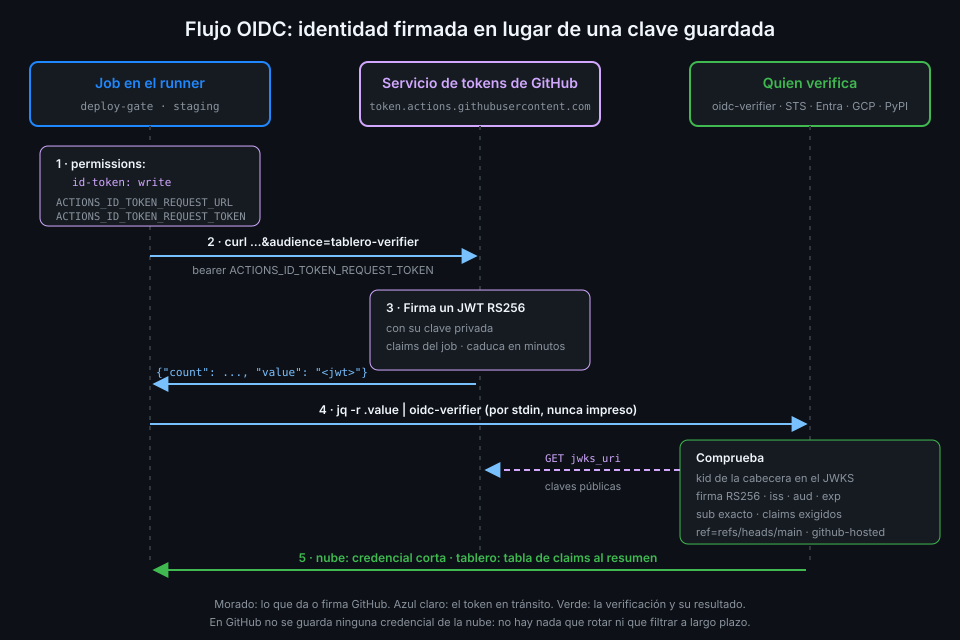

# De credenciales estáticas a OIDC

> El mejor secreto es el que no existe. Con OIDC, el job no guarda ninguna credencial de la nube:
> demuestra quién es con un token firmado que caduca en minutos y la cambia por un acceso corto.



## 🎯 Objetivos

Al terminar este archivo eres capaz de:

- Explicar qué riesgos tiene una credencial de larga duración guardada como secreto
- Describir el flujo OIDC completo: permiso, petición, firma, verificación e intercambio
- Explicar qué da y qué no da el permiso `id-token: write`
- Pedir un token OIDC con `curl` y con `core.getIDToken`
- Explicar cómo comprueba quien verifica que el token lo firmó GitHub
- Situar el verificador de `tablero` frente a AWS, Azure, GCP y PyPI

## 1. Qué problema resuelve

La forma clásica de desplegar desde Actions a una nube es crear un usuario técnico, generarle
una clave de acceso y guardarla como secreto. Funciona, y tiene cuatro problemas:

| Problema | Consecuencia |
|---|---|
| **Larga duración** | La clave vale hasta que alguien la rota. Si se filtra hoy, sirve dentro de seis meses |
| **Portable** | Quien la tenga la usa desde cualquier sitio: tu runner, un portátil, un servidor ajeno |
| **Sin contexto** | La nube no sabe si la usa el job de `main` o una rama de pruebas: solo ve la clave |
| **Rotación manual** | Rotarla es una tarea que se olvida; muchas claves tienen años |

El archivo 02 mostró cuántas formas tiene un secreto de acabar en un log. Con una clave de larga
duración, cada una de esas fugas es grave.

**OIDC** (OpenID Connect) da la vuelta al problema: el job no guarda nada. Cuando necesita
acceso, pide a GitHub un **token de identidad** firmado que dice quién es: qué repo, qué rama,
qué workflow, qué environment. La nube comprueba la firma, compara esos datos con una política
que tú escribiste y, si casan, entrega una credencial que dura lo que dura el job.

| | Clave en un secreto | OIDC |
|---|---|---|
| Qué se guarda en GitHub | La clave | Nada |
| Duración | Hasta que se rote | Minutos |
| Vale desde | Cualquier sitio | Solo para quien la política acepte |
| Qué sabe la nube del job | Nada | Repo, ref, workflow, environment, evento… |
| Rotación | Manual | No hay nada que rotar |

## 2. Cómo funciona

El diagrama recorre los cinco pasos:

1. **Permiso**. El job declara `id-token: write`. Sin él, el runner no le da los medios para
   pedir un token.
2. **Petición**. Un paso llama al servicio de tokens de GitHub con la **audiencia** que quiere
   en el token: para quién es.
3. **Emisión**. GitHub firma un JWT con su clave privada. El token lleva los **claims** del job
   (archivo 05) y caduca pronto.
4. **Verificación**. El job envía el token a quien lo consume. Este descarga las claves públicas
   de GitHub, comprueba la firma y después los claims contra su política (archivo 06).
5. **Intercambio**. Si todo casa, la nube devuelve una credencial de corta duración. En
   `tablero` no hay nube: el verificador imprime los claims que aceptó y el job sigue.

### El permiso `id-token: write`

El scope `id-token` solo admite `write` o `none`. `write` aquí significa "puede pedir un token
de identidad", **no** "puede escribir en el repo": no da acceso a ningún recurso, ni de GitHub
ni de la nube. Lo que el token consiga depende enteramente de la política del otro lado.

Aun así, va en el job que lo necesita y no en la raíz: un token que dice "soy `tablero`" es lo
que la nube acepta, y no quieres que lo pueda pedir el job de lint.

Con el permiso, el runner pone en el entorno del job dos variables:

| Variable | Qué es |
|---|---|
| `ACTIONS_ID_TOKEN_REQUEST_URL` | La URL del servicio de tokens para este job |
| `ACTIONS_ID_TOKEN_REQUEST_TOKEN` | Un token para autenticar esa petición |

Sin el permiso, **no existen**. Ese es el síntoma típico: la petición falla con un error que no
menciona permisos.

_Verificado con la documentación de OpenID Connect de GitHub Actions y ubuntu-24.04, noviembre
de 2026._

### Quién firma y cómo se comprueba

El emisor (`iss`) de todos los tokens es `https://token.actions.githubusercontent.com`. Como todo
proveedor OIDC, publica un documento de descubrimiento:

```bash
curl -sSf https://token.actions.githubusercontent.com/.well-known/openid-configuration |
  jq '{issuer, jwks_uri, id_token_signing_alg_values_supported}'
# {
#   "issuer": "https://token.actions.githubusercontent.com",
#   "jwks_uri": "https://token.actions.githubusercontent.com/.well-known/jwks",
#   "id_token_signing_alg_values_supported": [
#     "RS256"
#   ]
# }
```

El `jwks_uri` lleva a un **JWKS**: la lista de claves públicas RSA de GitHub, cada una con un
identificador `kid`. La cabecera de cada token dice qué `kid` lo firmó. Quien verifica busca esa
clave en el JWKS y comprueba la firma. Nadie que no tenga la clave privada de GitHub puede
fabricar un token que pase.

_Comprobado el 4 de noviembre de 2026: el JWKS publicaba 4 claves RSA._

GitHub rota esas claves: por eso quien verifica descarga el JWKS (o lo cachea con caducidad) en
lugar de copiar una clave a mano.

## 3. Cómo se usa

### Pedir el token con `curl`

```bash
curl -sSf -H "Authorization: bearer $ACTIONS_ID_TOKEN_REQUEST_TOKEN" \
  "$ACTIONS_ID_TOKEN_REQUEST_URL&audience=tablero-verifier" | jq -r .value
```

La respuesta es un JSON `{"count": ..., "value": "<jwt>"}`; `jq -r .value` saca el token. El
`&audience=` va pegado porque la URL ya trae su propia query string.

Sin `id-token: write`, las dos variables están vacías y `curl` intenta resolver un host llamado
`&audience=tablero-verifier`:

```text
curl: (6) Could not resolve host: &audience=tablero-verifier
```

### Pedirlo con `actions/github-script`

En una action de JavaScript, `@actions/core` lo hace por ti con `core.getIDToken(audience)`. En
`actions/github-script` v9, `core` ya está inyectado:

```yaml
name: oidc-js-example
on:
  workflow_dispatch:
permissions: {}
jobs:
  token:
    runs-on: ubuntu-24.04
    timeout-minutes: 5
    permissions:
      id-token: write
    steps:
      - uses: actions/github-script@3a2844b7e9c422d3c10d287c895573f7108da1b3 # v9.0.0
        env:
          AUDIENCE: tablero-verifier
        with:
          script: |
            const token = await core.getIDToken(process.env.AUDIENCE);
            // El token ya está enmascarado; solo se muestra cuántos segmentos tiene el JWT.
            core.info(`segmentos: ${token.split('.').length}`);
```

La audiencia llega por `env:`, como cualquier dato, y el token no se imprime.

### El token pasa por un pipe, no por el disco

El token vale minutos, pero durante esos minutos es una credencial. En `tablero` no se guarda en
una variable de entorno, ni en un archivo, ni se imprime: va de `curl` a `jq` y de `jq` al
verificador por stdin:

```bash
curl -sSf -H "Authorization: bearer $ACTIONS_ID_TOKEN_REQUEST_TOKEN" \
    "$ACTIONS_ID_TOKEN_REQUEST_URL&audience=$AUDIENCE" |
  jq -r .value |
  uv run --no-sync oidc-verifier --audience "$AUDIENCE" --sub "$EXPECTED_SUB"
```

Para que un fallo de `curl` haga fallar el paso, el workflow declara `shell: bash` en
`defaults.run`: con shell explícito el runner usa `bash --noprofile --norc -eo pipefail {0}`;
sin él, `bash -e {0}`, sin `pipefail`, y el paso lo decidiría solo el último comando del pipe.

### Quién verifica en el mundo real

| Consumidor | Qué configuras del lado de la nube |
|---|---|
| AWS | Un proveedor de identidad OIDC con el emisor de GitHub y un rol IAM cuya trust policy exige `token.actions.githubusercontent.com:aud` = `sts.amazonaws.com` y un `sub` concreto |
| Azure (Entra ID) | Una federated credential en una app registration, con el `sub` exacto |
| Google Cloud | Un Workload Identity Pool con un attribute mapping y una attribute condition sobre los claims |
| PyPI | Un trusted publisher: repo, workflow y environment que pueden publicar |

Los cuatro hacen lo mismo que `oidc-verifier`: firma con el JWKS, emisor, audiencia, caducidad y
claims. `tablero` usa el verificador porque la capa no tiene nube; así ves las dos mitades.

## 4. Antipatrones

| Antipatrón | Por qué duele | Qué hacer en su lugar |
|---|---|---|
| Clave de acceso de larga duración en un secreto cuando la nube admite OIDC | Una fuga vale meses y desde cualquier sitio | Federación OIDC con un rol por environment |
| `id-token: write` en la raíz | Cualquier job puede pedir un token que la nube acepta | Solo en los jobs que despliegan |
| Imprimir el token "para depurar" | Durante su vida es una credencial válida | Decodificar solo el payload, nunca mostrar el JWT |
| Guardar el token en `$GITHUB_ENV` | Lo ven todos los pasos y actions siguientes | Un pipe dentro del mismo paso |
| Copiar a mano la clave pública de GitHub | GitHub rota sus claves y la verificación se rompe | Descargar el JWKS por `jwks_uri` |
| Pipe sin `pipefail` | Un `curl` fallido no hace fallar el paso | `shell: bash` explícito |

## 5. Trucos

- **Mira el JWKS que verifica tus tokens**:
  `curl -sSf https://token.actions.githubusercontent.com/.well-known/jwks | jq -r '.keys[].kid'`.
- **Comprueba el `pipefail` que recibió un paso**: en el log, la línea `shell:` del paso muestra
  el comando exacto del shell.
- **Qué claims puede llevar un token**: `claims_supported` en el documento de descubrimiento.

## 📚 Recursos Adicionales

- [GitHub Docs: OpenID Connect](https://docs.github.com/en/actions/concepts/security/openid-connect)
- [GitHub Docs: OpenID Connect reference](https://docs.github.com/en/actions/reference/security/oidc)
- [GitHub Docs: Configuring OpenID Connect in AWS](https://docs.github.com/en/actions/how-tos/secure-your-work/security-harden-deployments/oidc-in-aws)
- [PyPI: Trusted publishers](https://docs.pypi.org/trusted-publishers/)

## ✅ Checklist de Verificación

- [ ] Sé qué cuatro problemas tiene una clave de larga duración
- [ ] Sé recorrer los cinco pasos del flujo OIDC
- [ ] Sé qué da y qué no da `id-token: write`, y por qué va en el job
- [ ] Sé pedir un token con `curl` y con `core.getIDToken`
- [ ] Sé cómo se comprueba la firma con el JWKS y el `kid`
- [ ] Sé por qué el token va por un pipe y el paso necesita `pipefail`
- [ ] Sé qué configura cada nube para aceptar un token de GitHub

---

| ← Anterior | Siguiente → |
|:---|---:|
| [Environments y reglas de protección](03-environments-y-reglas-de-proteccion.md) | [El token OIDC y sus claims](05-el-token-oidc-y-sus-claims.md) |
