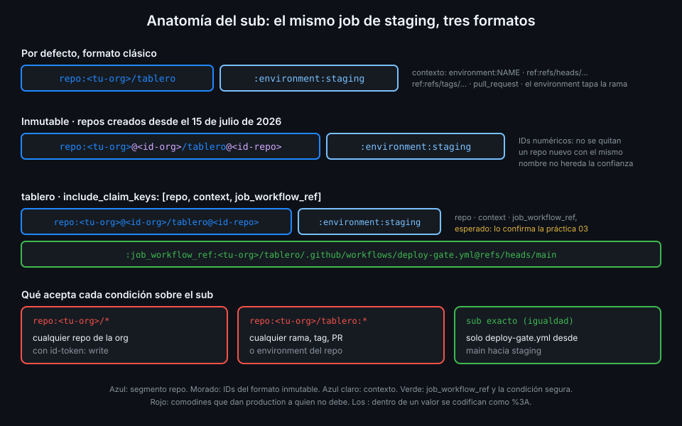

# El token OIDC y sus claims

> Un token OIDC es un JSON firmado que describe al job. Quien lo verifica decide con lo que pone
> ahí, así que tienes que saber leerlo campo a campo, y sobre todo el `sub`.



## 🎯 Objetivos

Al terminar este archivo eres capaz de:

- Separar las tres partes de un JWT y decodificar el payload sin imprimir el token
- Explicar los claims estándar (`iss`, `aud`, `sub`, `exp`) y los propios de GitHub
- Elegir la audiencia de un token y explicar por qué no conviene la de por defecto
- Predecir el `sub` por defecto de un job según su evento, rama y environment
- Reconocer el formato inmutable del `sub` y saber cuándo lo tiene un repo
- Explicar qué claims identifican de verdad al repo y cuáles se pueden suplantar

## 1. Qué problema resuelve

El archivo 04 dijo que la nube compara "los datos del token" con una política. Para escribir esa
política, o para el `OIDC_SUB` de `tablero`, necesitas saber **qué datos** son, qué valor tiene
cada uno en tu job y cuáles son fiables. Escribir una política sin haber leído nunca un token es
la forma más rápida de aceptar de más o de rechazarlo todo.

## 2. Cómo funciona

### Las tres partes del JWT

Un JWT son tres segmentos en base64url separados por puntos:

| Segmento | Contiene | ¿Secreto? |
|---|---|---|
| Cabecera | `alg` (`RS256`), `typ`, `kid` de la clave que firmó | No |
| Payload | Los claims | No |
| Firma | RS256 de cabecera y payload con la clave privada de GitHub | No, pero junto a lo demás forma la credencial |

Ninguna parte va cifrada: cualquiera que tenga el token lee los claims. Lo que no puede es
cambiarlos sin romper la firma. Por eso **los claims no son secretos y el token entero sí**:
mientras no caduque, quien lo tenga puede presentarlo como propio.

### Claims estándar

| Claim | Qué es | En `tablero` |
|---|---|---|
| `iss` | Emisor | `https://token.actions.githubusercontent.com` |
| `aud` | Para quién es el token | `tablero-verifier` |
| `sub` | De quién habla el token | Ver más abajo |
| `exp`, `iat`, `nbf` | Caducidad, emisión, no válido antes de | Minutos de vida |
| `jti` | Identificador único del token | — |

### Claims de GitHub

El documento de descubrimiento enumera los que puede llevar. Los que más usarás:

| Claim | Ejemplo | Para qué sirve |
|---|---|---|
| `repository`, `repository_owner` | `<tu-org>/tablero`, `<tu-org>` | Legible, pero un nombre se puede reutilizar |
| `repository_id`, `repository_owner_id` | Números | Identifican al repo aunque se renombre o se borre y alguien cree otro igual |
| `ref`, `ref_type`, `ref_protected` | `refs/heads/main`, `branch`, `true` | Desde qué rama o tag corre |
| `sha` | El commit | Qué código corre |
| `environment` | `staging` | Solo si el job declara environment |
| `event_name` | `push` | Qué lo disparó |
| `workflow_ref`, `job_workflow_ref` | `<tu-org>/tablero/.github/workflows/deploy-gate.yml@refs/heads/main` | Qué workflow; en un reutilizable, `job_workflow_ref` es el reutilizable |
| `runner_environment` | `github-hosted` o `self-hosted` | Dónde corre el job |
| `actor`, `actor_id` | Quien lanzó el run | Auditoría |
| `repository_visibility` | `public` | — |

Además, las propiedades personalizadas de la org llegan como `repo_property_*`.

_Verificado con el documento de descubrimiento de `token.actions.githubusercontent.com` y la
referencia de OIDC de GitHub, noviembre de 2026._

### La audiencia

Sin el parámetro `audience`, `aud` vale la URL del propietario del repo, por ejemplo
`https://github.com/<tu-org>`. Es la misma para todos los consumidores: un token pedido para la
nube A sirve también ante la nube B si las dos aceptan la audiencia por defecto. Pide siempre una
audiencia propia del consumidor (`sts.amazonaws.com` para AWS, `tablero-verifier` en `tablero`)
y que el consumidor la exija.

### El `sub` por defecto

El `sub` es el claim que casi todas las políticas comparan. Su formato clásico depende del
contexto del job:

| Contexto | `sub` |
|---|---|
| Job con environment | `repo:ORG/REPO:environment:NAME` |
| `pull_request` sin environment | `repo:ORG/REPO:pull_request` |
| Rama, sin environment | `repo:ORG/REPO:ref:refs/heads/BRANCH` |
| Tag, sin environment | `repo:ORG/REPO:ref:refs/tags/TAG` |

Fíjate en que el environment **sustituye** a la rama: el `sub` de un job con
`environment: staging` no dice desde qué rama corre. Por eso la regla de ramas del environment
(archivo 03) importa tanto: es lo que garantiza que `environment:staging` implica `main`.

Si un valor contiene `:`, se codifica como `%3A` para no romper el formato.

### El formato inmutable

Un nombre de repo se puede reutilizar: si `<tu-org>/tablero` se borra o se renombra, otra cuenta
podría crear algo con ese nombre y su `sub` clásico sería idéntico al tuyo. El **formato
inmutable** añade los IDs numéricos del propietario y del repo:

```text
repo:octo-org@123456/octo-repo@456789:ref:refs/heads/main
```

Las reglas:

- Los repos creados **a partir del 15 de julio de 2026** lo usan siempre. Los anteriores
  mantienen el formato clásico salvo que la org o el repo lo activen.
- Un repo renombrado o transferido después de esa fecha pasa al inmutable.
- Los IDs van siempre en el segmento `repo`, también con una plantilla personalizada, y no se
  pueden quitar.

_Verificado con la referencia de OIDC de GitHub, noviembre de 2026._

Tu `tablero` es de noviembre de 2026: su `sub` está en formato inmutable. La documentación no
muestra un ejemplo con environment en ese formato, así que no te lo damos como dato: lo lees en
tu propio token en la práctica 03.

## 3. Cómo se usa

### Leer el payload sin mostrar el token

El patrón de la práctica 03: separar el segundo segmento, completar el relleno de base64url y
decodificarlo. Nunca aparece el token en el log, solo los claims:

````yaml
name: oidc-claims-example
on:
  workflow_dispatch:
permissions: {}
defaults:
  run:
    shell: bash
jobs:
  claims:
    runs-on: ubuntu-24.04
    timeout-minutes: 5
    permissions:
      id-token: write
    steps:
      - name: Claims del token en el resumen del job
        env:
          AUDIENCE: tablero-verifier
        run: |
          payload=$(curl -sSf -H "Authorization: bearer $ACTIONS_ID_TOKEN_REQUEST_TOKEN" \
              "$ACTIONS_ID_TOKEN_REQUEST_URL&audience=$AUDIENCE" |
            jq -r .value | cut -d. -f2 | tr '_-' '/+')
          # base64url quita el relleno "=": se repone hasta un múltiplo de 4.
          while [ $(( ${#payload} % 4 )) -ne 0 ]; do payload="$payload="; done
          {
            echo '```json'
            printf '%s' "$payload" | base64 -d | jq .
            echo '```'
          } >> "$GITHUB_STEP_SUMMARY"
````

El payload se guarda en una variable porque es público; el token completo no sale del pipe.

### Qué comparar con qué

| Quieres garantizar | Claim | No uses |
|---|---|---|
| Que es tu repo | `repository_id` o el `sub` inmutable | `repository` solo: el nombre se reutiliza |
| Que es la rama `main` | `ref` = `refs/heads/main` | Un `sub` con environment sin regla de ramas |
| Que es production | `environment` en el `sub` | `workflow` (el `name:` del YAML, lo cambia cualquiera) |
| Que es este workflow y no otro del repo | `job_workflow_ref` | `workflow` |
| Que es un runner de GitHub | `runner_environment` = `github-hosted` | — |

El verificador de `tablero` usa el `sub` personalizado (archivo 06) más dos `--claim` exactos:
`ref=refs/heads/main` y `runner_environment=github-hosted`.

## 4. Antipatrones

| Antipatrón | Por qué duele | Qué hacer en su lugar |
|---|---|---|
| Imprimir el token para leer los claims | Es una credencial válida durante minutos | Decodificar solo el payload |
| Pensar que los claims son secretos | Lleva a esconder datos inútiles y a enseñar el token | Los claims se leen; el token no se muestra |
| Aceptar la audiencia por defecto | Un token para un consumidor vale para otro | Una audiencia por consumidor, exigida |
| Confiar en `repository` (nombre) | Otro puede crear un repo con ese nombre | `repository_id` o el `sub` inmutable |
| Confiar en `workflow` | Es el `name:` del YAML, texto libre | `job_workflow_ref` |
| Escribir el `sub` esperado de memoria | Un detalle (IDs, `%3A`) lo hace no coincidir nunca | Copiarlo de un token real |

## 5. Trucos

- **El `sub` que firmó GitHub, gratis**: si `oidc-verifier` rechaza el token, el mensaje
  `rechazado: sub '...' no es el esperado '...'` trae el real. Compruébalo antes de copiarlo.
- **Decodificar el payload solo con `jq`**, sin preocuparte del relleno:
  `jq -R 'split(".")[1] | gsub("-";"+") | gsub("_";"/") | @base64d | fromjson'`. Le llega el
  JWT por stdin, igual que al verificador.
- **Lista de claims posibles**: `curl -sSf https://token.actions.githubusercontent.com/.well-known/openid-configuration | jq .claims_supported`.

## 📚 Recursos Adicionales

- [GitHub Docs: OpenID Connect reference](https://docs.github.com/en/actions/reference/security/oidc)
- [RFC 7519: JSON Web Token](https://www.rfc-editor.org/rfc/rfc7519)
- [jwt.io: introducción a JWT](https://jwt.io/introduction)

## ✅ Checklist de Verificación

- [ ] Sé qué hay en cada segmento de un JWT y qué parte es secreta
- [ ] Sé leer los claims de un token sin mostrarlo
- [ ] Sé qué audiencia lleva un token por defecto y por qué cambiarla
- [ ] Sé predecir el `sub` clásico según evento, rama y environment
- [ ] Sé qué añade el formato inmutable y cuándo lo tiene un repo
- [ ] Sé qué claim usar para repo, rama, environment y workflow

---

| ← Anterior | Siguiente → |
|:---|---:|
| [De credenciales estáticas a OIDC](04-de-credenciales-estaticas-a-oidc.md) | [Política de confianza y sub personalizado](06-politica-de-confianza-y-sub-personalizado.md) |
