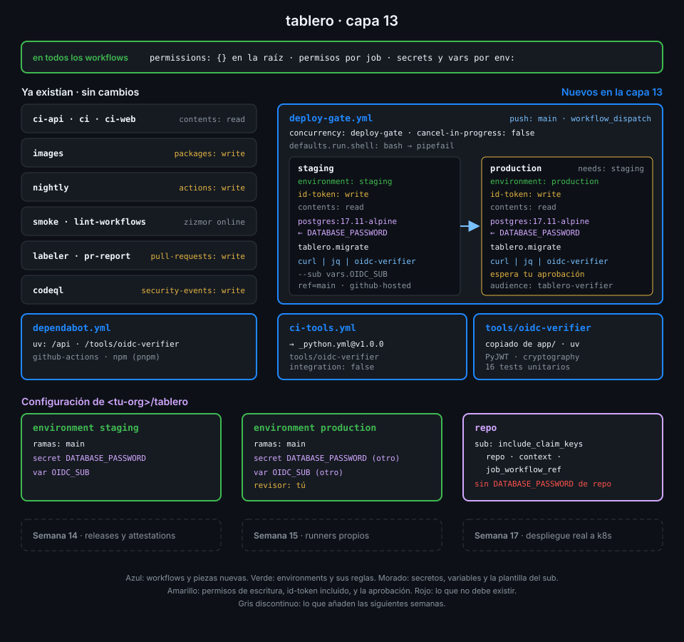

# Proyecto: capa 13 de tablero



## 🎯 Objetivo

Que `tablero` tenga dónde desplegar antes de desplegar de verdad: dos environments, `staging` y
`production`, cada uno con su propia contraseña de base de datos que ningún otro job puede leer,
production detrás de tu aprobación, y un ensayo de despliegue que solo pasa si el token OIDC del
job demuestra exactamente quién lo pidió, desde qué workflow y para qué environment.

## 📦 Qué añade esta capa

| Pieza de `tablero` | Qué hace | Por qué existe |
|---|---|---|
| Environment `staging` | Solo despliega desde `main`; secreto `DATABASE_PASSWORD` y variable `OIDC_SUB` propios | Un job de otra rama no llega ni a pedir sus secretos |
| Environment `production` | Lo mismo, más un revisor obligatorio | Nada toca production sin que una persona lo mire |
| Plantilla del `sub` | `repo`, `context` y `job_workflow_ref` | El `sub` dice también qué workflow pidió el token: otro workflow del repo no puede hacerse pasar por `deploy-gate` |
| `tools/oidc-verifier/` (copiado de `app/`) | Verifica firma, emisor, audiencia, caducidad y `sub` exacto de un token OIDC | Hace lo que en la Semana 17 o en tu empresa hace la nube: sin nube, ves las dos mitades del trato |
| `ci-tools.yml` (nuevo) | Lint y tests del verificador con `_python.yml` del repo central, sin integración | Reutilizas el CI de Python; el verificador no despliega nada si no está probado |
| `deploy-gate.yml` (nuevo) | En `push` a `main`: `staging` y, tras tu aprobación, `production`. Cada job migra un PostgreSQL de servicio con la contraseña de su environment y pasa su token OIDC al verificador | Es el esqueleto del `deploy.yml` de la Semana 17; ya tiene identidad, aprobación y concurrencia |
| `dependabot.yml` | El ecosistema `uv` vigila también `/tools/oidc-verifier` | PyJWT y cryptography son las dependencias que más importan del repo: validan identidades |

| Situación | Qué pasa |
|---|---|
| Alguien lanza `deploy-gate` desde una rama | El job no arranca: la rama no está permitida en el environment y no recibe sus secretos |
| Otro workflow de `tablero` pide un token con la misma audiencia | El verificador lo rechaza: su `job_workflow_ref` no es `deploy-gate.yml` |
| Alguien cambia `OIDC_SUB` de staging por el de production | Staging falla: el `sub` firmado dice `environment:staging` y no coincide |
| Un PR de un fork modifica `deploy-gate.yml` | No corre: el workflow solo escucha `push` a `main` y `workflow_dispatch` |
| El token se filtra en un log | Caduca en minutos y solo vale para la audiencia `tablero-verifier` |
| Dos pushes seguidos a `main` | El segundo espera en cola: un despliegue no se corta a medias |

La Semana 14 sigue con lo que este ensayo todavía no tiene: qué se despliega. Releases
versionadas, imágenes firmadas con attestations y despliegue por digest.

## ✅ Requisitos verificables

- tools/oidc-verifier está en tablero con su pyproject.toml y su uv.lock
- Los tests unitarios de oidc-verifier pasan en local
- ci-tools.yml prueba tools/oidc-verifier llamando al _python.yml del repo central, sin integración
- deploy-gate.yml tiene un job staging con environment staging y un job production con environment production que necesita a staging
- deploy-gate.yml declara concurrency en la raíz sin cancel-in-progress
- Solo los jobs staging y production de deploy-gate.yml piden id-token: write
- Solo escriben codeql (security-events), deploy-gate (id-token), images (packages), labeler y pr-report (pull-requests) y nightly (actions); ningún write-all ni read-all
- Los dos jobs de deploy-gate.yml dan a PostgreSQL el secreto DATABASE_PASSWORD de su environment
- Los dos jobs de deploy-gate.yml pasan su token OIDC por stdin a oidc-verifier con el sub esperado de vars.OIDC_SUB
- Ningún run ni script de github-script contiene una expresión ${{ }}: secretos, variables y datos llegan por env
- Los environments staging y production solo admiten despliegues desde la rama main
- production exige la aprobación de un revisor antes de ejecutar su job
- DATABASE_PASSWORD existe como secreto de staging y de production, y no como secreto del repositorio
- El sub del token OIDC de tablero usa la plantilla repo, context y job_workflow_ref
- Cada environment guarda en la variable OIDC_SUB el sub exacto que acepta: su environment y deploy-gate.yml en main
- Los workflows de tablero pasan actionlint y zizmor con las auditorías online sin hallazgos
- ci-tools y deploy-gate, con la aprobación de production, terminan en success sobre el último commit de main

## 🎨 Criterios de calidad

Lo que `check-week.sh` no ve y la [rúbrica](../rubrica-evaluacion.md) sí puntúa:

- Las dos contraseñas se generaron con `openssl rand` y se cargaron por stdin: no están en el
  historial del shell, ni en un archivo, ni son iguales entre sí.
- El token OIDC no se imprime en ningún sitio, ni siquiera enmascarado: va de `curl` a `jq` y de
  `jq` al verificador por un pipe.
- `OIDC_SUB` de cada environment es exactamente el `sub` que GitHub firmó, sin comodines.
- El secreto de prueba de la práctica 01 y los workflows temporales `secrets-lab.yml` y
  `oidc-claims.yml` están borrados.
- Si tienes un secreto de org, su visibilidad es `selected` con solo los repos que lo usan.
- Los comentarios de `deploy-gate.yml` explican el porqué (concurrencia sin cancelación,
  `pipefail`, `id-token: write`), no repiten el YAML.
- Commits en Conventional Commits, uno por mecanismo (`ci: add deploy gate with environments`,
  `ci: verify oidc token in deploy gate`…).
- Sin `TODO` en el repo.

## 💡 Adaptación a tu dominio

| Tu proyecto | Environments | Secretos de environment | Quién verifica el token OIDC |
|---|---|---|---|
| Servicio en AWS | `staging`, `production` | Ninguno: el rol de IAM se asume con OIDC | STS, con una trust policy sobre `aud` y `sub` |
| Librería que publica en PyPI | `pypi` con revisor | Ninguno: trusted publishing | PyPI, que exige repo, workflow y environment |
| App en Azure | `dev`, `prod` | El ID del tenant y del cliente, que no son secretos: variables | Entra ID, con una federated credential por `sub` |
| Infraestructura con Terraform | `plan` sin revisor, `apply` con dos | La clave del backend de estado, si no admite OIDC | El proveedor de nube del `apply`; el `plan` usa un rol de solo lectura |

## 🚦 Cómo entregarlo

Si hiciste las cuatro prácticas ya lo tienes todo: repásalo contra los requisitos y los
criterios. Si no, parte del starter.

1. Copia el verificador y el starter en `tablero` y completa los `TODO 1` a `TODO 10`:

   ```bash
   cd ~/code/tablero
   B=~/code/bc-github-actions
   cp -r "$B"/app/tools .
   S="$B"/bootcamp/week-13-secretos_entornos_y_oidc/3-proyecto/starter
   cp -r "$S"/.github/. .github/
   grep -rnE "TODO [0-9]+" .github | wc -l
   # 10
   ```

2. Cambia `<tu-org>` y `<sha-de-v1.0.0>` por los de tu org, como en el resto de llamadas al
   repo central, y añade `/tools/oidc-verifier` a los `directories` de `uv` en `dependabot.yml`.

3. Crea los environments, sus reglas, sus secretos y la plantilla del `sub`
   ([práctica 01](../2-practicas/01-secretos-de-repo-environment-y-org.md),
   [práctica 02](../2-practicas/02-environments-y-reglas-de-proteccion.md) y
   [práctica 03](../2-practicas/03-token-oidc-y-sus-claims.md)).

4. Antes de hacer push, comprueba lo que se puede ver en local:

   ```bash
   (cd tools/oidc-verifier && uv sync --locked && uv run --no-sync pytest tests/unit -q)
   actionlint && GH_TOKEN=$(gh auth token) zizmor -q .github/ && echo limpio
   # limpio
   ```

5. Haz push a `main`, aprueba production cuando `deploy-gate` lo pida y guarda en `OIDC_SUB` el
   `sub` que veas ([práctica 04](../2-practicas/04-verificador-oidc-y-deploy-gate.md)). Si el
   primer run falla porque `OIDC_SUB` aún no existía, vuelve a lanzarlo con
   `gh run rerun <run-id>`: el `sha` es el mismo.

6. Lanza la verificación:

   ```bash
   cd ~/code/bc-github-actions
   ./scripts/check-week.sh 13
   # 17/17 comprobaciones superadas.
   ```

## 🧯 Errores comunes

| Síntoma | Causa | Solución |
|---|---|---|
| `Branch "x" is not allowed to deploy to staging due to environment protection rules.` | Lanzaste `deploy-gate` desde otra rama | Es lo esperado: lánzalo desde `main` |
| El job de production se queda en `Waiting` | Espera tu aprobación | Apruébalo en la UI o con la API de `pending_deployments` |
| No puedes aprobar tu propio despliegue | `prevent_self_review` está activado y eres el único revisor | Desactívalo mientras trabajes solo; en un equipo, déjalo activado |
| `curl: (6) Could not resolve host: &audience=tablero-verifier` | El job no tiene `id-token: write` y `ACTIONS_ID_TOKEN_REQUEST_URL` llega vacía | Añádelo en los permisos del job, no en la raíz |
| `rechazado: sub '...' no es el esperado ''` | La variable `OIDC_SUB` no existe en ese environment | Créala con el `sub` del mensaje, después de comprobar que es el tuyo |
| `rechazado: token inválido: Audience doesn't match` | La audiencia de la petición y la de `--audience` no son la misma | Usa la misma variable `AUDIENCE` en las dos |
| `password authentication failed for user "tablero"` | El secreto del environment no existe y llega vacío | `gh secret list --env staging`; vuelve a cargarlo |
| `could not translate host name` o el `DATABASE_URL` se corta | La contraseña tiene caracteres que rompen la URL | Genera solo hexadecimal: `openssl rand -hex 24` |
| `gh secret list --org` dice `HTTP 403` | Falta el scope `admin:org` | `gh auth refresh -h github.com -s admin:org` |
| `deploy-gate` lleva minutos en `Pending` sin empezar | Hay otro run del grupo de concurrencia esperando aprobación | Aprueba o rechaza el anterior; la cola es intencionada |

## 🔗 Navegación

---

| ← Anterior | Siguiente → |
|:---|---:|
| [Verificador OIDC y deploy-gate](../2-practicas/04-verificador-oidc-y-deploy-gate.md) | [Rúbrica de evaluación](../rubrica-evaluacion.md) |
