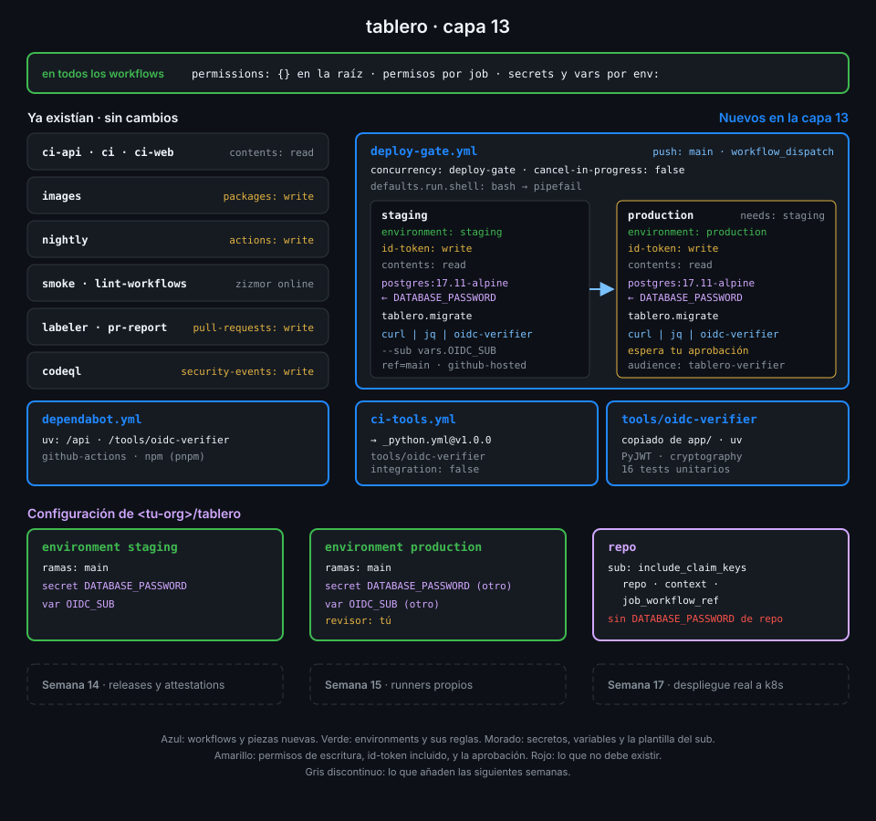

# Semana 13 — Secretos, entornos y OIDC

> La Semana 12 cerró las puertas a quien no es de confianza. Esta semana decides qué recibe quien
> sí lo es: secretos con alcance de environment, una aprobación antes de production y una
> identidad firmada en lugar de una contraseña que dura para siempre.

## 🎯 Objetivos de la Semana

Al terminar la semana eres capaz de:

- Elegir el nivel de un secreto (org, repo o environment), predecir cuál gana cuando se llaman
  igual y explicar quién lo recibe y quién no (forks, Dependabot, reutilizables)
- Explicar qué enmascara el runner y qué no (valores derivados, datos estructurados, otros
  jobs), y qué hacer cuando un secreto llega a un log
- Configurar environments con ramas permitidas, revisores obligatorios y wait timer, y aprobar o
  rechazar un despliegue desde la UI y desde la API
- Explicar por qué OIDC sustituye a las credenciales de larga duración y recorrer el flujo
  completo: `id-token: write`, petición del token, firma, JWKS y política de confianza
- Leer los claims de un token OIDC, reconocer el `sub` por defecto, el inmutable y uno
  personalizado, y escribir una política que no se pueda saltar con un comodín
- Verificar tú mismo un token OIDC como lo haría la nube: firma, emisor, audiencia, caducidad
  y `sub` exacto

## 📋 Prerrequisitos

| Necesitas | Dónde se aprende |
|---|---|
| `check-week.sh 12` en 17/17 | [Semana 12](../week-12-modelo_de_amenazas_y_endurecimiento/README.md) |
| `secrets.GITHUB_TOKEN` y secretos en reutilizables | [Semana 06](../week-06-imagenes_docker_y_ghcr/README.md) y [Semana 09](../week-09-workflows_reutilizables/README.md) |
| Service containers con PostgreSQL | [Semana 05](../week-05-service_containers_y_postgresql/README.md) |
| `::add-mask::` y comandos de workflow | [Semana 08](../week-08-probar_y_depurar_workflows/README.md) |
| `_python.yml` y `setup-tablero` en el repo central | [Semana 11](../week-11-actions_a_escala_de_organizacion/README.md) |
| Permisos por job y modelo de amenazas | [Semana 12](../week-12-modelo_de_amenazas_y_endurecimiento/README.md) |

## 🗂️ Estructura de la Semana

```
week-13-secretos_entornos_y_oidc/
├── README.md
├── rubrica-evaluacion.md
├── checks.json                    17 comprobaciones
├── 0-assets/                      diagramas SVG
├── 1-teoria/                      6 archivos, uno por concepto
├── 2-practicas/                   4 prácticas guiadas
├── 3-proyecto/
│   ├── README.md
│   └── starter/.github/workflows/ deploy-gate.yml y ci-tools.yml
├── 4-recursos/{ebooks-free,videografia,webgrafia}/README.md
└── 5-glosario/README.md
```

Además copias de `app/` la carpeta nueva `tools/oidc-verifier/`.

## 📝 Contenidos

### Teoría

| # | Archivo | Qué aprendes | Tiempo |
|:--:|---|---|:--:|
| 01 | [Secretos de repo, environment y org](1-teoria/01-secretos-de-repo-environment-y-org.md) | Niveles, precedencia, visibilidad, cifrado y quién recibe cada secreto | 30 min |
| 02 | [Enmascarado y fugas de secretos](1-teoria/02-enmascarado-y-fugas-de-secretos.md) | Cómo redacta el runner, qué se le escapa y qué hacer ante una fuga | 30 min |
| 03 | [Environments y reglas de protección](1-teoria/03-environments-y-reglas-de-proteccion.md) | Ramas permitidas, revisores, wait timer, variables y la cola de aprobación | 30 min |
| 04 | [De credenciales estáticas a OIDC](1-teoria/04-de-credenciales-estaticas-a-oidc.md) | Por qué una contraseña en un secreto es el problema y cómo funciona la federación | 30 min |
| 05 | [El token OIDC y sus claims](1-teoria/05-el-token-oidc-y-sus-claims.md) | Estructura del JWT, claims, audiencia, `sub` por defecto e inmutable | 30 min |
| 06 | [Política de confianza y sub personalizado](1-teoria/06-politica-de-confianza-y-sub-personalizado.md) | `include_claim_keys`, comodines peligrosos y qué comprueba quien verifica | 30 min |

### Prácticas

| # | Archivo | Qué haces | Tiempo |
|:--:|---|---|:--:|
| 01 | [Secretos de repo, environment y org](2-practicas/01-secretos-de-repo-environment-y-org.md) | Compruebas la precedencia sin imprimir nada, generas `DATABASE_PASSWORD` por environment y empiezas `deploy-gate.yml` | 1 h |
| 02 | [Environments y reglas de protección](2-practicas/02-environments-y-reglas-de-proteccion.md) | Solo `main` despliega, production espera tu aprobación y la das por la API | 1 h |
| 03 | [El token OIDC y sus claims](2-practicas/03-token-oidc-y-sus-claims.md) | Lees los claims de tu propio token, personalizas el `sub` y guardas el esperado en cada environment | 1 h |
| 04 | [Verificador OIDC y deploy-gate](2-practicas/04-verificador-oidc-y-deploy-gate.md) | Pruebas `oidc-verifier`, lo conectas a los dos jobs e intentas engañarlo | 1 h |

### Proyecto

[Capa 13 de `tablero`](3-proyecto/README.md): dos environments con su propia contraseña de base
de datos, production detrás de tu aprobación, y un ensayo de despliegue que solo pasa si el token
OIDC del job dice exactamente quién es.



## ⏱️ Distribución del Tiempo (10 horas)

| Actividad | Horas |
|---|:--:|
| Teoría (6 archivos) | 3 |
| Práctica 01 — Secretos de repo, environment y org | 1 |
| Práctica 02 — Environments y reglas de protección | 1 |
| Práctica 03 — El token OIDC y sus claims | 1 |
| Práctica 04 — Verificador OIDC y deploy-gate | 1 |
| Proyecto — capa 13 | 2 |
| Autoevaluación con la rúbrica | 1 |
| **Total** | **10** |

## 🎓 En el examen

GH-200 pregunta por el **nivel y la precedencia de los secretos** (environment gana a repo, repo
gana a org), por **qué no recibe un PR de un fork**, por las **reglas de protección** de un
environment y por **qué permiso pide un job para usar OIDC** (`id-token: write`, que no da
acceso a nada por sí solo). Cae también la diferencia entre un secreto y una variable, y que
`secrets` no se puede leer directamente en un `if:`.

## 🎩 Trucos y atajos

- **Genera un secreto sin que pase por tu historial ni por la pantalla**:
  `openssl rand -hex 24 | gh secret set DATABASE_PASSWORD --env staging`. `gh secret set` lee el
  valor de stdin si no le das `--body`, y el valor no queda en `~/.zsh_history`.
- **Aprueba un despliegue desde la terminal**:
  `gh api "repos/{owner}/{repo}/actions/runs/<run-id>/pending_deployments"` lista lo que espera;
  un `POST` al mismo endpoint con `environment_ids[]`, `state=approved` y `comment` lo aprueba.
  Útil cuando el revisor eres tú y estás en la terminal.
- **Mira el `sub` real de un job sin tocar el token**: si `oidc-verifier` lo rechaza, el mensaje
  `rechazado: sub '...' no es el esperado` trae el `sub` que GitHub firmó. Los claims no son
  secretos; el token sí.
- **Lista qué environments existen y qué protegen en una línea**:
  `gh api 'repos/{owner}/{repo}/environments' --jq '.environments[] | [.name, ([.protection_rules[].type] | join(","))] | @tsv'`.
- **Comprueba qué ve un secreto de org**: `gh secret list --org <tu-org>` muestra la columna de
  visibilidad; un secreto `private` no llega a `tablero`, que es público. Necesita el scope
  `admin:org` (`gh auth refresh -h github.com -s admin:org`).

## 📌 Entregables

- Environments `staging` y `production` con ramas permitidas, revisor en production, su secreto
  `DATABASE_PASSWORD` y su variable `OIDC_SUB`; ningún `DATABASE_PASSWORD` a nivel de repo
- `sub` personalizado con `repo`, `context` y `job_workflow_ref`
- `tools/oidc-verifier/`, `ci-tools.yml` y `deploy-gate.yml` en `main`, con `ci-tools` y
  `deploy-gate` (aprobado) en verde sobre el último commit (ver [proyecto](3-proyecto/README.md))
- La rúbrica respondida

## ✅ Verificación

```bash
cd ~/code/bc-github-actions
./scripts/check-week.sh 13
# Semana 13 — Secretos, entornos y OIDC  [repo: <tu-org>/tablero]
#
#   ✅ tools/oidc-verifier está en tablero con su pyproject.toml y su uv.lock
#   ...
# 17/17 comprobaciones superadas.
```

Si algo sale en rojo, la pista te dice qué práctica y qué paso lo arreglan.

## 🔗 Navegación

---

| ← Anterior | Siguiente → |
|:---|---:|
| [Semana 12 — Modelo de amenazas y endurecimiento](../week-12-modelo_de_amenazas_y_endurecimiento/README.md) | [Secretos de repo, environment y org](1-teoria/01-secretos-de-repo-environment-y-org.md) |
