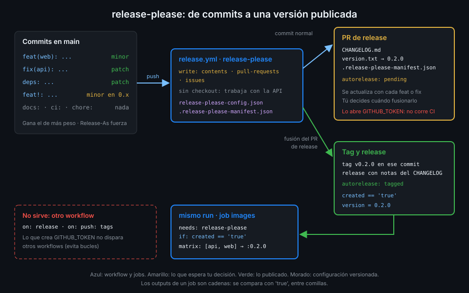

# Versionado semántico y release-please

> Una versión es una promesa a quien te usa: qué cambió y si se va a romper. release-please la
> calcula a partir de tus commits y la publica sin que nadie tenga que acordarse de hacerlo.



## 🎯 Objetivos

Al terminar este archivo eres capaz de:

- Explicar qué significa cada número de una versión SemVer y qué cambia antes de la 1.0.0
- Predecir qué versión propone release-please a partir de los commits convencionales
- Describir el ciclo del PR de release: cuándo se abre, qué contiene y qué pasa al fusionarlo
- Escribir la configuración en modo manifest que usa `tablero`
- Leer los outputs de la action y encadenar un job que solo corre cuando hay release
- Explicar por qué las imágenes de la versión salen en el mismo run y no en otro workflow

## 1. Qué problema resuelve

Hasta ahora `tablero` publica imágenes etiquetadas con el SHA del commit (Semana 06). Sirven para
la máquina, pero no responden a lo que pregunta una persona: ¿qué versión hay en producción?,
¿qué trae de nuevo?, ¿puedo actualizar sin romper nada?

Versionar a mano tiene tres fallos conocidos: alguien olvida subir el número, el CHANGELOG se
escribe de memoria el día de la release y el tag se crea desde un portátil con un commit que no
pasó por CI. **release-please** quita a la persona del camino: lee los commits desde la última
release, decide el siguiente número, escribe el CHANGELOG y, cuando tú lo apruebas, crea el tag y
la release desde un workflow.

## 2. Cómo funciona

### SemVer en tres números

Una versión `MAJOR.MINOR.PATCH` promete:

| Sube | Cuándo | Ejemplo |
|---|---|---|
| `PATCH` | Arreglos que no cambian la interfaz | `0.2.0` → `0.2.1` |
| `MINOR` | Funcionalidad nueva compatible | `0.2.1` → `0.3.0` |
| `MAJOR` | Cambio que rompe a quien te usa | `1.4.2` → `2.0.0` |

La serie `0.x` es especial: SemVer dice que **antes de la 1.0.0 cualquier cosa puede cambiar**.
Por eso es habitual que un cambio incompatible en `0.x` suba solo el `MINOR`. `tablero` empieza en
`0.1.0` y sigue esa convención.

### De commits a versión

release-please lee los mensajes con formato de Conventional Commits que usas desde la Semana 01:

| Commit | Efecto en la versión |
|---|---|
| `fix(api): ...` | `PATCH` |
| `feat(web): ...` | `MINOR` |
| `deps: ...` | `PATCH` |
| `feat!: ...` o pie `BREAKING CHANGE:` | `MAJOR` (en `0.x` con `bump-minor-pre-major`, `MINOR`) |
| `docs:`, `ci:`, `chore:`, `test:`, `refactor:` | Ninguno: no abren release por sí solos |

Gana el commit de mayor peso: diez `fix` y un `feat` dan un `MINOR`. Un pie `Release-As: 1.0.0` en
cualquier commit fuerza esa versión exacta, que es como se sale de la serie `0.x` cuando decidas.

### El PR de release

En cada push a `main` el workflow de release-please hace una de dos cosas:

1. **Si hay commits que suben versión y no hay release pendiente de fusionar**, abre (o
   actualiza) un PR de release. Ese PR solo toca tres archivos: `CHANGELOG.md` con las entradas
   agrupadas por tipo, `version.txt` con el número nuevo (es lo que escribe el tipo `simple`) y
   `.release-please-manifest.json`, que guarda la última versión publicada.
2. **Si el commit que llega es la fusión de ese PR**, crea el tag `vX.Y.Z` en ese commit y la
   release de GitHub con el trozo de CHANGELOG como notas. Las etiquetas del PR pasan de
   `autorelease: pending` a `autorelease: tagged`.

El PR se queda abierto y se va actualizando con cada `feat` o `fix` que entra en `main`. Tú
decides cuándo publicar fusionándolo: la release es un acto deliberado, no un efecto lateral de
cualquier push.

### Modo manifest

release-please admite configurarse con inputs sueltos o con dos archivos versionados. `tablero`
usa los archivos (modo manifest), que son los que la documentación recomienda y los que permiten
crecer a varios paquetes en un monorepo:

```json
{
  "$schema": "https://raw.githubusercontent.com/googleapis/release-please/main/schemas/config.json",
  "include-component-in-tag": false,
  "bump-minor-pre-major": true,
  "packages": {
    ".": {
      "release-type": "simple",
      "package-name": "tablero"
    }
  }
}
```

Y el manifest, que release-please reescribe en cada PR de release:

```json
{ ".": "0.1.0" }
```

| Clave | Para qué |
|---|---|
| `packages."."` | Un único paquete en la raíz: `tablero` se versiona entero, API y web juntas |
| `release-type: simple` | No sabe de `pyproject.toml` ni de `package.json`: escribe `version.txt` y el CHANGELOG |
| `include-component-in-tag: false` | El tag es `v0.2.0` y no `tablero-v0.2.0` |
| `bump-minor-pre-major: true` | Un cambio incompatible en `0.x` sube el `MINOR` |

Si el repo no tiene ninguna release previa, release-please recorre **todo** el historial y el
primer CHANGELOG lo incluye entero. La clave `bootstrap-sha` acota desde qué commit empieza a
leer; en `tablero` no hace falta porque el historial es el del bootcamp.

## 3. Cómo se usa

### El job de release-please

```yaml
name: release-example
on:
  push:
    branches: [main]
# Dos runs a la vez se pisarían el PR y el tag: el segundo espera.
concurrency:
  group: release
  cancel-in-progress: false
permissions: {}
jobs:
  release-please:
    runs-on: ubuntu-24.04
    timeout-minutes: 10
    permissions:
      contents: write
      pull-requests: write
      issues: write
    outputs:
      created: ${{ steps.release.outputs.release_created }}
      version: ${{ steps.release.outputs.version }}
    steps:
      - id: release
        uses: googleapis/release-please-action@45996ed1f6d02564a971a2fa1b5860e934307cf7 # v5.0.0
        with:
          config-file: release-please-config.json
          manifest-file: .release-please-manifest.json

  after-release:
    needs: release-please
    if: ${{ needs.release-please.outputs.created == 'true' }}
    runs-on: ubuntu-24.04
    timeout-minutes: 5
    permissions: {}
    steps:
      - name: Versión publicada
        env:
          VERSION: ${{ needs.release-please.outputs.version }}
        run: echo "Publicada la versión $VERSION" >> "$GITHUB_STEP_SUMMARY"
```

Fíjate en tres detalles:

- **No hay `actions/checkout`**: release-please trabaja contra la API de GitHub, no contra una
  copia local. Un checkout ahí solo añadiría una credencial en disco.
- **`issues: write`** aparece aunque no uses issues: las etiquetas de un PR se gestionan con la
  API de issues. Los tres permisos son los que pide el README de la action.
- **`== 'true'`, con comillas**: los outputs de un job son siempre cadenas (Semana 02). Sin
  comillas comparas una cadena con un booleano y la condición nunca se cumple.

Outputs útiles de la action: `release_created`, `tag_name`, `version`, `major`, `minor`, `patch`,
`sha` y `html_url`. Cuando no hay release, `release_created` no vale `true`.

_Verificado con googleapis/release-please-action@v5.0.0 y ubuntu-24.04, noviembre de 2026._

### Por qué las imágenes salen en el mismo run

Lo natural sería un segundo workflow con `on: release` o `on: push: tags`. No funciona: la release
y el tag los crea el `GITHUB_TOKEN`, y **los eventos que provoca el `GITHUB_TOKEN` no disparan
otros workflows** (salvo `workflow_dispatch` y `repository_dispatch`). Es la protección de GitHub
contra bucles infinitos de workflows.

Por eso en `tablero` el job de imágenes vive en `release.yml`, detrás del de release-please y con
el `if:` sobre `created`. El mismo motivo explica que **el PR de release no ejecute tu CI**: lo
abre el `GITHUB_TOKEN`. Lo verás con los checks obligatorios en la Semana 18.

### Permitir que el token abra PR

Por defecto, `GITHUB_TOKEN` no puede crear PR. El ajuste se llama **Allow GitHub Actions to create
and approve pull requests** y existe en la org y en el repo. Va primero en la org: si la org lo
prohíbe, el repo no puede activarlo.

```bash
gh api -X PUT orgs/<tu-org>/actions/permissions/workflow \
  -f default_workflow_permissions=read -F can_approve_pull_request_reviews=true
gh api -X PUT repos/<tu-org>/tablero/actions/permissions/workflow \
  -f default_workflow_permissions=read -F can_approve_pull_request_reviews=true
```

`default_workflow_permissions=read` se mantiene tal como lo dejaste en la Semana 11: solo abres la
creación de PR, no subes los permisos por defecto. A partir de aquí `check-week.sh 11` marca
`org-default-token-read` en rojo: es lo esperado, porque la capa 14 sustituye esa política, y la
Semana 18 cierra el riesgo. Otra política de la Semana 11 también se toca: la lista de actions
permitidas de la org necesita el patrón `googleapis/release-please-action@*`.

## 4. Antipatrones

| Antipatrón | Por qué duele | Qué hacer en su lugar |
|---|---|---|
| Crear tags a mano desde el portátil | El tag apunta a un commit que quizá no pasó CI | Que el tag lo cree el workflow al fusionar el PR de release |
| Escribir el CHANGELOG el día de la release | Se olvida la mitad y no casa con los commits | Generarlo de los commits convencionales |
| Commits como `update` o `wip` en `main` | release-please no los entiende y no sube versión | Conventional Commits, y squash con título convencional |
| `on: release` para publicar las imágenes | Una release creada por `GITHUB_TOKEN` no lo dispara | Job dependiente en el mismo workflow con `if:` |
| `if: needs.x.outputs.created` sin comparar | Si llega la cadena `'false'`, no está vacía y cuenta como verdadera | `== 'true'` |
| Subir `default_workflow_permissions` a `write` para que funcione | Todos los workflows heredan escritura | Activar solo la creación de PR |
| Saltar a `1.0.0` por costumbre | Prometes estabilidad que aún no tienes | Quedarte en `0.x` y usar `Release-As` cuando toque |

## 5. Trucos

- **Mira qué versión propondría sin esperar al PR**: el PR de release se actualiza en cada push;
  su título y `version.txt` en la rama del PR dicen el número antes de fusionar.
- **Un commit vacío con pie fuerza la versión**:
  `git commit --allow-empty -m "chore: release 1.0.0" -m "Release-As: 1.0.0"`.
- **El enlace a la release en el resumen**: el output `html_url` apunta a la página de la release
  recién creada; pásalo por `env:` a un step y escríbelo en `$GITHUB_STEP_SUMMARY`.

## 📚 Recursos Adicionales

- [Semantic Versioning 2.0.0](https://semver.org/lang/es/)
- [Conventional Commits 1.0.0](https://www.conventionalcommits.org/es/v1.0.0/)
- [release-please-action](https://github.com/googleapis/release-please-action)
- [release-please: manifest releaser](https://github.com/googleapis/release-please/blob/main/docs/manifest-releaser.md)
- [GitHub Docs: Triggering a workflow from a workflow](https://docs.github.com/en/actions/how-tos/write-workflows/choose-when-workflows-run/trigger-a-workflow#triggering-a-workflow-from-a-workflow)

## ✅ Checklist de Verificación

- [ ] Sé qué número sube cada tipo de commit y qué cambia en la serie `0.x`
- [ ] Sé qué archivos toca el PR de release y qué pasa al fusionarlo
- [ ] Sé escribir la configuración y el manifest del modo manifest
- [ ] Sé qué tres permisos pide release-please y por qué no necesita checkout
- [ ] Sé por qué las imágenes no pueden salir en un workflow `on: release`
- [ ] Sé activar la creación de PR sin subir los permisos por defecto

---

| ← Anterior | Siguiente → |
|:---|---:|
| [Semana 14 — Releases, cadena de suministro y attestations](../README.md) | [Tags, digests e imágenes versionadas](02-tags-digests-e-imagenes-versionadas.md) |
