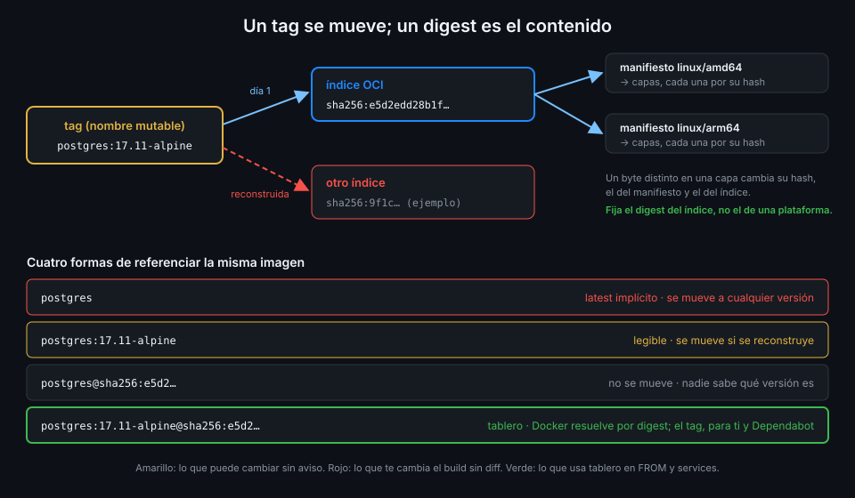

# Tags, digests e imágenes versionadas

> Un tag es un nombre que alguien puede mover; un digest es la huella del contenido y no se mueve
> nunca. Las personas leen tags, las máquinas deberían comparar digests.



## 🎯 Objetivos

Al terminar este archivo eres capaz de:

- Explicar qué es un digest, de qué se calcula y por qué no puede cambiar
- Distinguir el digest de un índice multiarquitectura del de un manifiesto de una plataforma
- Explicar qué hace Docker cuando una referencia lleva tag y digest a la vez
- Decidir qué imágenes de `tablero` se fijan por digest y cuáles se etiquetan con la versión
- Obtener el digest de una imagen sin descargarla
- Dejar que Dependabot mueva los digests y saber qué no vigila

## 1. Qué problema resuelve

En la Semana 06 fijaste las bases con tag completo (`postgres:17.11-alpine`), que ya es mucho mejor
que `latest`. Pero un tag es una etiqueta mutable: quien publica la imagen puede volver a empujar
`17.11-alpine` con otro contenido. Lo hacen los mantenedores oficiales cuando reconstruyen una base
con parches de seguridad, y lo haría un atacante con acceso a la cuenta del publicador.

En los dos casos tu build cambia sin que cambie ni una línea de tu repo. Si la nueva imagen trae una
regresión, no sabes qué build la cogió; si trae una puerta trasera, ningún diff te avisa. Es el
mismo problema que resolviste en la Semana 12 fijando las actions por SHA, ahora con imágenes.

## 2. Cómo funciona

### Qué es un digest

Una imagen OCI es un árbol de documentos JSON y capas, y cada nodo se referencia por el
**SHA-256 de sus bytes**. El digest de una imagen es el hash de su documento raíz:

```text
postgres:17.11-alpine@sha256:e5d2edd28b1f8d40a0a6c0c9cdc545b19b56a0d5d88f94bc11a97d970d4700d0
```

Como es un hash del contenido, si cambia un solo byte de una capa cambia el hash de la capa, el del
manifiesto que la lista y el del índice que lista al manifiesto. **El digest no se puede mover**:
otro contenido es, por definición, otro digest.

### Índice y manifiesto

Las imágenes oficiales son multiarquitectura. Su raíz es un **índice** que apunta a un manifiesto
por plataforma:

| Nivel | Media type | Qué identifica |
|---|---|---|
| Índice | `application/vnd.oci.image.index.v1+json` | La imagen para todas las plataformas |
| Manifiesto | `application/vnd.oci.image.manifest.v1+json` | La imagen de una plataforma (`linux/amd64`) |
| Capa | `...tar+gzip` | Un trozo del sistema de archivos |

Las cinco bases de `tablero` (`python`, `node`, `nginx-unprivileged`, `postgres` y `uv`) son
índices OCI. Fija siempre el digest **del índice**: así el mismo `FROM` funciona en el runner
`amd64` y en un Mac `arm64`, y Docker elige el manifiesto de su plataforma.

_Verificado con `docker buildx imagetools inspect` y ubuntu-24.04, noviembre de 2026._

### Tag y digest juntos

Una referencia puede llevar las dos cosas: `imagen:tag@sha256:...`. Docker **ignora el tag** y
resuelve por el digest. Entonces, ¿para qué escribir el tag? Para las personas y para Dependabot:
quien lee el Dockerfile sabe qué versión es sin buscar el hash, y Dependabot sabe qué tag vigilar.

| Referencia | Quién la entiende | ¿Se mueve? |
|---|---|---|
| `postgres` | Nadie: es `latest` implícito | Sí, a cualquier versión |
| `postgres:17.11-alpine` | Personas | Sí, si se reconstruye |
| `postgres@sha256:e5d2...` | Máquinas | No, pero no sabes qué es |
| `postgres:17.11-alpine@sha256:e5d2...` | Las dos | No |

### Dos papeles distintos en `tablero`

Las imágenes que **consumes** y las que **publicas** se tratan distinto:

- **Bases y services** (lo que consumes): tag para leer más digest para fijar. Lo publica otro,
  así que fijas el contenido exacto que revisaste.
- **`tablero-api` y `tablero-web`** (lo que publicas): tag con la versión de release-please,
  `ghcr.io/<tu-org>/tablero-api:0.2.0`, sin la `v` del tag de git. Tú controlas ese tag, y la
  versión es lo que buscan las personas. El digest que devuelve `build-push-action` es lo que
  firmas (archivo 05) y lo que desplegarás en la Semana 17: el despliegue va por digest.

## 3. Cómo se usa

### El digest sin descargar la imagen

```bash
docker buildx imagetools inspect postgres:17.11-alpine --format '{{json .Manifest}}' | jq -r .digest
# sha256:e5d2edd28b1f8d40a0a6c0c9cdc545b19b56a0d5d88f94bc11a97d970d4700d0
```

`imagetools inspect` habla con el registro y lee solo el índice. Sin `--format` lista además los
manifiestos de cada plataforma: no copies uno de esos, copia el de arriba.

### En un Dockerfile

```dockerfile
FROM python:3.15.2-slim-trixie@sha256:65a65fc7b30b06cb6df4930fd4650697cb23f4c2698ab81fc87e4b031bc36928 AS build
COPY --from=ghcr.io/astral-sh/uv:0.13.6@sha256:af22a52f5eafef3d78e551599d405c02df61919d18028f0cea8eda93bc9986d0 /uv /usr/local/bin/uv
```

Fíjate en el `COPY --from`: también descarga una imagen externa y también se fija. Una etapa propia
(`COPY --from=build`) no, porque se construye en el mismo build.

### En un service container

```yaml
name: digest-example
on:
  workflow_dispatch:
permissions:
  contents: read
jobs:
  db:
    runs-on: ubuntu-24.04
    timeout-minutes: 5
    services:
      postgres:
        image: postgres:17.11-alpine@sha256:e5d2edd28b1f8d40a0a6c0c9cdc545b19b56a0d5d88f94bc11a97d970d4700d0
        env:
          # Credencial desechable de CI: no protege nada fuera de este job.
          POSTGRES_PASSWORD: cambiame
        ports:
          - 5432:5432
        options: >-
          --health-cmd "pg_isready -U postgres"
          --health-interval 5s
          --health-timeout 5s
          --health-retries 10
    steps:
      - name: Versión del servidor
        env:
          PGPASSWORD: cambiame
        run: psql -h localhost -U postgres -tAc 'select version()'
```

### Que Dependabot mueva el digest

Fijar por digest sin nadie que lo actualice te deja con una base vieja y llena de CVE. El
ecosistema `docker` de Dependabot lee los `FROM`, y cuando el mismo tag publica un digest nuevo
o sale un tag más reciente abre un PR que cambia los dos:

```yaml
version: 2
updates:
  - package-ecosystem: docker
    directories:
      - /api
      - /web
    schedule:
      interval: weekly
    cooldown:
      default-days: 7
```

El `cooldown` es el de la Semana 12: una imagen recién publicada espera siete días antes de
proponerse, tiempo para que, si estaba comprometida, alguien lo descubra.

Lo que esta configuración **no vigila** en `tablero` es el `image:` de los `services:` de los
workflows. Cuando Dependabot suba `postgres` en otro sitio, o cuando cambies de parche, actualizas
a mano el digest del service con el comando de arriba.

## 4. Antipatrones

| Antipatrón | Por qué duele | Qué hacer en su lugar |
|---|---|---|
| Solo tag en las bases | El publicador puede reconstruirlo y tu build cambia sin diff | `tag@sha256:` |
| Solo digest, sin tag | Nadie sabe qué versión es ni Dependabot qué vigilar | `tag@sha256:` |
| Copiar el digest de un manifiesto de plataforma | El build falla o coge otra arquitectura en otra máquina | El digest del índice |
| Digest fijado sin Dependabot | La base envejece y acumula vulnerabilidades | Ecosistema `docker` con `cooldown` |
| Publicar `tablero-api` solo con el SHA del commit | Nadie sabe qué release es | Tag con la versión, y firmar el digest |
| Desplegar por tag la imagen propia | El tag se puede reescribir entre la firma y el despliegue | Desplegar por digest (Semana 17) |

## 5. Trucos

- **Comprueba que un `FROM` resuelve lo que dice el tag**: compara la salida de
  `imagetools inspect` del tag con el digest del Dockerfile. Si difieren, el tag se movió y
  Dependabot debería tener un PR abierto.
- **Todas las referencias externas de golpe**:
  `grep -rhoE '(FROM|--from=|image:) *[^ ]+' api/Dockerfile web/Dockerfile .github/workflows/`
  te las lista para revisar que ninguna se quedó sin digest.
- **El digest de lo que acabas de publicar está en el log**: `build-push-action` lo deja en su
  output `digest` y en el resumen del job; no hace falta volver a preguntarle al registro.

## 📚 Recursos Adicionales

- [OCI Image Specification: descriptors y digests](https://github.com/opencontainers/image-spec/blob/main/descriptor.md)
- [Docker Docs: Pin base image versions](https://docs.docker.com/build/building/best-practices/#pin-base-image-versions)
- [GitHub Docs: Dependabot options reference](https://docs.github.com/en/code-security/reference/supply-chain-security/dependabot-options-reference)

## ✅ Checklist de Verificación

- [ ] Sé explicar por qué un digest no se puede mover y un tag sí
- [ ] Sé distinguir el digest del índice del de un manifiesto
- [ ] Sé qué hace Docker con `tag@sha256:` y para qué sirve el tag ahí
- [ ] Sé qué imágenes de `tablero` van por digest y cuáles con la versión
- [ ] Sé obtener un digest sin descargar la imagen
- [ ] Sé qué actualiza Dependabot y qué tengo que actualizar a mano

---

| ← Anterior | Siguiente → |
|:---|---:|
| [Versionado semántico y release-please](01-versionado-semantico-y-release-please.md) | [Cadena de suministro y SLSA](03-cadena-de-suministro-y-slsa.md) |
