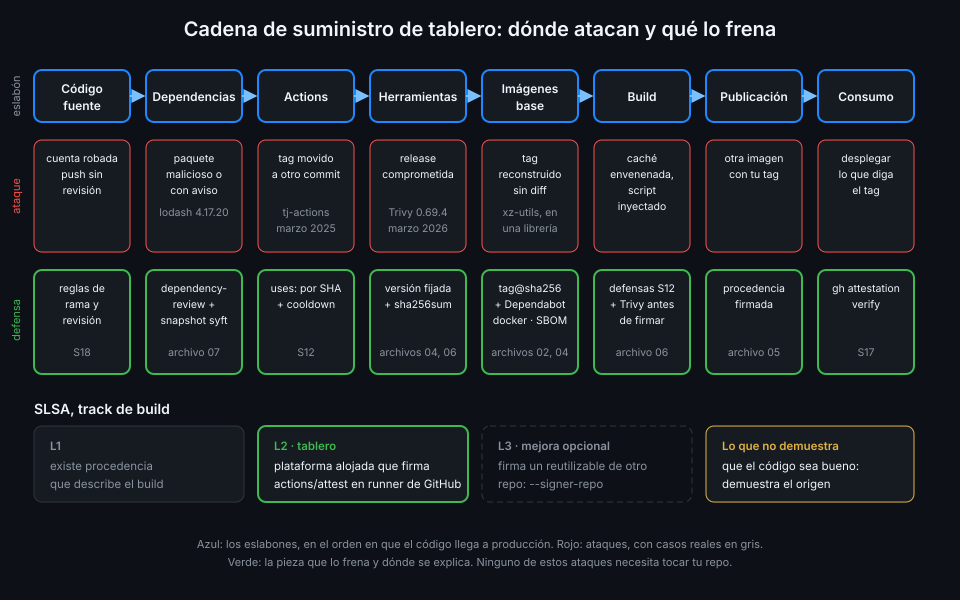

# Cadena de suministro y SLSA

> Lo que despliegas no es solo tu código: son tus dependencias, tus actions, tus herramientas, tus
> imágenes base y el runner que lo junta todo. Cualquier eslabón puede ser el que entre el ataque.



## 🎯 Objetivos

Al terminar este archivo eres capaz de:

- Recorrer la cadena de suministro de `tablero` del commit al despliegue
- Situar en ella ataques reales y explicar qué tenían en común
- Explicar qué es la procedencia (provenance) de un artefacto y qué demuestra y qué no
- Describir los niveles del track de build de SLSA y qué nivel alcanza Actions
- Asociar cada pieza de la capa 14 al ataque que frena
- Explicar por qué una procedencia sin verificar no protege de nada

## 1. Qué problema resuelve

En la [Semana 12](../../week-12-modelo_de_amenazas_y_endurecimiento/1-teoria/01-modelo-de-amenazas-de-un-pipeline.md)
miraste el pipeline desde dentro: qué puede hacer un PR malicioso, un token con demasiado permiso o
una caché envenenada. Esta semana lo miras desde fuera, desde quien **recibe** la imagen de
`tablero`: ¿cómo sabe que esa imagen salió de tu repo, de tu workflow y de tu commit, y no de un
portátil comprometido o de un registro manipulado?

Sin respuesta a esa pregunta, todo el endurecimiento de la Semana 12 se puede saltar por el lado:
el atacante no necesita romper tu CI si puede empujar una imagen con tu nombre.

## 2. Cómo funciona

### Los eslabones

| Eslabón | En `tablero` | Ataque típico |
|---|---|---|
| Código fuente | Commits en `main` | Push directo sin revisión, cuenta de mantenedor robada |
| Dependencias | `uv.lock`, `pnpm-lock.yaml` | Paquete malicioso, versión secuestrada, typosquatting |
| Actions | `uses:` de los workflows | Tag movido a un commit malicioso |
| Herramientas | syft, Trivy, actionlint | Binario de una release comprometida |
| Imágenes base | `FROM`, `services:` | Tag reconstruido con otro contenido |
| Build | El runner y el job | Caché envenenada, runner compartido, script inyectado |
| Publicación | GHCR | Alguien empuja otra imagen con el mismo tag |
| Consumo | El despliegue (Semana 17) | Se despliega lo que hay en el tag, sin comprobar nada |

### Ataques reales

No son hipótesis. Tres casos que ya conoces o deberías conocer:

- **`tj-actions/changed-files` (marzo de 2025)**: los atacantes movieron los tags de la action a
  un commit que volcaba los secretos del runner en el log. Todo workflow que la usaba por tag
  ejecutó el código nuevo sin cambiar una línea. Quien la tenía fijada por SHA no se enteró.
- **Trivy `0.69.4` (19 de marzo de 2026)**: una release comprometida de la propia herramienta de
  escaneo (aviso `GHSA-69fq-xp46-6x23`). Por eso `tablero` fija la versión de Trivy, la descarga
  con checksum y nunca usa esa versión ni `trivy-action` por tag (archivo 06).
- **xz-utils (2024)**: una puerta trasera metida durante meses por un mantenedor de confianza en
  una librería que acaba en casi todas las imágenes base. Ningún checksum la habría parado: el
  código venía firmado por quien debía. Lo que ayuda ahí es **saber dónde está**: el SBOM
  (archivo 04).

Lo que tienen en común: el atacante no tocó tu repo. Entró por un eslabón que tú consumías con
confianza implícita.

### Procedencia

La **procedencia** (provenance) es un documento que describe cómo se construyó un artefacto:

- El **sujeto**: el artefacto, identificado por su digest
- Qué **repo y commit** se usaron como fuente
- Qué **workflow**, en qué ref y con qué evento lo construyó
- En qué **runner** y en qué ejecución concreta

Firmada, la procedencia permite a quien consume la imagen comprobar "este digest salió de
`<tu-org>/tablero`, del workflow `release.yml`, en `main`, en un runner de GitHub". Lo que **no**
dice es que el código sea bueno: si fusionas un commit malicioso, la procedencia certificará
fielmente que la imagen maliciosa salió de tu pipeline. Demuestra el origen, no la calidad.

### SLSA

[SLSA](https://slsa.dev) (Supply-chain Levels for Software Artifacts, se pronuncia "salsa") es un
marco de la OpenSSF que ordena estas garantías en niveles. Su track de **build** tiene cuatro:

| Nivel | Exige | Qué frena |
|---|---|---|
| Build L0 | Nada | — |
| Build L1 | Existe procedencia que describe el build | Errores y builds hechos "a mano" sin rastro |
| Build L2 | Build en una plataforma alojada que **firma** la procedencia | Manipular el artefacto después del build |
| Build L3 | Plataforma endurecida: builds aislados entre sí y el material de firma fuera del alcance de los pasos del usuario | Que un paso del build falsifique su propia procedencia |

Con Actions:

- **Una attestation de procedencia firmada por `actions/attest`** en un runner alojado por GitHub
  da **Build L2**: la plataforma (GitHub) firma, y el certificado lleva la identidad del job.
- **Build L3** exige además que las instrucciones de build no las controle el mismo repo que las
  usa. GitHub lo consigue construyendo y firmando dentro de un **workflow reutilizable** de otro
  repo: el firmante es el reutilizable, y verificas con `--signer-repo` o `--signer-workflow`
  que es ese y no otro.

_Verificado con la documentación de artifact attestations de GitHub y la especificación SLSA v1,
noviembre de 2026._

`tablero` firma en su propio `release.yml`: la identidad del firmante es `tablero`, y te quedas en
L2 con verificación estricta del workflow. Llevar el build a un reutilizable del repo central
(Semana 11) es la mejora natural hacia L3, y la dejas como criterio opcional.

## 3. Cómo se usa

### Qué pieza frena qué

La capa 14 completa el mapa de la Semana 12. Cada pieza tapa un eslabón:

| Eslabón | Pieza | Dónde |
|---|---|---|
| Actions | `uses:` por SHA + Dependabot con `cooldown` | Semana 12 |
| Herramientas | Versión fijada + `sha256sum -c` del asset de la release | Archivos 04 y 06 |
| Imágenes base | `tag@sha256:` + Dependabot `docker` | Archivo 02 |
| Dependencias | dependency-review con snapshot de syft | Archivo 07 |
| Vulnerabilidades conocidas | Trivy rompe la release con `CRITICAL` corregible | Archivo 06 |
| Publicación | Attestation de procedencia firmada | Archivo 05 |
| Inventario | SBOM firmado junto a la imagen | Archivos 04 y 05 |
| Consumo | `gh attestation verify` antes de desplegar | Archivo 05 y Semana 17 |

### Los permisos de la firma

El job que firma necesita, además de `packages: write` para empujar la imagen:

```yaml
name: provenance-permissions-example
on:
  workflow_dispatch:
permissions: {}
jobs:
  sign:
    runs-on: ubuntu-24.04
    timeout-minutes: 5
    permissions:
      # Token OIDC para pedir el certificado de firma (Semana 13).
      id-token: write
      # Guardar la attestation en el repo.
      attestations: write
    steps:
      - name: Permisos del job
        run: echo "Este job podría firmar una attestation" >> "$GITHUB_STEP_SUMMARY"
```

`id-token: write` aparece por la misma razón que en la Semana 13: la firma se apoya en la identidad
OIDC del job, no en una clave guardada. Lo ves en el archivo 05.

### La pregunta del consumidor

Todo lo anterior se resume en una comprobación que hace quien va a usar la imagen. En la Semana 17
será el despliegue; esta semana la haces tú a mano:

```bash
gh attestation verify oci://ghcr.io/<tu-org>/tablero-api:0.2.0 \
  --repo <tu-org>/tablero \
  --signer-workflow <tu-org>/tablero/.github/workflows/release.yml
# Loaded digest sha256:... for oci://ghcr.io/<tu-org>/tablero-api:0.2.0
# ...
```

Si pasa, sabes que ese digest lo construyó y lo firmó `release.yml` de `tablero`. Si falla, no
importa lo bien endurecido que esté el CI: esa imagen no salió de él, o no se puede demostrar.
Las salidas completas y los fallos típicos están en el archivo 05.

## 4. Antipatrones

| Antipatrón | Por qué duele | Qué hacer en su lugar |
|---|---|---|
| Firmar y no verificar nunca | Una firma que nadie comprueba no frena nada | `gh attestation verify` antes de usar la imagen |
| Verificar solo el repo | Cualquier workflow del repo, incluido uno de prueba, vale como firmante | `--signer-workflow` con la ruta exacta |
| Creer que la procedencia certifica el código | Un commit malicioso fusionado sale con procedencia válida | Revisión y reglas de rama, además de la procedencia |
| Confiar en la herramienta de seguridad por ser de seguridad | Trivy `0.69.4` fue el vector | Versión fijada y checksum, como cualquier binario |
| Endurecer el CI y dejar el registro sin control | Una imagen empujada a mano con tu tag pasa por buena | Desplegar solo lo que verifica |
| Prometer SLSA L3 por firmar en el propio workflow | El repo que firma controla sus instrucciones de build | Decir L2, o firmar desde un reutilizable de otro repo |

## 5. Trucos

- **Lee la procedencia de cualquier imagen pública firmada con Actions**: `gh attestation verify
  oci://<imagen>@<digest> --owner <org> --format json` devuelve el statement completo; no hace
  falta ser el dueño del repo.
- **El repo de la [Semana 12](../../week-12-modelo_de_amenazas_y_endurecimiento/1-teoria/06-dependencias-de-actions.md)
  ya te dio la mitad**: actions por SHA y Dependabot con `cooldown` son defensas de cadena de
  suministro. Esta semana añades las imágenes y la prueba de origen.
- **Pregúntate por cada eslabón "¿qué pasa si mañana cambia sin que yo toque nada?"**. Si la
  respuesta es "mi build cambia", ese eslabón está sin fijar.

## 📚 Recursos Adicionales

- [SLSA: Security levels](https://slsa.dev/spec/v1.0/levels)
- [GitHub Docs: Artifact attestations](https://docs.github.com/en/actions/concepts/security/artifact-attestations)
- [GitHub Docs: Using artifact attestations and reusable workflows to achieve SLSA v1 Build Level 3](https://docs.github.com/en/actions/how-tos/secure-your-work/use-artifact-attestations/increase-security-rating)
- [GitHub Advisory: tj-actions/changed-files (CVE-2025-30066)](https://github.com/advisories/GHSA-mrrh-fwg8-r2c3)

## ✅ Checklist de Verificación

- [ ] Sé nombrar los eslabones de la cadena de `tablero` y un ataque a cada uno
- [ ] Sé qué tienen en común `tj-actions`, Trivy `0.69.4` y xz-utils
- [ ] Sé qué contiene una procedencia y qué no demuestra
- [ ] Sé qué exige cada nivel del track de build de SLSA
- [ ] Sé por qué `tablero` queda en L2 y cómo llegaría a L3
- [ ] Sé qué pieza de la capa 14 frena cada eslabón

---

| ← Anterior | Siguiente → |
|:---|---:|
| [Tags, digests e imágenes versionadas](02-tags-digests-e-imagenes-versionadas.md) | [SBOM con syft](04-sbom-con-syft.md) |
