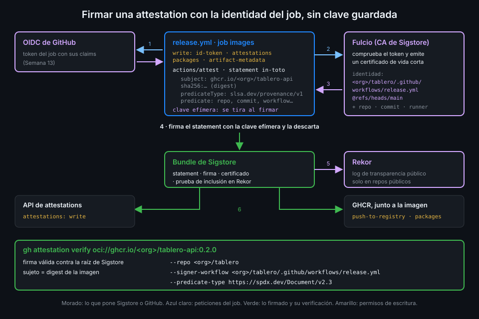

# Attestations y Sigstore

> Una attestation es una afirmación firmada sobre un digest: "esto lo construyó este workflow" o
> "esto contiene estos paquetes". Sigstore la firma con la identidad OIDC del job, sin que nadie
> guarde una clave privada.



## 🎯 Objetivos

Al terminar este archivo eres capaz de:

- Describir las partes de una attestation: sujeto, tipo de predicado y predicado
- Explicar cómo `actions/attest` firma sin clave guardada usando el token OIDC del job
- Elegir entre los tres modos de `actions/attest` y saber qué tipo de predicado produce cada uno
- Dar a un job exactamente los permisos que necesita para firmar y publicar la attestation
- Verificar una imagen con `gh attestation verify` exigiendo repo, workflow y tipo de predicado
- Explicar por qué un reutilizable cambia la identidad del firmante

## 1. Qué problema resuelve

El archivo 03 dejó la pregunta: ¿cómo demuestra `tablero` que una imagen salió de su pipeline? La
respuesta clásica es firmar con una clave privada. Pero entonces la clave es un secreto de larga
duración guardado en GitHub, con todos los problemas que viste en la
[Semana 13](../../week-13-secretos_entornos_y_oidc/1-teoria/04-de-credenciales-estaticas-a-oidc.md):
hay que rotarla, se puede filtrar, y quien la robe firma lo que quiera como si fuera tu CI.

Sigstore aplica la misma idea que OIDC: en lugar de una clave guardada, **una identidad
verificable en el momento**. El job demuestra quién es con su token OIDC, recibe un certificado
que vale minutos, firma y tira la clave.

## 2. Cómo funciona

### Qué es una attestation

Es un documento [in-toto](https://in-toto.io) con tres partes:

| Parte | Qué contiene | En `tablero-api` |
|---|---|---|
| `subject` | Nombre y digest de lo que se afirma | `ghcr.io/<tu-org>/tablero-api` + `sha256:...` |
| `predicateType` | Qué tipo de afirmación es | `https://slsa.dev/provenance/v1` |
| `predicate` | La afirmación en sí | Repo, commit, workflow, ref, evento, runner, run |

El sujeto va **por digest**: la attestation habla de un contenido exacto, no de un tag que mañana
apunte a otra cosa.

### Cómo se firma

1. El job pide un token OIDC a GitHub (por eso `id-token: write`), igual que en la Semana 13.
2. Genera un par de claves efímero y manda la pública y el token a **Fulcio**, la autoridad de
   certificación de Sigstore.
3. Fulcio comprueba el token y emite un **certificado de vida corta** cuya identidad es el
   workflow que corre: `https://github.com/<tu-org>/tablero/.github/workflows/release.yml@refs/heads/main`,
   con extensiones para el repo, el commit, el evento y el tipo de runner. Son los claims del
   token de la [Semana 13](../../week-13-secretos_entornos_y_oidc/1-teoria/05-el-token-oidc-y-sus-claims.md),
   ahora dentro de un certificado.
4. El job firma la attestation con la clave efímera y la descarta.
5. La firma se anota en **Rekor**, el registro de transparencia público de Sigstore: un log de
   solo escritura que prueba que la firma existía mientras el certificado era válido.
6. El resultado, un **bundle de Sigstore** (attestation, firma, certificado y prueba de Rekor), se
   guarda en la API de attestations del repo (`attestations: write`) y, con `push-to-registry`,
   junto a la imagen en GHCR (`packages: write`).

En un repo **público** se usa la instancia pública de Sigstore, con Rekor. En uno privado o interno
se usa la instancia de GitHub, que no tiene log de transparencia, y además exige GitHub
Enterprise Cloud. `tablero` es público: coste cero y entrada en Rekor.

### Los tres modos de `actions/attest`

| Modo | Se activa con | `predicateType` |
|---|---|---|
| Procedencia | Ni `sbom-path` ni predicado | `https://slsa.dev/provenance/v1` |
| SBOM | `sbom-path` (SPDX o CycloneDX en JSON, hasta 16 MB) | El del formato; para el SPDX-2.3 de syft, `https://spdx.dev/Document/v2.3` |
| Personalizado | `predicate-type` con `predicate` o `predicate-path` | El que declares |

`actions/attest-build-provenance` sigue existiendo, pero en v4 es una action compuesta que solo
llama a `actions/attest`. `tablero` usa la de abajo directamente.

_Verificado con actions/attest@v4.2.2 y ubuntu-24.04, noviembre de 2026._

### Los permisos

| Permiso | Para qué |
|---|---|
| `id-token: write` | Pedir el token OIDC que Fulcio canjea por el certificado |
| `attestations: write` | Guardar el bundle en la API de attestations del repo |
| `packages: write` | Empujar la imagen y, con `push-to-registry`, la attestation a GHCR |
| `artifact-metadata: write` | Crear el *storage record* que `push-to-registry` emite en repos de una org |

El *storage record* registra en qué registro vive la imagen y la enseña en la página
**Linked Artifacts** de la org. Si no lo quieres, `create-storage-record: false` y sobra el
último permiso.

## 3. Cómo se usa

### Firmar procedencia y SBOM de una imagen

```yaml
name: attest-example
on:
  workflow_dispatch:
permissions: {}
jobs:
  publish:
    runs-on: ubuntu-24.04
    timeout-minutes: 20
    permissions:
      contents: read
      packages: write
      id-token: write
      attestations: write
      artifact-metadata: write
    steps:
      - uses: actions/checkout@3d3c42e5aac5ba805825da76410c181273ba90b1 # v7.0.1
        with:
          persist-credentials: false

      - name: Nombre de la imagen en minúsculas
        id: name
        env:
          OWNER: ${{ github.repository_owner }}
        run: echo "image=ghcr.io/${OWNER,,}/attest-demo" >> "$GITHUB_OUTPUT"

      - uses: docker/setup-buildx-action@f87e5991a6d7451dcb8d9637bfbc97413f497069 # v4.4.1

      - uses: docker/login-action@81c6f93d4bc991e510b342a00b419b3bb4efc5c6 # v4.7.0
        with:
          registry: ghcr.io
          username: ${{ github.actor }}
          password: ${{ secrets.GITHUB_TOKEN }}

      - name: Construir y publicar
        id: build
        uses: docker/build-push-action@c3c9e263c25d99ce0380d002d59b67737d91b0dc # v7.4.0
        with:
          context: api
          push: true
          tags: ${{ steps.name.outputs.image }}:0.0.1-demo

      - name: Attestation de procedencia
        uses: actions/attest@1e69f48acb82d1966a394da916b4c1698aa569d6 # v4.2.2
        with:
          subject-name: ${{ steps.name.outputs.image }}
          subject-digest: ${{ steps.build.outputs.digest }}
          push-to-registry: true
```

Tres detalles que fallan a menudo:

- **`subject-name` sin tag**: el nombre completo del registro, `ghcr.io/<org>/<imagen>`. El tag
  no identifica nada; el digest va aparte en `subject-digest`.
- **Minúsculas**: GHCR rechaza mayúsculas y `github.repository_owner` puede tenerlas. La
  expansión `${OWNER,,}` de bash lo arregla en un step.
- **El SBOM es el mismo step con `sbom-path`**: en `tablero` hay dos `actions/attest` seguidos
  sobre el mismo sujeto, uno de procedencia y otro de SBOM. Lo montas en la práctica 03.

### Verificar

`gh attestation verify` comprueba la firma contra la raíz de confianza de Sigstore, que el sujeto
sea el digest de la imagen y que la identidad del certificado sea la que exiges:

```bash
gh attestation verify oci://ghcr.io/<tu-org>/tablero-api:0.2.0 \
  --repo <tu-org>/tablero \
  --signer-workflow <tu-org>/tablero/.github/workflows/release.yml \
  --predicate-type https://spdx.dev/Document/v2.3
# Loaded digest sha256:... for oci://ghcr.io/<tu-org>/tablero-api:0.2.0
# ...
# ✓ Verification succeeded!
```

| Flag | Exige que |
|---|---|
| `--repo` o `--owner` | La attestation pertenezca a ese repo u org (uno de los dos es obligatorio) |
| `--signer-workflow` | El workflow firmante sea esa ruta exacta |
| `--signer-repo` | El workflow firmante viva en ese repo |
| `--predicate-type` | El tipo sea ese; por defecto, la procedencia SLSA v1 |
| `--source-ref` | El build saliera de esa ref, por ejemplo `refs/heads/main` |
| `--deny-self-hosted-runners` | No se firmara en un runner propio |
| `--bundle-from-oci` | Lea las attestations de GHCR en lugar de la API de GitHub |

Con una referencia `oci://` de una imagen pública no necesitas sesión; con una privada, antes
`docker login ghcr.io`. Con
`--format json` y `--jq` sacas cualquier campo del statement.

_Verificado con gh 2.104.0 y ubuntu-24.04, noviembre de 2026._

### Cuando firma un reutilizable

Si el build y la firma ocurren dentro de un workflow reutilizable del repo central, el certificado
lleva la identidad **del reutilizable**, no la del workflow que lo llama. `--repo` sigue siendo
`<tu-org>/tablero` (a quien pertenece la attestation), pero el firmante es
`<tu-org>/actions-tablero/.github/workflows/...`: verificas con `--signer-repo` o
`--signer-workflow` apuntando ahí. Es el camino a SLSA Build L3 del archivo 03.

## 4. Antipatrones

| Antipatrón | Por qué duele | Qué hacer en su lugar |
|---|---|---|
| Firmar con una clave privada guardada como secreto | Hay que rotarla y quien la robe firma por ti | Firma sin clave con la identidad OIDC del job |
| `subject-name` con tag | El push de la attestation al registro falla o queda mal asociado | Nombre sin tag y `subject-digest` |
| Verificar solo con `--owner` | Cualquier repo de la org vale como origen | `--repo` y `--signer-workflow` |
| No pasar `--predicate-type` al verificar el SBOM | Verificas la procedencia y crees que el SBOM está firmado | El tipo de SPDX explícito |
| `id-token: write` en la raíz del workflow | Todos los jobs pueden pedir tokens | Solo en el job que firma |
| Firmar antes de escanear | Firmas una imagen que luego no pasa la puerta | Trivy primero; si falla, no hay attestation (archivo 06) |

## 5. Trucos

- **Qué attestations tiene una imagen**: `gh attestation verify oci://... --repo <tu-org>/tablero --format json --jq '.[].verificationResult.statement.predicateType'`.
- **Descarga el bundle para verificar sin red**: `gh attestation download` guarda las
  attestations en un archivo que luego pasas a `verify --bundle`.
- **La página de la attestation**: el output `attestation-url` de `actions/attest` enlaza a ella;
  pásalo por `env:` al resumen del job.

## 📚 Recursos Adicionales

- [actions/attest](https://github.com/actions/attest)
- [GitHub Docs: Artifact attestations](https://docs.github.com/en/actions/concepts/security/artifact-attestations)
- [Sigstore: overview](https://docs.sigstore.dev/about/overview/)
- [in-toto attestation framework](https://github.com/in-toto/attestation)

## ✅ Checklist de Verificación

- [ ] Sé qué son sujeto, tipo de predicado y predicado
- [ ] Sé explicar el papel de Fulcio, Rekor y el token OIDC en la firma
- [ ] Sé qué modo de `actions/attest` produce cada tipo de predicado
- [ ] Sé qué cuatro permisos pide el job y para qué es cada uno
- [ ] Sé verificar exigiendo repo, workflow firmante y tipo de predicado
- [ ] Sé cómo cambia la verificación si firma un reutilizable

---

| ← Anterior | Siguiente → |
|:---|---:|
| [SBOM con syft](04-sbom-con-syft.md) | [Escaneo de vulnerabilidades con Trivy](06-escaneo-de-vulnerabilidades-con-trivy.md) |
