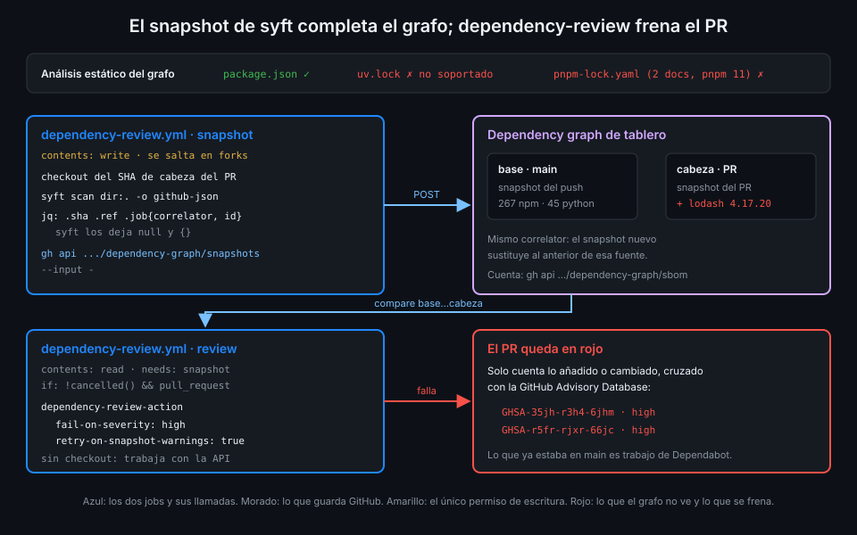
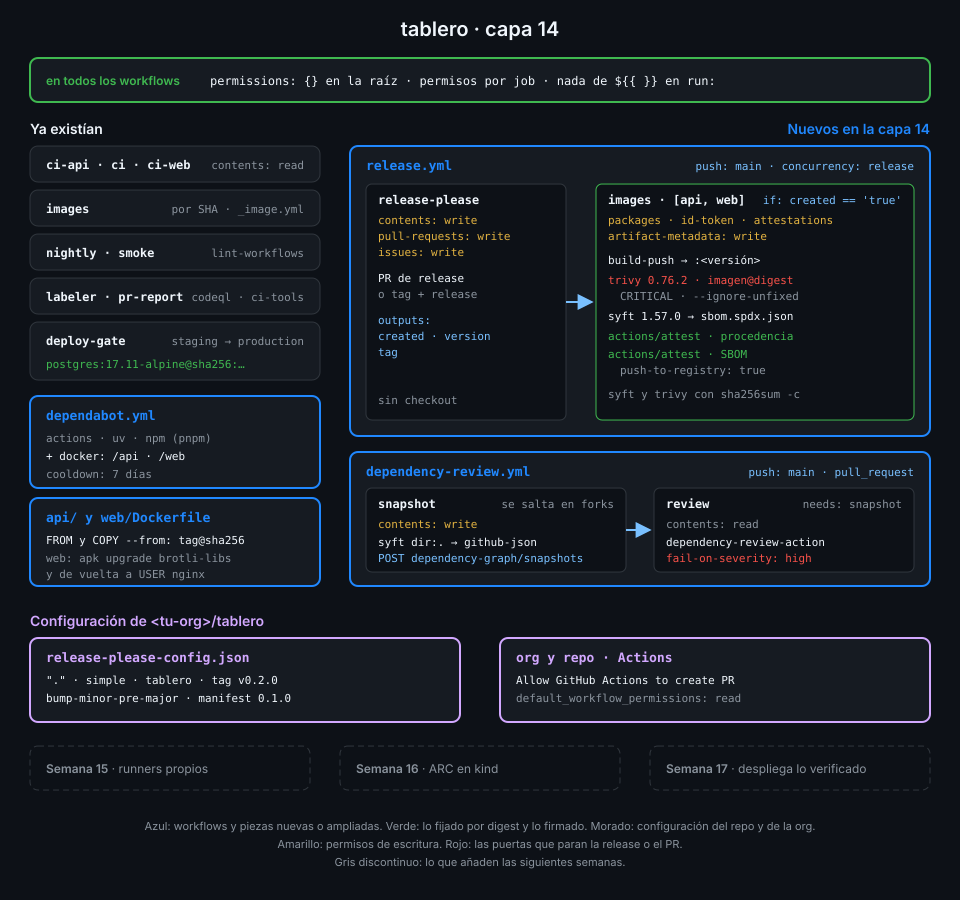

# Dependency graph y dependency review

> Dependabot te avisa cuando una dependencia que ya tienes resulta vulnerable. dependency-review
> impide que entre una que ya se sabe vulnerable. Las dos dependen de que GitHub vea tus
> dependencias, y en `tablero` no las ve solo.



## 🎯 Objetivos

Al terminar este archivo eres capaz de:

- Explicar qué es el dependency graph y de dónde saca las dependencias
- Comprobar qué ve de verdad el grafo de tu repo y detectar lo que no ve
- Completar el grafo con un snapshot de syft por la API de dependency submission
- Explicar qué compara dependency-review en un PR y cuándo falla
- Distinguir dependency-review de las alertas y los PR de Dependabot
- Manejar los PR desde forks, que no pueden enviar snapshots

## 1. Qué problema resuelve

En la Semana 12 activaste Dependabot: cuando aparece un aviso sobre una dependencia de `main`, te
abre una alerta y, si puede, un PR. Eso protege **lo que ya está dentro**. No impide que mañana un
PR añada `lodash@4.17.20`, que tiene avisos `high` publicados desde hace años; Dependabot se
enteraría después de fusionarlo.

**dependency-review** es la puerta en el PR: compara las dependencias de la rama base con las de
la cabeza y falla si las nuevas traen un aviso de la severidad que elijas. Pero solo puede comparar
lo que el **dependency graph** conoce, y ahí está el problema de `tablero`.

## 2. Cómo funciona

### Qué lee el dependency graph

El grafo de dependencias de GitHub se alimenta de dos fuentes:

| Fuente | Cómo llega | En `tablero` |
|---|---|---|
| Análisis estático | GitHub lee los manifiestos y lockfiles soportados en cada push | Lee `package.json`; no lee `uv.lock` ni el lockfile de pnpm 11 |
| Dependency submission | Un workflow envía un *snapshot* por la API | Lo que añade esta capa |

Las dos lagunas son concretas:

- **`uv.lock` no está en la lista de ecosistemas soportados** del grafo. Para GitHub, la API de
  `tablero` no tiene dependencias Python.
- **`pnpm-lock.yaml` sí está soportado, pero la documentación avisa** de que el grafo no detecta
  sus dependencias cuando pnpm escribe el lockfile como dos documentos YAML. Es lo que hace pnpm
  11 en adelante: el de `tablero` empieza con `---` y tiene dos documentos.

_Verificado con la documentación "Dependency graph supported package ecosystems" de GitHub,
noviembre de 2026._

Sin hacer nada, dependency-review compararía dos listas casi vacías y aprobaría cualquier PR.

### El snapshot

La API `POST /repos/{owner}/{repo}/dependency-graph/snapshots` recibe un JSON con:

| Campo | Qué es |
|---|---|
| `version` | Versión del formato |
| `sha`, `ref` | Commit y ref a los que pertenecen las dependencias |
| `job.correlator` | Identifica la fuente: un snapshot nuevo con el mismo correlator **sustituye** al anterior |
| `job.id` | La ejecución concreta |
| `detector` | Qué herramienta las detectó (nombre, versión, URL) |
| `scanned` | Cuándo |
| `manifests` | Las dependencias, agrupadas por archivo, con su purl |

syft escribe ese formato con `-o github-json`, pero deja vacíos los campos que solo conoce el
workflow: `sha` y `ref` a `null` y `job` como `{}`. Hay que rellenarlos antes del envío:

```bash
syft scan dir:. -q -o "github-json=$RUNNER_TEMP/snapshot.json"
jq --arg sha "$SHA" --arg ref "$GITHUB_REF" \
   --arg correlator "${GITHUB_WORKFLOW}_${GITHUB_JOB}" --arg id "$GITHUB_RUN_ID" \
   '.sha = $sha | .ref = $ref | .job = {correlator: $correlator, id: $id}' \
   "$RUNNER_TEMP/snapshot.json" |
  gh api "repos/$GITHUB_REPOSITORY/dependency-graph/snapshots" --input - --jq .message
```

_Verificado con syft v1.57.0 y ubuntu-24.04, noviembre de 2026._

Tres decisiones que no son obvias:

- **Qué SHA**: en un PR, el del commit de cabeza (`github.event.pull_request.head.sha`), no el
  commit de merge que crea GitHub para el run (`github.sha`). dependency-review busca el snapshot
  de la cabeza; si lo envías a otro commit, no lo encuentra. El job hace checkout de ese mismo SHA
  para que lo catalogado y lo declarado coincidan.
- **Qué permiso**: la API exige `contents: write`. Es el único job de esta capa con escritura en
  el contenido, y por eso va aislado.
- **Forks**: el `GITHUB_TOKEN` de un PR desde un fork es de solo lectura y el envío fallaría. El
  job de snapshot se salta cuando `github.event.pull_request.head.repo.full_name` no es el repo.

### Qué compara dependency-review

En un PR, `actions/dependency-review-action` pide a GitHub la diferencia de dependencias entre la
base y la cabeza, cruza las **añadidas o cambiadas** con la GitHub Advisory Database y falla si
alguna tiene un aviso de severidad igual o mayor que `fail-on-severity`. Las que ya estaban en la
base no cuentan: no es su trabajo, es el de Dependabot.

Si el snapshot de la cabeza aún no ha llegado, la action avisa de que la comparación puede estar
incompleta. Con `retry-on-snapshot-warnings: true` espera y reintenta en lugar de aprobar a medias.

## 3. Cómo se usa

### El job de revisión

```yaml
name: dependency-review-example
on:
  pull_request:
    branches: [main]
permissions: {}
jobs:
  review:
    runs-on: ubuntu-24.04
    timeout-minutes: 10
    permissions:
      contents: read
    steps:
      - name: Comparar dependencias entre base y cabeza
        uses: actions/dependency-review-action@a1d282b36b6f3519aa1f3fc636f609c47dddb294 # v5.0.0
        with:
          fail-on-severity: high
          retry-on-snapshot-warnings: true
```

No necesita checkout: trabaja con la API. Con `comment-summary-in-pr` dejaría un comentario en el
PR, pero eso pide `pull-requests: write`, y el resumen del job ya muestra el mismo informe.

En `tablero` este job va después del de snapshot (`needs:`) con
`if: ${{ !cancelled() && github.event_name == 'pull_request' }}`: corre aunque el snapshot se
salte por venir de un fork, y no corre en `push`, donde no hay nada que comparar.

_Verificado con actions/dependency-review-action@v5.0.0 y ubuntu-24.04, noviembre de 2026._

### Un PR que debe quedarse en rojo

`lodash@4.17.20` tiene, entre otros, `GHSA-35jh-r3h4-6jhm` (high, inyección de comandos) y
`GHSA-r5fr-rjxr-66jc` (high, inyección de código vía `_.template`). Puedes comprobarlo tú:

```bash
gh api '/advisories?ecosystem=npm&affects=lodash@4.17.20' --jq '.[] | [.ghsa_id, .severity] | @tsv'
```

En la práctica 04 lo añades en una rama con `pnpm add lodash@4.17.20`, abres el PR y miras cómo
dependency-review lo para. El PR se cierra sin fusionar.

### Dependabot frente a dependency-review

| | Dependabot | dependency-review |
|---|---|---|
| Cuándo | Después: cuando sale un aviso o una versión | Antes: en cada PR |
| Sobre qué | Todo lo que hay en la rama por defecto | Solo lo que el PR añade o cambia |
| Qué hace | Alerta y PR de actualización | Falla el check del PR |
| Depende del grafo | Sí, para las alertas | Sí, para la comparación |

Se complementan: uno vigila lo que tienes y el otro lo que entra.

### La capa 14 completa



Con este archivo tienes todas las piezas de la capa: release-please y las imágenes versionadas en
`release.yml`, el escaneo y las dos attestations en el job de imágenes, las bases por digest con
Dependabot `docker`, y `dependency-review.yml` con su snapshot. Las prácticas las montan en ese
orden.

## 4. Antipatrones

| Antipatrón | Por qué duele | Qué hacer en su lugar |
|---|---|---|
| Activar dependency-review sin mirar qué ve el grafo | Compara listas vacías y aprueba todo | `gh api .../dependency-graph/sbom` antes y después del snapshot |
| Enviar el snapshot al `github.sha` de un PR | Es el commit de merge; la revisión no lo encuentra | El SHA de la cabeza del PR |
| `contents: write` en la raíz para el snapshot | Todo el workflow puede escribir en el repo | Solo en el job de snapshot |
| Dejar que el snapshot falle en los PR de forks | El run sale en rojo por un permiso, no por una dependencia | Saltar el job con `if:` |
| `fail-on-severity: low` | Ruido en cada PR y la gente aprende a ignorarlo | `high`, y revisar el resto en el informe |
| Confiar solo en Dependabot | Una dependencia vulnerable entra y se detecta después | dependency-review en cada PR |

## 5. Trucos

- **Cuenta lo que ve el grafo**: `gh api 'repos/{owner}/{repo}/dependency-graph/sbom' --jq '.sbom.packages | length'`.
  Compáralo antes y después de enviar el snapshot de syft.
- **Prueba la comparación sin abrir PR**: `gh api 'repos/{owner}/{repo}/dependency-graph/compare/main...<rama>'`
  devuelve la diferencia que vería dependency-review.
- **Los snapshots se sustituyen por correlator**: si cambias el nombre del workflow o del job,
  cambias el correlator y el snapshot viejo se queda; mantén estables esos nombres.

## 📚 Recursos Adicionales

- [GitHub Docs: Dependency graph supported package ecosystems](https://docs.github.com/en/code-security/reference/supply-chain-security/dependency-graph-supported-package-ecosystems)
- [GitHub Docs: Using the dependency submission API](https://docs.github.com/en/code-security/how-tos/secure-your-supply-chain/secure-your-dependencies/using-the-dependency-submission-api)
- [actions/dependency-review-action](https://github.com/actions/dependency-review-action)

## ✅ Checklist de Verificación

- [ ] Sé de qué dos fuentes se alimenta el dependency graph
- [ ] Sé por qué el grafo no ve `uv.lock` ni el lockfile de pnpm 11 de `tablero`
- [ ] Sé qué campos de `github-json` hay que rellenar y con qué valores
- [ ] Sé por qué el snapshot va al SHA de la cabeza y se salta en forks
- [ ] Sé qué compara dependency-review y qué no
- [ ] Sé qué hace Dependabot que dependency-review no hace, y al revés

---

| ← Anterior | Siguiente → |
|:---|---:|
| [Escaneo de vulnerabilidades con Trivy](06-escaneo-de-vulnerabilidades-con-trivy.md) | [release-please y versionado semántico](../2-practicas/01-release-please-y-versionado-semantico.md) |
