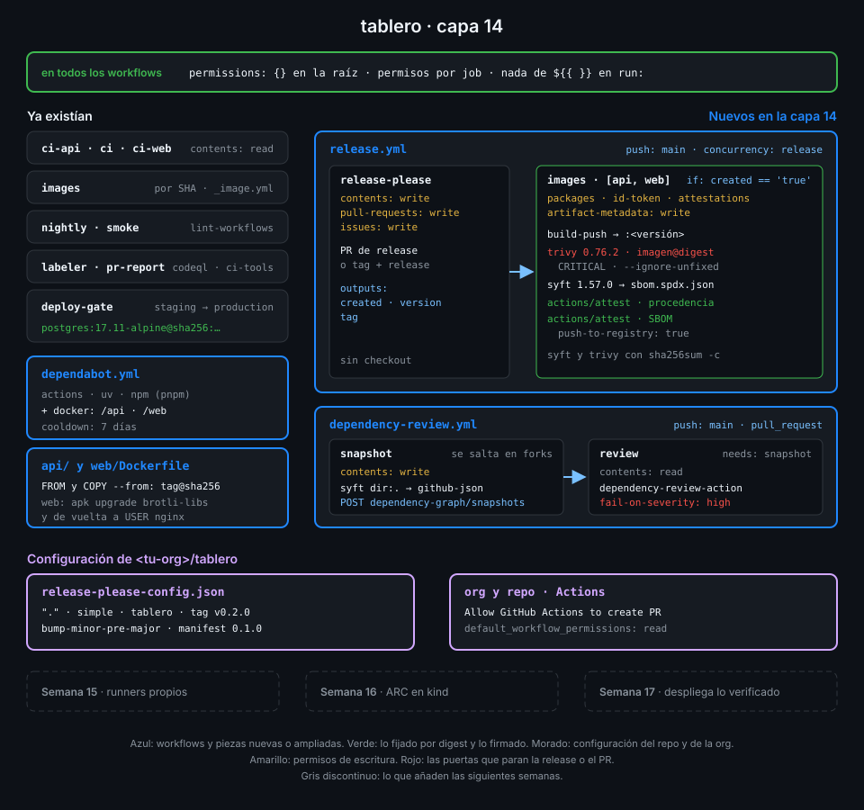

# Proyecto: capa 14 de tablero



## 🎯 Objetivo

Que cada versión de `tablero` sea algo que se pueda nombrar, auditar y comprobar: una release
con su CHANGELOG, dos imágenes con esa versión como tag, escaneadas antes de firmarse, con un
SBOM y una attestation de procedencia que cualquiera puede verificar con `gh`. Y que lo que
entra por debajo, las imágenes base y las dependencias de un PR, no cambie a tus espaldas ni
traiga un aviso grave.

## 📦 Qué añade esta capa

| Pieza de `tablero` | Qué hace | Por qué existe |
|---|---|---|
| `release-please-config.json` y `.release-please-manifest.json` (nuevos) | Un único paquete `simple` en la raíz, tags `vX.Y.Z` sin componente, versión actual en el manifest | release-please sabe qué versionar y desde qué versión partir |
| `release.yml` (nuevo), job `release-please` | En cada `push` a `main` actualiza el PR de release; al fusionarlo crea tag, release y CHANGELOG | La versión sale de los commits, no de alguien que se acuerda de subirla |
| `release.yml`, job `images` | Solo si hubo release: publica `tablero-api` y `tablero-web` con la versión, las escanea con Trivy, genera su SBOM con syft y firma dos attestations | La release la crea `GITHUB_TOKEN`, que no dispara otros workflows: las imágenes salen en el mismo run |
| `api/Dockerfile` y `web/Dockerfile` | Bases (y la imagen de `uv`) fijadas por tag y digest; la web parchea `brotli-libs` mientras la base no se reconstruya | El mismo `FROM` construye siempre lo mismo; el parche cierra la CVE que Trivy encontró |
| `deploy-gate.yml` | El PostgreSQL de servicio, fijado por digest | Lo que la Semana 17 despliega se ensaya contra una base que no cambia sola |
| `dependabot.yml` | Ecosistema `docker` en `/api` y `/web` | Sin él, un digest fijado se queda viejo y acumula CVE |
| `dependency-review.yml` (nuevo) | Envía al dependency graph un snapshot de syft y, en cada PR, falla si entra una dependencia con aviso `high` o `critical` | El grafo no lee `uv.lock` ni el `pnpm-lock.yaml` de pnpm 11+: sin el snapshot, la revisión no vería nada |

| Situación | Qué pasa |
|---|---|
| Fusionas un `fix:` en `main` | release-please abre o actualiza el PR de release con la siguiente versión de parche |
| Fusionas el PR de release | Tag `vX.Y.Z`, release con notas y, en el mismo run, imágenes publicadas y firmadas |
| La imagen tiene una CVE `CRITICAL` con arreglo | El escaneo falla y no hay attestations: esa versión no pasará el `gh attestation verify` de la Semana 17 |
| Alguien sube a GHCR una `tablero-api` construida en su portátil | `gh attestation verify` la rechaza: no la firmó `release.yml` de `tablero` |
| Docker Hub vuelve a publicar `python:3.15.2-slim-trixie` | Tu `FROM` no cambia; Dependabot te abre un PR con el digest nuevo tras el cooldown |
| Un PR añade una dependencia con un aviso `high` | `dependency-review` se pone en rojo y enseña el aviso |

La Semana 15 deja de usar solo runners de GitHub: montas uno propio, efímero y blindado. La
Semana 17 cierra el círculo: despliega por digest y solo lo que pase `gh attestation verify`.

## ✅ Requisitos verificables

- release-please-config.json declara un único paquete en la raíz de tipo simple, con tags sin componente, y .release-please-manifest.json existe
- release.yml corre en push a main y su job release-please usa release-please-action fijada por SHA con el config y el manifest
- El job release-please escribe solo en contents, pull-requests e issues
- El job images de release.yml necesita a release-please y solo corre si se creó una release
- El job images publica api y web con la versión de la release como tag
- release.yml instala Trivy y syft como binario de su release comprobado con sha256sum, sin trivy-action ni la versión comprometida 0.69.4
- Un step de images escanea la imagen publicada por digest con Trivy y falla con --exit-code 1
- El job images firma dos attestations con actions/attest fijada por SHA sobre el digest publicado: procedencia y SBOM, las dos guardadas en el registro
- El job images pide id-token, attestations, artifact-metadata y packages en escritura y contents en lectura, nada más
- Todas las imágenes externas de api/Dockerfile y web/Dockerfile (FROM y COPY --from) van fijadas por tag y digest
- Las imágenes de services de los workflows de tablero van fijadas por tag y digest
- dependabot.yml vigila el ecosistema docker en /api y /web con cooldown
- dependency-review.yml envía el snapshot de syft a la API de dependency submission desde un job con contents: write
- En los PR a main, dependency-review-action fijada por SHA falla con avisos de gravedad high o superior, desde un job de solo lectura
- Solo escriben codeql, deploy-gate, images, labeler, nightly, pr-report, release (release-please e images) y dependency-review (snapshot); ningún write-all ni read-all
- actionlint y zizmor pasan sin hallazgos sobre los workflows de tablero
- tablero tiene una release vX.Y.Z publicada por release-please y release.yml está en verde en el último commit de main
- gh attestation verify acepta la procedencia y el SBOM de tablero-api en la última versión, firmados por release.yml de tablero

## 🎨 Criterios de calidad

Lo que `check-week.sh` no ve y la [rúbrica](../rubrica-evaluacion.md) sí puntúa:

- Los digests se sacaron con `docker buildx imagetools inspect` (o del PR de Dependabot), no
  copiados de un blog: son los del índice multiarquitectura del tag que dice el comentario.
- El parche de `brotli-libs` lleva un comentario con la CVE, la fecha y cuándo quitarlo; si al
  hacer la semana la base ya viene arreglada, no hay parche, y lo dice el commit.
- Ninguna excepción de Trivy sin justificar: si hay `.trivyignore`, cada línea lleva el porqué y
  una fecha de revisión.
- El CHANGELOG de la release se lee bien porque los commits son convencionales y con alcance
  (`fix(web): ...`, `feat(api): ...`), no `update` ni `wip`.
- Las versiones de syft y Trivy coinciden con `docs/stack-versions.md` y aparecen una sola vez
  (en `env:`), no repetidas en cada comando.
- Los workflows de prueba de las prácticas y la rama del PR vulnerable de la práctica 04 están
  borrados; el PR, cerrado sin fusionar.
- Sin `TODO` en el repo.

## 💡 Adaptación a tu dominio

| Tu proyecto | `release-type` de release-please | Qué se firma | Qué escanea la puerta |
|---|---|---|---|
| Librería Python en PyPI | `python` (sube la versión de `pyproject.toml`) | El wheel y el sdist (`subject-path: dist/*`), además de trusted publishing | `uv.lock` con Trivy en modo `fs` |
| CLI en Go con binarios por plataforma | `go` | Cada binario de la release, con `subject-checksums` | Los binarios y el módulo |
| Monorepo con servicios que versionan por separado | `simple` por carpeta, con `include-component-in-tag: true` | Una imagen por servicio, con su propio tag `servicio-vX.Y.Z` | Cada imagen, en una matriz por servicio |
| Chart de Helm | `helm` (sube `Chart.yaml`) | El chart empaquetado subido a un registro OCI | Las imágenes que referencia el chart |

## 🚦 Cómo entregarlo

Si hiciste las cuatro prácticas ya lo tienes todo: repásalo contra los requisitos y los
criterios. Si no, parte del starter.

1. Copia el starter en `tablero` y completa los `TODO 1` a `TODO 13`:

   ```bash
   cd ~/code/tablero
   S=~/code/bc-github-actions/bootcamp/week-14-releases_cadena_de_suministro_y_attestations/3-proyecto/starter
   cp -r "$S"/.github/. .github/
   grep -rnE "TODO [0-9]+" .github | wc -l
   # 13
   ```

2. Escribe `release-please-config.json` y `.release-please-manifest.json`, y permite que
   `GITHUB_TOKEN` cree pull requests
   ([práctica 01](../2-practicas/01-release-please-y-versionado-semantico.md)).

3. Fija por digest las bases de `api/Dockerfile` y `web/Dockerfile` y el PostgreSQL de
   `deploy-gate.yml`, y añade el ecosistema `docker` a `dependabot.yml`
   ([práctica 04](../2-practicas/04-digests-y-revision-de-dependencias.md)).

4. Antes de hacer push, comprueba lo que se puede ver en local:

   ```bash
   docker build -q -t tablero-web:local web >/dev/null
   trivy image -q --exit-code 1 --severity CRITICAL --ignore-unfixed tablero-web:local && echo sin-criticas
   # sin-criticas
   actionlint && GH_TOKEN=$(gh auth token) zizmor -q .github/ && echo limpio
   # limpio
   ```

5. Haz push a `main`, fusiona el PR de release que abre release-please y espera a que `images`
   termine ([práctica 02](../2-practicas/02-imagenes-versionadas-y-escaneo.md) y
   [práctica 03](../2-practicas/03-sbom-y-attestations.md)).

6. Lanza la verificación:

   ```bash
   cd ~/code/bc-github-actions
   ./scripts/check-week.sh 14
   # 18/18 comprobaciones superadas.
   ```

## 🧯 Errores comunes

| Síntoma | Causa | Solución |
|---|---|---|
| `GitHub Actions is not permitted to create or approve pull requests.` | El repo (o la org) no deja a `GITHUB_TOKEN` crear PR | Actívalo en la org y en el repo ([práctica 01](../2-practicas/01-release-please-y-versionado-semantico.md), paso 1) |
| `The action googleapis/release-please-action@... is not allowed in <tu-org>` | La lista de actions permitidas de la Semana 11 no la incluye | Añade el patrón partiendo de la lista guardada ([práctica 01](../2-practicas/01-release-please-y-versionado-semantico.md), paso 1) |
| `check-week.sh 11` marca `org-default-token-read` en rojo | La capa 14 activa `can_approve_pull_request_reviews` | Es lo esperado ([comprobaciones superadas por capas posteriores](../../../docs/autograding.md#comprobaciones-superadas-por-capas-posteriores)) |
| El PR de release no tiene checks de CI | Los PR que crea `GITHUB_TOKEN` no disparan workflows | Es lo esperado; si un ruleset exige checks (Semana 18), usa el token de una GitHub App |
| release-please no abre PR tras tu commit | Solo `feat`, `fix`, `deps` y los `!` suben versión; `ci:` o `docs:` no | Es lo esperado: haz un `fix:` real o usa `Release-As:` |
| El primer PR de release trae todo el historial en el CHANGELOG | No había release anterior: release-please empieza desde el principio | Edita el CHANGELOG en el propio PR antes de fusionarlo o usa `bootstrap-sha` en el config |
| El job `images` se salta tras fusionar el PR de release | El `if:` compara con `true` sin comillas o lee un output que no existe | Compara `needs.release-please.outputs.created == 'true'`: los outputs son cadenas |
| `Error: Failed to get ID token` en `actions/attest` | Falta `id-token: write` en el job | Añádelo en los permisos del job `images` |
| `Resource not accessible by integration` al firmar | Faltan `attestations: write` o `artifact-metadata: write` | Los dos, en el job `images` |
| Trivy sale con código 1 en la imagen web | CVE `CRITICAL` con arreglo en la base (`brotli-libs` en noviembre de 2026) | Parchea la base o espera el digest nuevo; nunca bajes la severidad para pasar |
| `sha256sum: WARNING: 1 computed checksum did NOT match` | Descarga corrupta o asset distinto del que esperabas | No instales el binario; revisa versión y nombre del asset |
| `gh attestation verify` dice `no attestations found` | La imagen es de un run sin attestations o el `--repo` no es `tablero` | Comprueba el digest y que el job `images` terminó en verde |
| `dependency-review` avisa de que no hay snapshot | El job `snapshot` no ha terminado o se saltó (PR desde un fork) | Con `retry-on-snapshot-warnings` espera; en un fork solo ve lo que el grafo ve |

## 🔗 Navegación

---

| ← Anterior | Siguiente → |
|:---|---:|
| [Digests y revisión de dependencias](../2-practicas/04-digests-y-revision-de-dependencias.md) | [Rúbrica de evaluación](../rubrica-evaluacion.md) |
