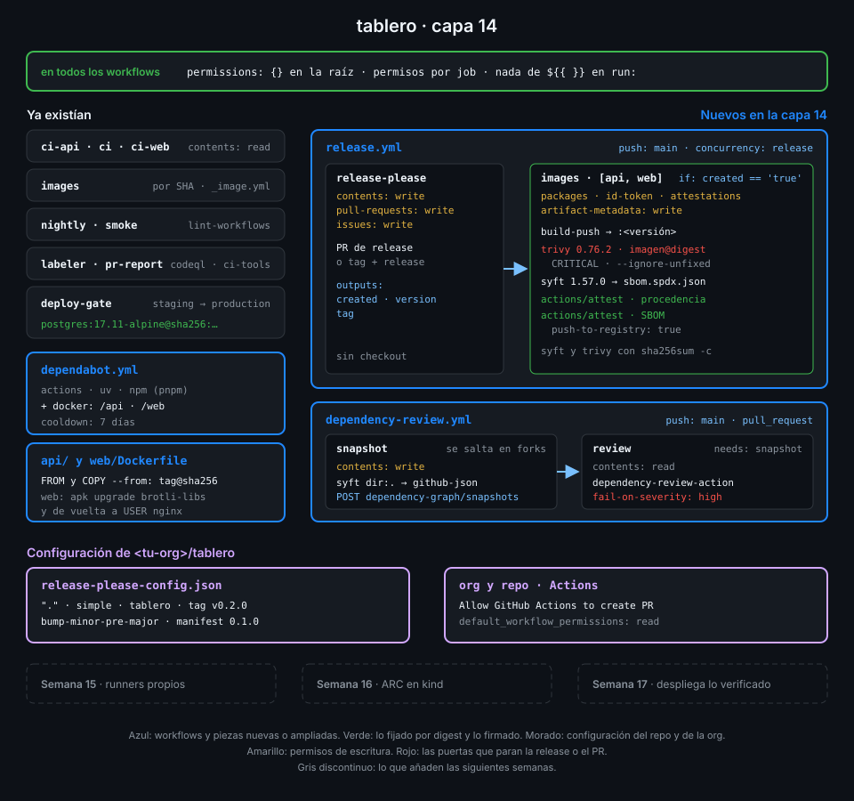

# Semana 14 — Releases, cadena de suministro y attestations

> La Semana 13 decidió quién puede desplegar. Esta semana decides qué se despliega: una versión
> con nombre, una imagen fijada por digest, escaneada, con su SBOM y con una firma que dice dónde
> y cómo se construyó.

## 🎯 Objetivos de la Semana

Al terminar la semana eres capaz de:

- Explicar cómo release-please convierte commits convencionales en una versión SemVer, un
  CHANGELOG, un tag y una release, y por qué las imágenes salen en el mismo run
- Distinguir un tag de un digest, fijar por digest las imágenes base y de services, y dejar que
  Dependabot mueva esos digests sin que tengas que mirarlos
- Situar en la cadena de suministro de `tablero` los ataques reales (actions comprometidas,
  herramientas comprometidas, dependencias maliciosas) y qué pieza frena cada uno
- Generar un SBOM con syft, leerlo y saber para qué lo vas a necesitar el día que salga una CVE
- Firmar attestations de procedencia y de SBOM con `actions/attest` y comprobarlas con
  `gh attestation verify`, exigiendo repo, workflow firmante y tipo de predicado
- Escanear una imagen con Trivy instalado con checksum, decidir qué rompe el build y qué no, y
  arreglar una vulnerabilidad real de la imagen base
- Hacer que dependency-review vea las dependencias que el dependency graph no lee y frene un PR
  que introduce una con un aviso grave

## 📋 Prerrequisitos

| Necesitas | Dónde se aprende |
|---|---|
| `check-week.sh 13` en 17/17 | [Semana 13](../week-13-secretos_entornos_y_oidc/README.md) |
| Conventional Commits y tags | [Semana 01](../week-01-primer_workflow_y_modelo_de_ejecucion/README.md) y [Semana 11](../week-11-actions_a_escala_de_organizacion/README.md) |
| Imágenes en GHCR por digest y `build-push-action` | [Semana 06](../week-06-imagenes_docker_y_ghcr/README.md) |
| Matrices y outputs entre jobs | [Semana 04](../week-04-ci_de_frontend_pnpm_matrices_y_artefactos/README.md) y [Semana 02](../week-02-expresiones_contextos_y_flujo_de_datos/README.md) |
| Releases inmutables y SemVer de actions | [Semana 11](../week-11-actions_a_escala_de_organizacion/README.md) |
| Dependabot, cooldown y modelo de amenazas | [Semana 12](../week-12-modelo_de_amenazas_y_endurecimiento/README.md) |
| Token OIDC del job y `id-token: write` | [Semana 13](../week-13-secretos_entornos_y_oidc/README.md) |

## 🗂️ Estructura de la Semana

```
week-14-releases_cadena_de_suministro_y_attestations/
├── README.md
├── rubrica-evaluacion.md          incluye el minisimulacro de cierre de la Fase 4
├── checks.json                    18 comprobaciones
├── 0-assets/                      diagramas SVG
├── 1-teoria/                      7 archivos, uno por concepto
├── 2-practicas/                   4 prácticas guiadas
├── 3-proyecto/
│   ├── README.md
│   └── starter/.github/workflows/ release.yml y dependency-review.yml
├── 4-recursos/{ebooks-free,videografia,webgrafia}/README.md
└── 5-glosario/README.md
```

## 📝 Contenidos

### Teoría

| # | Archivo | Qué aprendes | Tiempo |
|:--:|---|---|:--:|
| 01 | [Versionado semántico y release-please](1-teoria/01-versionado-semantico-y-release-please.md) | De commits convencionales a versión, CHANGELOG, tag y release; el PR de release y sus outputs | 25 min |
| 02 | [Tags, digests e imágenes versionadas](1-teoria/02-tags-digests-e-imagenes-versionadas.md) | Por qué un tag se mueve y un digest no, qué fijar por digest y cómo mantenerlo al día | 25 min |
| 03 | [Cadena de suministro y SLSA](1-teoria/03-cadena-de-suministro-y-slsa.md) | Dónde atacan un pipeline, qué es la procedencia y qué niveles de SLSA alcanza Actions | 25 min |
| 04 | [SBOM con syft](1-teoria/04-sbom-con-syft.md) | SPDX frente a CycloneDX, qué cataloga syft y para qué sirve un SBOM | 25 min |
| 05 | [Attestations y Sigstore](1-teoria/05-attestations-y-sigstore.md) | Cómo `actions/attest` firma con la identidad OIDC del job y qué comprueba `gh attestation verify` | 30 min |
| 06 | [Escaneo de vulnerabilidades con Trivy](1-teoria/06-escaneo-de-vulnerabilidades-con-trivy.md) | Severidad, `--ignore-unfixed`, qué rompe el build y por qué Trivy se instala con checksum | 25 min |
| 07 | [Dependency graph y dependency review](1-teoria/07-dependency-graph-y-dependency-review.md) | Qué ve el grafo, qué no, cómo completarlo con un snapshot y cómo frenar un PR | 25 min |

### Prácticas

| # | Archivo | Qué haces | Tiempo |
|:--:|---|---|:--:|
| 01 | [release-please y versionado semántico](2-practicas/01-release-please-y-versionado-semantico.md) | Configuras release-please, dejas que abra su PR de release y publicas la primera versión | 1 h |
| 02 | [Imágenes versionadas y escaneo](2-practicas/02-imagenes-versionadas-y-escaneo.md) | Publicas `tablero-api` y `tablero-web` con la versión, Trivy encuentra una CVE real y la arreglas | 1 h |
| 03 | [SBOM y attestations](2-practicas/03-sbom-y-attestations.md) | Firmas procedencia y SBOM de cada imagen y las verificas, también cuando no deberían pasar | 1 h |
| 04 | [Digests y revisión de dependencias](2-practicas/04-digests-y-revision-de-dependencias.md) | Fijas bases y services por digest, envías el snapshot de syft y un PR vulnerable se queda en rojo | 1 h |

### Proyecto

[Capa 14 de `tablero`](3-proyecto/README.md): cada versión de `tablero` es una release con
CHANGELOG cuyas imágenes llevan la versión como tag, pasan un escaneo y salen firmadas con su
procedencia y su SBOM; las bases están fijadas por digest y ningún PR mete una dependencia con
un aviso grave.



## ⏱️ Distribución del Tiempo (10 horas)

| Actividad | Horas |
|---|:--:|
| Teoría (7 archivos) | 3 |
| Práctica 01 — release-please y versionado semántico | 1 |
| Práctica 02 — Imágenes versionadas y escaneo | 1 |
| Práctica 03 — SBOM y attestations | 1 |
| Práctica 04 — Digests y revisión de dependencias | 1 |
| Proyecto — capa 14 | 1 |
| Minisimulacro de cierre de la Fase 4 | 1 |
| Autoevaluación con la rúbrica | 1 |
| **Total** | **10** |

## 🎓 Cierre de la Fase 4

Con esta semana termina la Fase 4 (Seguridad). La [rúbrica](rubrica-evaluacion.md) incluye un
minisimulacro cronometrado de 60 minutos sobre las semanas 12-14: preguntas tipo GH-200 de los
dominios que cubre la fase (D2 y D4, con repaso de D3) y una tarea práctica sobre `tablero`.

En el examen caen sobre todo los **permisos que pide una attestation** (`id-token: write` y
`attestations: write`), **qué demuestra** una attestation de procedencia y qué no (dice dónde se
construyó, no que el código sea bueno), **cómo se verifica** (`gh attestation verify`) y qué
hace **dependency-review** en un PR frente a Dependabot.

## 🎩 Trucos y atajos

- **Mira qué attestations tiene una imagen sin verificar nada todavía**:
  `gh attestation verify oci://ghcr.io/<tu-org>/tablero-api:0.2.0 --repo <tu-org>/tablero --format json --jq '.[].verificationResult.statement.predicateType'`
  lista los tipos de predicado firmados. Con `--predicate-type` exiges uno concreto.
- **El digest de un tag sin bajarte la imagen**:
  `docker buildx imagetools inspect postgres:17.11-alpine --format '{{json .Manifest}}' | jq -r .digest`
  da el digest del índice multiarquitectura, que es el que va en `FROM` y en `services:`.
- **Fuerza la siguiente versión sin inventarte un commit**: un commit vacío con el pie
  `Release-As: 1.0.0` (`git commit --allow-empty -m "chore: release 1.0.0" -m "Release-As: 1.0.0"`)
  hace que release-please proponga exactamente esa versión.
- **Pregunta al dependency graph qué ve de verdad**:
  `gh api 'repos/{owner}/{repo}/dependency-graph/sbom' --jq '.sbom.packages | length'` devuelve
  cuántos paquetes conoce; compáralo antes y después de enviar el snapshot de syft.
- **Prueba la puerta de Trivy en local antes del push**: `trivy image --exit-code 1 --severity CRITICAL --ignore-unfixed tablero-web:local`
  sobre la imagen construida con `docker build` te dice si la release va a fallar.

## 📌 Entregables

- `release-please-config.json`, `.release-please-manifest.json`, `release.yml` y
  `dependency-review.yml` en `main`
- Una release `vX.Y.Z` publicada por release-please, con `release.yml` en verde
- `tablero-api` y `tablero-web` de esa versión en GHCR, con attestations de procedencia y de
  SBOM que `gh attestation verify` acepta
- Bases de los Dockerfiles y services fijadas por digest, con Dependabot vigilándolas
- La rúbrica respondida, con el minisimulacro de cierre de la Fase 4

## ✅ Verificación

```bash
cd ~/code/bc-github-actions
./scripts/check-week.sh 14
# Semana 14 — Releases, cadena de suministro y attestations  [repo: <tu-org>/tablero]
#
#   ✅ release-please-config.json declara un único paquete en la raíz de tipo simple, ...
#   ...
# 18/18 comprobaciones superadas.
```

Si algo sale en rojo, la pista te dice qué práctica y qué paso lo arreglan.

## 🔗 Navegación

---

| ← Anterior | Siguiente → |
|:---|---:|
| [Semana 13 — Secretos, entornos y OIDC](../week-13-secretos_entornos_y_oidc/README.md) | [Versionado semántico y release-please](1-teoria/01-versionado-semantico-y-release-please.md) |
