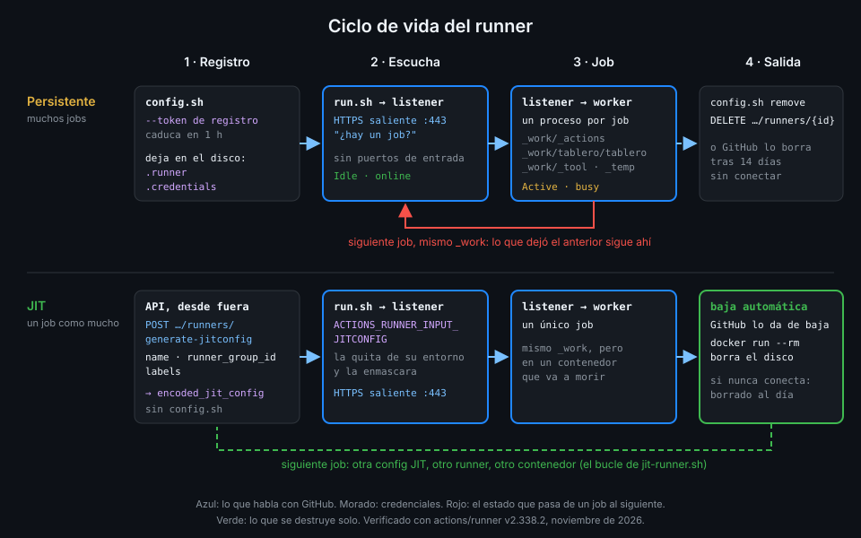

# Cómo funciona el runner

> El runner es un programa que se registra una vez, pide trabajo a GitHub por HTTPS y lanza un
> proceso por job. Saber dónde guarda cada cosa es saber qué queda en tu máquina.



## 🎯 Objetivos

Al terminar este archivo eres capaz de:

- Registrar un runner con `config.sh` y un token de registro, y decir qué archivos deja
- Explicar el papel del listener y del worker durante un job
- Localizar el directorio de trabajo, la caché de herramientas y los logs del runner
- Explicar cuándo se actualiza solo el runner y qué pasa si lo impides
- Dar de baja un runner de forma limpia o forzarla desde la API

## 1. Qué problema resuelve

En el archivo 01 viste que un runner propio deja estado. Para controlarlo necesitas saber **qué
estado**: qué archivos crea al registrarse, dónde clona el repo, dónde escribe las actions que
descarga y qué proceso tiene acceso a qué. Sin ese mapa no puedes decidir qué borrar, qué aislar
ni por qué un runner aparece *offline* en la UI.

## 2. Cómo funciona

### Registro

Registrar es presentarse a GitHub una vez. Pides un **token de registro** para el repo (caduca en
una hora) y se lo das a `config.sh`:

| Flag de `config.sh` | Para qué |
|---|---|
| `--url` | El repo (o la org) donde se registra |
| `--token` | El token de registro |
| `--name` | Nombre visible del runner |
| `--labels L1,L2` | Etiquetas propias, además de las por defecto |
| `--no-default-labels` | Quita `self-hosted`, `Linux` y `X64` |
| `--runnergroup` | Grupo, si se registra en una org (archivo 06) |
| `--work` | Directorio de trabajo; por defecto `_work` |
| `--unattended` | No pregunta nada: imprescindible en scripts |
| `--replace` | Sustituye a un runner con el mismo nombre |
| `--ephemeral` | Acepta un solo job y se da de baja (archivo 04) |
| `--disableupdate` | Apaga la actualización automática |

Al terminar, `config.sh` deja junto a él varios archivos ocultos. Los importantes son `.runner`
(a qué repo pertenece y con qué nombre) y `.credentials` con `.credentials_rsaparams`: la
**identidad del runner**, con la que se autentica desde entonces. El token de registro ya no hace
falta; la credencial que importa ahora vive en el disco de tu máquina, y quien la copie puede
hacerse pasar por tu runner.

### Escucha

`run.sh` arranca el **listener** (`Runner.Listener` en el código de `actions/runner`). El
listener abre conexiones HTTPS salientes por el puerto 443 para preguntar si hay un job para él.
No necesitas abrir ningún puerto de entrada: la conexión la inicia siempre el runner. Mientras
espera, la UI lo muestra *Idle* y la API, `status: online` con `busy: false`.

### Job

Cuando GitHub le asigna un job, el listener lanza un **worker** (`Runner.Worker`), un proceso
nuevo para ese job. El worker:

1. Descarga las actions del job a `_work/_actions`.
2. Prepara el directorio del repo, `_work/<repo>/<repo>`, que es `GITHUB_WORKSPACE`.
3. Ejecuta los steps con el usuario del sistema que lanzó `run.sh`.
4. Envía el log de cada step a GitHub y termina.

Al final del job, el worker busca los procesos que el job dejó corriendo (los reconoce por la
variable `RUNNER_TRACKING_ID` que pone en su entorno) y los termina: en el log verás
`Cleaning up orphan processes`. Es una limpieza de cortesía, no una barrera: un proceso que
cambie esa variable se escapa.

El listener vuelve a esperar. En un runner persistente, `_work` sigue ahí con el checkout, las
actions descargadas, `_work/_tool` (la caché de herramientas que usan las actions `setup-*`) y
`_work/_temp`.

### Logs

El runner escribe sus propios logs en `_diag`:

| Archivo | Qué cuenta |
|---|---|
| `Runner_<fecha>.log` | El listener: arranque, conexión, jobs recibidos. Uno por arranque |
| `Worker_<fecha>.log` | El detalle de un job concreto. Uno por job |
| `SelfUpdate…` | Las actualizaciones del runner |

La imagen oficial `ghcr.io/actions/actions-runner` trae `ACTIONS_RUNNER_PRINT_LOG_TO_STDOUT=1`:
el log del listener sale también por la salida estándar, y con `docker logs` lo lees sin entrar
al contenedor.

### Actualización

El runner se actualiza solo: cuando recibe un job, o en la semana siguiente a una versión nueva si
está parado. Si lo arrancas con `--disableupdate`, la actualización es cosa tuya, y GitHub da
63 días desde que hay una versión nueva; pasado ese plazo, el runner deja de recibir jobs. En un
contenedor desechable la auto-actualización no tiene sentido (se perdería con el contenedor): en
`tablero` la versión la fija el `FROM` del Dockerfile y Dependabot propone la nueva (archivo 05).

### Baja

| Cómo | Qué hace |
|---|---|
| `config.sh remove --token <TOKEN>` con un token de baja | Da de baja el runner y borra sus archivos de configuración |
| `DELETE repos/{owner}/{repo}/actions/runners/{id}` | Lo borra en GitHub, esté como esté. Responde 204 |
| No volver a conectarse | GitHub lo borra a los 14 días; si es efímero, al día |

El token de baja se pide con `POST repos/{owner}/{repo}/actions/runners/remove-token`.

_Verificado con actions/runner v2.338.2 y ubuntu-24.04, noviembre de 2026._

## 3. Cómo se usa

### Registrar un runner persistente a mano

Es lo que haces en la práctica 01, dentro de un contenedor de la imagen oficial:

```bash
token=$(gh api -X POST "repos/$GH_REPO/actions/runners/registration-token" --jq .token)
./config.sh --unattended \
  --url "https://github.com/$GH_REPO" \
  --token "$token" \
  --name tablero-persistente \
  --labels tablero-lab
./run.sh
# √ Connected to GitHub
# ... Listening for Jobs
```

`GH_REPO` vale `<tu-org>/tablero`, igual que en el resto del bootcamp.

### Ver el estado desde fuera

```bash
gh api "repos/$GH_REPO/actions/runners" \
  --jq '.runners[] | {id, name, status, busy, ephemeral, version}'
# {"busy":false,"ephemeral":false,"id":42,"name":"tablero-persistente","status":"online","version":"2.338.2"}
```

| Campo | Qué te dice |
|---|---|
| `status` | `online` si el listener está conectado; `offline` si no |
| `busy` | `true` mientras un worker ejecuta un job |
| `ephemeral` | Si se dará de baja tras un job |
| `labels[].type` | `read-only` para las por defecto, `custom` para las tuyas |
| `version` | La versión del runner, para saber si se acerca el plazo de actualización |

### Qué hay en la máquina después de un job

Tras un job de `tablero` en un runner persistente, `ls _work` enseña algo así:

```bash
ls _work
# _actions  _temp  _tool  tablero
ls _work/_actions
# actions  astral-sh
```

El checkout de `tablero`, el `uv` que instaló `setup-uv` y el código de las actions siguen ahí.
El siguiente job, sea de quien sea, los encuentra. El archivo 04 explica cómo hacer que no haya
"siguiente job".

### Cuándo un job no arranca

| Lo que ves | Qué pasa |
|---|---|
| Job en *Queued* sin fin | Ningún runner online casa con `runs-on` (archivo 03) |
| El job vuelve a la cola | El runner asignado no lo recogió en 60 segundos |
| *Failed* tras 24 horas en cola | Nadie lo recogió a tiempo |
| Runner *Offline* en la UI | El listener no corre o no llega a GitHub por el 443 |

## 4. Antipatrones

| Antipatrón | Por qué duele | Qué hacer en su lugar |
|---|---|---|
| Ejecutar `run.sh` como root | Todo job es root en la máquina | Un usuario sin privilegios; en contenedor, sin escalada |
| Copiar la carpeta del runner a otra máquina | Duplicas `.credentials`: dos máquinas con la misma identidad | Registra cada runner con su propio token |
| Guardar el token de registro en un script del repo | Quien lo lea registra runners en tu repo durante una hora | Pídelo justo antes con `gh api` |
| `--disableupdate` sin un plan para actualizar | A los 63 días deja de recibir jobs | Versión fijada en el Dockerfile y Dependabot |
| Borrar `_work` a mano mientras corre un job | Rompes el job y no limpias lo que importa | Runner efímero: no hay nada que limpiar |

## 5. Trucos

- **El log de un job desde la máquina**: si el log de la UI se corta porque el runner murió,
  `Worker_<fecha>.log` en `_diag` tiene lo que pasó hasta el final.
- **`--replace` al reiniciar con el mismo nombre**: evita el error de nombre duplicado cuando un
  runner anterior quedó registrado y *offline*.
- **Cualquier flag por el entorno**: `config.sh` y `run.sh` aceptan `ACTIONS_RUNNER_INPUT_<FLAG>`
  en lugar de `--<flag>`; el archivo 04 lo usa para que una credencial no aparezca en `ps`.

## 📚 Recursos Adicionales

- [GitHub Docs: Self-hosted runners reference](https://docs.github.com/en/actions/reference/runners/self-hosted-runners)
- [GitHub Docs: Monitoring and troubleshooting self-hosted runners](https://docs.github.com/en/actions/how-tos/manage-runners/self-hosted-runners/monitor-and-troubleshoot)
- [GitHub Docs: Removing self-hosted runners](https://docs.github.com/en/actions/how-tos/manage-runners/self-hosted-runners/remove-runners)
- [REST API: Self-hosted runners](https://docs.github.com/en/rest/actions/self-hosted-runners)
- [actions/runner, código fuente](https://github.com/actions/runner/tree/main/src)

## ✅ Checklist de Verificación

- [ ] Sé registrar un runner con `config.sh --unattended` y un token de registro
- [ ] Sé qué archivos guardan la identidad del runner y por qué hay que protegerlos
- [ ] Sé qué hacen el listener y el worker
- [ ] Sé qué hay en `_work` después de un job y en `_diag` siempre
- [ ] Sé cuándo se actualiza el runner y qué plazo hay si lo impido
- [ ] Sé dar de baja un runner con `config.sh remove` y con la API

---

| ← Anterior | Siguiente → |
|:---|---:|
| [Por qué un runner propio](01-por-que-un-runner-propio.md) | [Etiquetas y `runs-on`](03-etiquetas-y-runs-on.md) |
