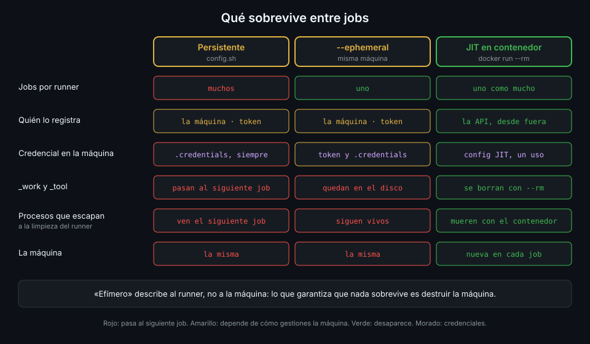

# Runners efímeros y JIT

> Un runner persistente acumula todo lo que sus jobs dejan. Uno efímero acepta un job y se da de
> baja; uno JIT, además, nace ya registrado y nunca ve un token de registro.



## 🎯 Objetivos

Al terminar este archivo eres capaz de:

- Distinguir un runner persistente, uno `--ephemeral` y uno JIT por cuántos jobs acepta y qué
  credencial usa
- Explicar qué sobrevive de un job al siguiente en cada caso, y qué depende de la máquina y no
  del runner
- Pedir una configuración JIT a la API con `gh api`
- Pasar la configuración JIT al runner sin que aparezca en la lista de procesos
- Explicar por qué `tablero` combina JIT con un contenedor que se borra

## 1. Qué problema resuelve

En el archivo 02 viste lo que queda en `_work` después de un job. La guía de seguridad de GitHub
es tajante: con un runner que acepta varios jobs, **no hay forma de garantizar que un runner solo
ejecute un job**, y un job puede dejar algo para el siguiente. La solución obvia es que cada
runner viva lo que dura un job. El runner ofrece dos formas de hacerlo, y no son equivalentes.

## 2. Cómo funciona

### Persistente

Es el modo por defecto. `config.sh` con un token de registro, `run.sh`, y el runner acepta jobs
uno tras otro hasta que lo paras. Su identidad (`.credentials`) vive en el disco mientras exista.
Lo usas en la práctica 01 para ver el problema con tus ojos.

### `--ephemeral`

`config.sh --ephemeral` registra un runner que **acepta un solo job**; al terminarlo, el servicio
de Actions lo da de baja. Resuelve el "siguiente job", pero deja dos cosas abiertas:

- **El registro sigue usando un token de registro**, que tiene que llegar a la máquina que
  registra el runner.
- **La máquina no se borra.** El runner se da de baja, pero `_work`, los archivos del usuario y
  cualquier proceso que el job dejara siguen en el disco. Si vuelves a registrar un runner en la
  misma máquina, el nuevo job lo encuentra todo.

### JIT (*just-in-time*)

Un runner JIT se crea **desde la API**, no desde la máquina:

1. Alguien con permisos de administración del repo llama a
   `POST repos/{owner}/{repo}/actions/runners/generate-jitconfig` con `name`,
   `runner_group_id` (`1` es el grupo por defecto) y `labels`.
2. GitHub registra el runner y devuelve `runner` (con su `id`) y `encoded_jit_config`: un blob
   con todo lo que el runner necesita para conectarse como ese runner.
3. La máquina arranca `run.sh` con esa configuración. **No ejecuta `config.sh`** y nunca ve un
   token de registro.
4. El runner hace **como mucho un job** y GitHub lo da de baja.

La configuración JIT es una credencial de un solo uso: sirve para ese runner y para un job. Si se
filtra después, ya no vale para nada; si se filtra antes, quien la tenga puede conectarse como ese runner
y recibir el job que le toque. Se trata como un secreto.

### Qué sobrevive

| | Persistente | `--ephemeral` | JIT |
|---|---|---|---|
| Jobs por runner | Muchos | Uno | Uno como mucho |
| Credencial en la máquina | `.credentials` mientras exista | Token de registro y luego `.credentials` | Solo la config JIT |
| Quién lo registra | La máquina | La máquina | La API, desde fuera |
| `_work`, `_tool`, procesos | Pasan al siguiente job | Quedan en la máquina | Quedan en la máquina |
| Si deja de conectarse | Se borra a los 14 días | Se borra al día | Se borra al día |

La fila de `_work` es la trampa: **efímero describe al runner, no a la máquina**. Lo que garantiza
que nada sobrevive es destruir la máquina después del job. La propia guía de GitHub avisa de que
reutilizar el hardware de runners JIT puede exponer información del entorno. Por eso `tablero`
corre cada runner JIT en un contenedor con `--rm`: al salir `run.sh`, el contenedor desaparece con
todo lo que el job escribió (archivo 05).

### Cómo llega la configuración al runner

`run.sh` acepta `--jitconfig <cfg>`, pero un argumento se ve en `ps` y en la línea de comandos
del contenedor. El runner ofrece otra vía: lee cualquier argumento de una variable
`ACTIONS_RUNNER_INPUT_<ARG>`, la **quita de su entorno** antes de lanzar nada y enmascara
`jitconfig` como secreto en los logs. Con `ACTIONS_RUNNER_INPUT_JITCONFIG`, los procesos del job
no la heredan.

Si arrancas un runner con una configuración JIT inválida o ya usada, el listener termina con:

```text
Runner listener exit with terminated error, stop the service, no retry needed.
```

_Verificado con actions/runner v2.338.2 y ubuntu-24.04, noviembre de 2026._

## 3. Cómo se usa

### Cuál elegir

| Situación | Tipo |
|---|---|
| Ver con tus ojos cómo un job hereda lo del anterior (práctica 01) | Persistente, y lo borras al terminar |
| Una máquina que ya se destruye sola tras cada job y que se registra a sí misma | `--ephemeral` |
| Un orquestador (tu script, ARC) que crea la máquina y le da la credencial | JIT |
| Código que no controlas del todo | JIT en una máquina desechable, nunca persistente |

`tablero` usa JIT: el script del host es el orquestador, el contenedor es la máquina desechable.

### Pedir una configuración JIT

```bash
name="demo-$(date +%s)"
ACTIONS_RUNNER_INPUT_JITCONFIG=$(gh api -X POST "repos/$GH_REPO/actions/runners/generate-jitconfig" \
  -f name="$name" \
  -F runner_group_id=1 \
  -f 'labels[]=self-hosted' \
  -f 'labels[]=demo' \
  --jq .encoded_jit_config)
export ACTIONS_RUNNER_INPUT_JITCONFIG
```

Detalles que fallan a menudo:

- **`-F` para el entero, `-f` para las cadenas**: `runner_group_id` tiene que llegar como número.
- **`labels[]=` repetido** construye la lista. Entre 1 y 100 etiquetas, y son **todas** las que
  tendrá el runner: sin `self-hosted`, un `runs-on: [self-hosted, demo]` no casa (archivo 03).
- **Un nombre por runner**: el nombre es lo que ves en la UI y en `runner_name`. La marca de
  tiempo hace único cada uno.
- **El permiso**: el token de `gh` necesita administrar el repo. Tu sesión de `gh` como dueño de
  la org lo tiene.

### Arrancarlo

```bash
docker run --rm -e ACTIONS_RUNNER_INPUT_JITCONFIG \
  ghcr.io/actions/actions-runner:2.338.2@sha256:6d0b2d80d80f143f77dcb676e50920100bbb547e39e883454d57f45ab8c31300 \
  ./run.sh
# √ Connected to GitHub
# ... Listening for Jobs
```

`-e VAR` sin `=valor` copia la variable del entorno de tu shell al contenedor: el valor no
aparece en la línea de comandos. Cuando el job termina, `run.sh` sale y `--rm` borra el
contenedor. Para el siguiente job, otra configuración y otro contenedor: es el bucle de
`ops/runner/jit-runner.sh` que montas en la práctica 02.

### Comprobar que no queda nada

```bash
gh api "repos/$GH_REPO/actions/runners" --jq '.runners[] | {name, status, ephemeral}'
# (vacío si no hay ningún runner esperando)
```

Mientras espera, un runner JIT sale con `ephemeral: true`. Después del job ya no está.

### Si paras el bucle a mitad

Si cortas con Ctrl-C mientras un runner JIT espera sin job, queda registrado y *offline*. No es
peligroso (su configuración solo vivía en ese contenedor), pero ensucia la lista. Bórralo con
`DELETE repos/{owner}/{repo}/actions/runners/{id}` o deja que GitHub lo borre al día.

## 4. Antipatrones

| Antipatrón | Por qué duele | Qué hacer en su lugar |
|---|---|---|
| Runner persistente para código de terceros | Un job deja procesos o herramientas trucadas para el siguiente | JIT en una máquina que se destruye |
| `--ephemeral` en la misma máquina sin limpiarla | El runner cambia, el disco no | Contenedor con `--rm` o VM nueva por job |
| `run.sh --jitconfig "$cfg"` | La credencial se ve en `ps` y en la línea de comandos | `ACTIONS_RUNNER_INPUT_JITCONFIG` por el entorno |
| Guardar la config JIT en un archivo "para luego" | Quien lo lea se lleva el próximo job | Pedirla justo antes de arrancar el runner |
| Pedir la config JIT desde dentro de un job | El job necesita permisos de administración del repo | Pedirla desde fuera: el script del host o ARC |

El tercero, para reconocerlo:

```bash
./run.sh --jitconfig "$cfg" # antipatron
```

## 5. Trucos

- **El `id` viene en la misma respuesta**: `--jq '.runner.id'` sobre la respuesta de
  `generate-jitconfig` te da el número para borrarlo si algo falla antes del job.
- **`ephemeral` en la API distingue los dos mundos**: un listado con `ephemeral: false` en
  `tablero` significa que quedó vivo un runner de la práctica 01.
- **El runner enmascara la config JIT**: aunque se te escape un `set -x` en el script, el log del
  runner no la imprime. Tu script, sí: no hagas `echo` de ella.

## 📚 Recursos Adicionales

- [GitHub Docs: Secure use reference, just-in-time runners](https://docs.github.com/en/actions/reference/security/secure-use)
- [REST API: Create configuration for a just-in-time runner](https://docs.github.com/en/rest/actions/self-hosted-runners#create-configuration-for-a-just-in-time-runner-for-a-repository)
- [GitHub Docs: Self-hosted runners reference, ephemeral runners](https://docs.github.com/en/actions/reference/runners/self-hosted-runners)
- [actions/runner, `CommandSettings.cs`](https://github.com/actions/runner/blob/main/src/Runner.Listener/CommandSettings.cs)

## ✅ Checklist de Verificación

- [ ] Sé cuántos jobs acepta cada tipo de runner y qué credencial usa
- [ ] Sé por qué un runner efímero no garantiza una máquina limpia
- [ ] Sé pedir una configuración JIT con `gh api` y qué campos son obligatorios
- [ ] Sé por qué un runner JIT necesita `self-hosted` en sus etiquetas
- [ ] Sé pasar la configuración por `ACTIONS_RUNNER_INPUT_JITCONFIG`
- [ ] Sé qué hacer con un runner JIT que quedó *offline*

---

| ← Anterior | Siguiente → |
|:---|---:|
| [Etiquetas y `runs-on`](03-etiquetas-y-runs-on.md) | [El runner en un contenedor](05-runner-en-contenedor.md) |
