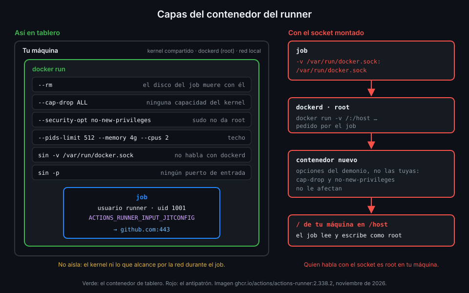

# El runner en un contenedor

> Un contenedor desechable es la máquina que se destruye después de cada job. Pero un contenedor
> no es una VM: lo que le quites (capacidades, escalada, el socket de Docker) es lo que lo separa
> de tu máquina.



## 🎯 Objetivos

Al terminar este archivo eres capaz de:

- Describir qué trae la imagen oficial `ghcr.io/actions/actions-runner` y con qué usuario corre
- Explicar qué aísla un contenedor y qué no
- Justificar cada flag de `docker run` con el que `tablero` arranca su runner
- Explicar por qué montar el socket de Docker da root en tu máquina a cualquier job
- Fijar la imagen del runner por digest y mantenerla al día con Dependabot

## 1. Qué problema resuelve

El archivo 04 terminó en una conclusión: un runner JIT solo es seguro si la máquina que lo
ejecuta se destruye después del job. Una VM por job es lo más aislado, pero lenta de crear en tu
portátil. Un contenedor con `--rm` nace en segundos y desaparece con todo lo que el job escribió.
El precio es que comparte el kernel y el demonio de Docker con tu máquina: si lo arrancas con las
opciones por defecto, o peor, con el socket montado, el job tiene más alcance del que crees.

## 2. Cómo funciona

### La imagen oficial

GitHub publica el runner como imagen en `ghcr.io/actions/actions-runner`, con el tag igual a la
versión del runner:

| Qué | Valor en 2.338.2 |
|---|---|
| Base | Ubuntu 24.04 |
| Usuario | `runner` (uid 1001), en los grupos `sudo` y `docker` |
| Directorio | `WORKDIR /home/runner`, con `config.sh`, `run.sh`, `bin/` y `externals/` |
| Arranque | Sin `ENTRYPOINT`; `CMD` es `/bin/bash`, así que le pasas `./run.sh` |
| Herramientas | `git`, `curl`, `jq`, `python3`, el cliente `docker` y `sudo` |
| Entorno | `RUNNER_MANUALLY_TRAP_SIG=1`, `ACTIONS_RUNNER_PRINT_LOG_TO_STDOUT=1`, `ImageOS=ubuntu24` |

No es la imagen de `ubuntu-24.04` de los runners alojados: no trae `uv`, ni `pnpm`, ni cientos de
herramientas. Lo que el job necesite lo instala con sus actions `setup-*`, como `setup-uv`. Y el
usuario `runner` puede hacer `sudo` **sin contraseña**: dentro del contenedor, cualquier job puede
ser root si no se lo impides.

### Qué aísla un contenedor y qué no

| Aísla | No aísla |
|---|---|
| El sistema de archivos: con `--rm`, todo desaparece al salir | El kernel: es el de tu máquina |
| Los procesos: el job no ve los de tu máquina | La red: llega a tu red local como cualquier proceso |
| Por defecto, con un juego de capacidades reducido | Lo que montes con `-v`: es tu disco de verdad |

Docker arranca los contenedores con un conjunto limitado de capacidades del kernel, pero no
vacío. Y el demonio de Docker corre como root: la documentación de Docker dice que **solo
usuarios de confianza deberían poder controlarlo**.

### Las capas de `tablero`

| Flag | Qué quita | Qué pasa si falta |
|---|---|---|
| `--rm` | El contenedor y su disco al terminar | El contenedor parado sigue en tu disco con lo que dejó el job |
| `--cap-drop ALL` | Todas las capacidades del kernel | El job conserva las capacidades por defecto de Docker |
| `--security-opt no-new-privileges` | La escalada con `sudo` o binarios setuid | `sudo` da root dentro del contenedor |
| `--pids-limit 512` | Bombas de procesos | Un job puede agotar los procesos de tu máquina |
| `--memory 4g` · `--cpus 2` | Consumo sin techo | Un job puede dejar tu máquina sin memoria |
| Sin `-v /var/run/docker.sock` | El control del demonio | El job es root en tu máquina (abajo) |
| Sin `-p` | Puertos abiertos hacia el contenedor | Nada: el runner solo hace conexiones salientes |

Con `no-new-privileges`, `sudo` falla así:

```text
sudo: The "no new privileges" flag is set, which prevents sudo from running as root.
```

Con todas las capas puestas, el runner arranca, escribe en `_work` y llega a GitHub: no necesita
nada de lo que le quitas.

### Por qué el socket de Docker es root en tu máquina

Montar `/var/run/docker.sock` dentro del contenedor es una costumbre extendida para que los jobs
puedan construir imágenes. Pero quien habla con ese socket habla con el demonio, y el demonio es
root en tu máquina. Un job no necesita salir de su contenedor: le basta con pedirle al demonio
**otro** contenedor:

```bash
docker run --rm -v /:/host ubuntu:24.04 chroot /host # antipatron
```

Ese segundo contenedor lo crea el demonio con sus propias opciones, no con las tuyas: tu
`--cap-drop ALL` y tu `no-new-privileges` no le afectan. Con `/` de tu máquina montado en
`/host`, el job lee y escribe tu disco como root. La documentación de Docker describe exactamente
este caso. La guía de seguridad de GitHub añade el otro: con el socket, un job puede inspeccionar
los demás contenedores y ejecutar comandos dentro de ellos.

El precio de quitarlo: en este runner no funcionan los jobs que necesitan Docker, como los que
usan `services:` o `container:`, ni `docker build`. El job de `tablero-lab` solo corre tests
unitarios, así que no lo echa de menos. Si algún día lo necesitas, la respuesta no es el socket
del host, sino una máquina dedicada a eso; en la Semana 16 verás cómo lo plantea ARC.

_Verificado con actions/runner v2.338.2 y ubuntu-24.04, noviembre de 2026._

## 3. Cómo se usa

### La imagen fijada

`ops/runner/Dockerfile` de `tablero` es una sola línea útil: un `FROM` con la imagen oficial
fijada por tag y digest del índice, igual que las bases de `api/` y `web/` en la Semana 14:

```dockerfile
FROM ghcr.io/actions/actions-runner:2.338.2@sha256:6d0b2d80d80f143f77dcb676e50920100bbb547e39e883454d57f45ab8c31300
```

¿Para qué un Dockerfile de una línea? Para que **Dependabot lo vea**. Con `/ops/runner` en los
`directories` del ecosistema `docker` de `dependabot.yml`, Dependabot abre un PR cuando sale una
versión nueva del runner, con tag y digest nuevos. Eso importa por dos motivos:

- Un runner que se queda atrás deja de recibir jobs: el plazo es de 63 días desde que hay una
  versión nueva.
- El runner se actualiza solo al recibir un job. En un contenedor que se tira después, esa
  actualización se repite en **cada** contenedor nuevo mientras la imagen siga vieja: tiempo
  perdido en cada job.

### El contenedor endurecido

```bash
docker build -q -t tablero-runner:local ops/runner
docker run --rm --name "$name" \
  --cap-drop ALL \
  --security-opt no-new-privileges \
  --pids-limit 512 --memory 4g --cpus 2 \
  -e ACTIONS_RUNNER_INPUT_JITCONFIG \
  tablero-runner:local ./run.sh
```

Los límites son un punto de partida: ajústalos a tu máquina, pero que existan. La práctica 03
añade las capas una a una y comprueba cada una desde dentro de un job.

### Comprobarlo desde fuera

```bash
docker inspect "$name" --format '{{.HostConfig.CapDrop}} {{.HostConfig.SecurityOpt}} {{.HostConfig.PidsLimit}}'
# [ALL] [no-new-privileges] 512
docker inspect "$name" --format '{{.HostConfig.Binds}}'
# []
```

Y desde dentro, en un step del job, la prueba de que la escalada está cerrada:

```bash
sudo -n true || echo "sin escalada"
# sudo: The "no new privileges" flag is set, which prevents sudo from running as root.
# sin escalada
```

## 4. Antipatrones

| Antipatrón | Por qué duele | Qué hacer en su lugar |
|---|---|---|
| `-v /var/run/docker.sock:/var/run/docker.sock` | Cualquier job es root en tu máquina | Sin socket; máquina dedicada si hace falta Docker |
| `--privileged` | Quita casi todo el aislamiento del contenedor | Nunca en un runner |
| Contenedor sin `--rm` | El disco del job sigue en tu máquina | `--rm` siempre |
| `FROM ghcr.io/actions/actions-runner:latest` | No sabes qué versión corre ni Dependabot puede proponer nada | Tag y digest | <!-- antipatron -->
| Montar tu `$HOME` "para tener las claves" | El job lee tus credenciales | La credencial que necesite, por el entorno y de un solo uso |
| `-p 8080:8080` en el runner | Expones un puerto que nadie necesita | Ningún `-p`: el runner solo sale hacia GitHub |

Los dos primeros, tal como aparecen en tutoriales:

```bash
docker run -v /var/run/docker.sock:/var/run/docker.sock "$IMAGE" ./run.sh # antipatron
docker run --privileged "$IMAGE" ./run.sh # antipatron
```

## 5. Trucos

- **El log sin entrar**: `docker logs -f "$name"` es el log del listener, gracias a
  `ACTIONS_RUNNER_PRINT_LOG_TO_STDOUT=1`.
- **Cuánto consume el job ahora mismo**: `docker stats --no-stream "$name"` enseña CPU, memoria
  y procesos frente a los límites que pusiste.
- **Qué hay dentro de la imagen**: `docker run --rm --entrypoint id <imagen>` imprime el usuario
  y sus grupos sin arrancar el runner.

## 📚 Recursos Adicionales

- [actions/runner: imagen de contenedor](https://github.com/actions/runner/pkgs/container/actions-runner)
- [Docker Docs: Docker security](https://docs.docker.com/engine/security/)
- [Docker Docs: Runtime options with memory, CPUs](https://docs.docker.com/engine/containers/resource_constraints/)
- [GitHub Docs: Secure use reference](https://docs.github.com/en/actions/reference/security/secure-use)

## ✅ Checklist de Verificación

- [ ] Sé qué usuario usa la imagen oficial y por qué `sudo` es un riesgo
- [ ] Sé qué aísla un contenedor y qué comparte con mi máquina
- [ ] Sé qué quita cada flag del `docker run` de `tablero`
- [ ] Sé explicar por qué el socket de Docker montado es root en el host
- [ ] Sé qué jobs dejan de funcionar sin el socket y por qué a `tablero-lab` no le afecta
- [ ] Sé por qué la imagen del runner va fijada por digest y vigilada por Dependabot

---

| ← Anterior | Siguiente → |
|:---|---:|
| [Runners efímeros y JIT](04-runners-efimeros-y-jit.md) | [Runner groups y políticas](06-runner-groups-y-politicas.md) |
