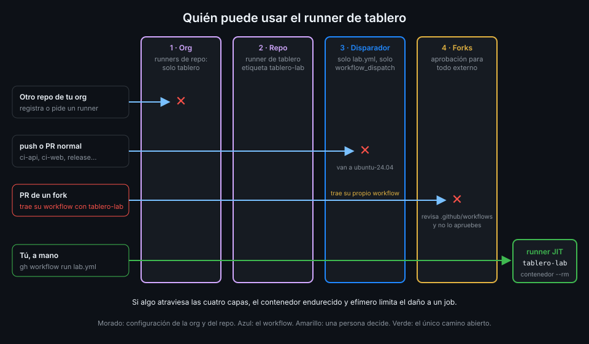

# Runner groups y políticas

> Dónde registras un runner decide qué repos pueden mandarle jobs. Los runner groups lo afinan en
> una organización de pago; en una Free, la herramienta es la política de runners de repositorio.



## 🎯 Objetivos

Al terminar este archivo eres capaz de:

- Comparar un runner de repositorio con uno de organización por quién puede usarlo
- Explicar qué controla un runner group: repos, repos públicos y workflows
- Decir qué grupos existen en cada plan y por qué `tablero` no usa uno propio
- Limitar los runners de repositorio de una organización a un único repo, desde la UI y la API
- Pedir un runner de un grupo con `runs-on` y `group`

## 1. Qué problema resuelve

Un runner propio solo debería ejecutar el código que tú esperas. El primer filtro es **qué repos**
pueden mandarle jobs. Si cualquier repo de la organización puede, basta con que alguien cree un
repo nuevo, o que un repo con menos cuidado que `tablero` acepte un PR malicioso, para que tu
máquina ejecute su código. La guía de seguridad de GitHub lo avisa: con runners de organización o
de empresa, GitHub puede programar workflows de varios repos en el mismo runner, y un compromiso
tiene un impacto amplio.

## 2. Cómo funciona

### Runner de repositorio frente a runner de organización

| | De repositorio | De organización |
|---|---|---|
| Se registra en | `https://github.com/<tu-org>/tablero` | `https://github.com/<tu-org>` |
| Quién puede usarlo | Solo ese repo | Los repos que permita su runner group |
| API | `repos/{owner}/{repo}/actions/runners/...` | `orgs/{org}/actions/runners/...` |
| Quién lo administra | Admin del repo | Owner de la org |
| Grupo | Ninguno que elegir; la API usa el grupo por defecto, `1` | El que elijas con `--runnergroup` o `runner_group_id` |

Un runner de repositorio es la frontera más estrecha que existe: ningún otro repo puede pedirle
nada.

### Runner groups

Un **runner group** es un conjunto de runners de organización con una lista de acceso. Toda
organización tiene un único **grupo por defecto**. Los owners de una organización con plan **Team**
pueden crear grupos adicionales; Enterprise tiene sus propias opciones, fuera del alcance del
bootcamp. Un grupo controla:

| Ajuste | Qué hace | Por defecto |
|---|---|---|
| Repos con acceso (`visibility`) | Todos, los seleccionados o ninguno | Según el grupo |
| Repos públicos (`allows_public_repositories`) | Si los repos públicos pueden usar sus runners | `false`: solo privados |
| Workflows (`restricted_to_workflows` y `selected_workflows`) | Solo esos workflows, en una ref concreta | `false`: cualquier workflow |

Fíjate en el segundo: **por defecto, solo los repos privados pueden usar los runners de un
grupo**. Es la recomendación de GitHub convertida en ajuste. Activarlo para un repo público es
una decisión explícita.

Las entradas de `selected_workflows` tienen la forma
`<tu-org>/tablero/.github/workflows/lab.yml@refs/heads/main`: un workflow concreto, en una rama
concreta. Un PR que añade otro workflow no podría usar el grupo.

Un runner se puede mover de un grupo a otro después de registrarlo.

### Por qué `tablero` no usa un grupo

Tu organización del bootcamp es Free. La documentación solo garantiza grupos adicionales en el
plan Team, así que con Free tienes el grupo por defecto, y no puedes crear uno que solo vea
`tablero`. Un runner de organización ahí estaría al alcance de lo que permita ese grupo, no de un
único repo. Un runner **de repositorio** resuelve el problema sin depender del plan.

### La política de runners de repositorio

Queda un hueco: un runner de repositorio lo puede registrar el admin de **cualquier** repo de la
organización. La política de la org cierra ese hueco. En **Settings → Actions → General**,
*Repository-level self-hosted runners*:

| Opción | Efecto |
|---|---|
| *All repositories* | Cualquier repo puede tener sus runners |
| *Selected repositories* | Solo los repos de la lista |
| *Disabled* | Ninguno; los runners existentes quedan *Disabled* y no reciben jobs |

En la API es `orgs/{org}/actions/permissions/self-hosted-runners` con `enabled_repositories`
(`all`, `selected` o `none`), más la lista de repos en `.../repositories`. Pide `admin:org` (o el
permiso fino *Actions policies*), el mismo que usaste para las políticas de actions de la
[Semana 11](../../week-11-actions_a_escala_de_organizacion/1-teoria/06-politicas-de-actions-de-la-organizacion.md).

`tablero` queda así: runners de repositorio solo en `tablero`, y su runner registrado en
`tablero`. Ningún otro repo de tu org puede tener runners propios.

_Verificado con actions/runner v2.338.2 y ubuntu-24.04, noviembre de 2026._

## 3. Cómo se usa

### Limitar los runners de repositorio a `tablero`

```bash
gh api -X PUT "orgs/<tu-org>/actions/permissions/self-hosted-runners" \
  -f enabled_repositories=selected
repo_id=$(gh api "repos/<tu-org>/tablero" --jq .id)
gh api -X PUT "orgs/<tu-org>/actions/permissions/self-hosted-runners/repositories/$repo_id"
```

Y para comprobarlo:

```bash
gh api "orgs/<tu-org>/actions/permissions/self-hosted-runners" --jq .enabled_repositories
# selected
gh api "orgs/<tu-org>/actions/permissions/self-hosted-runners/repositories" \
  --jq '[.repositories[].name]'
# ["tablero"]
```

Si `gh` responde 403, tu sesión no tiene `admin:org`: `gh auth refresh -s admin:org`, como en la
Semana 11. La práctica 01 empieza por aquí, antes de registrar nada.

Cuando ya no quieras runners propios en la org, el mismo `PUT` con `enabled_repositories=none`
los deja todos *Disabled* sin borrar nada.

### En una organización Team: un grupo para `tablero`

Lo que harías con plan Team. **No lo ejecutes en tu org Free**:

```bash
gh api -X POST "orgs/<tu-org>/actions/runner-groups" \
  -f name=tablero-runners \
  -f visibility=selected \
  -F 'selected_repository_ids[]'="$repo_id" \
  -F allows_public_repositories=true \
  -F restricted_to_workflows=true \
  -f 'selected_workflows[]=<tu-org>/tablero/.github/workflows/lab.yml@refs/heads/main'
```

Tres candados en una llamada: un solo repo, una excepción explícita para un repo público y un
único workflow en `main`. El runner se registraría en la org con `--runnergroup tablero-runners`
(o con su `runner_group_id` en `generate-jitconfig`).

### Pedir un runner de un grupo

```yaml
name: group-example
on:
  workflow_dispatch:
permissions: {}
jobs:
  unit:
    runs-on:
      group: tablero-runners
      labels: [self-hosted, tablero-lab]
    timeout-minutes: 15
    permissions:
      contents: read
    steps:
      - run: echo "runner=$RUNNER_NAME"
```

El runner tiene que estar en el grupo **y** tener las etiquetas. Sin `labels`, cualquier runner
del grupo vale.

## 4. Antipatrones

| Antipatrón | Por qué duele | Qué hacer en su lugar |
|---|---|---|
| Runner de organización en el grupo por defecto | Lo puede usar cualquier repo que el grupo permita | Runner de repositorio, o un grupo propio en Team |
| Activar repos públicos en un grupo "para probar" | Un fork de cualquier repo público del grupo llega a tu máquina | Solo con un único repo y workflows restringidos |
| Política de runners de repositorio en *All repositories* | Cualquier admin de un repo registra un runner y lo expone | *Selected repositories* con la lista mínima |
| Grupo restringido a workflows en cualquier ref | Una rama nueva con el mismo workflow cambiado lo usa | Fijar la ref, normalmente `refs/heads/main` |
| Dejar runners viejos registrados en repos que ya no los usan | Siguen al alcance de esos repos | Bórralos y saca el repo de la política |

## 5. Trucos

- **Qué grupo usó un job**: `runner_group_name` en `actions/runs/<id>/jobs`. Para un runner de
  repositorio verás el grupo por defecto.
- **La lista de grupos de tu org**: `gh api "orgs/<tu-org>/actions/runner-groups" --jq
  '.runner_groups[] | {id, name, default}'`. En una org Free verás solo el de por defecto.
- **Saca un repo de la política sin tocar los demás**: `DELETE` sobre
  `.../self-hosted-runners/repositories/{repository_id}`; el `PUT` con
  `selected_repository_ids` sustituye la lista entera.

## 📚 Recursos Adicionales

- [GitHub Docs: Managing access to self-hosted runners using groups](https://docs.github.com/en/actions/how-tos/manage-runners/self-hosted-runners/manage-access)
- [REST API: Self-hosted runner groups](https://docs.github.com/en/rest/actions/self-hosted-runner-groups)
- [REST API: GitHub Actions permissions](https://docs.github.com/en/rest/actions/permissions)
- [GitHub Docs: Secure use reference](https://docs.github.com/en/actions/reference/security/secure-use)

## ✅ Checklist de Verificación

- [ ] Sé quién puede usar un runner de repositorio y uno de organización
- [ ] Sé qué tres cosas controla un runner group
- [ ] Sé qué grupos tiene una org Free y cuáles una Team
- [ ] Sé por qué `tablero` usa un runner de repositorio
- [ ] Sé limitar los runners de repositorio a `tablero` desde la UI y la API
- [ ] Sé pedir un runner con `group` y `labels` en `runs-on`

---

| ← Anterior | Siguiente → |
|:---|---:|
| [El runner en un contenedor](05-runner-en-contenedor.md) | [Un runner propio en un repo público](07-runner-propio-en-un-repo-publico.md) |
