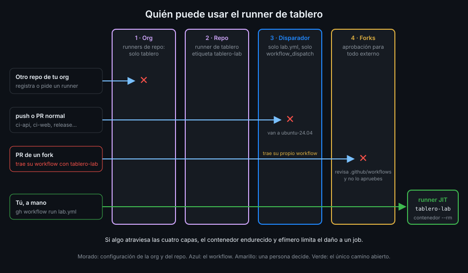

# Un runner propio en un repo público

> En un repo público, cualquiera puede proponerte un workflow. Si ese workflow llega a tu runner,
> un desconocido ejecuta código en tu máquina. Ninguna capa sola lo impide; varias juntas, sí.



## 🎯 Objetivos

Al terminar este archivo eres capaz de:

- Describir paso a paso cómo un fork intenta ejecutar código en un runner propio
- Explicar por qué un `pull_request` ejecuta el workflow del PR y no el de `main`
- Enumerar las capas que protegen el runner de `tablero` y qué frena cada una
- Saber qué revisar en un PR antes de aprobar su ejecución
- Reconocer los riesgos que quedan aunque todas las capas estén puestas

## 1. Qué problema resuelve

GitHub lo dice sin rodeos: los runners propios *casi nunca deberían usarse en repos públicos*,
porque cualquiera puede abrir un pull request y comprometer el entorno, incluidos los secretos y,
según cómo esté configurado, el acceso de escritura al repo. `tablero` es público y aun así tiene
un runner propio. Este archivo explica cómo se sostiene esa decisión, y cuál es su límite.

## 2. Cómo funciona

### El ataque

1. Alguien hace un fork de `<tu-org>/tablero`.
2. En su fork añade un workflow, o modifica uno que ya existe:

   ```yaml
   name: innocent-looking
   on: pull_request # antipatron
   permissions: {}
   jobs:
     build:
       runs-on: [self-hosted, tablero-lab] # antipatron
       timeout-minutes: 5
       steps:
         - run: echo "aquí iría cualquier cosa contra tu máquina"
   ```

3. Abre un PR contra `tablero`. Para el evento `pull_request`, GitHub usa los workflows **del
   commit del PR**, no los de `main`. Su archivo cuenta como si ya estuviera en tu repo.
4. Si nadie lo para, el job pide `[self-hosted, tablero-lab]`, tu runner lo recoge y su `run:` se
   ejecuta en tu máquina.

Lo que el atacante busca no es el `GITHUB_TOKEN` (en un PR de fork es de solo lectura y sin
secretos, lo viste en la Semana 12): es **la máquina**. Desde ella llega a tu red local, puede
dejar un proceso esperando al siguiente job o usar tu CPU para lo que quiera.

### Las capas de `tablero`

Ninguna de estas capas basta sola. Cada una frena un camino distinto:

| Capa | Dónde | Qué frena | Qué no frena |
|---|---|---|---|
| 1. Política de runners de la org en *Selected*: solo `tablero` | Org (archivo 06) | Que otro repo de tu org tenga runners propios | Un PR contra `tablero` |
| 2. Runner de repositorio con etiqueta única | Repo (archivo 03) | Que el runner reciba jobs de otro repo | Un workflow de `tablero` que pida la etiqueta |
| 3. Solo `lab.yml` pide `tablero-lab`, y solo con `workflow_dispatch` | Workflow | Que un push o un PR normal lancen jobs en el runner | Un PR que **añada** un workflow con esa etiqueta |
| 4. Aprobación para todos los contribuidores externos | Repo | Que el workflow de un PR de fork corra sin que lo apruebes | Tu aprobación por descuido |
| 5. JIT en un contenedor endurecido | Host (archivos 04 y 05) | Persistencia, root en el host y que el daño pase de un job | Lo que el job alcance por la red durante ese job |
| 6. El runner solo vive mientras tú lo arrancas | Host | Cualquier job cuando no estás mirando | Un job aprobado mientras el bucle corre |

La capa 3 solo protege `main`: `workflow_dispatch` lo lanza alguien con permiso de escritura, y
ningún otro workflow de `main` pide el runner. Pero el ataque no toca `main`: trae su propio
workflow. Por eso la capa 4 es la que de verdad cierra la puerta en un repo público.

### La aprobación de PR de forks

Desde la Semana 01, `tablero` tiene `approval_policy: all_external_contributors`: **todo** PR de
alguien sin acceso de escritura espera a que un mantenedor con permiso de escritura apruebe la
ejecución de sus workflows. Las otras dos opciones solo piden aprobación a quien contribuye por
primera vez, o a quien además es nuevo en GitHub; con ellas, un atacante paciente primero hace un
PR inocente y, cuando ya no es nuevo, manda el malo.

Aprobar es decir "acepto ejecutar este código". La documentación de GitHub pide revisar los
cambios del PR antes, con especial atención a `.github/workflows/`. En `tablero`, la regla es
sencilla: **si un PR de fork toca `.github/` y menciona `self-hosted` o `tablero-lab`, no se
aprueba**. Una ejecución pendiente de aprobación caduca a los 63 días y queda como fallida.

### Lo que queda

Con todas las capas puestas, el riesgo no es cero:

| Riesgo | Por qué sigue | Cómo lo reduces |
|---|---|---|
| Un colaborador con escritura | Puede lanzar `lab.yml` o cambiarlo en `main` | Rulesets y revisión obligatoria (Semana 18) |
| Una action o dependencia comprometida en `lab.yml` | Corre en tu runner con todo su alcance | Actions por SHA y `uv sync --locked` (Semanas 03 y 12) |
| La red durante el job | El contenedor llega a tu red local | Máquina o VM dedicada, sin acceso a tu red |
| Aprobar sin leer | La capa 4 depende de una persona | La regla de arriba y revisar el diff de `.github/` |

_Verificado con actions/runner v2.338.2 y ubuntu-24.04, noviembre de 2026._

## 3. Cómo se usa

### Comprobar las capas

```bash
# 1. Política de la org
gh api "orgs/<tu-org>/actions/permissions/self-hosted-runners" --jq .enabled_repositories
# selected

# 3. Ningún workflow salvo lab.yml pide el runner propio
grep -l 'self-hosted' .github/workflows/*.yml
# .github/workflows/lab.yml

# 4. Aprobación de forks
gh api "repos/$GH_REPO/actions/permissions/fork-pr-contributor-approval" --jq .approval_policy
# all_external_contributors
```

El `checks.json` de la semana comprueba estas mismas capas, más el contenedor y el runner.

### El esqueleto seguro de `lab.yml`

```yaml
name: lab
on:
  workflow_dispatch:
concurrency:
  group: ${{ github.workflow }}
  cancel-in-progress: false
permissions: {}
jobs:
  unit:
    runs-on: [self-hosted, tablero-lab]
    timeout-minutes: 15
    permissions:
      contents: read
    steps:
      - uses: actions/checkout@3d3c42e5aac5ba805825da76410c181273ba90b1 # v7.0.1
        with:
          persist-credentials: false
      - run: echo "runner=$RUNNER_NAME"
```

Cada línea responde a una capa: solo `workflow_dispatch` (capa 3), `concurrency` para que dos
lanzamientos no compitan por tu único runner, `permissions: {}` en la raíz y `contents: read` en
el job, `timeout-minutes` para que un job colgado no retenga el runner y checkout sin dejar
credenciales en el disco del contenedor. La práctica 04 le añade los tests de la API.

### Qué hacer con un PR de fork

1. Mira la lista de archivos del PR. ¿Toca `.github/`?
2. Si toca workflows, lee el diff entero: `runs-on`, eventos nuevos y cualquier `run:`.
3. Si pide `self-hosted` o tu etiqueta, ciérralo sin aprobar.
4. Si no, apruébalo: correrá en los runners de GitHub, que es donde debe correr.

### Si sospechas que un job malicioso llegó al runner

1. Para el bucle con Ctrl-C: sin runner esperando, ningún job nuevo llega a tu máquina.
2. Borra los runners que queden registrados:
   `gh api -X DELETE "repos/$GH_REPO/actions/runners/<id>"` por cada uno de la lista.
3. Comprueba que no queda ningún contenedor del runner: `docker ps -a --filter name=tablero-lab`.
4. Revisa en el log del run qué ejecutó el job y a qué pudo llegar desde tu red.
5. Pon la política de runners de la org en *Disabled* hasta entender qué pasó.

## 4. Antipatrones

| Antipatrón | Por qué duele | Qué hacer en su lugar |
|---|---|---|
| `on: pull_request` en un job con runner propio | Cualquier PR, también de forks, llega a tu máquina | Solo eventos de confianza: `workflow_dispatch`, `push` a `main` |
| `pull_request_target` con checkout del head en un runner propio | Código del fork, con los permisos del repo base, en tu máquina | Nunca; el patrón seguro de la Semana 12 |
| Aprobación solo para primeros contribuidores | Un PR inocente antes y el malo después | `all_external_contributors` |
| Aprobar PR de forks sin mirar `.github/` | Ejecutas el workflow del atacante | Revisar el diff de workflows antes de aprobar |
| Dejar el bucle del runner siempre encendido | Un descuido en la aprobación encuentra el runner listo | Arrancarlo cuando vayas a lanzar `lab.yml` |
| Runner persistente "porque solo lo uso yo" | Un día no serás solo tú | JIT en contenedor desde el principio |

## 5. Trucos

- **zizmor lo ve**: su auditoría `self-hosted-runner` marca los jobs que piden un runner propio.
  Solo corre con `--pedantic`, porque zizmor no puede saber cómo está configurado tu runner.
- **Los runs que esperan tu aprobación**: `gh run list --status action_required` lista las
  ejecuciones bloqueadas por la política de forks.
- **Qué workflows usa un PR**: `gh pr diff <n> --name-only | grep '^.github/'` enseña de un
  vistazo si el PR toca workflows o configuración.

## 📚 Recursos Adicionales

- [GitHub Docs: Secure use reference, hardening self-hosted runners](https://docs.github.com/en/actions/reference/security/secure-use)
- [GitHub Docs: Approving workflow runs from forks](https://docs.github.com/en/actions/how-tos/manage-workflow-runs/approve-runs-from-forks)
- [GitHub Docs: Managing access to self-hosted runners](https://docs.github.com/en/actions/how-tos/manage-runners/self-hosted-runners/manage-access)
- [zizmor: audits](https://docs.zizmor.sh/audits/)

## ✅ Checklist de Verificación

- [ ] Sé explicar el ataque desde un fork contra un runner propio
- [ ] Sé por qué un `pull_request` ejecuta el workflow que trae el PR
- [ ] Sé qué frena cada una de las seis capas de `tablero` y qué no
- [ ] Sé por qué la aprobación de forks es la capa que cierra la puerta
- [ ] Sé qué revisar en un PR antes de aprobar su ejecución
- [ ] Sé qué riesgos quedan con todas las capas puestas

---

| ← Anterior | Siguiente → |
|:---|---:|
| [Runner groups y políticas](06-runner-groups-y-politicas.md) | [Primer runner propio](../2-practicas/01-primer-runner-propio.md) |
