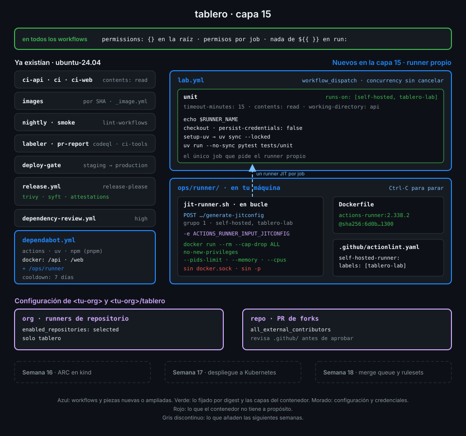

# Proyecto: capa 15 de tablero



## 🎯 Objetivo

Que `tablero` tenga un runner propio que puedas encender cuando quieras y que no sea una puerta
abierta a tu máquina: nace para un job y muere con él, corre encerrado en un contenedor sin
privilegios, solo `tablero` puede usarlo y el único job que lo pide lo lanzas tú.

## 📦 Qué añade esta capa

| Pieza de `tablero` | Qué hace | Por qué existe |
|---|---|---|
| `ops/runner/Dockerfile` (nuevo) | Fija la imagen oficial del runner por tag y digest | El mismo `docker build` da siempre el mismo runner, y Dependabot sabe qué vigilar |
| `dependabot.yml` | Añade `/ops/runner` al ecosistema `docker` | Un runner más de 63 días por detrás de la última versión deja de recibir jobs |
| `ops/runner/jit-runner.sh` (nuevo) | En bucle: pide una config JIT, arranca un contenedor desechable con ella y espera un job | Cada job empieza en una máquina limpia y la credencial sirve para un solo runner |
| `.github/workflows/lab.yml` (nuevo) | Corre los tests unitarios de la API en `[self-hosted, tablero-lab]`, solo con `workflow_dispatch` | Ningún evento que pueda provocar un desconocido llega a tu máquina |
| `.github/actionlint.yaml` (nuevo) | Declara la etiqueta `tablero-lab` | Sin ella, actionlint rechaza el `runs-on` y `lint-workflows` se pone en rojo |
| Política de la org | Runners de repositorio solo en `tablero` | Otro repo de la org no puede registrar ni usar un runner propio |

| Situación | Qué pasa |
|---|---|
| Lanzas `lab` con el bucle parado | El job espera en cola; si en 24 h no hay runner, falla |
| Lanzas `lab` con el bucle en marcha | Un runner `tablero-lab-<n>` lo coge, lo ejecuta y desaparece; el bucle registra otro |
| Un job intenta `sudo` o montar el disco del host | `no-new-privileges` y la falta de socket de Docker lo impiden |
| Alguien abre un PR desde un fork | Ningún workflow de `pull_request` pide `self-hosted`, y sus runs esperan tu aprobación |
| Sale `actions/runner` 2.339.0 | Dependabot abre un PR con el digest nuevo en `ops/runner/Dockerfile` tras el cooldown |

La Semana 16 cambia el bucle de shell por Actions Runner Controller en kind: el mismo runner
efímero, pero creado bajo demanda por Kubernetes. La Semana 17 lo usa para desplegar en el
clúster.

## ✅ Requisitos verificables

- ops/runner/Dockerfile parte de la imagen oficial ghcr.io/actions/actions-runner fijada por tag y digest
- dependabot.yml vigila la imagen del runner: el ecosistema docker incluye /ops/runner además de /api y /web
- jit-runner.sh registra cada runner con la API generate-jitconfig del repositorio, sin token de registro ni config.sh
- El runner JIT se registra en el grupo por defecto con las etiquetas self-hosted y tablero-lab
- La config JIT llega al contenedor por la variable ACTIONS_RUNNER_INPUT_JITCONFIG, nunca como argumento --jitconfig
- El contenedor del runner se borra al salir (--rm) y corre sin capacidades, sin escalada y con techo de procesos y memoria
- El contenedor del runner no es privilegiado, no monta el socket de Docker ni volúmenes y no publica puertos ni usa la red del host
- lab.yml solo se lanza con workflow_dispatch
- El único job de los workflows de tablero que pide self-hosted está en lab.yml
- El job de lab.yml pide runs-on: [self-hosted, tablero-lab] y actionlint conoce la etiqueta
- El job de lab.yml solo lee contents, tiene timeout-minutes de 30 o menos y no usa secretos
- actionlint y zizmor pasan sin hallazgos sobre los workflows de tablero
- tablero exige aprobación para los workflows de todos los contribuidores externos
- La org solo permite runners propios de repositorio en tablero
- lab.yml está en verde en el último commit de main y lo ejecutó un runner tablero-lab con las etiquetas self-hosted y tablero-lab
- tablero no tiene runners persistentes registrados y el runner del último lab.yml ya no existe

## 🎨 Criterios de calidad

Lo que `check-week.sh` no ve y la [rúbrica](../rubrica-evaluacion.md) sí puntúa:

- El digest del `Dockerfile` se sacó con `docker buildx imagetools inspect` y es el del índice
  del tag que dice la línea.
- La config JIT nunca toca el disco ni el historial: no hay `echo` de ella, ni archivo
  temporal, ni `set -x` en el script.
- Los límites de memoria y CPU tienen sentido para tu máquina, y un comentario dice por qué.
- El runner persistente de la práctica 01 está borrado, y también los JIT que quedaron offline
  al parar el bucle.
- El workflow de prueba de las prácticas (`runner-probe.yml`) está borrado de `main`.
- `lab.yml` no usa secretos ni sube permisos: lo que corre en tu máquina no recibe más de lo
  que necesita.
- Sin `TODO` en el repo.

## 💡 Adaptación a tu dominio

| Tu caso | Dónde registras el runner | Cómo lo aíslas | Qué jobs lo usan |
|---|---|---|---|
| Repo privado de un equipo pequeño | Runner de repositorio, como aquí | Contenedor desechable por job | Los que necesitan algo de tu red (una base interna, una GPU) |
| Varios repos de una org en plan Team | Runner group con `visibility: selected` y `restricted_to_workflows` | Contenedor o VM por job | Solo los workflows que el grupo lista |
| Builds pesados de imágenes | Runner en una VM propia, no en contenedor | VM efímera: el job sí necesita Docker | `push` a `main`, nunca PR |
| Cientos de jobs al día | Actions Runner Controller en Kubernetes (Semana 16) | Un pod por job | Escalado por la cola de jobs |

## 🚦 Cómo entregarlo

Si hiciste las cuatro prácticas ya lo tienes todo: repásalo contra los requisitos y los
criterios. Si no, parte del starter.

1. Copia el starter en `tablero` y completa los `TODO 1` a `TODO 10`:

   ```bash
   cd ~/code/tablero
   S=~/code/bc-github-actions/bootcamp/week-15-runners_self_hosted/3-proyecto/starter
   cp -r "$S"/. .
   grep -rnE "TODO [0-9]+" ops .github | wc -l
   # 10
   ```

2. Añade `/ops/runner` al ecosistema `docker` de `dependabot.yml`
   ([práctica 03](../2-practicas/03-contenedor-endurecido-e-imagen-al-dia.md), paso 2).

3. Limita los runners de repositorio de la org a `tablero`
   ([práctica 01](../2-practicas/01-primer-runner-propio.md), paso 1).

4. Comprueba en local lo que se puede ver sin GitHub:

   ```bash
   docker build -q -t tablero-runner:local ops/runner >/dev/null && echo imagen
   # imagen
   actionlint && GH_TOKEN=$(gh auth token) zizmor -q .github/ && echo limpio
   # limpio
   ```

5. Haz push a `main`, arranca el bucle en otra terminal, lanza `lab` y espera a que termine
   ([práctica 04](../2-practicas/04-workflow-del-runner-propio.md)):

   ```bash
   GH_REPO=<tu-org>/tablero ops/runner/jit-runner.sh
   ```

6. Lanza la verificación:

   ```bash
   cd ~/code/bc-github-actions
   ./scripts/check-week.sh 15
   # 16/16 comprobaciones superadas.
   ```

## 🧯 Errores comunes

| Síntoma | Causa | Solución |
|---|---|---|
| `lab` se queda en `queued` | No hay ningún runner online con **todas** las etiquetas de `runs-on` | Arranca el bucle y revisa que el runner tenga `self-hosted` y `tablero-lab` |
| `label "tablero-lab" is unknown` en actionlint | Falta la etiqueta en `.github/actionlint.yaml` | `self-hosted-runner: labels: [tablero-lab]` |
| `HTTP 403` o `404` en `generate-jitconfig` | Tu token no tiene `repo` o no eres admin de `tablero` | `gh auth status`; el endpoint pide admin del repo |
| El runner no se registra, o aparece como deshabilitado y no coge jobs | La política de la org no incluye `tablero` | [Práctica 01](../2-practicas/01-primer-runner-propio.md), paso 1 |
| `sudo: The "no new privileges" flag is set` en un job | El job intenta ser root dentro del contenedor | Es lo esperado: instala lo que necesites sin root o en la imagen |
| `check-week.sh 14` marca `dependabot-docker` en rojo | La capa 15 añade `/ops/runner` al ecosistema `docker` | Es lo esperado ([comprobaciones superadas por capas posteriores](../../../docs/autograding.md#comprobaciones-superadas-por-capas-posteriores)) |
| `runners-ephemeral` dice `persistent=1` | Sigue registrado el runner de la práctica 01 | Bórralo con `gh api -X DELETE repos/{owner}/{repo}/actions/runners/<id>` |

## 🔗 Navegación

---

| ← Anterior | Siguiente → |
|:---|---:|
| [El workflow del runner propio](../2-practicas/04-workflow-del-runner-propio.md) | [Rúbrica de evaluación](../rubrica-evaluacion.md) |
