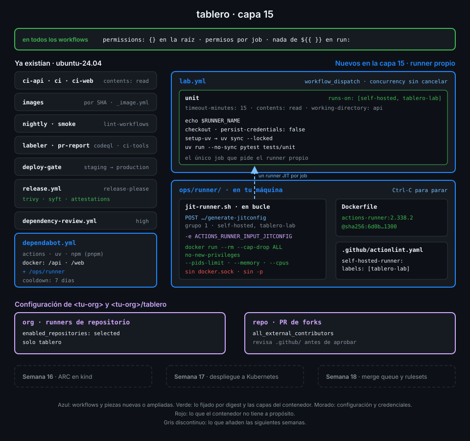

# Semana 15 — Runners propios

> Hasta ahora cada job corría en una máquina de GitHub que nacía y moría con él. Esta semana el
> job corre en tu máquina: tú pones el runner, y también todo lo que un job podría hacerle.

## 🎯 Objetivos de la Semana

Al terminar la semana eres capaz de:

- Decidir cuándo compensa un runner propio y qué riesgo compras con él, sobre todo en un repo
  público como `tablero`
- Explicar cómo el runner se registra, pide trabajo a GitHub, ejecuta un job y se actualiza, y
  dónde deja su estado
- Elegir un runner con `runs-on` por etiquetas y hacer que actionlint conozca las tuyas
- Distinguir un runner persistente, uno `--ephemeral` y uno JIT, y saber qué sobrevive de un job
  al siguiente en cada caso
- Correr el runner oficial en un contenedor desechable, sin capacidades, sin escalada, con
  límites y sin el socket de Docker
- Limitar quién puede usar un runner propio: política de runners de la organización, runner
  groups (y en qué plan existen) y aprobación de PR de forks
- Dejar en `tablero` un único job en el runner propio, que solo se lanza a mano y que no deja
  rastro

## 📋 Prerrequisitos

| Necesitas | Dónde se aprende |
|---|---|
| `check-week.sh 14` en 18/18 | [Semana 14](../week-14-releases_cadena_de_suministro_y_attestations/README.md) |
| Docker: imágenes, `docker run`, `docker build` | [Semana 05](../week-05-service_containers_y_postgresql/README.md) y [Semana 06](../week-06-imagenes_docker_y_ghcr/README.md) |
| `workflow_dispatch` y concurrencia | [Semana 07](../week-07-disparadores_filtros_y_concurrencia/README.md) |
| actionlint y su configuración | [Semana 08](../week-08-probar_y_depurar_workflows/README.md) |
| Políticas de Actions de la organización y `admin:org` | [Semana 11](../week-11-actions_a_escala_de_organizacion/README.md) |
| Modelo de amenazas y aprobación de PR de forks | [Semana 12](../week-12-modelo_de_amenazas_y_endurecimiento/README.md) |
| Imágenes fijadas por digest y Dependabot `docker` | [Semana 14](../week-14-releases_cadena_de_suministro_y_attestations/README.md) |

## 🗂️ Estructura de la Semana

```
week-15-runners_self_hosted/
├── README.md
├── rubrica-evaluacion.md
├── checks.json                    16 comprobaciones
├── 0-assets/                      diagramas SVG
├── 1-teoria/                      7 archivos, uno por concepto
├── 2-practicas/                   4 prácticas guiadas
├── 3-proyecto/
│   ├── README.md
│   └── starter/                   ops/runner/ y .github/ (lab.yml, actionlint.yaml)
├── 4-recursos/{ebooks-free,videografia,webgrafia}/README.md
└── 5-glosario/README.md
```

## 📝 Contenidos

### Teoría

| # | Archivo | Qué aprendes | Tiempo |
|:--:|---|---|:--:|
| 01 | [Por qué un runner propio](1-teoria/01-por-que-un-runner-propio.md) | Qué te da y qué te cuesta frente a un runner de GitHub, y por qué un repo público lo complica | 25 min |
| 02 | [Cómo funciona el runner](1-teoria/02-como-funciona-el-runner.md) | Registro, sondeo de jobs, listener y worker, `_work`, logs y actualizaciones | 25 min |
| 03 | [Etiquetas y `runs-on`](1-teoria/03-etiquetas-y-runs-on.md) | Etiquetas por defecto y propias, cómo casan con `runs-on` y cómo se lo dices a actionlint | 25 min |
| 04 | [Runners efímeros y JIT](1-teoria/04-runners-efimeros-y-jit.md) | Persistente, `--ephemeral` y JIT: qué sobrevive entre jobs y qué credencial usa cada uno | 25 min |
| 05 | [El runner en un contenedor](1-teoria/05-runner-en-contenedor.md) | La imagen oficial, qué aísla un contenedor, por qué el socket de Docker es root en tu máquina | 25 min |
| 06 | [Runner groups y políticas](1-teoria/06-runner-groups-y-politicas.md) | Runners de repo y de org, grupos, la política de runners de repositorio y qué hay en cada plan | 25 min |
| 07 | [Un runner propio en un repo público](1-teoria/07-runner-propio-en-un-repo-publico.md) | El ataque desde un fork y las capas que lo frenan en `tablero` | 30 min |

### Prácticas

| # | Archivo | Qué haces | Tiempo |
|:--:|---|---|:--:|
| 01 | [Primer runner propio](2-practicas/01-primer-runner-propio.md) | Limitas los runners de la org a `tablero`, registras uno persistente y ves cómo un job hereda lo que dejó el anterior | 1 h |
| 02 | [Runner JIT efímero en Docker](2-practicas/02-runner-jit-efimero-en-docker.md) | Cambias el token de registro por una config JIT y cada job empieza en un contenedor nuevo | 1 h |
| 03 | [Contenedor endurecido e imagen al día](2-practicas/03-contenedor-endurecido-e-imagen-al-dia.md) | Fijas la imagen por digest, Dependabot la vigila, quitas capacidades y el socket de Docker | 1 h |
| 04 | [El workflow del runner propio](2-practicas/04-workflow-del-runner-propio.md) | `lab.yml` corre los tests de la API en tu runner, solo a mano, y el runner desaparece al terminar | 1 h |

### Proyecto

[Capa 15 de `tablero`](3-proyecto/README.md): `tablero` tiene un runner propio en Docker que
nace para un job y muere con él, solo `tablero` puede usarlo, y el único job que lo pide se
lanza a mano.



## ⏱️ Distribución del Tiempo (10 horas)

| Actividad | Horas |
|---|:--:|
| Teoría (7 archivos) | 3 |
| Práctica 01 — Primer runner propio | 1 |
| Práctica 02 — Runner JIT efímero en Docker | 1 |
| Práctica 03 — Contenedor endurecido e imagen al día | 1 |
| Práctica 04 — El workflow del runner propio | 1 |
| Proyecto — capa 15 | 1.5 |
| Autoevaluación con la rúbrica | 1.5 |
| **Total** | **10** |

## 🎓 En el examen

GH-200 pregunta sobre todo por **cómo se elige un runner** (`runs-on` con etiquetas, todas
tienen que casar, y `group:`), **qué etiquetas pone el runner por defecto** (`self-hosted`, el
sistema y la arquitectura), **runner groups** (para qué sirven y quién puede usarlos), **runners
efímeros** frente a persistentes y **por qué GitHub desaconseja runners propios en repos
públicos**. También cae dónde se registra un runner (repo, org, enterprise) y qué pasa si ninguno
está libre.

## 🎩 Trucos y atajos

- **Tus runners sin abrir la UI**:
  `gh api repos/{owner}/{repo}/actions/runners --jq '.runners[] | "\(.name) \(.status) busy=\(.busy) ephemeral=\(.ephemeral)"'`
  dice cuáles están conectados, cuáles trabajan y cuáles se borrarán solos.
- **Qué máquina ejecutó cada job de un run**:
  `gh api repos/{owner}/{repo}/actions/runs/<id>/jobs --jq '.jobs[] | "\(.name): \(.runner_name) [\(.labels | join(","))]"'`.
  La UI lo enseña dentro de cada log; la API, de todos a la vez.
- **Cualquier argumento del runner por el entorno**: `run.sh` y `config.sh` leen
  `ACTIONS_RUNNER_INPUT_<ARG>` (por ejemplo `ACTIONS_RUNNER_INPUT_JITCONFIG`), lo borran de su
  entorno y enmascaran los secretos. Así una credencial no aparece en `ps` ni en la línea de órdenes, y los procesos del job no la heredan (`docker inspect` sí la enseña: quien controla Docker en tu máquina ya es root).
- **Barre los runners que quedaron offline** tras parar el bucle a mitad:
  `gh api repos/{owner}/{repo}/actions/runners --jq '.runners[] | select(.status == "offline") | .id' | xargs -I{} gh api -X DELETE repos/{owner}/{repo}/actions/runners/{}`.
- **El log del runner, sin buscar `_diag`**: la imagen oficial trae
  `ACTIONS_RUNNER_PRINT_LOG_TO_STDOUT=1`, así que `docker logs <contenedor>` ya es el log del
  listener.

## 📌 Entregables

- `ops/runner/Dockerfile` y `ops/runner/jit-runner.sh` en `main`, con la imagen fijada por
  digest y Dependabot vigilándola
- `.github/workflows/lab.yml` y `.github/actionlint.yaml` en `main`
- Runners de repositorio de la org limitados a `tablero` y aprobación para todos los
  contribuidores externos
- Un run de `lab.yml` en verde en el último commit de `main`, ejecutado por un runner JIT que ya
  no existe
- La rúbrica respondida

## ✅ Verificación

```bash
cd ~/code/bc-github-actions
./scripts/check-week.sh 15
# Semana 15 — Runners propios  [repo: <tu-org>/tablero]
#
#   ✅ ops/runner/Dockerfile parte de la imagen oficial ghcr.io/actions/actions-runner fijada por tag y digest
#   ...
# 16/16 comprobaciones superadas.
```

Si algo sale en rojo, la pista te dice qué práctica y qué paso lo arreglan.

## 🔗 Navegación

---

| ← Anterior | Siguiente → |
|:---|---:|
| [Semana 14 — Releases, cadena de suministro y attestations](../week-14-releases_cadena_de_suministro_y_attestations/README.md) | [Por qué un runner propio](1-teoria/01-por-que-un-runner-propio.md) |
