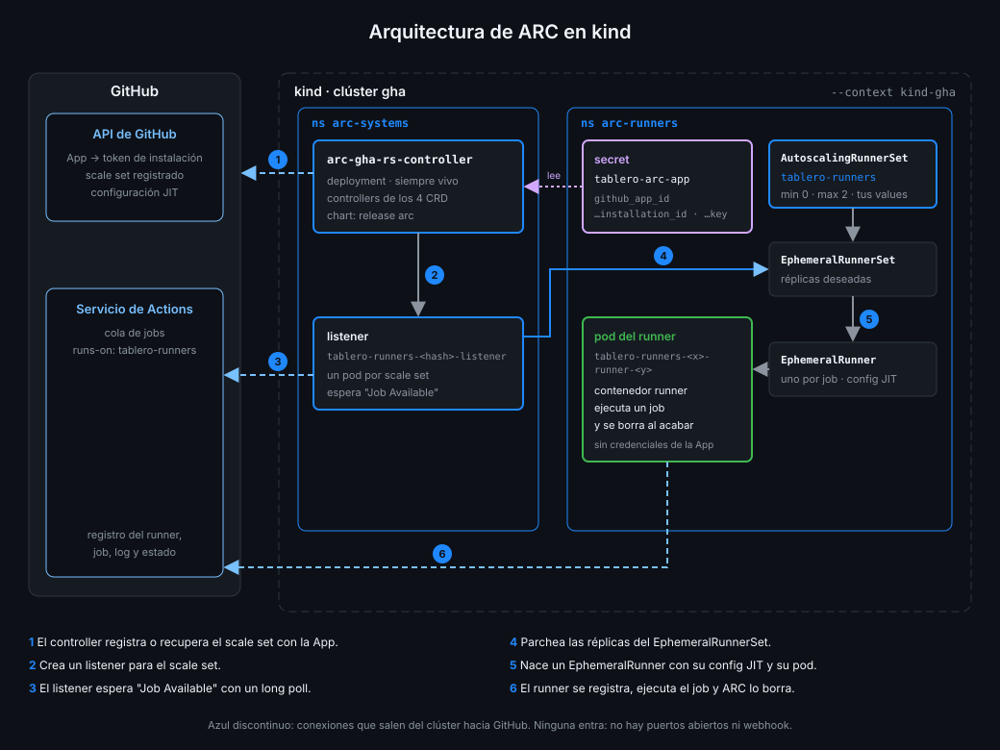

# Arquitectura de ARC

> ARC hace lo mismo que el bucle de la Semana 15: pedir una configuración JIT y arrancar un
> runner desechable por job. La diferencia es quién lo hace: objetos de Kubernetes que se
> vigilan entre sí, en paralelo y sin que tengas una terminal abierta.



## 🎯 Objetivos

Al terminar este archivo eres capaz de:

- Nombrar las piezas de ARC y en qué namespace vive cada una
- Seguir el viaje de un job desde la cola de GitHub hasta un pod y de vuelta
- Explicar qué parte del bucle de la Semana 15 hace cada pieza de ARC
- Explicar por qué ARC no necesita ningún puerto abierto hacia tu clúster
- Saber qué mirar cuando un job se queda en cola y no aparece ningún pod

## 1. Qué problema resuelve

`jit-runner.sh` de la Semana 15 hacía cuatro cosas en bucle: pedir a la API una configuración
JIT, arrancar un contenedor con ella, esperar a que terminara y volver a empezar. Funciona, pero
arranca el runner **antes** de que haya un job, solo puede tener uno a la vez y depende de que tu
terminal siga abierta.

ARC (Actions Runner Controller) reparte ese trabajo entre piezas que corren en Kubernetes. Cada
una hace una cosa, se reinicia sola si muere y se comunica con las demás a través de objetos de
la API, no de procesos que se llaman entre sí.

| En el bucle de la Semana 15 | En ARC |
|---|---|
| El bucle corre en tu terminal | El controller corre como deployment en `arc-systems` |
| El runner arranca y espera un job | El listener espera el job y solo entonces se crea el runner |
| `POST .../generate-jitconfig` desde el script | El controller pide la configuración JIT de cada runner |
| `docker run --rm` | Un pod por runner en `arc-runners` |
| Un runner a la vez | Tantos como jobs, hasta `maxRunners` |
| Ctrl-C para parar | `helm uninstall` |

## 2. Cómo funciona

### Las piezas

| Pieza | Qué es | Dónde vive |
|---|---|---|
| **Controller** | El deployment `arc-gha-rs-controller`, que instala el chart del controller. Contiene los controllers de los cuatro CRD | `arc-systems` |
| **AutoscalingRunnerSet** | Tu scale set: el objeto que crea el chart del scale set a partir de tus values | `arc-runners` |
| **Listener** | Un pod por scale set que mantiene una conexión abierta con GitHub y recibe los avisos de jobs | `arc-systems` |
| **EphemeralRunnerSet** | Cuántos runners quiere el scale set ahora mismo | `arc-runners` |
| **EphemeralRunner** | Un runner concreto: su configuración JIT y su pod | `arc-runners` |
| **Pod del runner** | El contenedor `runner` con la imagen del runner, que ejecuta un job y muere | `arc-runners` |

Los runners van en un namespace distinto del controller por una recomendación expresa de la
documentación de GitHub: así un pod de runner no comparte namespace, ni secrets, ni permisos con
las piezas que gobiernan el clúster.

### El viaje de un job

La documentación de GitHub describe el funcionamiento en once pasos. Agrupados en tres fases:

**Al instalar**

1. El chart del controller despliega el controller en `arc-systems`.
2. El chart del scale set crea el `AutoscalingRunnerSet`. Su controller llama a la API de GitHub
   para obtener el runner group y para **crear o recuperar** el scale set en el servicio de
   Actions. Desde ese momento, GitHub sabe que en tu repo existe un scale set llamado
   `tablero-runners`.
3. El controller crea el listener. El listener se autentica ante el servicio de Actions y abre
   una conexión HTTPS de *long poll*: una petición que el servidor deja abierta hasta que tiene
   algo que decir. Y espera.

**Cuando llega un job**

4. Lanzas un workflow. El servicio de Actions asigna el job a un scale set cuyo nombre (o
   etiqueta) coincide con `runs-on`.
5. El listener recibe un mensaje *Job Available*, comprueba que puede escalar al número deseado
   y acepta el job.
6. Con su service account y un role que solo le deja eso, el listener **parchea** el
   `EphemeralRunnerSet` con el nuevo número de réplicas.
7. El `EphemeralRunnerSet` crea un `EphemeralRunner`. Su controller pide una configuración JIT
   para registrar el runner, la de la Semana 15, y crea el pod. Si el pod falla, lo reintenta
   hasta cinco veces.
8. El runner del pod usa la configuración JIT para registrarse y abre su propia conexión de
   *long poll* para recibir el job.

**Durante y después**

9. GitHub acepta el registro y le envía los detalles del job.
10. El runner ejecuta los steps y va enviando el log y el estado.
11. Al terminar, el controller pregunta a GitHub si el runner se puede borrar. Si sí, el
    `EphemeralRunnerSet` lo borra, y con él el pod y todo lo que el job escribió.

Si ningún runner acepta un job en 24 horas, GitHub lo desasigna: el job falla, no espera para
siempre.

### Todo son conexiones salientes

Fíjate en las flechas del diagrama: todas salen del clúster hacia GitHub. El listener y los
runners **abren** conexiones HTTPS y esperan respuesta; GitHub nunca llama a tu clúster. No hace
falta webhook, ni ingress, ni ningún puerto abierto. Tu kind puede estar detrás del NAT de tu
casa y funciona igual, que es lo que exige la regla 12 de seguridad.

### Qué credencial usa cada pieza

| Pieza | Habla con | Con qué |
|---|---|---|
| Controller | API de GitHub y API de Kubernetes | La GitHub App del secret `tablero-arc-app` y su service account |
| Listener | Servicio de Actions y API de Kubernetes | Las credenciales de la App y una service account que solo puede parchear su `EphemeralRunnerSet` |
| Runner | Servicio de Actions | Solo su configuración JIT, de un uso |

El runner es la única pieza que ejecuta código ajeno, y es la que menos credenciales tiene. El
archivo 04 explica la App; el 07, cómo quitarle al pod del runner incluso el token de Kubernetes
que le tocaría por defecto.

_Verificado con ARC 0.15.1 y kind v0.33.0, noviembre de 2026._

## 3. Cómo se usa

### Los objetos que ves tras instalar

```bash
kubectl --context kind-gha get autoscalingrunnersets -n arc-runners
# NAME              MINIMUM RUNNERS   MAXIMUM RUNNERS   ...
# tablero-runners   0                 2                 ...
kubectl --context kind-gha get pods -n arc-systems
# arc-gha-rs-controller-<hash>          1/1   Running
# tablero-runners-<hash>-listener       1/1   Running
```

Sin job en cola, en `arc-runners` no hay ningún pod: con `minRunners: 0` nadie espera.

### Mirar el viaje en vivo

En una terminal:

```bash
kubectl --context kind-gha get ephemeralrunners -n arc-runners -w
```

En otra lanzas `lab.yml` con `gh workflow run lab.yml`. Verás aparecer un `EphemeralRunner`, su
pod `tablero-runners-<x>-runner-<y>` pasar a `Running` y, al terminar el job, desaparecer los dos.
En la API del run, el job dirá que corrió en un runner cuyo nombre empieza por
`tablero-runners-`. La práctica 03 lo comprueba.

### Cuando el job se queda en cola

| Lo que ves | Dónde mirar | Causa habitual |
|---|---|---|
| No hay pod de listener | `kubectl logs -n arc-systems deploy/arc-gha-rs-controller` | La App está mal: clave, id o installation id |
| Hay listener pero no hay runner | `runs-on` de tu workflow | No coincide con el nombre del scale set: GitHub no le asigna el job |
| El pod del runner no arranca | `kubectl describe pod` en `arc-runners` | Imagen que no baja, `securityContext` que no cuadra, límites que no caben |

Con una clave privada mal copiada, por ejemplo, el controller no llega a crear el listener y su
log lo dice claro:

```text
failed to instantiate client with GitHub App auth: invalid credentials: failed to parse RSA private key from PEM
```

## 4. Antipatrones

| Antipatrón | Por qué duele | Qué hacer en su lugar |
|---|---|---|
| Controller y runners en el mismo namespace | Un job comparte namespace con los secrets y permisos del controller | `arc-systems` y `arc-runners` separados |
| Abrir un puerto o un webhook "para que GitHub avise" | ARC no lo necesita y expones tu clúster | Nada expuesto: todo es saliente |
| Tocar a mano `EphemeralRunnerSet` o `EphemeralRunner` | El controller los reconcilia y deshace tu cambio | Cambiar los values del scale set |
| Borrar a mano el pod de un runner en mitad de un job | El job falla y el runner puede quedar registrado | Dejar que ARC lo borre al terminar |
| Buscar el fallo en GitHub antes que en el controller | La UI solo dice "en cola" | El log del controller y del listener primero |

## 5. Trucos

- **Todos los objetos de ARC de un vistazo**:
  `kubectl get autoscalingrunnersets,ephemeralrunnersets,ephemeralrunners -n arc-runners`.
- **Los errores del controller, sin ruido**:
  `kubectl logs -n arc-systems deploy/arc-gha-rs-controller | grep -i error`.
- **El listener sin copiar su nombre**: `kubectl get pods -n arc-systems -o name | grep listener`
  devuelve `pod/tablero-runners-<hash>-listener`, listo para pasárselo a `kubectl logs -n arc-systems`.
- **Un pod que no arranca, en una línea**: `kubectl get pods -n arc-runners` enseña el motivo en la
  columna `STATUS`, por ejemplo `CreateContainerConfigError` cuando el `securityContext` no cuadra
  con la imagen (archivo 07).

## 📚 Recursos Adicionales

- [GitHub Docs: Actions Runner Controller](https://docs.github.com/en/actions/concepts/runners/actions-runner-controller)
- [GitHub Docs: Quickstart for ARC](https://docs.github.com/en/actions/tutorials/use-actions-runner-controller/quickstart)
- [GitHub Docs: Troubleshooting ARC errors](https://docs.github.com/en/actions/tutorials/use-actions-runner-controller/troubleshoot)
- [actions/actions-runner-controller](https://github.com/actions/actions-runner-controller)

## ✅ Checklist de Verificación

- [ ] Sé nombrar las piezas de ARC y su namespace
- [ ] Sé contar los pasos desde que lanzo un workflow hasta que se borra el pod
- [ ] Sé qué hace el listener y por qué espera con una conexión de long poll
- [ ] Sé qué parte del bucle de la Semana 15 hace cada pieza
- [ ] Sé por qué ARC no necesita ningún puerto abierto
- [ ] Sé qué credencial tiene cada pieza y por qué el runner es la que menos tiene
- [ ] Sé dónde mirar cuando un job se queda en cola

---

| ← Anterior | Siguiente → |
|:---|---:|
| [Helm, lo justo](02-helm-lo-justo.md) | [Autenticar ARC con una GitHub App](04-autenticar-arc-con-una-github-app.md) |
