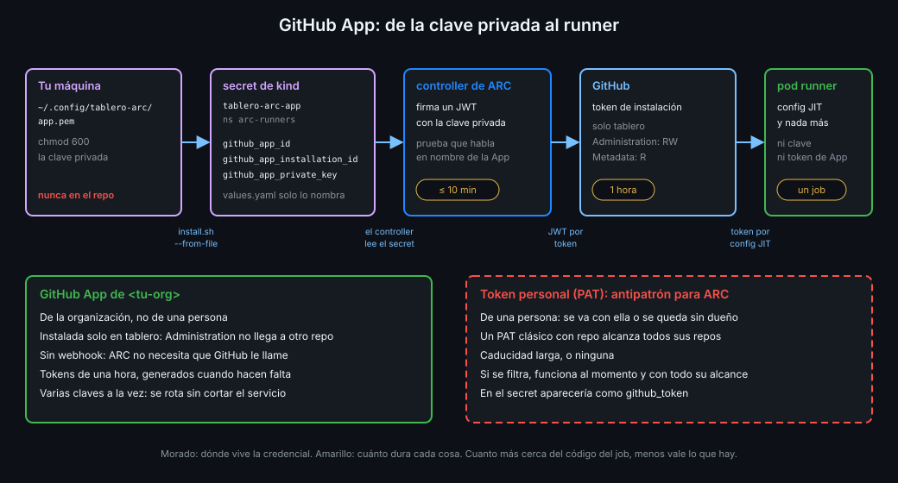

# Autenticar ARC con una GitHub App

> ARC necesita una credencial que pueda registrar runners en tu repo, día y noche, sin que tú
> estés delante. Una GitHub App de la organización la da con los permisos justos y tokens que
> caducan en una hora; un token personal, no.



## 🎯 Objetivos

Al terminar este archivo eres capaz de:

- Explicar por qué ARC se autentica con una GitHub App y no con un token personal
- Elegir los permisos de la App según el alcance del scale set: repositorio u organización
- Describir cómo la clave privada se convierte en tokens de corta vida
- Saber qué tres datos guarda el secret de Kubernetes y de dónde sale cada uno
- Guardar, comprobar y rotar la clave privada sin que toque el repo ni el log

## 1. Qué problema resuelve

En la Semana 15, `jit-runner.sh` pedía configuraciones JIT con tu sesión de `gh`: tu identidad,
tus permisos, mientras tu terminal estuviera abierta. ARC corre solo en el clúster y necesita
su propia credencial, guardada en un secret y usada por un proceso. Esa credencial puede
registrar runners en `tablero`, así que quien la robe puede meter un runner suyo en tu repo o
tocar su configuración. Hay que elegir bien cuál es y dónde vive.

ARC acepta dos tipos: un token personal (PAT) o una GitHub App. La regla del bootcamp es clara:
**nunca un PAT para ARC**. Este archivo explica por qué.

## 2. Cómo funciona

### PAT frente a GitHub App

| | Token personal (PAT) | GitHub App |
|---|---|---|
| De quién es | De una persona | De la organización |
| Qué alcanza | Todo lo que esa persona puede tocar (un PAT clásico con `repo`, todos sus repos) | Solo los repos donde está instalada |
| Permisos | Scopes amplios en el PAT clásico | Permisos uno a uno, por recurso |
| Caducidad | Larga, o ninguna | Tokens de una hora, generados cuando hacen falta |
| Si la persona se va | La credencial se va con ella, o se queda activa sin dueño | La App sigue: es de la org |
| Qué se roba si se filtra | Un token que funciona ya, con todo su alcance | La clave privada: grave, pero acotada a la instalación |

La App no es inmune: su clave privada es la **joya de la corona** de esta semana. Pero lo que
puede hacer quien la tenga está acotado a lo que tú decidas al crearla y al instalarla.

### Los permisos según el alcance

La documentación de GitHub pide permisos distintos según dónde registra ARC el scale set:

| Alcance del scale set | Permisos de la App |
|---|---|
| Repositorio (`githubConfigUrl` acaba en `/tablero`) | Repository: **Administration: Read and write** y **Metadata: Read-only** |
| Organización (`githubConfigUrl` acaba en `/<tu-org>`) | Organization: **Self-hosted runners: Read and write** (y Metadata) |

La documentación lo dice literal: Administration solo hace falta para registrar a nivel de
repositorio. Es un permiso fuerte: da acceso a la configuración del repo, incluidos sus runners.

`tablero` usa el alcance de repositorio, el mismo que el runner de la Semana 15. Una org Free no
puede limitar su runner group por defecto a repos concretos (eso es de Team), así que un scale
set de organización quedaría al alcance de cualquier repo de la org. Con alcance de repo, solo
`tablero` lo ve. El precio es Administration, y lo pagas así: la App se instala **solo** en
`tablero`, de modo que ese permiso no llega a ningún otro repo.

Con un scale set de enterprise no puedes usar una App: la documentación dice que ahí solo vale
un PAT. Es la única excepción, y no aplica a tu org.

### Sin webhook

Una App puede recibir eventos por webhook, pero ARC no los usa: habla con GitHub por conexiones
salientes (archivo 03). Al crear la App desmarcas **Active** en la sección de webhook. Una App
sin webhook no tiene URL a la que GitHub envíe nada.

### De la clave privada al runner

1. Al crear la App, GitHub te da su **client ID** y te deja generar una **clave privada**, un
   archivo `.pem` que descargas una vez.
2. Al instalarla en `tablero`, la instalación recibe un **installation ID**. Lo ves en la URL de
   la instalación: `https://github.com/organizations/<tu-org>/settings/installations/<ID>`.
3. ARC firma con la clave privada un JWT de vida corta (diez minutos como mucho) que prueba que
   habla en nombre de la App.
4. Con ese JWT pide un **token de instalación** para la instalación de `tablero`. Ese token
   caduca en una hora y solo tiene los permisos de la App en los repos donde está instalada.
5. Con el token de instalación, ARC registra el scale set y pide la configuración JIT de cada
   runner. El runner solo recibe esa configuración, de un uso.

La clave privada nunca sale del secret de Kubernetes, y ningún token de los que genera dura más
de una hora.

### El secret que lee ARC

El chart del scale set acepta las credenciales de tres formas: en sus values, como token o como
App, o como el **nombre** de un secret que ya existe en el namespace. `tablero` usa la tercera:
`values.yaml` solo dice `githubConfigSecret: tablero-arc-app`, y el secret se crea aparte.

| Clave del secret | Qué guarda | De dónde sale |
|---|---|---|
| `github_app_id` | El client ID de la App (el chart acepta el client ID o el app ID) | Página de la App |
| `github_app_installation_id` | El ID de la instalación en `tablero` | URL de la instalación |
| `github_app_private_key` | El contenido del `.pem` | El archivo que descargaste |

Los nombres de las claves son exactos: ARC busca la App con esos tres nombres. El comentario del
`values.yaml` del chart 0.15.1 es el que confirma que `github_app_id` acepta el client ID.

_Verificado con ARC 0.15.1 y kind v0.33.0, noviembre de 2026._

## 3. Cómo se usa

### Dónde vive la clave

La clave privada vive en tu máquina, fuera de cualquier repo, legible solo por ti:

```bash
mkdir -p ~/.config/tablero-arc
mv ~/Downloads/<nombre-de-la-app>.*.private-key.pem ~/.config/tablero-arc/app.pem
chmod 600 ~/.config/tablero-arc/app.pem
```

Y en `tablero` compruebas que ningún archivo contiene una:

```bash
git grep -lE -- '-----BEGIN [A-Z ]*PRIVATE KEY-----' || echo "sin claves privadas"
# sin claves privadas
```

### Crear el secret sin tocar el disco ni el log

`install.sh` recibe los tres datos por variables de entorno y genera el secret en memoria:

```bash
kubectl --context kind-gha create secret generic tablero-arc-app --namespace arc-runners \
  --from-literal=github_app_id="$APP_CLIENT_ID" \
  --from-literal=github_app_installation_id="$APP_INSTALLATION_ID" \
  --from-file=github_app_private_key="$APP_PRIVATE_KEY_FILE" \
  --dry-run=client -o yaml | kubectl --context kind-gha apply -f -
```

`--dry-run=client -o yaml` construye el objeto sin crearlo y `apply` lo crea o lo actualiza:
puedes repetirlo cuantas veces quieras. La clave se lee del archivo con `--from-file`, sin pasar
por la línea de comandos ni por el historial del shell. Y nada de esto se escribe en el repo.

### Comprobar sin mirar

```bash
kubectl --context kind-gha get secret tablero-arc-app -n arc-runners -o json | jq -r '.data | keys | join(",")'
# github_app_id,github_app_installation_id,github_app_private_key
```

Si en la lista aparece `github_token`, alguien usó un PAT.

### Rotar la clave

Una App puede tener varias claves privadas a la vez, y eso permite rotar sin cortar el servicio:
generas una nueva en la página de la App, relanzas `install.sh` con la nueva ruta, compruebas que
el listener sigue vivo y borras la vieja en GitHub. Si sospechas que la clave se filtró, el orden
es el mismo, pero sin esperar.

## 4. Antipatrones

| Antipatrón | Por qué duele | Qué hacer en su lugar |
|---|---|---|
| Un PAT clásico con `repo` para ARC | Alcanza todos los repos de una persona y no caduca | GitHub App instalada solo en `tablero` |
| Instalar la App en "All repositories" | Administration llega a todos los repos de la org | "Only select repositories": `tablero` |
| Permisos de org y de repo "por si acaso" | Más alcance del que el scale set usa | Los del alcance elegido, nada más |
| Webhook activo con una URL cualquiera | GitHub envía eventos a un sitio que nadie controla | Webhook desactivado |
| El `.pem` en la carpeta del repo, aunque esté en `.gitignore` | Un `git add -f` o una herramienta que ignora `.gitignore` y se filtra | `~/.config/tablero-arc/` con `chmod 600` |
| `githubConfigSecret.github_app_private_key` en `values.yaml` | La clave queda en el repo y en los values de la release | Solo el nombre del secret |
| `cat app.pem` para "ver si está bien" | La clave queda en tu terminal y en cualquier grabación | `jq '.data \| keys'` sobre el secret |

## 5. Trucos

- **El installation ID sin buscarlo**: con la App ya instalada, la página
  `https://github.com/organizations/<tu-org>/settings/installations` enlaza cada instalación; el
  número final de la URL es el ID.
- **Qué permisos tiene la App de verdad**: la página de la instalación en la org los lista tal
  como los aceptaste. Si cambias los permisos de la App, la org tiene que aceptarlos de nuevo y
  hasta entonces la instalación sigue con los antiguos.
- **Un `.pem` válido sin abrirlo**: `openssl pkey -in ~/.config/tablero-arc/app.pem -noout`
  no imprime nada si la clave se puede leer y da error si el archivo está corrupto o truncado.

## 📚 Recursos Adicionales

- [GitHub Docs: Authenticating ARC to the GitHub API](https://docs.github.com/en/actions/tutorials/use-actions-runner-controller/authenticate-to-the-api)
- [GitHub Docs: Registering a GitHub App](https://docs.github.com/en/apps/creating-github-apps/registering-a-github-app/registering-a-github-app)
- [GitHub Docs: Managing private keys for GitHub Apps](https://docs.github.com/en/apps/creating-github-apps/authenticating-with-a-github-app/managing-private-keys-for-github-apps)
- [GitHub Docs: Authenticating as a GitHub App installation](https://docs.github.com/en/apps/creating-github-apps/authenticating-with-a-github-app/authenticating-as-a-github-app-installation)

## ✅ Checklist de Verificación

- [ ] Sé explicar cinco diferencias entre un PAT y una GitHub App para ARC
- [ ] Sé qué permisos pide la App para un scale set de repo y para uno de org
- [ ] Sé por qué `tablero` usa alcance de repo y cómo limito el permiso Administration
- [ ] Sé cómo la clave privada se convierte en un JWT y en un token de una hora
- [ ] Sé qué tres claves lleva el secret `tablero-arc-app` y de dónde sale cada una
- [ ] Sé crear el secret sin que la clave pase por el repo, la línea de comandos ni el log
- [ ] Sé rotar la clave sin cortar el servicio

---

| ← Anterior | Siguiente → |
|:---|---:|
| [Arquitectura de ARC](03-arquitectura-de-arc.md) | [Scale sets y `runs-on`](05-scale-sets-y-runs-on.md) |
