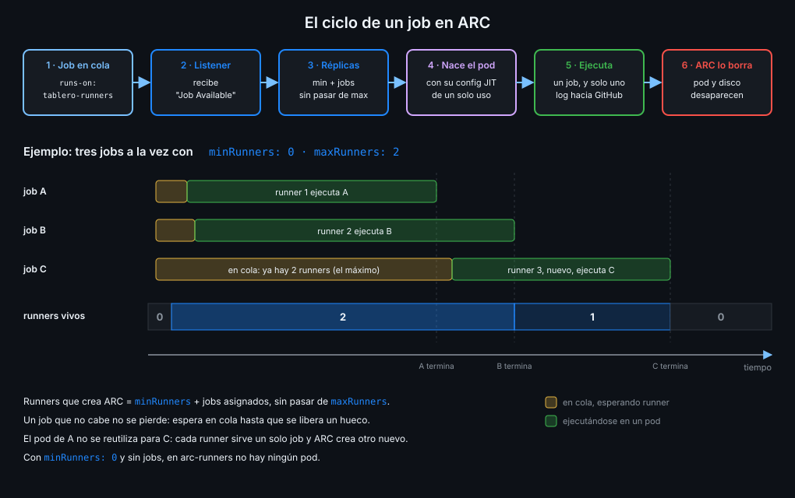

# Scale sets y `runs-on`

> Un scale set es un grupo de runners idénticos con un nombre, un mínimo y un máximo. El
> workflow lo pide por su nombre, y ARC crea tantos runners como jobs haya en cola, sin pasarse
> del máximo.



## 🎯 Objetivos

Al terminar este archivo eres capaz de:

- Declarar el nombre de un scale set y pedirlo con `runs-on`
- Saber cuándo hacen falta etiquetas y cuál es el nombre correcto del valor de Helm
- Calcular cuántos runners crea ARC a partir de `minRunners`, `maxRunners` y los jobs en cola
- Elegir entre alcance de repositorio y de organización, y saber qué papel juega el runner group
- Hacer que actionlint acepte un `runs-on` que no es una etiqueta conocida

## 1. Qué problema resuelve

En la Semana 15 elegías runner con etiquetas: `runs-on: [self-hosted, tablero-lab]`, y GitHub
buscaba un runner que las tuviera todas. Con ARC no hay runners esperando a los que poner
etiquetas: existen después de que llegue el job. Lo que existe antes es el **scale set**, y es a
él a quien GitHub asigna el job. Hace falta decidir cómo se llama, quién puede verlo y cuántos
runners puede crear como mucho en tu portátil.

## 2. Cómo funciona

### El nombre es lo que pone `runs-on`

El valor `runnerScaleSetName` del chart da nombre al scale set; si no lo pones, se usa el nombre
de la release de Helm. La documentación de GitHub dice que el workflow puede pedir el scale set
por cualquiera de los dos. En `tablero` coinciden a propósito:

| Dónde | Valor |
|---|---|
| Release de Helm | `tablero-runners` |
| `runnerScaleSetName` en `values.yaml` | `tablero-runners` |
| `runs-on` en `lab.yml` | `tablero-runners` |
| Nombre de cada runner | `tablero-runners-<x>-runner-<y>` |

`runs-on` es una cadena, no una lista, y no lleva `self-hosted`. La documentación de ARC y la
de la librería del scale set eligen el scale set por su nombre (o por las etiquetas de
`scaleSetLabels`) y en ningún sitio dicen que lleve `self-hosted`: no la pidas, porque un job
que pide una etiqueta que ningún runner tiene se queda en cola hasta caducar a las 24 horas.

Los nombres de scale set son únicos **dentro de su runner group**. Si instalas dos con el mismo
nombre en el mismo grupo, el segundo choca con el primero.

### Etiquetas: existen, pero `tablero` no las usa

Desde ARC 0.14.0 un scale set puede llevar varias etiquetas además de su nombre, para que un
mismo `runs-on` encaje en scale sets distintos. Aquí hay una trampa de nombres:

| Dónde | Cómo se llama |
|---|---|
| Valor del chart de Helm (`values.yaml`) | `scaleSetLabels` |
| Campo del objeto `AutoscalingRunnerSet` | `runnerScaleSetLabels` |
| La documentación de GitHub | Habla de `runnerScaleSetLabels` como valor de `values.yaml` |

Con Helm, el valor que funciona es `scaleSetLabels`: es el que aparece en el `values.yaml` del
chart 0.15.1, y la plantilla lo copia al campo `runnerScaleSetLabels` del objeto. `tablero` tiene
un solo scale set y lo pide por su nombre: no necesita etiquetas.

### Cuántos runners: mínimo, máximo y jobs en cola

El comentario del `values.yaml` del chart lo explica en una frase: el número de runners que
crea ARC es **la suma de `minRunners` y los jobs asignados al scale set**, sin pasar de
`maxRunners`.

| Valores | Qué hace ARC |
|---|---|
| `minRunners: 0`, `maxRunners: 2` | Ningún runner si no hay jobs; uno por job hasta dos; el tercero espera en cola |
| `minRunners: 1`, `maxRunners: 2` | Siempre uno esperando; arranca antes, pero ocupa memoria y está registrado sin hacer nada |
| Ninguno de los dos | Tantos runners como jobs asignados, sin techo, y 0 si no hay jobs |
| Los dos a 0 | No crea runners nuevos: sirve para vaciar el scale set antes de tocarlo |

`minRunners` nunca puede ser mayor que `maxRunners`. Y no hay mínimos ni máximos por horario:
ARC no los soporta.

`tablero` usa 0 y 2. El 0, porque en tu portátil no quieres un pod esperando todo el día; el
arranque tarda unos segundos más, y en un laboratorio eso no importa. El 2, porque es el techo
que tu máquina aguanta: cada runner puede llegar a 4 GiB de memoria (archivo 07), y además
`lab.yml` ya serializa sus ejecuciones con `concurrency`. Un job que no cabe no se pierde: espera
en cola a que termine otro.

### Alcance y runner group

`githubConfigUrl` decide dónde se registra el scale set:

| URL | Alcance | Quién puede usarlo |
|---|---|---|
| `https://github.com/<tu-org>/tablero` | Repositorio | Solo `tablero` |
| `https://github.com/<tu-org>` | Organización | Los repos que permita su runner group |
| `https://github.com/enterprises/<empresa>` | Enterprise | Las orgs que permita su runner group |

Los runner groups son de organización y de enterprise: el valor `runnerGroup` del chart elige
en cuál entra un scale set de org, y el grupo debe existir antes. En una org Free solo tienes el
grupo por defecto, y no puedes limitar a qué repos llega (las políticas de acceso de los grupos
son de Team). Por eso `tablero` registra su scale set en el repositorio, igual que el runner de
la Semana 15, y la política de la org que ya limitaba los runners de repositorio a `tablero`
sigue valiendo.

_Verificado con ARC 0.15.1 y kind v0.33.0, noviembre de 2026._

## 3. Cómo se usa

### Los values del scale set

```yaml
githubConfigUrl: https://github.com/<tu-org>/tablero
githubConfigSecret: tablero-arc-app
runnerScaleSetName: tablero-runners
minRunners: 0
maxRunners: 2
```

Cinco líneas deciden dónde se registra, con qué credencial, cómo se llama y cuánto puede crecer.
El resto de `values.yaml` es la plantilla del pod (archivos 06 y 07).

### El job que lo pide

```yaml
name: lab
on:
  workflow_dispatch:
concurrency:
  group: ${{ github.workflow }}
  cancel-in-progress: false
permissions: {}
jobs:
  unit:
    name: Tests unitarios en un runner de ARC
    runs-on: tablero-runners
    timeout-minutes: 15
    permissions:
      contents: read
    steps:
      - name: Quién ejecuta este job
        run: echo "runner=$RUNNER_NAME"
      - uses: actions/checkout@3d3c42e5aac5ba805825da76410c181273ba90b1 # v7.0.1
        with:
          persist-credentials: false
```

Sigue siendo `workflow_dispatch` y nada más: el runner corre en tu máquina y solo lo lanza
alguien con permiso de escritura. Un `pull_request` desde un fork no puede llegar a él.

### actionlint y las etiquetas desconocidas

actionlint conoce las etiquetas de los runners de GitHub, pero no `tablero-runners`, y lo marca
como error. Se le enseña en `.github/actionlint.yaml`, el mismo archivo de la Semana 15:

```yaml
self-hosted-runner:
  labels:
    - tablero-lab
    - tablero-runners
```

### Comprobar dónde corrió

```bash
run_id=$(gh run list --workflow lab.yml --limit 1 --json databaseId --jq '.[0].databaseId')
gh api "repos/{owner}/{repo}/actions/runs/$run_id/jobs" --jq '.jobs[] | {runner_name, labels}'
# {"labels":["tablero-runners"],"runner_name":"tablero-runners-<x>-runner-<y>"}
```

## 4. Antipatrones

| Antipatrón | Por qué duele | Qué hacer en su lugar |
|---|---|---|
| `runs-on: [self-hosted, tablero-runners]` | Pide una etiqueta que la documentación no garantiza en un scale set: el job puede quedarse en cola | `runs-on: tablero-runners` |
| `runnerScaleSetLabels` en los values de Helm | El chart no lo lee: tus etiquetas no llegan al scale set | `scaleSetLabels`, si de verdad necesitas etiquetas |
| Sin `maxRunners` en un portátil | Diez jobs en cola son diez pods y tu máquina sin memoria | Un techo que quepa en tu máquina |
| `minRunners` alto "para que vaya rápido" | Pods registrados y ociosos todo el día | 0 en el laboratorio |
| Scale set de organización en una org Free | Cualquier repo de la org puede mandarle jobs | Alcance de repositorio |
| Dos scale sets con el mismo nombre en el mismo grupo | Los nombres son únicos dentro del grupo: no pueden convivir | Nombres únicos, o grupos distintos |

## 5. Trucos

- **Vaciar antes de tocar**: pon `maxRunners: 0` (y `minRunners: 0`), relanza `install.sh` y
  espera a que no quede ningún `EphemeralRunner`. Así no matas un job a medias.
- **Ver la cola desde el clúster**: `kubectl get ephemeralrunnersets -n arc-runners -w` cambia
  cada vez que el listener pide más o menos runners, antes de que exista el pod.
- **El nombre de la release y el del scale set iguales**: si coinciden, `helm list`, `kubectl` y
  `runs-on` hablan del mismo nombre y no tienes que traducir.

## 📚 Recursos Adicionales

- [GitHub Docs: Deploying runner scale sets with ARC](https://docs.github.com/en/actions/tutorials/use-actions-runner-controller/deploy-runner-scale-sets)
- [GitHub Docs: Using ARC runners in a workflow](https://docs.github.com/en/actions/tutorials/use-actions-runner-controller/use-arc-in-a-workflow)
- [ARC: values.yaml del chart 0.15.1](https://github.com/actions/actions-runner-controller/blob/gha-runner-scale-set-0.15.1/charts/gha-runner-scale-set/values.yaml)
- [actionlint: configuración](https://github.com/rhysd/actionlint/blob/main/docs/config.md)

## ✅ Checklist de Verificación

- [ ] Sé de dónde sale el nombre que pongo en `runs-on`
- [ ] Sé por qué `runs-on` no lleva `self-hosted` con ARC
- [ ] Sé qué valor de Helm lleva las etiquetas y por qué la documentación confunde
- [ ] Sé calcular cuántos runners crea ARC con un mínimo, un máximo y N jobs en cola
- [ ] Sé por qué `tablero` usa 0 y 2
- [ ] Sé qué cambia entre alcance de repositorio, de organización y de enterprise
- [ ] Sé enseñar a actionlint la etiqueta `tablero-runners`

---

| ← Anterior | Siguiente → |
|:---|---:|
| [Autenticar ARC con una GitHub App](04-autenticar-arc-con-una-github-app.md) | [Modos de contenedor](06-modos-de-contenedor.md) |
