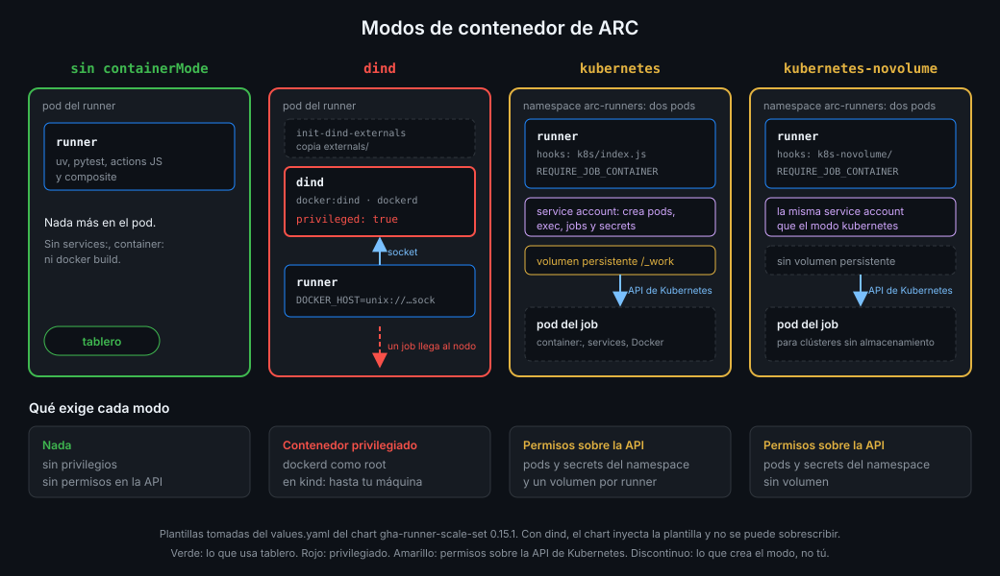

# Modos de contenedor

> Muchos jobs necesitan Docker: `services:`, `container:`, `docker build`. ARC ofrece tres modos
> para dárselo, y los tres cobran en privilegios. `tablero` no usa ninguno, y esta semana sabrás
> exactamente qué se ahorra.



## 🎯 Objetivos

Al terminar este archivo eres capaz de:

- Decir qué jobs funcionan en un runner de ARC sin modo de contenedor y cuáles no
- Explicar qué añade al pod el modo `dind` y por qué exige un contenedor privilegiado
- Explicar cómo los modos `kubernetes` y `kubernetes-novolume` crean pods desde el runner y qué
  permisos de la API necesitan para ello
- Elegir modo por lo que exige, no por lo que permite
- Justificar por qué `tablero` no declara `containerMode`

## 1. Qué problema resuelve

En la Semana 15 quitaste el socket de Docker al contenedor del runner: un job con el socket es
root en tu máquina. El precio fue que en `tablero-lab` no corren `services:`, `container:` ni
actions de tipo Docker. En Kubernetes el problema es el mismo con otra forma: un pod no trae un
demonio de Docker, así que alguien tiene que dárselo, o tiene que haber otra forma de arrancar
contenedores para el job. El valor `containerMode` del chart elige cuál, y cada opción tiene un
coste en privilegios que conviene conocer antes de copiarla de un tutorial.

## 2. Cómo funciona

### Sin modo: solo el contenedor del runner

Es lo que tienes si no declaras `containerMode`: el pod tiene un único contenedor, `runner`, con
la plantilla que tú escribas. No hay demonio de Docker ni permisos sobre la API de Kubernetes.

| Funciona | No funciona |
|---|---|
| `run:` con lo que traiga la imagen o instalen las actions `setup-*` | `services:` (PostgreSQL de la Semana 05) |
| Actions JavaScript y composite | `container:` en el job |
| `uv sync`, `pytest`, `pnpm install` | Actions de tipo Docker y `docker build` |

### `dind`: un demonio de Docker al lado del runner

Con `containerMode.type: dind` el chart rellena la plantilla del pod por ti, y según la
documentación de GitHub esos valores **no se pueden sobrescribir**. El `values.yaml` del chart
0.15.1 enseña lo que inyecta:

| Contenedor | Qué hace |
|---|---|
| `init-dind-externals` (init) | Copia `externals/` del runner a un volumen compartido |
| `dind` | La imagen `docker:dind` arrancando `dockerd`, con `securityContext.privileged: true` |
| `runner` | Tu runner, con `DOCKER_HOST=unix:///var/run/docker.sock` apuntando al socket del `dind` |

Un contenedor **privilegiado** tiene todas las capacidades del kernel y acceso a los
dispositivos del nodo: no hay aislamiento que valga. La documentación de GitHub lo dice de dos
formas: el contenedor dind "requiere modo privilegiado" y `docker:dind` "ejecuta el demonio de
Docker como root". Incluso la variante `docker:dind-rootless` necesita el pod en modo
privilegiado.

Y el job habla con ese demonio por el socket: es el escenario de la Semana 15, un piso más abajo.
Un job puede pedirle al `dind` un contenedor con `/` montado y llegar al sistema de archivos del
nodo. En kind, el nodo es a su vez un contenedor privilegiado de tu Docker: el camino termina en
tu máquina.

### `kubernetes`: un pod por cada contenedor del job

Con `containerMode.type: kubernetes`, el runner no arranca contenedores: usa los **runner
container hooks**, un programa (`/home/runner/k8s/index.js`) que pide a la API de Kubernetes un
pod nuevo en el mismo namespace para cada `container:`, servicio o action de tipo Docker.
Necesita dos cosas:

- Un **volumen persistente** por runner (`kubernetesModeWorkVolumeClaim`), para compartir el
  directorio de trabajo entre el pod del runner y el pod del job. El clúster tiene que saber
  crearlo.
- **Permisos sobre la API**. El chart crea para el runner una service account con un role que,
  en 0.15.1, permite crear y borrar pods, ejecutar comandos en ellos (`pods/exec`), leer sus
  logs, y crear, leer y borrar `jobs` y `secrets` del namespace.

Además, el modo obliga a que el job declare `container:`
(`ACTIONS_RUNNER_REQUIRE_JOB_CONTAINER=true`). Si no lo hace, falla con:

```text
Jobs without a job container are forbidden on this runner.
```

Se puede desactivar poniendo esa variable a `false`, y la documentación avisa de lo que cuesta:
el pod del runner puede acabar con privilegios elevados sobre la API, incluida la capacidad de
crear pods y acceder a secrets.

### `kubernetes-novolume`: lo mismo, sin volumen

`containerMode.type: kubernetes-novolume` usa otros hooks (`/home/runner/k8s-novolume/index.js`)
que no necesitan volumen persistente: la documentación lo propone para clústeres sin
almacenamiento compartido. Los permisos sobre la API son los mismos: el chart crea el mismo
role en los dos modos `kubernetes`.

### Lo que cuesta cada uno

| Modo | Docker para el job | Qué exige |
|---|---|---|
| Sin modo | No | Nada más que el runner |
| `dind` | Sí, un `dockerd` en el pod | Contenedor privilegiado con `dockerd` como root |
| `kubernetes` | Pods en vez de contenedores | Volumen persistente y una service account que crea pods y secrets |
| `kubernetes-novolume` | Pods en vez de contenedores | La misma service account, sin volumen |

_Verificado con ARC 0.15.1 y kind v0.33.0, noviembre de 2026._

## 3. Cómo se usa

### La elección de `tablero`: ninguno

`lab.yml` corre los tests unitarios de la API: `uv sync` y `pytest`, sin PostgreSQL ni Docker.
Las imágenes se construyen en `images.yml`, en runners de GitHub, desde la Semana 06. Ningún job
del runner propio necesita Docker, así que `ops/arc/values.yaml` no declara `containerMode` y el
runner se queda con lo mínimo.

El starter de esta semana, copiado de un tutorial típico, trae esto:

```yaml
containerMode:
  type: "dind" # antipatron: contenedor privilegiado con dockerd como root
```

Quitarlo es el `TODO 6` del proyecto. Y la comprobación `arc-no-dind` mira dos cosas: que no
haya `containerMode` y que ningún contenedor de la plantilla sea privilegiado.

Así queda el reparto de los jobs de `tablero` que tocan Docker:

| Job | Necesita | Dónde corre |
|---|---|---|
| Tests de integración de `ci-api` | `services:` con PostgreSQL | `ubuntu-24.04` |
| `images.yml` | `docker build` y push a GHCR | `ubuntu-24.04` |
| `unit` de `lab.yml` | Solo `uv` y `pytest` | `tablero-runners` |

### Comprobarlo en el clúster

```bash
helm get values tablero-runners -n arc-runners --kube-context kind-gha | grep -c containerMode
# 0
kubectl --context kind-gha get autoscalingrunnerset tablero-runners -n arc-runners \
  -o jsonpath='{.spec.template.spec.containers[*].name}'
# runner
```

Un solo contenedor, `runner`: ni `dind` ni init container.

### Si algún día necesitas Docker

La respuesta no es activar `dind` en el scale set del laboratorio. Las opciones, de menos a más
coste:

1. Hacer ese trabajo en un runner de GitHub, que es una VM desechable: lo que hace `images.yml`.
2. Un scale set aparte, con su propio nombre, sus propios límites y solo para los workflows que lo
   necesiten, en un clúster o unos nodos dedicados a eso.
3. Modo `kubernetes`, sabiendo que el runner tendrá permiso para crear pods y secrets en su
   namespace, y que ese namespace no debe tener nada más.

## 4. Antipatrones

| Antipatrón | Por qué duele | Qué hacer en su lugar |
|---|---|---|
| `containerMode: dind` "porque viene en el ejemplo" | Pod privilegiado: un job llega al nodo y, en kind, a tu máquina | Sin modo si los jobs no necesitan Docker |
| Montar `/var/run/docker.sock` del nodo en la plantilla | Es el socket del host de la Semana 15, ahora en el nodo | Nunca |
| `privileged: true` en el contenedor `runner` | Sin aislamiento, con o sin Docker | `allowPrivilegeEscalation: false` y `drop: [ALL]` (archivo 07) |
| `ACTIONS_RUNNER_REQUIRE_JOB_CONTAINER=false` en modo `kubernetes` | El job corre en el pod que tiene permisos sobre la API | Dejarlo en `true` |
| Modo `kubernetes` en el mismo namespace que otros secrets | El runner puede leer y crear secrets del namespace | Un namespace solo para esos runners |
| Un scale set con Docker para todo "por si acaso" | Todos los jobs pagan los privilegios que solo uno usa | Scale sets separados por necesidad |

## 5. Trucos

- **Lo que inyecta cada modo, sin instalarlo**: `helm show values` del chart del scale set con
  `--version 0.15.1` trae comentada la plantilla completa de `dind`, `kubernetes` y
  `kubernetes-novolume`. Léela antes de activar cualquiera.
- **Un pod privilegiado en el clúster, en una línea**:
  `kubectl get pods -A -o jsonpath='{range .items[*]}{.metadata.name}{" "}{.spec.containers[*].securityContext.privileged}{"\n"}{end}' | grep true`
  lista los que lo son. En tu `kind-gha` no debería salir ningún runner.
- **Qué puede hacer una service account**:
  `kubectl auth can-i --list --as=system:serviceaccount:arc-runners:<nombre> -n arc-runners`
  enseña sus permisos. La del runner sin modo no puede casi nada.

## 📚 Recursos Adicionales

- [GitHub Docs: Deploying runner scale sets with ARC, Using Docker-in-Docker or Kubernetes mode](https://docs.github.com/en/actions/tutorials/use-actions-runner-controller/deploy-runner-scale-sets)
- [actions/runner-container-hooks](https://github.com/actions/runner-container-hooks)
- [Kubernetes: Pod Security Standards](https://kubernetes.io/docs/concepts/security/pod-security-standards/)
- [Docker Docs: Runtime privilege and Linux capabilities](https://docs.docker.com/engine/containers/run/)

## ✅ Checklist de Verificación

- [ ] Sé qué jobs corren en un runner sin modo de contenedor y cuáles no
- [ ] Sé qué contenedores añade `dind` y por qué uno de ellos es privilegiado
- [ ] Sé por qué un pod privilegiado en kind acaba alcanzando mi máquina
- [ ] Sé cómo el modo `kubernetes` crea pods y qué permisos da al runner
- [ ] Sé qué cambia `kubernetes-novolume` y qué no
- [ ] Sé por qué `tablero` no declara `containerMode`
- [ ] Sé qué hacer si un job necesita Docker sin abrir el scale set del laboratorio

---

| ← Anterior | Siguiente → |
|:---|---:|
| [Scale sets y `runs-on`](05-scale-sets-y-runs-on.md) | [Endurecer el pod del runner](07-endurecer-el-pod-del-runner.md) |
