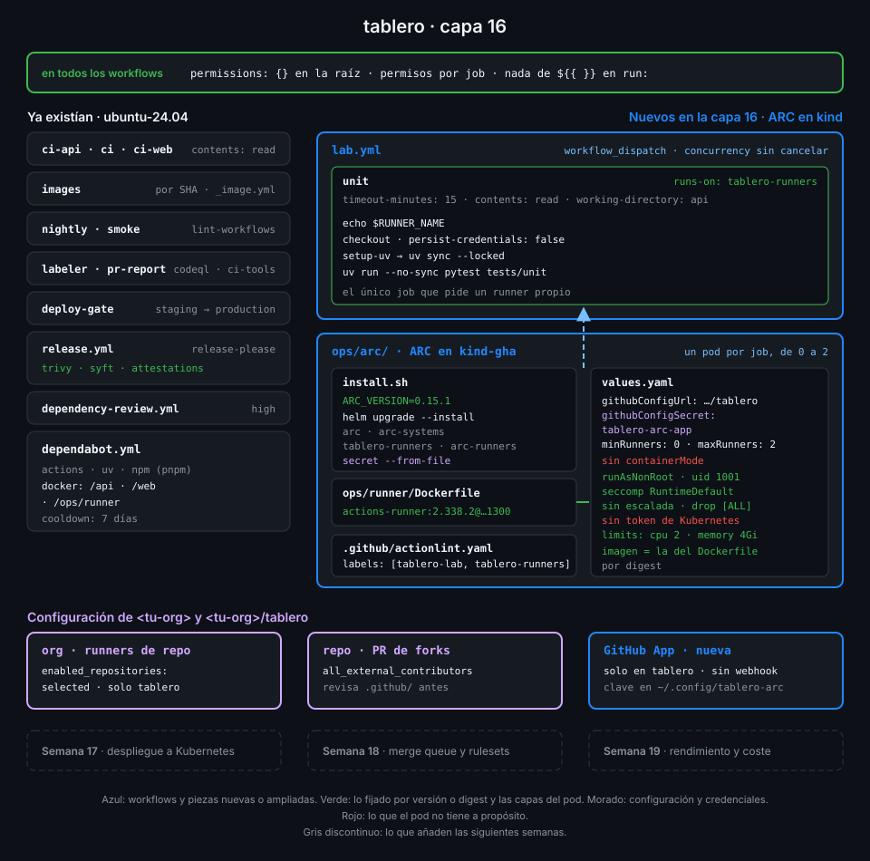

# Proyecto: capa 16 de tablero



## 🎯 Objetivo

Que el runner propio de `tablero` deje de ser un bucle en tu terminal y pase a ser un servicio:
ARC, en tu clúster kind, escucha los jobs de `tablero` y crea un pod para cada uno, que se borra
cuando el job termina. La credencial es una GitHub App que solo ve `tablero`, y el pod no tiene
root, ni capacidades, ni acceso a la API de Kubernetes.

## 📦 Qué añade esta capa

| Pieza de `tablero` | Qué hace | Por qué existe |
|---|---|---|
| `ops/arc/install.sh` (nuevo) | Instala el controller y el scale set con la misma versión de ARC y crea el secret de la GitHub App desde tres variables | Un único comando reconstruye ARC en un kind recién creado; la clave nunca pasa por el repo |
| `ops/arc/values.yaml` (nuevo) | Scale set `tablero-runners` registrado en el repo, de 0 a 2 runners, sin modo de contenedor y con el pod endurecido | Es todo lo que decides sobre tus runners, versionado y revisable en un PR |
| `lab.yml` | `runs-on: tablero-runners` | El job de la Semana 15 pasa de tu bucle de Docker a ARC sin cambiar nada más |
| `.github/actionlint.yaml` | Añade la etiqueta `tablero-runners` | actionlint sigue sin quejarse de una etiqueta desconocida |
| `ops/runner/Dockerfile` | Sin cambios: su `FROM` es la imagen que usa también el pod de ARC | Dependabot vigila una sola línea y un check comprueba que las dos coinciden |

| Situación | Qué pasa |
|---|---|
| Lanzas `lab.yml` a mano | El listener lo ve, ARC crea un pod `tablero-runners-…-runner-…`, corre el job y el pod se borra |
| Lanzas `lab.yml` dos veces seguidas | Su `concurrency` deja uno en marcha y el otro pendiente; otros workflows en `tablero-runners` nunca pasarían de 2 pods |
| Nadie lanza nada | No hay ningún pod de runner: `minRunners: 0` |
| Un job intenta `sudo` | `no new privileges` lo impide, igual que en la Semana 15 |
| Un job busca el token de Kubernetes | No existe: el pod no lo monta |
| Un PR de un fork | Ningún workflow con `pull_request` usa `tablero-runners`: nunca llega a tu clúster |

La Semana 17 usa el clúster del laboratorio, recreado con la configuración OIDC, como destino: despliega `tablero` en kind por digest, con
aprobación para production y rollback automático.

## ✅ Requisitos verificables

- install.sh instala el controller y el scale set desde los charts OCI oficiales de ARC con la misma versión fijada
- values.yaml registra el scale set en el repositorio tablero, no en la organización
- values.yaml referencia la credencial por el nombre de un secret de Kubernetes, sin credenciales en el archivo
- Ningún archivo de tablero contiene una clave privada
- El scale set se llama tablero-runners
- tablero-runners escala desde 0 runners hasta como mucho 3
- El contenedor runner usa la misma imagen y el mismo digest que ops/runner/Dockerfile
- El pod del runner corre como uid 1001 sin root, sin escalada de privilegios y sin capacidades
- El contenedor runner declara límites de CPU y de memoria
- El pod del runner no monta el token de la API de Kubernetes
- El scale set no usa containerMode ni contenedores privilegiados
- El job de lab.yml corre en tablero-runners y actionlint conoce esa etiqueta
- Solo lab.yml pide un runner propio (self-hosted, tablero-lab o tablero-runners)
- actionlint y zizmor pasan sin hallazgos sobre los workflows de tablero
- kind-gha tiene desplegadas las releases arc y tablero-runners con la versión de ARC de install.sh
- El secret tablero-arc-app de arc-runners guarda la GitHub App y ningún token personal
- lab.yml terminó en success sobre el último commit de main en un runner de tablero-runners

## 🎨 Criterios de calidad

Lo que `check-week.sh` no ve y la [rúbrica](../rubrica-evaluacion.md) sí puntúa:

- La GitHub App no tiene webhook, ni más permisos que Administration (lectura y escritura) y
  Metadata (lectura), y está instalada en `tablero` y en ningún otro repo.
- La clave `.pem` vive fuera del repo con permisos `600`, y el historial de `git log -p` no
  la contiene en ningún commit.
- `values.yaml` explica con un comentario cada decisión que un revisor podría cuestionar:
  alcance de repo, `minRunners: 0`, sin `containerMode`, uid numérico.
- `install.sh` es idempotente: lanzarlo dos veces no falla ni duplica nada.
- Los límites de CPU y memoria caben en tu máquina: con `maxRunners` pods a la vez, kind sigue
  respondiendo.
- Los pods de prueba de las prácticas están borrados (`kubectl get pods -n arc-runners` solo
  enseña runners mientras hay un job).
- Sin `TODO` en el repo.

## 💡 Adaptación a tu dominio

| Tu caso | Alcance del scale set | Modo de contenedor | Qué cambia en `values.yaml` |
|---|---|---|---|
| Un repo privado de tu empresa | Organización, en un runner group limitado a ese repo (plan Team) | Ninguno | `githubConfigUrl` de la org y `runnerGroup` |
| Jobs que construyen imágenes Docker | Repo | `dind` solo en un clúster dedicado y solo para repos privados | Un scale set aparte con `containerMode.type: dind` para esos jobs |
| Jobs con `container:` o `services:` | Repo u org | `kubernetes` con un volumen de trabajo | `containerMode.type: kubernetes` y `kubernetesModeWorkVolumeClaim` |
| Jobs que necesitan GPU | Org | Ninguno | Otro scale set con `nodeSelector` y `resources.limits` de GPU, y su propio nombre en `runs-on` |

## 🚦 Cómo entregarlo

Si hiciste las cuatro prácticas ya lo tienes todo: repásalo contra los requisitos y los
criterios. Si no, parte del starter.

1. Copia el starter en `tablero` y completa los `TODO 1` a `TODO 10`:

   ```bash
   cd ~/code/tablero
   S=~/code/bc-github-actions/bootcamp/week-16-actions_runner_controller_en_kind/3-proyecto/starter
   cp -r "$S"/. .
   grep -rnE "TODO [0-9]+" ops/arc | wc -l
   # 10
   ```

2. Crea la GitHub App, instálala solo en `tablero` y guarda la clave fuera del repo
   ([práctica 01](../2-practicas/01-github-app-para-arc.md)).

3. Cambia `runs-on` de `lab.yml` a `tablero-runners` y añade la etiqueta a
   `.github/actionlint.yaml` ([práctica 03](../2-practicas/03-scale-set-de-tablero.md), paso 4).

4. Levanta kind e instala ARC:

   ```bash
   ~/code/bc-github-actions/scripts/lab-up.sh
   export APP_CLIENT_ID=<client-id> APP_INSTALLATION_ID=<installation-id>
   export APP_PRIVATE_KEY_FILE=~/.config/tablero-arc/app.pem
   ops/arc/install.sh
   helm list -A --kube-context kind-gha -o json | jq -r '.[] | .name + " " + .status'
   # arc deployed
   # tablero-runners deployed
   ```

5. Haz push a `main`, lanza `lab.yml` y espera a que termine:

   ```bash
   gh workflow run lab.yml --ref main
   gh run watch "$(gh run list --workflow lab.yml --limit 1 --json databaseId --jq '.[0].databaseId')"
   ```

6. Lanza la verificación:

   ```bash
   cd ~/code/bc-github-actions
   ./scripts/check-week.sh 16
   # 17/17 comprobaciones superadas.
   ```

## 🧯 Errores comunes

| Síntoma | Causa | Solución |
|---|---|---|
| El nodo `gha-worker` no llega a `Ready` y el kubelet dice `inotify_init: too many open files` | Otro clúster kind (o muchos contenedores) gasta las instancias de inotify del host | `sudo sysctl -w fs.inotify.max_user_instances=512` y vuelve a crear el clúster ([práctica 02](../2-practicas/02-arc-con-helm.md)) |
| `helm template` del scale set falla con `No gha-rs-controller deployment found` | El chart busca el controller en el clúster para darle permisos | Instala antes el controller; `install.sh` ya lo hace en ese orden |
| El controller registra `failed to parse RSA private key from PEM` y no aparece el listener | La clave del secret no es el `.pem` de la App (copiada a medias o con otro formato) | Vuelve a lanzar `install.sh` con `APP_PRIVATE_KEY_FILE` apuntando al `.pem` descargado |
| El pod del runner se queda en `CreateContainerConfigError`: `image has non-numeric user (runner), cannot verify user is non-root` | `runAsNonRoot` sin `runAsUser`: la imagen declara su usuario por nombre | Añade `runAsUser: 1001` ([práctica 04](../2-practicas/04-pod-del-runner-endurecido.md), paso 2) |
| `lab.yml` se queda en cola para siempre | El listener no está conectado, `runs-on` no coincide con `runnerScaleSetName` o la política de la org no deja runners de repo a `tablero` | Mira los logs del controller y compara `runs-on` con `helm get values tablero-runners -n arc-runners` |
| `arc-runner-image-matches` en rojo tras fusionar un PR de Dependabot | Dependabot subió el digest de `ops/runner/Dockerfile`, no el de `values.yaml` | Copia el nuevo `FROM` a `values.yaml` y vuelve a lanzar `install.sh` |
| `check-week.sh 15` marca `lab-runs-on`, `self-hosted-only-in-lab` y `lab-green-on-own-runner` en rojo | La capa 16 mueve `lab.yml` a ARC | Es lo esperado ([comprobaciones superadas por capas posteriores](../../../docs/autograding.md#comprobaciones-superadas-por-capas-posteriores)) |

## 🔗 Navegación

---

| ← Anterior | Siguiente → |
|:---|---:|
| [El pod del runner endurecido](../2-practicas/04-pod-del-runner-endurecido.md) | [Rúbrica de evaluación](../rubrica-evaluacion.md) |
