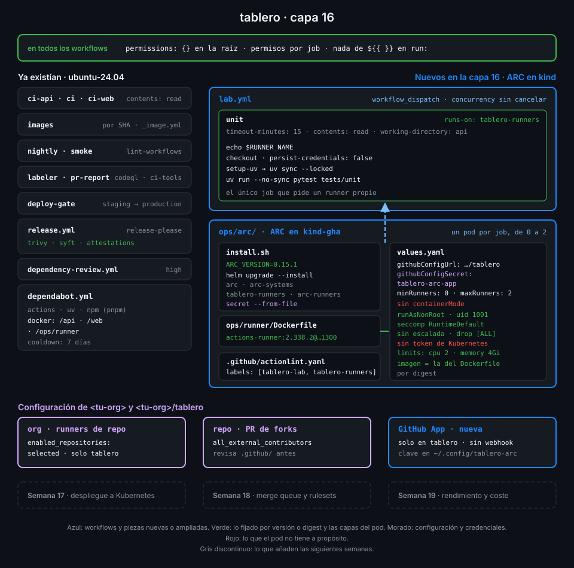

# Semana 16 — Actions Runner Controller en kind

> El bucle de la Semana 15 crea un runner por job, pero solo en tu máquina y de uno en uno. Esta
> semana Kubernetes hace ese trabajo: ARC escucha a GitHub y crea un pod por job, y cuando el job termina borra el pod.

## 🎯 Objetivos de la Semana

Al terminar la semana eres capaz de:

- Manejar lo justo de Kubernetes y Helm para operar ARC: pods, namespaces, secrets, service
  accounts, CRD, charts, releases y values
- Explicar cómo ARC convierte un job en cola en un pod: controller, listener, scale set y runner
  efímero, y qué hace cada uno con GitHub
- Autenticar ARC con una GitHub App en lugar de un token personal, con los permisos justos y la
  clave privada fuera del repo
- Declarar un scale set de repositorio con nombre, mínimo y máximo, y apuntarle un job con
  `runs-on`
- Elegir modo de contenedor sabiendo qué privilegios exige cada uno y por qué `tablero` no usa
  ninguno
- Endurecer el pod del runner: sin root, sin escalada, sin capacidades, sin token de la API de
  Kubernetes, con límites y con la misma imagen fijada de la Semana 15

## 📋 Prerrequisitos

| Necesitas | Dónde se aprende |
|---|---|
| `check-week.sh 15` en 16/16 | [Semana 15](../week-15-runners_self_hosted/README.md) |
| Runners JIT, etiquetas y política de runners de la org | [Semana 15](../week-15-runners_self_hosted/README.md) |
| Contenedor endurecido (capacidades, `no-new-privileges`, límites) | [Semana 15](../week-15-runners_self_hosted/README.md) |
| Docker funcionando en tu máquina | [Semana 05](../week-05-service_containers_y_postgresql/README.md) |
| Secretos fuera del repo y del log | [Semana 13](../week-13-secretos_entornos_y_oidc/README.md) |
| Memoria de WSL2 ampliada para kind (si usas Windows) | [`docs/setup-entorno.md`](../../docs/setup-entorno.md#wsl2-memoria) |

Kubernetes y Helm no se asumen: la teoría 01 y 02 enseña lo que ARC necesita y nada más.

## 🗂️ Estructura de la Semana

```
week-16-actions_runner_controller_en_kind/
├── README.md
├── rubrica-evaluacion.md
├── checks.json                    17 comprobaciones (contexto kind-gha)
├── 0-assets/                      diagramas SVG
├── 1-teoria/                      7 archivos, uno por concepto
├── 2-practicas/                   4 prácticas guiadas
├── 3-proyecto/
│   ├── README.md
│   └── starter/ops/arc/           install.sh y values.yaml
├── 4-recursos/{ebooks-free,videografia,webgrafia}/README.md
└── 5-glosario/README.md
```

## 📝 Contenidos

### Teoría

| # | Archivo | Qué aprendes | Tiempo |
|:--:|---|---|:--:|
| 01 | [Kubernetes, lo justo](1-teoria/01-kubernetes-lo-justo.md) | kind, kubectl, pods, namespaces, secrets, service accounts y el patrón CRD + controller | 30 min |
| 02 | [Helm, lo justo](1-teoria/02-helm-lo-justo.md) | Charts, releases y values, charts OCI, `upgrade --install` y por qué se fija la versión | 25 min |
| 03 | [Arquitectura de ARC](1-teoria/03-arquitectura-de-arc.md) | Controller, listener, scale set y runner efímero: el viaje de un job hasta un pod | 30 min |
| 04 | [Autenticar ARC con una GitHub App](1-teoria/04-autenticar-arc-con-una-github-app.md) | Por qué no un PAT, permisos de repo frente a org, tokens de instalación y dónde guardar la clave | 25 min |
| 05 | [Scale sets y `runs-on`](1-teoria/05-scale-sets-y-runs-on.md) | Nombre, etiquetas, mínimo y máximo, runner group y alcance de repo u organización | 25 min |
| 06 | [Modos de contenedor](1-teoria/06-modos-de-contenedor.md) | Sin modo, `dind`, `kubernetes` y `kubernetes-novolume`: qué permiten y qué privilegios piden | 25 min |
| 07 | [Endurecer el pod del runner](1-teoria/07-endurecer-el-pod-del-runner.md) | `securityContext`, uid numérico, token de la API, límites y la imagen de la Semana 15 | 25 min |

### Prácticas

| # | Archivo | Qué haces | Tiempo |
|:--:|---|---|:--:|
| 01 | [Una GitHub App para ARC](2-practicas/01-github-app-para-arc.md) | Creas la App de la org, la instalas solo en `tablero` y guardas su clave en un secret de kind | 1 h |
| 02 | [ARC con Helm](2-practicas/02-arc-con-helm.md) | Levantas kind, instalas Helm con checksum y el controller de ARC con la versión fijada | 1 h |
| 03 | [El scale set de tablero](2-practicas/03-scale-set-de-tablero.md) | Declaras `tablero-runners`, lo instalas y `lab.yml` corre en un pod que nace y muere con el job | 1 h |
| 04 | [El pod del runner endurecido](2-practicas/04-pod-del-runner-endurecido.md) | Fijas la imagen, quitas root, escalada, capacidades y token, y compruebas qué ve un job | 1 h |

### Proyecto

[Capa 16 de `tablero`](3-proyecto/README.md): `lab.yml` corre en `tablero-runners`, un scale set
de ARC en tu kind que solo `tablero` puede usar, autenticado con una GitHub App y con pods sin
root ni token de Kubernetes.



## ⏱️ Distribución del Tiempo (10 horas)

| Actividad | Horas |
|---|:--:|
| Teoría (7 archivos) | 3 |
| Práctica 01 — Una GitHub App para ARC | 1 |
| Práctica 02 — ARC con Helm | 1 |
| Práctica 03 — El scale set de tablero | 1 |
| Práctica 04 — El pod del runner endurecido | 1 |
| Proyecto — capa 16 | 1.5 |
| Autoevaluación con la rúbrica | 1.5 |
| **Total** | **10** |

## 🎓 En el examen

GH-200 trata ARC como una forma más de operar runners propios: **qué es un scale set** y cómo
lo eliges en `runs-on` (por su nombre), **cómo se autentica** ARC (GitHub App o PAT, y por qué la
App es la recomendada), que los runners de ARC son **efímeros** y escalan según los jobs en cola,
y **dónde se registran** (repo, org o enterprise). Los detalles de Kubernetes no caen; los de
seguridad de runners propios, sí.

## 🎩 Trucos y atajos

- **Mira nacer y morir los runners**: `kubectl get ephemeralrunners -n arc-runners -w` en una
  terminal mientras lanzas `lab.yml` en otra. Cada fila es un job; cuando termina, la fila se va.
- **Todas las opciones del chart sin clonar el repo de ARC**:
  `helm show values oci://ghcr.io/actions/actions-runner-controller-charts/gha-runner-scale-set --version 0.15.1`
  imprime el `values.yaml` comentado de esa versión exacta.
- **Lo que el clúster tiene aplicado, no lo que dice tu repo**: `helm get values tablero-runners -n arc-runners`
  enseña los values de la última instalación. Si no coinciden con `ops/arc/values.yaml`, alguien
  no volvió a lanzar `install.sh`.
- **Las claves de un secret sin imprimir sus valores**:
  `kubectl get secret tablero-arc-app -n arc-runners -o json | jq '.data | keys'`.
  Comprueba que la App está bien guardada sin poner la clave en tu terminal.
- **Por qué no aparece el listener**: `kubectl logs -n arc-systems deploy/arc-gha-rs-controller | grep -i error`
  da el motivo (clave mal copiada, installation ID equivocado) antes de que mires en GitHub.

## 📌 Entregables

- `ops/arc/install.sh` y `ops/arc/values.yaml` en `main`, con la versión de ARC fijada y la
  imagen del runner por digest
- `lab.yml` en `tablero-runners` y `.github/actionlint.yaml` con esa etiqueta
- Una GitHub App de la org instalada solo en `tablero`, con su clave fuera del repo
- ARC desplegado en `kind-gha` y un run de `lab.yml` en verde en el último commit de `main`
- La rúbrica respondida

## ✅ Verificación

```bash
cd ~/code/bc-github-actions
./scripts/check-week.sh 16
# Semana 16 — Actions Runner Controller en kind  [repo: <tu-org>/tablero]
#
#   ✅ install.sh instala el controller y el scale set desde los charts OCI oficiales de ARC con la misma versión fijada
#   ...
# 17/17 comprobaciones superadas.
```

Las comprobaciones del clúster usan el contexto `kind-gha`: levántalo con
`./scripts/lab-up.sh` antes de verificar. Si algo sale en rojo, la pista te dice qué práctica y
qué paso lo arreglan.

## 🔗 Navegación

---

| ← Anterior | Siguiente → |
|:---|---:|
| [Semana 15 — Runners propios](../week-15-runners_self_hosted/README.md) | [Kubernetes, lo justo](1-teoria/01-kubernetes-lo-justo.md) |
