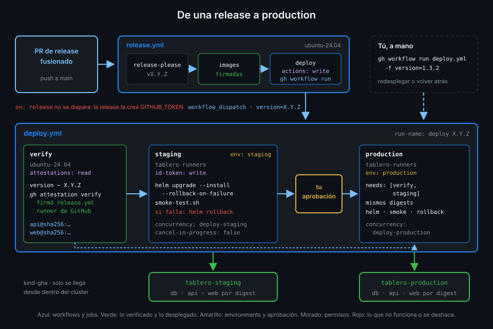

# Despliegue continuo y promoción

> Una release que nadie ejecuta es un archivo en un registro. El despliegue continuo la lleva
> sola a un entorno de prueba y, con tu permiso, al de verdad, sin reconstruir nada por el camino.



## 🎯 Objetivos

Al terminar este archivo eres capaz de:

- Distinguir entrega continua y despliegue continuo, y decir cuál monta `tablero`
- Explicar por qué se promueve el mismo digest de staging a production y no se reconstruye
- Usar los environments de GitHub como puertas entre etapas, con aprobación humana
- Saber qué es un deployment de GitHub, quién lo crea y dónde se consulta
- Encadenar `release.yml` y `deploy.yml` aunque `GITHUB_TOKEN` no dispare workflows
- Leer el historial de despliegues por el título de cada run

## 1. Qué problema resuelve

Desde la Semana 14, cada PR de release fusionado deja en GHCR dos imágenes versionadas,
firmadas y con su SBOM. Y ahí se quedan. Alguien tiene que acordarse de desplegarlas, elegir la
versión correcta, escribir los comandos en el orden correcto y no equivocarse de clúster.

Hacerlo a mano tiene tres problemas que no se arreglan con cuidado:

- **Se retrasa**: entre "está publicado" y "está corriendo" pasan días, y cada despliegue
  acumula más cambios y más riesgo.
- **No se repite igual**: el que despliega el viernes no escribe lo mismo que el del lunes.
- **No deja rastro**: dentro de un mes nadie sabe qué versión corría en production el día 3.

El `deploy-gate.yml` de la Semana 13 ensayó la forma del pipeline (staging, aprobación,
production) sin desplegar nada. Su cabecera lo prometía: en la Semana 17 pasa a desplegar de
verdad. Esta semana lo sustituye `deploy.yml`.

## 2. Cómo funciona

### Entrega continua y despliegue continuo

Las dos se abrevian CD y no son lo mismo:

| | Entrega continua | Despliegue continuo |
|---|---|---|
| Qué garantiza | Que cada cambio en `main` **podría** desplegarse | Que cada cambio que pasa las puertas **se despliega** |
| Último paso | Una persona decide desplegar | Una máquina despliega; las personas, si acaso, aprueban |
| En `tablero` | Hasta la Semana 16 | Desde esta semana |

`tablero` despliega solo hasta staging y pide aprobación para production. Algunos equipos lo
llaman entrega continua por esa aprobación; lo que importa es que la persona **no ejecuta nada**:
pulsa "Approve" sobre algo que ya está verificado y probado en staging.

### Promover, no reconstruir

Un pipeline de CD mueve un artefacto por una fila de entornos: staging, después production. La
regla de oro es que **production recibe exactamente lo mismo que se probó en staging**. Si cada
etapa construyera su imagen, el smoke test de staging probaría una imagen y production correría
otra.

Por eso `tablero` promueve un **digest**, no un tag ni una rama:

1. El job `verify` resuelve la versión a dos digests (`api` y `web`) con `gh attestation verify`.
2. `staging` despliega esos digests.
3. `production` despliega **los mismos digests**, leídos de `needs.verify.outputs`.

Nadie vuelve a preguntar a GHCR qué apunta ahora el tag `1.4.0`: entre staging y production
alguien podría haberlo movido. El archivo 07 explica de dónde sale el digest.

### Environments como puertas

Lo aprendido en la Semana 13 se aplica sin cambios. Cada job de despliegue entra en su
environment:

| Environment | Regla | Qué consigue |
|---|---|---|
| `staging` | Solo desde `main` | Una rama de prueba no despliega |
| `production` | Solo desde `main` y un revisor obligatorio | Nadie llega a production sin que tú lo apruebes |

Y el environment da algo más: el secreto `DATABASE_PASSWORD` de cada entorno solo lo ve el job
que entra en él. Esta semana añade una tercera función, que el archivo 04 desarrolla: el nombre
del environment viaja en el token OIDC del job y el clúster lo usa como **usuario**.

### Deployments de GitHub

Según la documentación de GitHub, un job con `environment:` crea un **deployment**: un registro
con el commit, el environment y una serie de estados (`in_progress`, `success`, `failure`...).
Es el rastro que faltaba. Aparece en la portada del repo, en la pestaña de environments y en la
API:

```bash
gh api 'repos/{owner}/{repo}/deployments?environment=production&per_page=5' \
  --jq '.[] | "\(.id) \(.created_at) \(.sha[0:7])"'
```

Cada deployment tiene sus estados en `deployments/<id>/statuses`; el último dice cómo terminó.
La comprobación `deploy-green-for-release` de esta semana lee justo eso.

### La cadena release → dispatch → deploy

El paso natural sería que `deploy.yml` escuchara `on: release`. No funciona: la release la crea
release-please con `GITHUB_TOKEN`, y los eventos que provoca `GITHUB_TOKEN` **no disparan
workflows**, para evitar bucles. Hay dos excepciones: `workflow_dispatch` y
`repository_dispatch`.

`tablero` usa la primera. `release.yml` gana un job al final que, cuando las imágenes ya están
publicadas y firmadas, lanza `deploy.yml` con la versión:

```yaml
  deploy:
    name: Lanzar el despliegue
    # Solo tras una release con sus dos imágenes publicadas y firmadas.
    needs: [release-please, images]
    runs-on: ubuntu-24.04
    timeout-minutes: 5
    permissions:
      # Lanzar un workflow por workflow_dispatch pide actions: write.
      actions: write
    steps:
      - name: Lanzar deploy.yml con la versión publicada
        env:
          GH_TOKEN: ${{ github.token }}
          VERSION: ${{ needs.release-please.outputs.version }}
        run: gh workflow run deploy.yml --repo "$GITHUB_REPOSITORY" --ref main -f version="$VERSION"
```

Tres detalles:

- `actions: write` es el permiso que pide la API de dispatch, y el único del job.
- `--ref main`: el run de `deploy.yml` corre sobre `main`. Esto importa en el archivo 04, porque
  el clúster solo acepta tokens de `refs/heads/main`.
- La versión llega por `env:`, nunca interpolada en `run:` (regla 4).

### Un solo disparador, tres usos

`deploy.yml` solo tiene `on: workflow_dispatch` con un input `version`. Esa decisión le da tres
usos con el mismo código:

| Quién lo lanza | Con qué versión | Para qué |
|---|---|---|
| `release.yml` | La recién publicada | Despliegue continuo |
| Tú, a mano | La misma que ya corre | Redesplegar (por ejemplo, tras recrear el clúster) |
| Tú, a mano | Una anterior | Rollback de negocio: "la 1.4.0 tiene un bug, vuelve a la 1.3.2" |

El rollback de negocio no es especial: es un despliegue más, verificado y aprobado como cualquier
otro. El rollback técnico, el que ocurre solo cuando un despliegue no arranca, lo hace Helm
(archivo 03).

_Verificado con gh 2.104.0, actionlint 1.7.12 y ubuntu-24.04, noviembre de 2026._

## 3. Cómo se usa

### La cabecera de `deploy.yml`

```yaml
name: deploy
# La versión en el título: en la lista de runs ves qué se desplegó sin abrir ninguno.
run-name: deploy ${{ inputs.version }}
on:
  workflow_dispatch:
    inputs:
      version:
        description: Versión de tablero (X.Y.Z, sin la v)
        required: true
        type: string
permissions: {}
```

`run-name` (Semana 07) convierte la lista de runs en el historial de despliegues:

```bash
gh run list --workflow deploy.yml --json displayTitle,conclusion \
  --jq '.[] | "\(.displayTitle) \(.conclusion)"'
# deploy 1.4.0 success
# deploy 1.3.2 success
```

### Lanzar un despliegue a mano

```bash
gh workflow run deploy.yml -f version=1.3.2
gh run watch "$(gh run list --workflow deploy.yml --limit 1 --json databaseId --jq '.[0].databaseId')"
```

El run se para en `production` con "Waiting" hasta que apruebes, como en la Semana 13.

### La forma completa del pipeline

| Job | Runner | Permisos | Qué hace |
|---|---|---|---|
| `verify` | `ubuntu-24.04` | `attestations: read` | Valida la versión y la resuelve a dos digests verificados |
| `staging` | `tablero-runners` | `contents: read`, `id-token: write` | Helm en `tablero-staging`, smoke test, rollback si falla |
| `production` | `tablero-runners` | `contents: read`, `id-token: write` | Lo mismo en `tablero-production`, tras `staging` y tu aprobación |

Por qué los dos últimos van en `tablero-runners`: el apiserver de kind no está expuesto fuera de
tu máquina (regla 12). Un runner de GitHub no llegaría; el pod de ARC, que vive dentro del
clúster, sí.

## 4. Antipatrones

| Antipatrón | Por qué duele | Qué hacer en su lugar |
|---|---|---|
| Construir la imagen dentro del job de despliegue | Production corre algo que nunca pasó por staging | Construir una vez en `release.yml` y promover el digest |
| Desplegar por tag (`tablero-api:1.4.0`) | El tag se puede mover entre staging y production | Desplegar el digest que devolvió `verify` |
| `on: release` en `deploy.yml` | La release de `GITHUB_TOKEN` no dispara nada: el workflow nunca corre | `gh workflow run` desde `release.yml` con `actions: write` |
| Un PAT para que la release dispare workflows | Una credencial de larga vida solo para encadenar dos workflows | `workflow_dispatch`, que `GITHUB_TOKEN` sí puede lanzar |
| Un workflow distinto para el rollback | Un camino que nunca se prueba hasta el día que hace falta | El mismo `deploy.yml` con una versión anterior |
| production sin `needs: staging` | Llega a production algo que no ha arrancado en ningún sitio | `needs: [verify, staging]` |

## 5. Trucos

- **Quién aprobó cada despliegue**: la pestaña del environment en la UI enseña cada deployment
  con su run; la aprobación queda en el propio run.
- **Lanzar y seguir en una línea**: `gh workflow run` no devuelve el id del run. El `gh run list
  --limit 1` de arriba lo recupera; si lanzas dos seguidos, filtra por `displayTitle`.
- **Qué commit está en production**: el campo `sha` del último deployment de production es el
  commit de `main` desde el que corrió `deploy.yml`, no el de la release. La versión está en
  el título del run.

## 📚 Recursos Adicionales

- [GitHub Docs: Deployments and environments](https://docs.github.com/en/actions/reference/workflows-and-actions/deployments-and-environments)
- [GitHub Docs: Triggering a workflow from a workflow](https://docs.github.com/en/actions/how-tos/write-workflows/choose-when-workflows-run/trigger-a-workflow#triggering-a-workflow-from-a-workflow)
- [GitHub Docs: REST API endpoints for deployments](https://docs.github.com/en/rest/deployments/deployments)
- [Martin Fowler: Continuous Delivery](https://martinfowler.com/bliki/ContinuousDelivery.html)

## ✅ Checklist de Verificación

- [ ] Sé distinguir entrega continua y despliegue continuo
- [ ] Sé por qué production recibe el digest de staging y no una imagen nueva
- [ ] Sé qué dos funciones cumple cada environment en `deploy.yml`
- [ ] Sé dónde consultar los deployments de GitHub y sus estados
- [ ] Sé por qué `deploy.yml` no escucha `on: release` y qué hace `release.yml` en su lugar
- [ ] Sé usar `deploy.yml` para redesplegar y para volver a una versión anterior
- [ ] Sé por qué los jobs de despliegue corren en `tablero-runners`

---

| ← Anterior | Siguiente → |
|:---|---:|
| [Semana 17 — Despliegue continuo a Kubernetes](../README.md) | [Kubernetes para desplegar una app](02-kubernetes-para-desplegar-una-app.md) |
