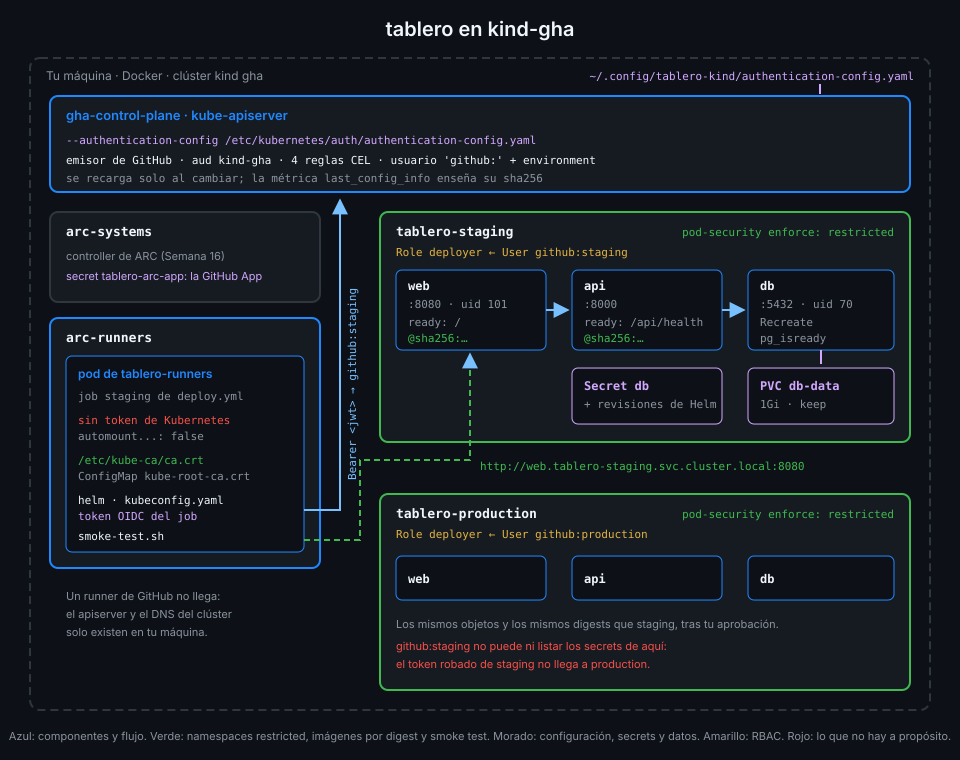

# Kubernetes para desplegar una app

> En la Semana 16 Kubernetes corría tus runners, que nacen y mueren con cada job. `tablero` es
> otra cosa: tiene que seguir vivo, cambiar de versión sin caerse y no perder sus datos.



## 🎯 Objetivos

Al terminar este archivo eres capaz de:

- Explicar qué hacen Deployment y ReplicaSet cuando cambias la imagen de una app
- Saber qué es un rollout y cuándo Kubernetes lo da por terminado
- Usar una readiness probe para que un pod no reciba tráfico antes de tiempo
- Conectar piezas por nombre con un Service y su DNS interno
- Guardar la contraseña en un Secret y los datos en un PersistentVolumeClaim
- Leer el chart de `tablero` y saber qué objeto sale de cada plantilla

## 1. Qué problema resuelve

El archivo 01 de la Semana 16 presentó los objetos que usa ARC: pods, namespaces, secrets,
service accounts. Para un runner basta, porque un runner es desechable: si su pod muere, el job
falla y ARC crea otro para el siguiente.

Una aplicación pide más:

- **Seguir viva**: si el contenedor de la API se cae a las tres de la mañana, alguien tiene que
  levantarlo.
- **Cambiar de versión sin cortar**: el pod nuevo no debería recibir peticiones hasta estar
  listo, ni el viejo morir antes.
- **Encontrarse**: la web tiene que llegar a la API y la API a PostgreSQL, aunque los pods cambien
  de IP en cada reinicio.
- **No perder datos**: las tareas de `tablero` sobreviven a un despliegue, a un rollback y a un
  reinicio de PostgreSQL.

Cada necesidad tiene su objeto. Este archivo cuenta lo justo de cada uno para entender el chart
de `tablero`; no es un curso de Kubernetes.

## 2. Cómo funciona

### Deployment y ReplicaSet

Un **Deployment** declara "quiero N pods con esta plantilla". No crea los pods directamente:
crea un **ReplicaSet**, que es quien mantiene N copias vivas de una plantilla concreta.

Cuando cambias algo de la plantilla (la imagen, una variable), el Deployment crea un ReplicaSet
**nuevo** y va pasando pods del viejo al nuevo. Eso es un **rollout**. El ReplicaSet viejo se
queda con cero pods, como registro de la versión anterior.

| Estrategia | Qué hace | En `tablero` |
|---|---|---|
| `RollingUpdate` (por defecto) | Arranca pods nuevos y retira los viejos a medida que los nuevos están listos | `api` y `web` |
| `Recreate` | Mata todos los viejos y después arranca los nuevos | `db` |

PostgreSQL usa `Recreate` porque dos PostgreSQL sobre el mismo volumen lo corrompen: el viejo
tiene que morir antes de que nazca el nuevo. A cambio, mientras cambia la base hay unos
segundos sin servicio.

### Readiness: cuándo un pod está listo

Un contenedor arrancado no es una app lista. La API de `tablero` corre las migraciones al
arrancar y, hasta que terminan, no responde. Una **readiness probe** le dice a Kubernetes cómo
comprobarlo:

| Pod | Probe | Listo cuando |
|---|---|---|
| `db` | `exec: pg_isready -U tablero -d tablero` | PostgreSQL acepta conexiones |
| `api` | `httpGet: /api/health` en el 8000 | La API responde tras migrar |
| `web` | `httpGet: /` en el 8080 | nginx sirve la página |

Mientras un pod no está Ready, **no recibe tráfico de su Service** y el rollout no avanza. Si
nunca llega a Ready, el rollout se queda a medias: el pod viejo sigue sirviendo y el nuevo
espera. Ese estado es el que Helm detecta en el archivo 03 para volver atrás.

En el laboratorio verás que el pod de la API **reinicia una o dos veces** al primer despliegue:
arranca antes de que PostgreSQL acepte conexiones, las migraciones fallan y el contenedor sale.
Kubernetes lo reinicia y, cuando la base está lista, arranca bien. Es normal; la readiness probe
evita que esos intentos reciban peticiones.

### Service y DNS

Los pods cambian de IP cada vez que se recrean. Un **Service** da un nombre y una IP estables a
"los pods con esta etiqueta", y reparte el tráfico entre los que estén Ready:

```yaml
apiVersion: v1
kind: Service
metadata:
  name: api
spec:
  selector:
    app: api
  ports:
    - port: 8000
```

Dentro del clúster, ese Service se resuelve por DNS:

| Nombre | Desde dónde vale |
|---|---|
| `api` | Desde cualquier pod del mismo namespace |
| `api.tablero-staging.svc.cluster.local` | Desde cualquier pod del clúster |

Por eso la API conecta con `db:5432` sin saber en qué namespace está, y por eso el smoke test de
`deploy.yml` llama a `http://web.tablero-staging.svc.cluster.local:8080`: el runner de ARC vive en
`arc-runners`, otro namespace, y necesita el nombre completo. Un runner de GitHub no podría
resolverlo: ese DNS solo existe dentro del clúster.

### Secret

La contraseña de PostgreSQL va en un **Secret** llamado `db`, que leen dos pods: `db` la usa como
`POSTGRES_PASSWORD` y `api` la mete en su `DATABASE_URL`:

```yaml
env:
  - name: DATABASE_PASSWORD
    valueFrom:
      secretKeyRef:
        name: db
        key: password
  # Kubernetes sustituye $(DATABASE_PASSWORD) por la variable de arriba.
  - name: DATABASE_URL
    value: postgresql://tablero:$(DATABASE_PASSWORD)@db:5432/tablero
```

Como en la Semana 16: un Secret no es un cofre, es base64. Lo que lo protege es quién puede
leerlo, y eso lo decide el RBAC del archivo 05.

### PersistentVolumeClaim

Un **PersistentVolumeClaim** (PVC) pide un volumen que sobrevive a los pods. `db-data` pide 1 GiB
y el pod de PostgreSQL lo monta en `/var/lib/postgresql/data`. Si el pod muere, el siguiente
monta el mismo volumen y encuentra los mismos datos.

Un detalle que muerde: PostgreSQL guarda en el volumen la contraseña con la que se **inicializó**.
Si cambias el Secret después, el pod nuevo arranca con la variable nueva, pero la base sigue
esperando la vieja. Por eso la práctica 02 genera la contraseña una vez y la guarda en el secreto
`DATABASE_PASSWORD` del environment antes del primer despliegue.

### Namespace

Cada environment de `tablero` vive en su **namespace**: `tablero-staging` y `tablero-production`.
Los dos tienen los mismos objetos con los mismos nombres (`db`, `api`, `web`) sin chocar, y cada
uno es la frontera donde se aplican el RBAC y Pod Security del archivo 05.

_Verificado con kind (nodo v1.37.0) y Helm v4.3.2, noviembre de 2026._

## 3. Cómo se usa

### El chart de `tablero`, objeto a objeto

| Plantilla | Objetos | Detalles que importan |
|---|---|---|
| `templates/db.yaml` | Secret `db`, PVC `db-data`, Deployment `db`, Service `db` | `Recreate`, uid/gid 70, `PGDATA` en un subdirectorio del volumen |
| `templates/api.yaml` | Deployment `api`, Service `api` | Solo acepta la imagen por digest; readiness en `/api/health` |
| `templates/web.yaml` | Deployment `web`, Service `web` | Solo acepta la imagen por digest; uid 101; readiness en `/` |

`PGDATA` apunta a `/var/lib/postgresql/data/pgdata` porque la raíz del volumen no es del usuario
70: PostgreSQL crea su carpeta dentro y es suya.

### Mirar un rollout

```bash
kubectl --context kind-gha -n tablero-staging get deploy,rs,pods
kubectl --context kind-gha -n tablero-staging rollout status deploy/api --timeout=2m
# deployment "api" successfully rolled out
```

`get rs` enseña un ReplicaSet por versión que ha pasado por el namespace; el actual es el que
tiene pods.

### Por qué un pod no arranca

| Lo que ves en `get pods` | Qué suele ser | Dónde mirar |
|---|---|---|
| `ImagePullBackOff` | La imagen o el digest no existen, o el paquete de GHCR es privado | `kubectl describe pod` |
| `CrashLoopBackOff` | El contenedor arranca y sale; en la API, la base no está lista | `kubectl logs --previous` |
| `CreateContainerConfigError` | Falta un Secret o el `securityContext` no se puede cumplir | `kubectl describe pod` |
| `Running` pero `0/1` en READY | La readiness probe no pasa | `kubectl describe pod` (eventos) |

## 4. Antipatrones

| Antipatrón | Por qué duele | Qué hacer en su lugar |
|---|---|---|
| Crear pods sueltos en vez de un Deployment | Si el pod muere, nadie lo levanta, y no hay rollout | Un Deployment, aunque sea de una réplica |
| Sin readiness probe | El Service manda tráfico a un pod que aún migra y el rollout se da por bueno antes de tiempo | Una probe que compruebe que la app responde |
| `RollingUpdate` para PostgreSQL con un volumen | Dos procesos sobre los mismos datos | `strategy: Recreate` |
| Conectar por IP de pod | Cambia en cada reinicio | El nombre del Service |
| Contraseña en `value:` del Deployment | Queda en la plantilla y en el historial de Helm en claro | Un Secret leído con `secretKeyRef` |
| Datos de la base en el sistema de archivos del contenedor | Se pierden en cada reinicio | Un PVC |

## 5. Trucos

- **Qué ha cambiado entre dos versiones**: `kubectl rollout history deploy/api` lista las
  revisiones del Deployment; Helm lleva las suyas aparte (archivo 03).
- **Ver los eventos en orden**: `kubectl get events -n tablero-staging --sort-by=.lastTimestamp`
  cuenta la historia de un rollout que se atasca mejor que `describe`.
- **Qué imagen corre de verdad**: `kubectl get deploy api -o jsonpath='{.spec.template.spec.containers[0].image}'`
  enseña el digest exacto; es lo que lee la comprobación `production-runs-latest-release`.

## 📚 Recursos Adicionales

- [Kubernetes: Deployments](https://kubernetes.io/docs/concepts/workloads/controllers/deployment/)
- [Kubernetes: Liveness, Readiness and Startup Probes](https://kubernetes.io/docs/concepts/configuration/liveness-readiness-startup-probes/)
- [Kubernetes: Service](https://kubernetes.io/docs/concepts/services-networking/service/)
- [Kubernetes: DNS for Services and Pods](https://kubernetes.io/docs/concepts/services-networking/dns-pod-service/)
- [Kubernetes: Persistent Volumes](https://kubernetes.io/docs/concepts/storage/persistent-volumes/)
- [Kubernetes: Secrets](https://kubernetes.io/docs/concepts/configuration/secret/)

## ✅ Checklist de Verificación

- [ ] Sé qué hace un Deployment con un ReplicaSet cuando cambio la imagen
- [ ] Sé por qué PostgreSQL usa `Recreate` y la API `RollingUpdate`
- [ ] Sé qué comprueba cada readiness probe de `tablero` y qué pasa si nunca pasa
- [ ] Sé por qué el smoke test usa el nombre DNS completo del Service
- [ ] Sé por qué cambiar la contraseña después del primer despliegue rompe la base
- [ ] Sé qué objetos crea cada plantilla del chart
- [ ] Sé diagnosticar un pod que no llega a Ready

---

| ← Anterior | Siguiente → |
|:---|---:|
| [Despliegue continuo y promoción](01-despliegue-continuo-y-promocion.md) | [Helm: releases y rollback](03-helm-releases-y-rollback.md) |
