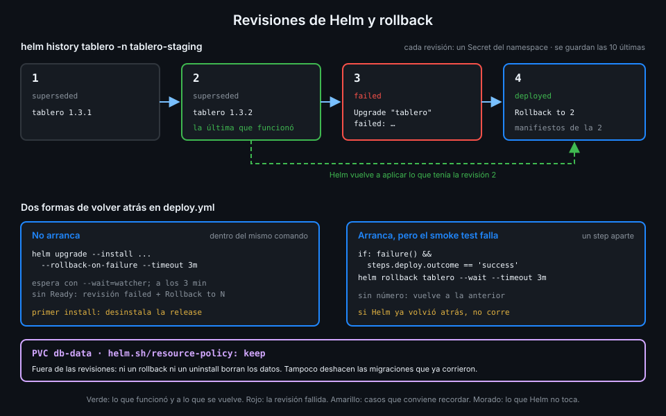

# Helm: releases y rollback

> En la Semana 16 usaste charts de otros para instalar ARC. Ahora `tablero` trae el suyo, y lo
> que importa de Helm ya no es instalar: es que cada despliegue deja una revisión a la que volver.



## 🎯 Objetivos

Al terminar este archivo eres capaz de:

- Leer un chart propio: `Chart.yaml`, `values.yaml` y plantillas con guardas
- Explicar qué es una revisión, dónde la guarda Helm y cuántas conserva
- Desplegar con `helm upgrade --install` y una descripción que diga qué versión es
- Elegir la estrategia de espera de Helm 4 y entender `--rollback-on-failure`
- Volver atrás a mano con `helm rollback` y saber qué no deshace
- Proteger los datos de un rollback o un `uninstall` con `helm.sh/resource-policy: keep`

## 1. Qué problema resuelve

`kubectl apply -f` aplica objetos y se olvida. Si el despliegue de la 1.4.0 no arranca, tienes
que saber qué había antes, encontrar esos YAML y aplicarlos de nuevo, con prisa. Y si la 1.4.0
borró un objeto que la 1.3.2 tenía, `apply` no lo vuelve a crear solo.

Helm guarda **cada despliegue como una revisión numerada** con sus values y sus manifiestos.
Volver atrás es pedir "la revisión 2", y Helm sabe exactamente qué tenía. Eso convierte un
rollback en un comando, que `deploy.yml` puede lanzar sin nadie delante.

## 2. Cómo funciona

### El chart de `tablero`

El chart vive en `app/deploy/k8s/` del bootcamp y se copia a `deploy/k8s/` de tu repo: la
aplicación trae cómo se despliega y el pipeline decide qué versión y dónde.

| Archivo | Qué lleva |
|---|---|
| `Chart.yaml` | Nombre `tablero`, versión del chart `1.0.0` |
| `values.yaml` | `images.api` e `images.web` vacíos, `images.postgres` por digest, `database.password` vacío |
| `templates/*.yaml` | `db.yaml`, `api.yaml` y `web.yaml` (archivo 02) |

Los valores vacíos son deliberados: el chart no despliega nada que `deploy.yml` no le pase. Y
las plantillas de la API y la web llevan una guarda que **falla al renderizar** si la imagen no
va por digest:

```yaml
{{- $image := required "images.api: deploy.yml la pasa por digest" .Values.images.api }}
{{- if not (regexMatch "@sha256:[0-9a-f]{64}$" $image) }}
{{- fail (printf "images.api tiene que ir por digest (...@sha256:...), no %s" $image) }}
{{- end }}
```

Con `ghcr.io/<tu-org>/tablero-api:1.4.0`, Helm se para antes de tocar el clúster. Es la regla 10
(despliegue por digest desde la S14) convertida en algo que no depende de que nadie se acuerde.

### Release y revisiones

Una **release** es una instalación con nombre de un chart en un namespace. `tablero` tiene dos
releases que se llaman igual, `tablero`, una en `tablero-staging` y otra en `tablero-production`:
el namespace las separa.

Cada `upgrade` o `rollback` crea una **revisión** nueva. Helm la guarda en un Secret del propio
namespace, con los values y los manifiestos de esa revisión. Por eso el Role de despliegue del
archivo 05 incluye `secrets`: sin poder leerlos, Helm no sabe ni qué hay instalado.

| Estado de una revisión | Significado |
|---|---|
| `deployed` | La que está aplicada ahora; solo hay una |
| `superseded` | Una anterior que funcionó |
| `failed` | Un intento que no llegó a terminar bien |

Helm 4 guarda por defecto las **10** últimas revisiones (`--history-max`). Las más antiguas se
borran: no puedes volver a una versión de hace once despliegues con `helm rollback`, pero sí con
`deploy.yml` y esa versión (archivo 01).

### `upgrade --install`

Como en la Semana 16: instala si no existe y actualiza si existe. `deploy.yml` lo usa siempre, así
el primer despliegue y el centésimo son el mismo comando.

### Esperar: las estrategias de Helm 4

Por defecto Helm aplica los objetos y termina, sin esperar a que los pods arranquen. Helm 4 cambió
`--wait` de booleano a estrategia:

| Valor | Qué espera |
|---|---|
| `hookOnly` (sin `--wait`) | Solo a los hooks del chart; no a los pods |
| `watcher` | A que los recursos estén listos, vigilando sus cambios |
| `legacy` | El comportamiento de espera de Helm 3 |

Sin esperar, `helm upgrade` termina en verde aunque la API vaya a quedarse en `CrashLoopBackOff`.

### `--rollback-on-failure`

En Helm 3 era `--atomic`; **en Helm 4 ese flag ya no existe**. Su sustituto, según
`helm upgrade --help`: "if set, Helm will rollback the upgrade to previous success release upon
failure. The --wait flag will be defaulted to "watcher"".

Con `--rollback-on-failure --timeout 3m`, si a los tres minutos los recursos no están listos,
Helm marca la revisión como `failed` y crea otra que vuelve a la última que funcionó:

```text
Error: UPGRADE FAILED: release tablero failed, and has been rolled back due to rollback-on-failure being set: resource Deployment/tablero-staging/api not ready. status: InProgress, message: ...
```

```bash
helm history tablero -n tablero-staging
# REVISION  STATUS      DESCRIPTION        (otras columnas recortadas)
# 2         superseded  tablero 1.3.2
# 3         failed      Upgrade "tablero" failed: ...
# 4         deployed    Rollback to 2
```

Un caso especial: en el **primer** `install` no hay revisión anterior, así que
`--rollback-on-failure` desinstala la release:
`Error: release tablero failed, and has been uninstalled due to rollback-on-failure being set: ...`.

### `helm rollback`: el rollback a mano

`--rollback-on-failure` cubre "no arranca". No cubre "arranca, pero está roto": los pods llegan a
Ready y el smoke test falla. Para eso, `deploy.yml` tiene un step que solo corre si algo falló
después de un despliegue que sí terminó:

```yaml
      - name: Volver a la revisión anterior si el smoke test falla
        if: failure() && steps.deploy.outcome == 'success'
        run: helm rollback tablero --namespace "$NAMESPACE" --wait --timeout 3m
```

Sin número de revisión, `helm rollback` vuelve a la anterior. La condición importa: si falló
el propio `helm upgrade`, Helm ya volvió atrás y otro rollback desharía ese.

### Lo que un rollback no deshace

Helm devuelve los **objetos** a la revisión anterior. No toca lo que tus pods hicieron mientras
corrían:

- **Migraciones de base de datos**: si la 1.4.0 añadió una columna, sigue ahí con la 1.3.2. Por
  eso las migraciones de una app que se despliega así tienen que ser compatibles hacia atrás
  durante al menos una versión.
- **Datos escritos**: las tareas creadas con la 1.4.0 siguen en la base.

### `helm.sh/resource-policy: keep`

El PVC `db-data` lleva una anotación:

```yaml
metadata:
  name: db-data
  annotations:
    # Un rollback o un uninstall no borran los datos.
    helm.sh/resource-policy: keep
```

Con ella Helm no borra ese objeto aunque una revisión ya no lo incluya ni aunque desinstales la
release. Los datos sobreviven; el precio es que, si de verdad quieres borrarlos, lo haces tú con
`kubectl delete pvc`.

_Verificado con Helm v4.3.2 y kind (nodo v1.37.0), noviembre de 2026._

## 3. Cómo se usa

### El despliegue de `deploy.yml`

```yaml
      - name: Desplegar por digest
        id: deploy
        env:
          API_IMAGE: ${{ needs.verify.outputs.api }}
          WEB_IMAGE: ${{ needs.verify.outputs.web }}
          DATABASE_PASSWORD: ${{ secrets.DATABASE_PASSWORD }}
          VERSION: ${{ inputs.version }}
        # Si los pods no llegan a Ready, Helm vuelve solo a la revisión anterior.
        run: |
          helm upgrade --install tablero deploy/k8s --namespace "$NAMESPACE" \
            --rollback-on-failure --timeout 3m --description "tablero $VERSION" \
            --set-string images.api="$API_IMAGE" --set-string images.web="$WEB_IMAGE" \
            --set-string database.password="$DATABASE_PASSWORD"
```

| Opción | Para qué |
|---|---|
| `--namespace "$NAMESPACE"` | `tablero-staging` o `tablero-production`; el namespace ya existe (archivo 05) |
| `--timeout 3m` | Cuánto espera a que todo esté listo antes de darlo por fallido |
| `--description "tablero $VERSION"` | La versión de `tablero` aparece en `helm history` |
| `--set-string` | Las imágenes y la contraseña como texto, sin que Helm intente interpretarlas |

La contraseña llega por `env:` desde el secreto del environment, nunca escrita en el YAML. Helm
la guarda dentro de la revisión, en un Secret del namespace: otra razón para que solo
`github:<env>` pueda leer secrets ahí.

### Consultar y volver atrás a mano

```bash
helm history tablero -n tablero-staging --max 5
helm get values tablero -n tablero-staging      # values de la revisión actual
helm rollback tablero 2 -n tablero-staging --wait --timeout 3m
```

## 4. Antipatrones

| Antipatrón | Por qué duele | Qué hacer en su lugar |
|---|---|---|
| `--atomic` en Helm 4 | El flag ya no existe: el comando falla | `--rollback-on-failure` |
| `helm upgrade` sin esperar | Termina en verde con la API en `CrashLoopBackOff` | `--rollback-on-failure`, que espera con `watcher` |
| Rollback en `if: failure()` sin mirar el step de Helm | Deshace el rollback que Helm ya hizo | `failure() && steps.deploy.outcome == 'success'` |
| Valores por defecto para las imágenes en `values.yaml` | Un despliegue sin imágenes instala algo que nadie eligió | Valores vacíos con `required` |
| PVC sin `resource-policy: keep` | Un `uninstall` borra los datos | La anotación en el PVC |
| Migraciones que rompen la versión anterior | El rollback vuelve a un código que ya no entiende la base | Migraciones compatibles hacia atrás |

## 5. Trucos

- **El historial como registro de despliegues**: con `--description "tablero $VERSION"`,
  `helm history` enseña versión, fecha y si fue un rollback, sin abrir GitHub.
- **Lo que se aplicaría, sin aplicarlo**: `helm template t deploy/k8s --set-string ...` renderiza
  el chart en local; es como la comprobación `chart-digest-only` prueba la guarda.
- **Qué cambió entre dos revisiones**: `diff <(helm get manifest tablero -n tablero-staging --revision 2) <(helm get manifest tablero -n tablero-staging --revision 3)`.

## 📚 Recursos Adicionales

- [Helm: helm upgrade](https://helm.sh/docs/helm/helm_upgrade/)
- [Helm: helm rollback](https://helm.sh/docs/helm/helm_rollback/)
- [Helm: Chart Template Guide](https://helm.sh/docs/chart_template_guide/)
- [Helm: Tips and tricks (resource policy)](https://helm.sh/docs/howto/charts_tips_and_tricks/)

## ✅ Checklist de Verificación

- [ ] Sé por qué el chart deja vacías las imágenes y falla si no van por digest
- [ ] Sé qué es una revisión, dónde la guarda Helm y cuántas conserva
- [ ] Sé por qué Helm necesita leer secrets en el namespace
- [ ] Sé qué hace `--rollback-on-failure` y qué pasa en el primer install
- [ ] Sé por qué el step de rollback mira `steps.deploy.outcome`
- [ ] Sé qué no deshace un rollback
- [ ] Sé qué protege `helm.sh/resource-policy: keep`

---

| ← Anterior | Siguiente → |
|:---|---:|
| [Kubernetes para desplegar una app](02-kubernetes-para-desplegar-una-app.md) | [El apiserver verifica el token OIDC](04-el-apiserver-verifica-el-token-oidc.md) |
