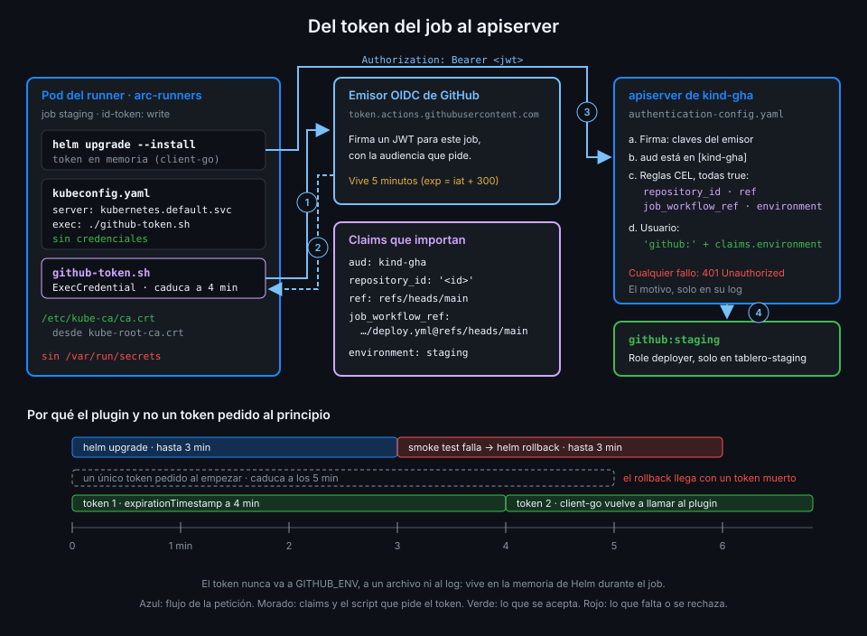

# El apiserver verifica el token OIDC

> En la Semana 13 la nube decidía si el token de tu job valía algo. Esta semana ese papel lo hace
> tu clúster: el apiserver de kind comprueba el token y lo convierte en un usuario de Kubernetes.



## 🎯 Objetivos

Al terminar este archivo eres capaz de:

- Explicar por qué no hace falta ningún secreto de Kubernetes en GitHub para desplegar
- Escribir una `AuthenticationConfiguration` que confía en el emisor de GitHub
- Restringir los tokens aceptados con reglas CEL sobre sus claims
- Convertir el environment del job en el usuario de Kubernetes con `claimMappings`
- Cambiar la configuración sin reiniciar el apiserver y comprobar cuál tiene cargada
- Comparar esta configuración con las políticas de confianza de una nube

## 1. Qué problema resuelve

Helm necesita una credencial para hablar con el apiserver. La salida rápida es la de siempre:
sacar un kubeconfig de administrador o un token de ServiceAccount, guardarlo en un secreto de
GitHub y pasarlo al job. Es exactamente el patrón que la Semana 13 retiró para las nubes:

- La credencial **no caduca**: si se filtra hoy, vale el año que viene.
- **No sabe quién la usa**: cualquier workflow con acceso al secreto despliega, desde cualquier
  rama.
- **Hay que rotarla** a mano, y nadie lo hace.

La Semana 13 cambió las credenciales guardadas por el token OIDC del job, y dejó una pregunta en
su rúbrica: dónde vive la verificación. La respuesta era "en el consumidor". Esta semana el
consumidor eres tú: el apiserver de `kind-gha` verifica el token de GitHub como lo haría AWS, y
**no hay ningún secreto de Kubernetes en GitHub ni en el pod del runner**.

## 2. Cómo funciona

### Structured authentication configuration

Kubernetes puede aceptar como credencial un JWT de un emisor OIDC externo. La forma moderna de
configurarlo es un archivo `AuthenticationConfiguration` (`apiserver.config.k8s.io/v1`) que el
apiserver lee al arrancar con el flag `--authentication-config` y **recarga solo** cuando cambia.

El laboratorio ya lo trae preparado. `lab/kind-config.yaml` monta una carpeta de tu máquina en el
control plane y le pasa el flag al apiserver:

```yaml
    extraMounts:
      - hostPath: __AUTH_DIR__
        containerPath: /etc/kubernetes/auth
        readOnly: true
    kubeadmConfigPatches:
      - |
        kind: ClusterConfiguration
        apiServer:
          extraArgs:
            authentication-config: /etc/kubernetes/auth/authentication-config.yaml
```

`lab-up.sh` cambia `__AUTH_DIR__` por `~/.config/tablero-kind` y, si allí no hay configuración,
copia una que **rechaza todos los tokens** (su única regla es `"false"`). Un clúster creado antes
de esta semana no tiene la carpeta montada: `lab-up.sh` lo detecta y te pide recrearlo.

### Qué comprueba el apiserver

Para cada petición con un `Authorization: Bearer <jwt>`, el apiserver:

1. Lee el emisor (`iss`) y busca una entrada de `jwt` con esa `issuer.url`.
2. Descarga las claves públicas del emisor por HTTPS y comprueba la **firma** y la caducidad.
3. Comprueba que la **audiencia** (`aud`) está en `issuer.audiences`.
4. Evalúa cada **`claimValidationRules`**: todas tienen que dar `true`.
5. Calcula el **usuario** con `claimMappings`.

Si algo falla, la respuesta es un 401 sin más detalle:

```json
{"kind":"Status",...,"message":"Unauthorized","code":401}
```

El detalle (qué regla no se cumplió) queda en el log del apiserver, nunca en la respuesta: quien
prueba tokens no aprende qué le falta.

### La configuración de `tablero`

```yaml
apiVersion: apiserver.config.k8s.io/v1
kind: AuthenticationConfiguration
jwt:
  - issuer:
      url: https://token.actions.githubusercontent.com
      # deploy.yml pide el token con esta audiencia: un token para otro destino no sirve aquí.
      audiences: [kind-gha]
    claimValidationRules:
      # El id no cambia si alguien renombra el repo o crea otro con el mismo nombre.
      - expression: "claims.repository_id == '<id-de-tablero>'"
        message: el token no es de tablero
      - expression: "claims.ref == 'refs/heads/main'"
        message: solo se despliega desde main
      - expression: "claims.job_workflow_ref == '<tu-org>/tablero/.github/workflows/deploy.yml@refs/heads/main'"
        message: solo deploy.yml despliega
      - expression: "has(claims.environment) && claims.environment in ['staging', 'production']"
        message: solo los environments staging y production
    claimMappings:
      username:
        expression: "'github:' + claims.environment"
```

### Las reglas, una a una

Las expresiones son **CEL** (Common Expression Language): un lenguaje pequeño, sin bucles ni
efectos, que Kubernetes usa para reglas declarativas. `claims` es el payload del JWT.

| Regla | Qué rechaza |
|---|---|
| `repository_id == '<id-de-tablero>'` | Tokens de cualquier otro repo, incluido uno que se llame igual tras borrar el tuyo |
| `ref == 'refs/heads/main'` | Un workflow lanzado desde otra rama |
| `job_workflow_ref == '.../deploy.yml@refs/heads/main'` | Cualquier otro workflow de `tablero`, aunque corra en `main` |
| `has(claims.environment) && environment in [...]` | Un job sin environment, o con uno que no sea staging o production |

Tres detalles:

- `repository_id` es un número, pero en el token de GitHub va **como texto**: por eso se compara
  con `'123...'` entre comillas. Lo sacas con `gh api repos/{owner}/{repo} --jq .id`.
- `has(...)` antes de leer `environment`: si el claim no existe, leerlo es un error de evaluación
  y la regla falla igualmente, pero con `has` el motivo queda claro.
- La regla del environment es la que hace valer la aprobación de la Semana 13: solo un job que
  ha pasado las puertas de su environment lleva ese claim.

### El environment como usuario

`claimMappings.username` dice qué nombre de usuario tiene en Kubernetes quien presenta el token.
`tablero` usa `'github:' + claims.environment`: el job de staging es el usuario
`github:staging` y el de production, `github:production`. El archivo 05 da permisos a esos dos
usuarios, cada uno en su namespace. La configuración inicial del laboratorio mapeaba
`'github:' + claims.sub`; para `tablero`, el environment es más útil porque es justo la frontera
de permisos.

### Recarga en caliente

El apiserver vigila el archivo. Al cambiarlo, en 10 a 60 segundos aparece en su log
`"reloaded authentication config"` y se actualizan dos métricas:

```text
apiserver_authentication_config_controller_automatic_reloads_total{status="success"} ...
apiserver_authentication_config_controller_last_config_info{...,hash="sha256:<sha256 del archivo>"} 1
```

El `hash` es el `sha256sum` del archivo cargado: la forma de saber, sin entrar en el nodo, que el
apiserver tiene **exactamente** tu versión.

Una trampa: si escribes el archivo en sitio (`>` o un heredoc), el apiserver puede leerlo vacío a
mitad de escritura y registrar `"failed to load authentication config" err="empty config data"`.
Se recupera en el siguiente intento, pero lo correcto es escribir al lado y renombrar, que es
atómico:

```bash
cp ops/cluster/authentication-config.yaml ~/.config/tablero-kind/.tmp
mv ~/.config/tablero-kind/.tmp ~/.config/tablero-kind/authentication-config.yaml
```

_Verificado con kind (nodo v1.37.0), noviembre de 2026: arranque, 401 con un token falso, recarga
y métrica con hash. No verificado sin una org real: un token de GitHub aceptado de punta a punta._

## 3. Cómo se usa

### Comprobar que el apiserver tiene tu archivo

```bash
sha256sum ops/cluster/authentication-config.yaml
kubectl --context kind-gha get --raw /metrics \
  | grep authentication_config_controller_last_config_info
```

Los dos hashes tienen que coincidir. Es lo que mira la comprobación `apiserver-oidc-config-loaded`.

### Comparado con una nube (Semana 13)

| Pieza | AWS (Semana 13) | `kind-gha` (esta semana) |
|---|---|---|
| Confianza en el emisor | Proveedor OIDC de IAM | `jwt[].issuer.url` |
| Audiencia | `sts.amazonaws.com` | `kind-gha` |
| Condiciones sobre claims | `Condition` de la trust policy sobre `sub` | `claimValidationRules` en CEL, sobre cualquier claim |
| Identidad resultante | El rol asumido | El usuario `github:<environment>` |
| Permisos | Políticas del rol | RBAC (archivo 05) |

La diferencia práctica: muchas trust policies solo comparan bien el `sub`, y por eso la Semana 13
personalizaba qué claims entraban en él. CEL lee cualquier claim por separado, así que aquí no
hace falta tocar el `sub`.

## 4. Antipatrones

| Antipatrón | Por qué duele | Qué hacer en su lugar |
|---|---|---|
| Kubeconfig de admin en un secreto de GitHub | Credencial eterna, sin rama ni workflow, que lo puede todo | OIDC verificado por el apiserver |
| Confiar en el emisor sin `claimValidationRules` | Cualquier repo de GitHub consigue un token con esa audiencia | Reglas sobre `repository_id`, `ref`, `job_workflow_ref` y `environment` |
| Comparar `repository` (nombre) en vez de `repository_id` | Si borras o renombras el repo, otro puede ocupar el nombre | El id, que no se reutiliza |
| Audiencia genérica o la de otro servicio | Un token pedido para otro consumidor sirve aquí | Una audiencia propia: `kind-gha` |
| Editar el archivo en sitio con `>` | El apiserver puede leerlo vacío | `cp` a un temporal y `mv` |
| Usuario fijo para todos los tokens | Staging y production tienen los mismos permisos | Usuario derivado del environment |

## 5. Trucos

- **El id de tu repo sin abrir la web**: con `GH_REPO` exportada como en `check-week.sh`,
  `gh api repos/{owner}/{repo} --jq .id` imprime el número que va en la primera regla.
- **Qué claims trae de verdad un token**: el archivo 05 de la
  [Semana 13](../../week-13-secretos_entornos_y_oidc/1-teoria/05-el-token-oidc-y-sus-claims.md)
  enseña a leer el payload sin imprimir el token. Antes de escribir una regla, mira el claim.
- **Si el hash no cambia**: tras copiar, espera un minuto. Si sigue igual, o copiaste el mismo
  archivo o el apiserver no pudo cargarlo; el log del apiserver dice cuál de las dos.

## 📚 Recursos Adicionales

- [Kubernetes: Authenticating, structured authentication configuration](https://kubernetes.io/docs/reference/access-authn-authz/authentication/#using-authentication-configuration)
- [Kubernetes: Common Expression Language in Kubernetes](https://kubernetes.io/docs/reference/using-api/cel/)
- [GitHub Docs: OpenID Connect reference](https://docs.github.com/en/actions/reference/security/oidc)
- [GitHub Docs: About security hardening with OpenID Connect](https://docs.github.com/en/actions/concepts/security/openid-connect)

## ✅ Checklist de Verificación

- [ ] Sé por qué el despliegue no necesita ningún secreto de Kubernetes en GitHub
- [ ] Sé qué comprueba el apiserver de un token y en qué orden
- [ ] Sé qué rechaza cada una de las cuatro reglas CEL de `tablero`
- [ ] Sé por qué `repository_id` va entre comillas
- [ ] Sé qué usuario de Kubernetes sale de cada job y por qué el environment
- [ ] Sé sustituir el archivo sin que el apiserver lo lea a medias
- [ ] Sé comprobar con la métrica qué configuración tiene cargada el apiserver

---

| ← Anterior | Siguiente → |
|:---|---:|
| [Helm: releases y rollback](03-helm-releases-y-rollback.md) | [RBAC y Pod Security por environment](05-rbac-y-pod-security-por-environment.md) |
