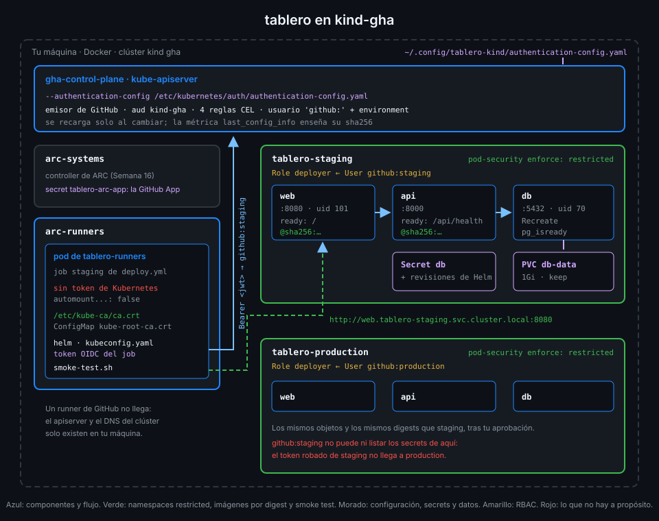

# RBAC y Pod Security por environment

> El apiserver ya sabe quién llama: `github:staging` o `github:production`. Falta decir qué puede
> hacer cada uno y qué clase de pods acepta cada namespace, aunque quien despliega se equivoque.



## 🎯 Objetivos

Al terminar este archivo eres capaz de:

- Dar a cada environment un Role limitado a su namespace con un RoleBinding a su usuario
- Elegir los recursos y verbos mínimos que necesita Helm para desplegar el chart
- Razonar qué podría hacer alguien con el token robado de un job de staging
- Comprobar permisos con `kubectl auth can-i` sin tener el token
- Explicar qué exige el nivel `restricted` de Pod Security y por qué lo cumple `tablero`
- Leer los dos errores típicos: falta de RBAC y pod rechazado

## 1. Qué problema resuelve

El archivo 04 convierte el token del job en un usuario. Un usuario sin permisos no puede hacer
nada, y está bien: Kubernetes niega todo lo que no está concedido. La tentación ahora es darle
`cluster-admin` "para que funcione". Eso tira por la borda lo ganado:

- El job de staging podría desplegar en production saltándose la aprobación.
- Un token robado del job podría leer los secrets de ARC (la clave de la GitHub App de la Semana
  16) o crear un pod privilegiado que escape al nodo.

Dos mecanismos lo impiden, y son independientes:

| Mecanismo | Pregunta que responde | Dónde se declara |
|---|---|---|
| **RBAC** | ¿Puede este usuario hacer esto en este namespace? | Role y RoleBinding |
| **Pod Security Admission** | ¿Se permite un pod con esta configuración en este namespace? | Una etiqueta en el Namespace |

RBAC limita a **quién despliega**; Pod Security limita **qué se despliega**. Si un día RBAC se
abre de más, Pod Security sigue rechazando un pod root.

## 2. Cómo funciona

### Role y RoleBinding

Un **Role** es una lista de permisos dentro de **un** namespace: grupos de API, recursos y verbos.
Un **RoleBinding** se lo asigna a un sujeto. No hay ClusterRole ni ClusterRoleBinding: nada que
valga para todo el clúster.

`ops/cluster/access.yaml` repite el mismo bloque para cada environment. El de staging:

```yaml
apiVersion: v1
kind: Namespace
metadata:
  name: tablero-staging
  labels:
    # Kubernetes rechaza cualquier pod con root, escalada, capacidades o sin seccomp.
    pod-security.kubernetes.io/enforce: restricted
---
apiVersion: rbac.authorization.k8s.io/v1
kind: Role
metadata:
  name: deployer
  namespace: tablero-staging
rules:
  # Lo que crea el chart, más los secrets donde Helm guarda cada revisión.
  - apiGroups: [""]
    resources: [secrets, services, persistentvolumeclaims]
    verbs: [get, list, watch, create, update, patch, delete]
  - apiGroups: [apps]
    resources: [deployments]
    verbs: [get, list, watch, create, update, patch, delete]
  # Solo lectura: para esperar el rollout y entender por qué falla.
  - apiGroups: [""]
    resources: [pods, events]
    verbs: [get, list, watch]
  - apiGroups: [apps]
    resources: [replicasets]
    verbs: [get, list, watch]
---
apiVersion: rbac.authorization.k8s.io/v1
kind: RoleBinding
metadata:
  name: deployer
  namespace: tablero-staging
subjects:
  - kind: User
    name: github:staging
    apiGroup: rbac.authorization.k8s.io
roleRef:
  kind: Role
  name: deployer
  apiGroup: rbac.authorization.k8s.io
```

### Por qué esos permisos y no otros

| Recurso | Verbos | Para qué |
|---|---|---|
| `secrets` | todos | El Secret `db` del chart y los Secrets donde Helm guarda las revisiones |
| `services`, `persistentvolumeclaims` | todos | Los objetos del chart |
| `deployments` | todos | Los tres Deployments |
| `pods`, `events`, `replicasets` | solo lectura | Que Helm espere el rollout y tú veas por qué falla |

No hay `pods/exec`, ni `create pods` directo, ni `namespaces`, ni comodines (`*`). Los pods los
crean los ReplicaSets en nombre del Deployment, no el usuario: por eso el usuario solo los lee.
La comprobación `rbac-per-environment` falla si aparece un `*` o algo de clúster.

### Un usuario de Kubernetes no existe en ningún sitio

`github:staging` no es un objeto: no hay que crearlo. Existe mientras alguien presente un token
que el apiserver mapee a ese nombre. El RoleBinding apunta a un nombre de texto, y el archivo 04
garantiza que solo los jobs de `deploy.yml` en el environment `staging` lo consiguen.

### Qué hace un token robado

Supón que alguien saca el token del job de staging (un step comprometido, un log mal enmascarado).
Con él puede:

| Puede | No puede |
|---|---|
| Leer el Secret `db` de `tablero-staging` | Tocar nada de `tablero-production` |
| Cambiar los Deployments de staging por otra imagen | Crear un pod root: Pod Security lo rechaza |
| Borrar el PVC de staging | Leer los secrets de `arc-systems` o `arc-runners` |
| Todo eso durante unos 5 minutos, lo que vive el token | Pedir un token nuevo: eso solo lo hace el job |

Staging es el environment sin aprobación, el más expuesto. Que su token no llegue a production es
justo lo que hace que la aprobación de production signifique algo.

### Pod Security Admission y `restricted`

Kubernetes trae un controlador de admisión que aplica los **Pod Security Standards** según una
etiqueta del namespace. `tablero` usa el nivel más estricto, `restricted`, en modo `enforce`:
un pod que no lo cumple **no se crea**.

Lo que exige, leído del propio error al crear un pod root:

```text
Error from server (Forbidden): pods "root" is forbidden: violates PodSecurity "restricted:latest": allowPrivilegeEscalation != false (container "root" must set securityContext.allowPrivilegeEscalation=false), unrestricted capabilities (...), runAsNonRoot != true (...), seccompProfile (...)
```

| Requisito | Cómo lo cumple el chart de `tablero` |
|---|---|
| `allowPrivilegeEscalation: false` | En cada contenedor |
| Capacidades: `drop: [ALL]` | En cada contenedor |
| `runAsNonRoot: true` | En el pod; con uid numérico (70, 101) donde la imagen usa un nombre |
| `seccompProfile: RuntimeDefault` | En el pod |

El chart añade dos cosas que `restricted` no pide y la comprobación `chart-pods-restricted` sí:
`automountServiceAccountToken: false` (ningún pod de `tablero` habla con la API) y `limits` de
CPU y memoria.

### El uid numérico

`runAsNonRoot: true` obliga a Kubernetes a comprobar que el proceso no es root. Si la imagen
declara el usuario por **nombre** (`USER nginx`), no puede comprobarlo sin abrirla, y se niega:

```text
container has runAsNonRoot and image has non-numeric user (nginx), cannot verify user is non-root
```

El pod queda en `CreateContainerConfigError`. Por eso `web.yaml` fija `runAsUser: 101`, el uid
del usuario `nginx`, y `db.yaml` fija `70`, el de `postgres` en la imagen alpine. Es el mismo
problema que la Semana 16 resolvió con el uid 1001 del runner.

_Verificado con kind (nodo v1.37.0) y Helm v4.3.1, noviembre de 2026._

## 3. Cómo se usa

### Aplicar y comprobar como administrador

`access.yaml` lo aplicas tú con el contexto de administrador del laboratorio, no `deploy.yml`:

```bash
kubectl --context kind-gha apply -f ops/cluster/access.yaml
kubectl --context kind-gha auth can-i create deployments -n tablero-staging --as github:staging
# yes
kubectl --context kind-gha auth can-i create deployments -n tablero-production --as github:staging
# no
```

`--as` es **impersonación**: el administrador pregunta "¿y si fuera este usuario?" sin tener su
token. Helm acepta lo mismo con `--kube-as-user github:staging`; la práctica 02 instala el chart
así para comprobar que el Role basta antes de que exista `deploy.yml`.

### Los dos errores que vas a ver

Falta un permiso (aquí, staging intentando leer production):

```text
Error: query: failed to query with labels: secrets is forbidden: User "github:staging" cannot list resource "secrets" in API group "" in the namespace "tablero-production"
```

El usuario, el verbo, el recurso, el grupo y el namespace: todo lo que necesitas para decidir si
falta una regla o si el job apunta al namespace equivocado.

Credencial no aceptada (el token no pasó el archivo 04):

```text
Error: kubernetes cluster unreachable: the server has asked for the client to provide credentials
```

Pese a decir "unreachable", el clúster respondió: rechazó la identidad.

## 4. Antipatrones

| Antipatrón | Por qué duele | Qué hacer en su lugar |
|---|---|---|
| `cluster-admin` para el usuario de despliegue | Staging despliega en production y lee los secrets de ARC | Un Role por namespace |
| Un solo usuario para los dos environments | La aprobación de production no protege nada | Usuario por environment y RoleBinding en su namespace |
| Comodines en `resources` o `verbs` | Incluyen lo que aún no existe, como `pods/exec` | Lista explícita |
| `create pods` o `pods/exec` al deployer | Puede correr lo que quiera saltándose el chart | Solo lectura de pods |
| Namespace sin etiqueta de Pod Security | Un despliegue con un pod root pasa | `enforce: restricted` |
| `runAsNonRoot` sin uid con imágenes que usan nombre | El pod no arranca | `runAsUser` numérico |

## 5. Trucos

- **Todo lo que puede un usuario**: `kubectl --context kind-gha auth can-i --list -n tablero-staging --as github:staging`.
  En `tablero-production` la lista se queda sin nada del chart.
- **Probar un namespace antes de etiquetarlo**: la etiqueta `pod-security.kubernetes.io/warn`
  avisa sin rechazar; útil para ver qué rompería `restricted` en un namespace que ya tiene pods.
- **Quién eres para el apiserver**: con `--as`, cualquier `kubectl get` responde como ese
  usuario; es la forma más rápida de reproducir el error de un job.

## 📚 Recursos Adicionales

- [Kubernetes: Using RBAC Authorization](https://kubernetes.io/docs/reference/access-authn-authz/rbac/)
- [Kubernetes: Pod Security Standards](https://kubernetes.io/docs/concepts/security/pod-security-standards/)
- [Kubernetes: Pod Security Admission](https://kubernetes.io/docs/concepts/security/pod-security-admission/)
- [Kubernetes: Configure a Security Context](https://kubernetes.io/docs/tasks/configure-pod-container/security-context/)

## ✅ Checklist de Verificación

- [ ] Sé qué decide RBAC y qué decide Pod Security, y por qué hacen falta los dos
- [ ] Sé qué permisos tiene el Role `deployer` y por qué cada uno
- [ ] Sé por qué `github:staging` no es un objeto que haya que crear
- [ ] Sé qué podría hacer un token robado de staging y qué no
- [ ] Sé comprobar permisos con `auth can-i --as` y `--kube-as-user`
- [ ] Sé qué exige `restricted` y por qué el chart fija uid numéricos
- [ ] Sé distinguir un error de RBAC de uno de autenticación

---

| ← Anterior | Siguiente → |
|:---|---:|
| [El apiserver verifica el token OIDC](04-el-apiserver-verifica-el-token-oidc.md) | [Credenciales de corta vida en el runner](06-credenciales-de-corta-vida-en-el-runner.md) |
