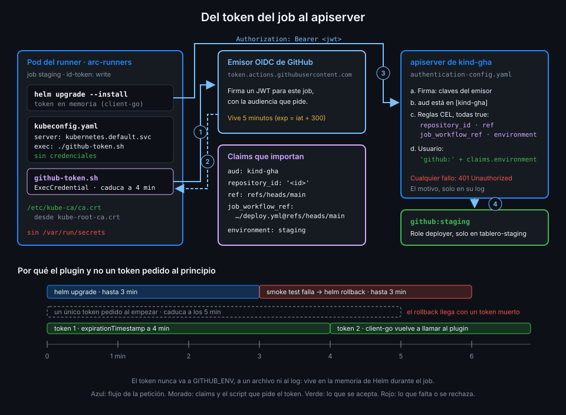

# Credenciales de corta vida en el runner

> El apiserver acepta el token del job. Ahora hay que dárselo a Helm sin escribirlo en ningún
> sitio, y conseguir que siga valiendo aunque el despliegue dure más que el propio token.



## 🎯 Objetivos

Al terminar este archivo eres capaz de:

- Escribir un kubeconfig que no contiene ninguna credencial y puede ir en el repo
- Explicar cómo un plugin `exec` entrega a Helm un token que pide en el momento
- Calcular por qué un token de 5 minutos no basta para un despliegue con rollback
- Dar al pod del runner el CA del clúster sin darle identidad
- Justificar por qué el token no va a `GITHUB_ENV` ni a un archivo
- Reconocer este patrón en `aws eks get-token` y `gke-gcloud-auth-plugin`

## 1. Qué problema resuelve

Helm lee un **kubeconfig**: a qué servidor hablar, cómo comprobar su certificado y con qué
credencial presentarse. El kubeconfig que kind te dejó en `~/.kube/config` lleva un certificado
de cliente de administrador: no sirve para un job.

La forma ingenua con OIDC sería un step que pide el token, lo escribe en el kubeconfig o en
`GITHUB_ENV` y deja que Helm lo use. Falla de dos maneras:

- **Caduca a mitad**. El token OIDC de GitHub vive 5 minutos: el ejemplo de la documentación
  tiene `iat` 1632493567 y `exp` 1632493867, 300 segundos. `deploy.yml` da a Helm 3 minutos para
  el upgrade y otros 3 para el rollback del smoke test. Si el token se pidió al principio del
  job, el rollback, justo cuando más falta hace, llega con un token muerto.
- **Se queda escrito**. Lo que va a `GITHUB_ENV` lo ve cada step siguiente, incluidas actions de
  terceros. Lo que va a un archivo sigue ahí hasta que el pod muere.

## 2. Cómo funciona

### Un kubeconfig sin credenciales

`ops/deploy/kubeconfig.yaml` va en el repo porque no tiene nada secreto:

```yaml
apiVersion: v1
kind: Config
clusters:
  - name: kind-gha
    cluster:
      server: https://kubernetes.default.svc
      # El CA del clúster, montado en el pod del runner (ops/arc/values.yaml).
      certificate-authority: /etc/kube-ca/ca.crt
users:
  - name: github-oidc
    user:
      exec:
        apiVersion: client.authentication.k8s.io/v1
        # Ruta relativa a este archivo.
        command: ./github-token.sh
        interactiveMode: Never
contexts:
  - name: deploy
    context:
      cluster: kind-gha
      user: github-oidc
current-context: deploy
```

| Campo | Qué dice |
|---|---|
| `server: https://kubernetes.default.svc` | El Service que todo clúster tiene para su apiserver; se resuelve desde cualquier pod |
| `certificate-authority` | Con qué CA comprobar que ese servidor es tu apiserver y no otro |
| `exec.command` | Para conseguir una credencial, ejecuta este programa |
| `interactiveMode: Never` | El programa no pregunta nada: en CI no hay nadie que conteste |

`deploy.yml` lo activa con `KUBECONFIG: ops/deploy/kubeconfig.yaml` en el `env:` del job.

### El plugin `exec`

Cuando Helm (por dentro, la librería client-go de Kubernetes) necesita una credencial, ejecuta
`github-token.sh` y lee de su salida un objeto **ExecCredential**:

```bash
#!/usr/bin/env bash
set -euo pipefail

token=$(curl -sSf -H "Authorization: bearer $ACTIONS_ID_TOKEN_REQUEST_TOKEN" \
  "$ACTIONS_ID_TOKEN_REQUEST_URL&audience=kind-gha" | jq -r .value)

# Un poco antes de que caduque de verdad, para no estrenar uno ya muerto.
jq -n --arg token "$token" --arg exp "$(date -u -d '+4 min' +%Y-%m-%dT%H:%M:%SZ)" '{
  apiVersion: "client.authentication.k8s.io/v1",
  kind: "ExecCredential",
  status: {token: $token, expirationTimestamp: $exp}
}'
```

1. `ACTIONS_ID_TOKEN_REQUEST_URL` y `ACTIONS_ID_TOKEN_REQUEST_TOKEN` existen solo en un job con
   `id-token: write` (Semana 13). Con ellas, el script pide a GitHub un token con audiencia
   `kind-gha`, la que exige el apiserver.
2. Devuelve el token con un `expirationTimestamp` a 4 minutos, uno antes de la caducidad real.
3. client-go guarda el token **en memoria** y lo manda en cada petición.
4. Cuando pasa ese momento, client-go **vuelve a llamar al script** y obtiene un token nuevo.

Así un despliegue de 6 minutos usa dos o tres tokens sin que nadie lo programe. El token nunca
toca el disco, ni `GITHUB_ENV`, ni el log.

### El patrón de las nubes

No es un invento de este bootcamp. `aws eks get-token` y `gke-gcloud-auth-plugin` son exactamente
esto: plugins `exec` de kubeconfig que convierten la identidad del momento en un token de corta
vida para el clúster. `github-token.sh` hace lo mismo con la identidad del job.

### El CA del clúster sin identidad

Para usar `https://kubernetes.default.svc`, Helm necesita el CA del clúster. En un pod normal
viene dentro del token de ServiceAccount montado en `/var/run/secrets/...`. Pero el pod del
runner lleva `automountServiceAccountToken: false` desde la Semana 16: no tiene nada montado.

La solución es que Kubernetes publica el CA en un ConfigMap llamado `kube-root-ca.crt` **en cada
namespace**. Un CA es público: sirve para comprobar al servidor, no para presentarse ante él.
`ops/arc/values.yaml` lo monta en el runner:

```yaml
template:
  spec:
    automountServiceAccountToken: false
    containers:
      - name: runner
        volumeMounts:
          - name: kube-ca
            mountPath: /etc/kube-ca
            readOnly: true
    volumes:
      - name: kube-ca
        configMap:
          name: kube-root-ca.crt
```

El pod tiene `/etc/kube-ca/ca.crt` y sigue sin `/var/run/secrets`. La única identidad que
existe es la del **job**, y solo en un job con environment: un job de `lab.yml` en el mismo
runner no tiene `id-token: write` ni environment: no puede pedir el token y, si lo pidiera, le
faltaría el claim `environment` y el apiserver lo rechazaría.

### Por qué no un token de ServiceAccount

Otra salida sería crear un ServiceAccount con el Role y guardar su token en un secreto de GitHub.
Vuelve todo lo que el archivo 04 quitó:

| | Token de ServiceAccount guardado | Token OIDC del job |
|---|---|---|
| Vida | Larga o sin caducidad | 5 minutos |
| Dónde está | En GitHub y en cada job que lo lea | Solo en memoria de Helm, durante el job |
| Rama y workflow | Cualquiera con acceso al secreto | Solo `deploy.yml` en `main` |
| Environment | No lo sabe | Es el usuario de Kubernetes |
| Rotación | A mano | No hay nada que rotar |

_Verificado con Helm v4.3.1 y kind (nodo v1.37.0), noviembre de 2026, desde un pod con la plantilla
del runner y un emisor simulado. No verificado sin una org real: el token de GitHub de punta a
punta._

## 3. Cómo se usa

### En `deploy.yml`

```yaml
    permissions:
      contents: read
      id-token: write
    env:
      NAMESPACE: tablero-staging
      HELM_VERSION: v4.3.1
      # Sin credenciales: Helm pide el token OIDC del job con ops/deploy/github-token.sh.
      KUBECONFIG: ops/deploy/kubeconfig.yaml
```

Nada más. Ningún step pide el token: lo hace Helm cuando lo necesita. `github-token.sh` necesita
el bit de ejecución en Git (`git update-index --chmod=+x`), o el plugin falla al lanzarse.

### Probarlo desde el pod

Desde un pod con la plantilla del runner, el CA funciona sin identidad:

```bash
curl --cacert /etc/kube-ca/ca.crt https://kubernetes.default.svc/version
# { ... "gitVersion": "v1.37.0", ... }
```

TLS correcto y sin credencial: `/version` responde a cualquiera. El resto de la API, con 401
hasta que el plugin entrega un token aceptado.

## 4. Antipatrones

| Antipatrón | Por qué duele | Qué hacer en su lugar |
|---|---|---|
| Pedir el token en un step y pasarlo por `GITHUB_ENV` | Lo ven todos los steps siguientes y caduca a mitad de despliegue | Plugin `exec` que lo pide cuando hace falta |
| `insecure-skip-tls-verify: true` | Helm le daría el token a cualquiera que conteste en esa dirección | `certificate-authority` desde `kube-root-ca.crt` |
| Activar `automountServiceAccountToken` para tener el CA | Cada job del runner obtiene una identidad en el clúster | Montar solo el ConfigMap del CA |
| `expirationTimestamp` igual a la caducidad real | La petición sale con un token que muere por el camino | Un margen: 4 de 5 minutos |
| Kubeconfig de admin en un secreto | Credencial eterna con todos los permisos | Kubeconfig sin credenciales en el repo |
| Imprimir el ExecCredential para depurar | El token queda en el log | Comprobar solo `jq -r .status.expirationTimestamp` |

## 5. Trucos

- **Ver cuándo se renueva el token**: añade al script, mientras depuras, un
  `echo "token pedido $(date -u +%T)" >&2`. client-go no mezcla el stderr del plugin con la
  credencial, y en el log ves cuántas veces se llamó.
- **El CA en una línea**: `kubectl --context kind-gha -n arc-runners get configmap kube-root-ca.crt -o jsonpath='{.data.ca\.crt}' | head -1`
  comprueba que el ConfigMap existe en el namespace del runner.
- **Por qué `./github-token.sh` funciona**: client-go resuelve una ruta relativa de `command`
  respecto al kubeconfig, no al directorio de trabajo del step.

## 📚 Recursos Adicionales

- [Kubernetes: client-go credential plugins](https://kubernetes.io/docs/reference/access-authn-authz/authentication/#client-go-credential-plugins)
- [Kubernetes: Organizing cluster access using kubeconfig files](https://kubernetes.io/docs/concepts/configuration/organize-cluster-access-kubeconfig/)
- [GitHub Docs: OpenID Connect reference](https://docs.github.com/en/actions/reference/security/oidc)
- [AWS: aws eks get-token](https://docs.aws.amazon.com/cli/latest/reference/eks/get-token.html)

## ✅ Checklist de Verificación

- [ ] Sé por qué el kubeconfig de `tablero` puede ir en el repo
- [ ] Sé qué hace cada campo del kubeconfig y del ExecCredential
- [ ] Sé por qué el token de 5 minutos no basta para un despliegue con rollback
- [ ] Sé cuándo vuelve client-go a llamar al plugin
- [ ] Sé de dónde sale el CA y por qué no es una credencial
- [ ] Sé por qué un job sin environment no despliega aunque corra en el mismo runner
- [ ] Sé por qué no uso un token de ServiceAccount guardado

---

| ← Anterior | Siguiente → |
|:---|---:|
| [RBAC y Pod Security por environment](05-rbac-y-pod-security-por-environment.md) | [Desplegar solo lo verificado](07-desplegar-solo-lo-verificado.md) |
