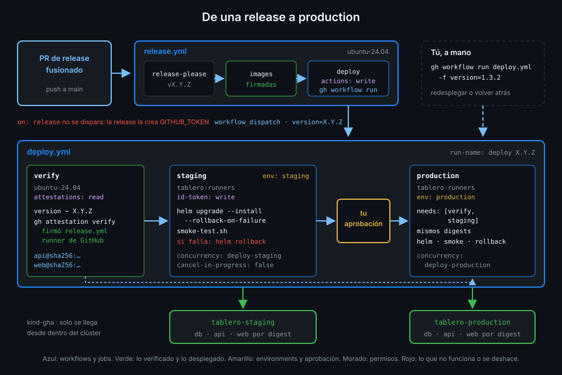

# Desplegar solo lo verificado

> La Semana 14 firmó cada imagen de `tablero`. Una firma que nadie comprueba antes de desplegar
> es decoración: esta semana el despliegue se niega a correr lo que no pase la verificación.



## 🎯 Objetivos

Al terminar este archivo eres capaz de:

- Colocar `gh attestation verify` como puerta antes de Helm, en un job propio
- Exigir con `--signer-workflow` que la imagen la firmara `release.yml`
- Explicar qué añade `--deny-self-hosted-runners` ahora que `tablero` tiene runners propios
- Desplegar el digest que cubre la attestation y no lo que diga el tag
- Validar el input `version` antes de usarlo
- Decidir la concurrencia de un despliegue y saber qué aportaría `queue`

## 1. Qué problema resuelve

El input `version` de `deploy.yml` es un texto: `1.4.0`. Entre ese texto y lo que acaba corriendo
en production hay tres huecos:

- **El tag se puede mover**. Quien tenga permiso para escribir en el paquete de GHCR puede subir
  otra imagen con el tag `1.4.0`.
- **La imagen puede venir de otro sitio**. Una imagen construida en un portátil y subida a mano
  tiene el mismo nombre que la buena.
- **El input puede ser cualquier cosa**. Quien lanza el workflow a mano escribe lo que quiere.

La Semana 14 dejó todo preparado: cada imagen de `release.yml` lleva una attestation de
procedencia firmada con Sigstore que dice qué workflow, qué commit y qué runner la construyeron.
Falta que alguien la compruebe **antes** de desplegar.

## 2. Cómo funciona

### Un job `verify` separado

```yaml
  verify:
    name: Verificar imágenes
    runs-on: ubuntu-24.04
    timeout-minutes: 5
    permissions:
      attestations: read
    outputs:
      api: ${{ steps.verify.outputs.api }}
      web: ${{ steps.verify.outputs.web }}
    steps:
      - name: Attestations de procedencia firmadas por release.yml
        id: verify
        env:
          GH_TOKEN: ${{ github.token }}
          OWNER: ${{ github.repository_owner }}
          VERSION: ${{ inputs.version }}
        run: |
          [[ "$VERSION" =~ ^[0-9]+\.[0-9]+\.[0-9]+$ ]] || { echo "::error::Versión no válida: $VERSION"; exit 1; }
          for c in api web; do
            image="ghcr.io/${OWNER,,}/tablero-$c"
            # Se despliega el digest que cubre la attestation, no lo que diga el tag después.
            digest=$(gh attestation verify "oci://$image:$VERSION" --repo "$GITHUB_REPOSITORY" \
              --signer-workflow "$GITHUB_REPOSITORY/.github/workflows/release.yml" \
              --source-ref refs/heads/main \
              --deny-self-hosted-runners \
              --format json --jq '.[0].verificationResult.statement.subject[0].digest.sha256')
            echo "$c=$image@sha256:$digest" >> "$GITHUB_OUTPUT"
            echo "- \`$image@sha256:$digest\`" >> "$GITHUB_STEP_SUMMARY"
          done
```

Por qué un job aparte y en `ubuntu-24.04`:

- **Permisos mínimos**: solo `attestations: read`. No tiene `id-token: write`: aunque un paso de
  la verificación se comprometiera, no podría pedir un token para el clúster.
- **Sin runner propio**: la verificación no necesita llegar a kind, así que no ocupa un pod de
  `tablero-runners` ni comparte máquina con el despliegue.
- **Una vez para los dos environments**: `staging` y `production` leen el mismo
  `needs.verify.outputs`, así que production despliega exactamente lo verificado.

### La versión, validada antes de usarla

La primera línea comprueba que `VERSION` es `X.Y.Z` con dígitos. El input llega por `env:` (regla
4) y, aun así, no se usa en ningún comando hasta pasar la expresión regular. Una versión como
`1.4.0 --signer-repo otro/repo` muere ahí.

### Las opciones que importan

| Opción | Qué exige |
|---|---|
| `--repo "$GITHUB_REPOSITORY"` | Que la attestation sea de `tablero` |
| `--signer-workflow "$GITHUB_REPOSITORY/.github/workflows/release.yml"` | Que la firmara `release.yml`, no cualquier workflow del repo |
| `--source-ref refs/heads/main` | Que `release.yml` corriera desde `main`: el apiserver exige lo mismo a `deploy.yml` |
| `--deny-self-hosted-runners` | Que la imagen se construyera en un runner de GitHub |
| `--format json --jq ...` | Sacar el digest que cubre la attestation |

`--signer-workflow` tiene la forma `[host/]<owner>/<repo>/<ruta>/<al>/<workflow>`. Si no coincide,
la verificación falla:

```text
Error: verifying with issuer "sigstore.dev"
```

El mensaje no dice qué no coincidió; con `--format json` sin `--jq`, ves la attestation completa.

### `--deny-self-hosted-runners`, ahora sí

Hasta la Semana 15 todos los runners de `tablero` eran de GitHub y esta opción no cambiaba nada.
Ahora hay dos tipos de runner propio, y uno de ellos (el pod de ARC) corre en la misma máquina
que el clúster. Las imágenes se construyen en `ubuntu-24.04`, y con esta opción se **exige**:
una imagen construida en un runner propio, aunque la firme `release.yml`, no se despliega. Si
alguien cambiara el `runs-on` de `images`, el despliegue se pararía en `verify`.

### El digest de la attestation, no el del tag

`gh attestation verify "oci://...:1.4.0"` resuelve el tag a un digest, busca attestations para ese
digest y las verifica. El `--jq` devuelve `subject[0].digest.sha256`: el digest **que firmó
`release.yml`**. Ese digest va a los outputs y Helm despliega `imagen@sha256:...`.

Si alguien moviera el tag `1.4.0` justo después de `verify`, no cambiaría nada: Helm ya no mira
el tag. Y el chart rechaza cualquier imagen que no vaya por digest (archivo 03), así que no hay
forma de saltarse este paso pasando un tag.

_Verificado con gh 2.104.0, actionlint 1.7.12 y zizmor 1.31.1, noviembre de 2026._

### Concurrencia de los despliegues

Dos runs de `deploy.yml` a la vez (una release y un rollback manual, o dos releases seguidas) no
pueden tocar el mismo namespace al mismo tiempo: Helm tendría dos upgrades sobre la misma
release. Cada job de despliegue lleva su grupo:

```yaml
    environment: staging
    # Dos despliegues al mismo namespace se pisan: el segundo espera.
    concurrency:
      group: deploy-staging
      cancel-in-progress: false
```

| Opción | Qué pasa con el segundo run | Por qué sí o no |
|---|---|---|
| `cancel-in-progress: true` | Cancela al primero, quizá a mitad de un upgrade | Deja la release en un estado a medias: no |
| `cancel-in-progress: false` | El segundo espera como **pending** | Ninguno se corta: sí |

El grupo está en el **job**, no en el workflow: el run B puede verificar mientras el run A
despliega, y solo espera en el momento de tocar el namespace. Staging y production tienen grupos
distintos: que production espere tu aprobación no bloquea el siguiente despliegue a staging.

### Y `queue`

`cancel-in-progress: false` tiene un límite que la Semana 07 ya contó: solo hay **un** pendiente
por grupo. Si llega un tercer run, sustituye al pendiente, que se cancela. Con tres releases
seguidas, la del medio no llega a desplegarse en ese environment.

La clave `queue: max` convertiría ese pendiente único en una fila ordenada. Es justo el caso de
esta semana, pero **actionlint 1.7.12 sigue sin aceptarla** y el CI de `tablero` se rompería. En
la práctica, que se salte una versión intermedia no es grave: el último run despliega la versión
más reciente, que incluye los cambios de la anterior. Cuando el linter la acepte, va aquí.

## 3. Cómo se usa

### Verificar a mano lo mismo que `verify`

```bash
owner=<tu-org>
gh attestation verify "oci://ghcr.io/$owner/tablero-api:1.4.0" --repo "$owner/tablero" \
  --signer-workflow "$owner/tablero/.github/workflows/release.yml" --source-ref refs/heads/main \
  --deny-self-hosted-runners \
  --format json --jq '.[0].verificationResult.statement.subject[0].digest.sha256'
```

Es el comando que la comprobación `production-runs-latest-release` compara con la imagen que
corre en `tablero-production`.

### Lo que ves en el run

El resumen del job `verify` lista las dos imágenes con su digest. Es lo primero que miras cuando
dudas de qué se desplegó: la versión está en el título del run y el digest, en el resumen.

## 4. Antipatrones

| Antipatrón | Por qué duele | Qué hacer en su lugar |
|---|---|---|
| Verificar y después desplegar el tag | Entre las dos cosas el tag puede moverse | Desplegar el digest que devuelve la verificación |
| `gh attestation verify` sin `--signer-workflow` | Vale una attestation de cualquier workflow del repo | `--signer-workflow` apuntando a `release.yml` |
| Verificar dentro del job de despliegue | El paso de verificación comparte permisos con el token del clúster | Job `verify` aparte con `attestations: read` |
| Usar `inputs.version` sin validar | El input es texto libre de quien lanza el workflow | Expresión regular antes de usarlo |
| `cancel-in-progress: true` en un despliegue | Un upgrade cortado a mitad | `false` |
| Escribir `queue: max` hoy | actionlint falla y el CI se rompe | Esperar a que el linter la acepte |

## 5. Trucos

- **Qué dice la attestation entera**: quita el `--jq` y pasa la salida por
  `jq '.[0].verificationResult.statement.predicate'`: es la procedencia de la Semana 14, con el
  workflow, el commit y el runner que construyeron la imagen.
- **Ver un despliegue en espera**: `gh run list --workflow deploy.yml --status pending` enseña el
  run que espera a que termine el otro del mismo grupo.
- **Qué digest corre en cada environment**: `kubectl --context kind-gha -n tablero-staging get deploy -o jsonpath='{range .items[*]}{.metadata.name} {.spec.template.spec.containers[0].image}{"\n"}{end}'`
  lista las tres imágenes; compáralas con el resumen de `verify`.

## 📚 Recursos Adicionales

- [GitHub CLI: gh attestation verify](https://cli.github.com/manual/gh_attestation_verify)
- [GitHub Docs: Using artifact attestations](https://docs.github.com/en/actions/how-tos/secure-your-work/use-artifact-attestations/use-artifact-attestations)
- [GitHub Docs: Control the concurrency of workflows and jobs](https://docs.github.com/en/actions/how-tos/write-workflows/choose-when-workflows-run/control-workflow-concurrency)
- [SLSA: Verifying artifacts](https://slsa.dev/spec/v1.0/verifying-artifacts)

## ✅ Checklist de Verificación

- [ ] Sé por qué la verificación va en un job aparte con `attestations: read`
- [ ] Sé qué exige cada opción de `gh attestation verify` en `deploy.yml`
- [ ] Sé por qué `--deny-self-hosted-runners` importa desde la Semana 15
- [ ] Sé de dónde sale el digest que despliega Helm y por qué no el del tag
- [ ] Sé por qué se valida `version` aunque llegue por `env:`
- [ ] Sé por qué el grupo de concurrencia va en el job y sin cancelar
- [ ] Sé qué resolvería `queue: max` y por qué todavía no lo uso

---

| ← Anterior | Siguiente → |
|:---|---:|
| [Credenciales de corta vida en el runner](06-credenciales-de-corta-vida-en-el-runner.md) | [El clúster confía en GitHub](../2-practicas/01-el-cluster-confia-en-github.md) |
